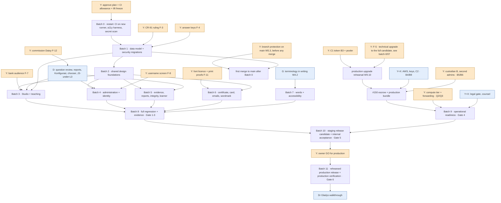

# D · Dependency map (2 Nov 2026)

How the open work (`C-OPEN-WORK-REGISTER`) depends on itself, on the owner, on Daisy and on outside parties. Each dependency below was observed in code, records or workflow files during Phase 0.

## 1. The graph

## 2. Dependencies, explained

### 2.1 Platform

- **Every batch → W0.2 (CI on the new runner).** *Corrected in Batch 0:*
  - The last CI before Batch 0 was **9 Oct, green** (37930520507). Nothing had failed; CI had simply not run.
  - `ubuntu-latest` is now Ubuntu 26.04 (Docker 29, psql 18, Node 24 for actions). Batch 0 measured it: the local stack, all 177 migrations and CI run on it (`batch-0/02-CI-COMPATIBILITY-EVIDENCE.md`).
- **Every staging change → the end of the freeze (D-140(d), D-141(a)).**
- **Every batch's CI → the CI allowance.**
  - The repository is public: GitHub bills 0 ms (verified 2 Nov). The allowance is a governance limit.
  - A batch's measured cost is in E (CI and verification resources).

### 2.2 Data model before screens (batch 1 before 3–5)

Each item below changes the database, which screens and tests read.
- **W1.6 send back:** a new content-status transition, out of IN_REVIEW.
- **W1.8 reviewer in history:** the history must record or derive who reviewed and approved.
- **W1.13:** the content step made atomic.
- **W4.1:** the wording held in the database.
- **W5.1 CR-91:** the activation and role guards.

Landing them together means **one migration release**, one staging apply, and one production-rehearsal input. If they landed later, every screen built on the old states would have to be re-proved.

### 2.3 Shared components before compositions (batch 2 before 3–6)

Every J composition uses the same pieces:
- skip link and page titles (all seven J records);
- Table/Collection (J2, Konfigurasi, Peran & akses, platform lists);
- account menu and Dialog (J2, CR-78, «Keluar semua»);
- FileField (CR-07 photo, Studio upload, «Laporkan masalah»);
- date helper with WIB and date echo (J5, Konfigurasi, RV-16);
- empty state (CR-46, RV-9);
- the idle warning (J7).

Built once, they are applied everywhere. **Doing screens first would mean doing them twice.**

### 2.4 Inside Studio and teaching

- **W1.1 J1Terbit** composition depends on **W1.4** (fewer release presses) and **W1.6** (send back). The composition draws the steps those decisions define.
- **W6.5 Studio proof** depends on W1.6 (a rejection must be walkable), W1.10 (a workbook a person can use) and a never-imported chapter.
- **W2.4 Uji Cepat score → W6.7** (the Level 3 Uji Cepat walk, CR-34).
- **W1.11 bank access** depends on **F-7**.

### 2.5 Identity and administration

- **W2.1–W2.3** (email, name, username correction) use the account menu and Dialog (W3.5) and the Collection (W3.4).
- **W2.3 → F-8.**
- **W2.15 transfers → F-10.**
- **W3.6 Konfigurasi → Daisy.**

### 2.6 Reports and integrity

- **W3.8 report pages → Daisy.** They also close X.7 and RV-11.
- **W2.7 (CR-77/75)** is application only; the grammar has it.

### 2.7 Brand

**W3.19 certificate, W3.20 card, emails and wordmark → F-11** (the font licence and physical print proofs). These are the only design items blocked outside both engineering and Daisy.

### 2.8 Words

**W4.2 Dr Gladys** → OP-6, OP-7, the six context words (W3.16) and the L4 §4 words.
- Asked **in writing now**; this is not the walkthrough, so the mandate's §12 gate is respected.
- Applied in batch 7.
- Until then the context control draws nothing for those six states (`istilah-menunggu.ts`).

### 2.9 The production track (independent of batches 1–8; on the critical path)

1. **C1 token (W9.1).**
2. **G6 can see production's backups** (W9.1 done), so production migrations become possible.
3. **Production upgrade rehearsal** (W9.10).
4. **Migration 162 on production.**
   - **Observed:** every production backup needs `pintar_backup`, which only migration 162 creates.
   - `db push` applies in order, so 162 means the database upgrade from 111 to at least 162.
   - So #150's production bundle (B4) and escrow (B5) **cannot happen before a production database upgrade** → **F-5**.
5. Then production bundle + escrow to R1+R2 (needs custodian B), then O8 rehearsal (B8), then **#150 PASS**.
6. Also before the release:
   - compute tier and L1 (W9.3, W9.4);
   - legal gate (W9.11);
   - second admins and break-glass (W9.7, W9.12);
   - support tiers (W9.16);
   - email (W9.13);
   - DNS (W9.15).

### 2.10 Acceptance

**Gate 6 → Dr Gladys** (mandate §12). Internal acceptance follows the production release (mandate §10–11).

## 3. What can run in parallel

| Track | Runs alongside | Constraint |
|---|---|---|
| Owner track (W9.1–W9.7, W9.11, W9.16, F-*) | Everything; **start now** | Long lead: AWS, counsel, named people |
| Daisy's new designs (D1) | Batches 0–2 | Needed by batches 3–5 |
| Dr Gladys's written words (W4.2) | Batches 0–6 | Needed by batch 7 |
| Batches 3, 4 and 5 | After batch 2 | They share files (`hle.ts`, `experience.css`, the shells). Sequential is safer; partial overlap is possible with care. Each still verifies on its own |
| Batch 6 | After F-11 and batch 2 | Independent of batches 3–5 |

## 4. The critical path

1. **The owner track is the true critical path:** C1 → upgrade rehearsal → 162 on production → escrow with custodian B → #150 PASS, plus legal and capacity. Its lead times (AWS account, counsel, people) are weeks, and engineering cannot shorten them.
2. **The engineering critical path is batch 0 → 1 → 2 → 3 → 8.**
   - Studio carries the most open work.
   - The Studio proof (W6.5) is the mandate's named end-to-end evidence.
   - Batches 4–7 fit inside it if Daisy's designs arrive by batch 3.
3. **Daisy's five designs** are on the path for batches 3–5. If they come late, batches 4–5 stall at their composition step.
