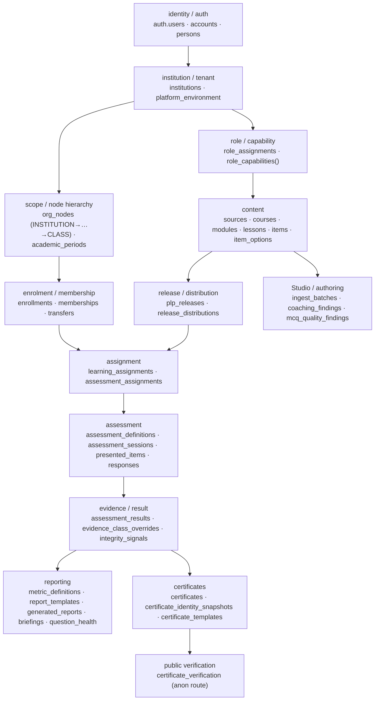

# PINTAR 4.0 — Core Architecture, Database & Backend Specification

**Deliverable for the Astra 6 ground-zero reconstruction package.**
**Role:** Bob the Builder 🛠️ — Core / Database / Backend engineering owner.
**Written:** 2026-09-17.

## How to read the evidence labels

Every claim in this document carries one of these. They are not decoration: a
reconstruction that cannot tell a measured fact from a reported one will rebuild
somebody's memory instead of the system.

| Label | Means |
|---|---|
| **OBSERVED** | I ran the query or read the file in this session, against the baseline in §1. |
| **DOCUMENTED** | Stated in authoritative project documentation; not independently re-measured here. |
| **REPORTED** | Supplied by another role or an earlier session; **not** verified by me. |
| **PRODUCT RULING** | An explicit product decision by Yazid/Sauron. |
| **RESIDUAL / GAP** | Known incomplete, deferred, bounded or unresolved. |
| **PROPOSAL** | Not implemented. Never current state. |

Unless a paragraph says otherwise, everything in §3, §4, §5, §7 and §13 is
**OBSERVED** — those sections are generated directly from the live catalogue of a
clean replay of the baseline below, not transcribed by hand.


## Contents

| § | Section | Generated? |
|---:|---|---|
| 1 | Exact baseline and history | hand-written |
| 2 | System architecture | hand-written |
| 3 | Complete database dictionary — all 77 tables and 10 views | **generated** |
| 4 | Types and enums — all 34 | **generated** |
| 5 | Functions and RPCs — all 234, plus the registry census | **generated** |
| 6 | Authorization model | hand-written |
| 7 | RLS matrix | **generated** |
| 8 | Assessment subsystem (incl. Q-12 and `assessment_orientation()`) | hand-written |
| 9 | Content / learning subsystem | hand-written |
| 10 | Evidence, metrics and reporting | hand-written |
| 11 | Certificates (incl. the V-6a lifecycle gap) | hand-written |
| 12 | Auth and fixtures (incl. the L3-F01 history) | hand-written |
| 13 | Migration history — all 85 | **generated** |
| 14 | Invariants → implementation → tests | hand-written |
| 15 | Seeds and demo data | hand-written |
| 16 | CI and test architecture | hand-written |
| 17 | **Known residual register** — read this before believing any other section | hand-written |
| 18 | Ground-zero database build recipe | hand-written |
| 19 | Acceptance criteria | hand-written |

---

## 1. Exact baseline and history

### 1.1 What I inspected

**OBSERVED.**

```
branch                  claude/quirky-meitner-a04smj
HEAD                    5feebf9d800197d0450a84497cee5c1977dc87a2
working tree            clean (0 modified, 0 untracked)
migrations on disk      85
manifest                selftest/manifest.json v32, 189 tests
CI at this HEAD         run 90 — SUCCESS — 16/16 jobs
inspection database     a clean local replay: drop, create, Supabase-shaped shim,
                        all 85 migrations in filename order, then the five seeds
                        in the order supabase/config.toml declares
```

The inspection database reports `85` rows in `supabase_migrations.schema_migrations`,
matching the 85 files on disk.

**Hosted project** (Supabase `sknixmwkynzmrgbxzrvb`, "pintar", development):
**OBSERVED at the Core freeze** — 83 migrations, declaration assertion true,
0 fixture identities. The two post-Core migrations (§1.3) had **not** been applied
to hosted when I last measured it; hosted is at the Core baseline, the repository
is two migrations ahead. This is a real divergence and Astra 6 must not assume
otherwise.

### 1.2 The frozen Core baseline

**OBSERVED.** Core Build was declared COMPLETE at:

```
commit      9b2cc5d1075f21b3d1f61a32a83ba1b07d25a3ba
CI          run 81 — SUCCESS
migrations  83
```

`9b2cc5d` is documentation-only on top of `d95c201`, the last commit that changed
implementation for Core. Both are green.

### 1.3 Post-Core migrations

**OBSERVED.** Two migrations exist beyond the frozen Core baseline. Both were
added for UX-1 Slice 2 under explicit clearance, and both are additive — neither
creates a table nor adds a column:

| # | Migration | What it adds | Gate |
|---|---|---|---|
| 84 | `20260920090000_a_learner_can_find_a_quick_assessment.sql` | `public.my_open_assessments()` — learner discovery of node-scoped assignments (Q-12) | CI run 89 |
| 85 | `20260921090000_a_learner_can_look_before_committing.sql` | `public.assessment_orientation(uuid)` — pre-start orientation facts | CI run 90 |

### 1.4 Major closure commits

**OBSERVED**, in order:

| Commit | What it closed |
|---|---|
| `481ff93` | **L3-F01** — repository-known synthetic credentials were live as privileged Auth identities on hosted. Hosted identities deleted; fail-closed marker added. |
| `408fbb5` | The Layer-3 finding ledger, preserved as evidence. |
| `add47fa` | **L3-F03** (four unguarded `SECURITY DEFINER` STAFF RPCs) and **L3-F02** (the INV-19 detector derived its population from the implementation it tested). |
| `2aedcef`, `dc7f42d`, `d95c201` | Three successive repairs to the *verification harness* itself, each found by CI rather than by inspection. |
| `9b2cc5d` | **PINTAR 4.0 CORE BUILD — COMPLETE.** |
| `318b7d0` | **Q-12** learner discovery contract. |
| `546e88f` | Merge of the UX-1 Experience branch into this line. |
| `5feebf9` | UX-1 Slice 2 pre-start orientation contract. |

### 1.5 Why "Core COMPLETE" does not mean production-ready

**PRODUCT RULING**, recorded verbatim in `docs/phases/PINTAR-4.0-STATE-OF-THE-SYSTEM.md` §0:

> The frozen Core Build scope has been implemented, and its known gate-blocking
> defects have been closed.

It explicitly does **not** mean: production ready · load tested · human validated ·
UI/UX complete · every residual closed.

Three things Astra 6 must carry forward rather than assume away:

1. **The evidence ceiling.** The Second Eye's independent verification covered
   **the hosted database and nothing else**. Every replay, adversarial plant,
   selftest count, digest and CI result in this document is the builder's own and
   was **not** independently reproduced. A closed finding does not promote the
   surrounding evidence to independent evidence.
2. **Behavioural claims are local-replay or CI evidence only.** Hosted parity was
   proven for **schema and structure**, by digest. No behavioural claim in this
   document has been executed against the hosted system.
3. **The residual register in §17 is open**, and several entries are load-bearing
   for a real deployment.

---

## 2. System architecture

### 2.1 Domain order

**OBSERVED** from the migration order and the foreign-key graph. Each domain
depends on everything above it; this is also the build order in §18.



### 2.2 The two structural rules that shape everything

**OBSERVED**, and Astra 6 will rebuild the wrong system if it misses either.

**One engine, reached through `SECURITY DEFINER` functions.** Client roles hold
almost no direct table privileges that matter. The learner's paper is assembled,
scored and finalised inside definer functions owned by the schema owner. This is
why `relforcerowsecurity` is `false` on every `public` table (§7): FORCE RLS would
apply RLS to the owner and break assembly, scoring and finalisation. The
protections that must survive the owner are carried by **triggers**, which fire for
every role — `audit_log_immutable` refuses even the owner.

**Authorization is one predicate, asked from both sides.** `can_in_institution`
and `can_on_node` are the primitives; RLS policies and RPC bodies call the same
ones. Where a newer contract needs to decide "may this learner do X", it delegates
to the existing predicate rather than restating it — `my_open_assessments()` and
`assessment_orientation()` both call `may_start_assessment()`, which is what
`start_learning_session()` itself calls.

---

## 3. Complete database dictionary

**OBSERVED**, generated from the live catalogue of the baseline replay. 79 base tables (77 in `public`, 2 in `telemetry`), 774 columns. Nothing is summarised away.

`relforcerowsecurity` is `false` on every table and that is deliberate — see §2.2.

### `public.academic_periods`

**RLS:** enabled=true · forced=false


| Column | Type | Null | Default |
|---|---|---|---|
| `id` | `uuid` | NOT NULL | `gen_random_uuid()` |
| `institution_id` | `uuid` | NOT NULL | — |
| `name` | `text` | NOT NULL | — |
| `starts_on` | `date` | NOT NULL | — |
| `ends_on` | `date` | NOT NULL | — |
| `created_at` | `timestamp with time zone` | NOT NULL | `now()` |

**Primary key:**

- `academic_periods_pkey` — `PRIMARY KEY (id)`

**Unique:**

- `academic_periods_institution_id_name_key` — `UNIQUE (institution_id, name)`

**Foreign keys:**

- `academic_periods_institution_id_fkey` — `FOREIGN KEY (institution_id) REFERENCES institutions(id)`

**Checks:**

- `academic_periods_check` — `CHECK ((ends_on > starts_on))`

**Indexes:**

- `CREATE UNIQUE INDEX academic_periods_institution_id_name_key ON public.academic_periods USING btree (institution_id, name)`
- `CREATE UNIQUE INDEX academic_periods_pkey ON public.academic_periods USING btree (id)`

**Triggers:**

- `academic_periods_append_only` — `CREATE TRIGGER academic_periods_append_only BEFORE DELETE OR UPDATE ON public.academic_periods FOR EACH ROW EXECUTE FUNCTION academic_periods_append_only()`

**RLS policies:**

| Policy | Cmd | Roles | USING | WITH CHECK |
|---|---|---|---|---|
| `academic_periods_write` | INSERT | authenticated | — | `has_scope('INSTITUTION_ADMIN'::app_role, institution_id)` |
| `academic_periods_select` | SELECT | authenticated | `is_member_of_institution(institution_id)` | — |
| `academic_periods_update` | UPDATE | authenticated | `has_scope('INSTITUTION_ADMIN'::app_role, institution_id)` | `has_scope('INSTITUTION_ADMIN'::app_role, institution_id)` |

**Client grants:** `authenticated` → INSERT, SELECT, UPDATE


### `public.accounts`

**RLS:** enabled=true · forced=false


| Column | Type | Null | Default |
|---|---|---|---|
| `id` | `uuid` | NOT NULL | `gen_random_uuid()` |
| `person_id` | `uuid` | NOT NULL | — |
| `auth_user_id` | `uuid` | NOT NULL | — |
| `kind` | `account_kind` | NOT NULL | — |
| `card_number` | `text` | NULL | — |
| `created_at` | `timestamp with time zone` | NOT NULL | `now()` |

**Primary key:**

- `accounts_pkey` — `PRIMARY KEY (id)`

**Unique:**

- `accounts_auth_user_id_key` — `UNIQUE (auth_user_id)`
- `accounts_card_number_key` — `UNIQUE (card_number)`

**Foreign keys:**

- `accounts_auth_user_id_fkey` — `FOREIGN KEY (auth_user_id) REFERENCES auth.users(id) ON DELETE CASCADE`
- `accounts_person_id_fkey` — `FOREIGN KEY (person_id) REFERENCES persons(id)`

**Checks:**

- `accounts_check` — `CHECK (((kind = 'CLASSROOM_CARD'::account_kind) = (card_number IS NOT NULL)))`

**Indexes:**

- `CREATE UNIQUE INDEX accounts_auth_user_id_key ON public.accounts USING btree (auth_user_id)`
- `CREATE UNIQUE INDEX accounts_card_number_key ON public.accounts USING btree (card_number)`
- `CREATE INDEX accounts_person_idx ON public.accounts USING btree (person_id)`
- `CREATE UNIQUE INDEX accounts_pkey ON public.accounts USING btree (id)`

**RLS policies:**

| Policy | Cmd | Roles | USING | WITH CHECK |
|---|---|---|---|---|
| `accounts_select_own` | SELECT | authenticated | `(auth_user_id = auth.uid())` | — |

**Client grants:** `authenticated` → SELECT


### `public.assessment_assignment_status_transitions`

**RLS:** enabled=true · forced=false


| Column | Type | Null | Default |
|---|---|---|---|
| `from_status` | `assessment_assignment_status` | NOT NULL | — |
| `to_status` | `assessment_assignment_status` | NOT NULL | — |

**Primary key:**

- `assessment_assignment_status_transitions_pkey` — `PRIMARY KEY (from_status, to_status)`

**Indexes:**

- `CREATE UNIQUE INDEX assessment_assignment_status_transitions_pkey ON public.assessment_assignment_status_transitions USING btree (from_status, to_status)`

**RLS policies:**

| Policy | Cmd | Roles | USING | WITH CHECK |
|---|---|---|---|---|
| `assessment_assignment_status_transitions_select` | SELECT | authenticated | `(current_person_id() IS NOT NULL)` | — |

**Client grants:** `authenticated` → SELECT


### `public.assessment_assignments`

**RLS:** enabled=true · forced=false


| Column | Type | Null | Default |
|---|---|---|---|
| `id` | `uuid` | NOT NULL | `gen_random_uuid()` |
| `institution_id` | `uuid` | NOT NULL | — |
| `assessment_definition_id` | `uuid` | NOT NULL | — |
| `learning_assignment_id` | `uuid` | NULL | — |
| `node_id` | `uuid` | NOT NULL | — |
| `academic_period_id` | `uuid` | NOT NULL | — |
| `opens_at` | `timestamp with time zone` | NULL | — |
| `closes_at` | `timestamp with time zone` | NULL | — |
| `status` | `assessment_assignment_status` | NOT NULL | `'DRAFT'::assessment_assignment_status` |
| `assigned_by_person_id` | `uuid` | NULL | — |
| `assigned_at` | `timestamp with time zone` | NULL | — |
| `created_at` | `timestamp with time zone` | NOT NULL | `now()` |

**Primary key:**

- `assessment_assignments_pkey` — `PRIMARY KEY (id)`

**Foreign keys:**

- `assessment_assignments_academic_period_id_fkey` — `FOREIGN KEY (academic_period_id) REFERENCES academic_periods(id)`
- `assessment_assignments_assessment_definition_id_fkey` — `FOREIGN KEY (assessment_definition_id) REFERENCES assessment_definitions(id)`
- `assessment_assignments_assigned_by_person_id_fkey` — `FOREIGN KEY (assigned_by_person_id) REFERENCES persons(id)`
- `assessment_assignments_institution_id_fkey` — `FOREIGN KEY (institution_id) REFERENCES institutions(id)`
- `assessment_assignments_learning_assignment_id_fkey` — `FOREIGN KEY (learning_assignment_id) REFERENCES learning_assignments(id)`
- `assessment_assignments_node_id_fkey` — `FOREIGN KEY (node_id) REFERENCES org_nodes(id)`

**Checks:**

- `assessment_assignments_window_ordered` — `CHECK (((closes_at IS NULL) OR (opens_at IS NULL) OR (closes_at > opens_at)))`

**Indexes:**

- `CREATE INDEX assessment_assignments_node_idx ON public.assessment_assignments USING btree (node_id, status)`
- `CREATE UNIQUE INDEX assessment_assignments_pkey ON public.assessment_assignments USING btree (id)`

**Triggers:**

- `assessment_assignments_status` — `CREATE TRIGGER assessment_assignments_status BEFORE INSERT OR UPDATE ON public.assessment_assignments FOR EACH ROW EXECUTE FUNCTION enforce_assignment_status()`
- `assessment_assignments_tenant_immutable` — `CREATE TRIGGER assessment_assignments_tenant_immutable BEFORE UPDATE ON public.assessment_assignments FOR EACH ROW EXECUTE FUNCTION enforce_record_tenant_immutable()`

**RLS policies:**

| Policy | Cmd | Roles | USING | WITH CHECK |
|---|---|---|---|---|
| `assessment_assignments_insert` | INSERT | authenticated | — | `(can_in_institution('CAN_DRAFT'::text, institution_id) OR can_in_institution('CAN_ASSIGN_LEARNING'::text, institution_id))` |
| `assessment_assignments_select` | SELECT | authenticated | `(can_in_institution('CAN_DRAFT'::text, institution_id) OR can_in_institution('CAN_ASSIGN_LEARNING'::text, institution_id))` | — |
| `assessment_assignments_update` | UPDATE | authenticated | `(can_in_institution('CAN_DRAFT'::text, institution_id) OR can_in_institution('CAN_ASSIGN_LEARNING'::text, institution_id))` | `(can_in_institution('CAN_DRAFT'::text, institution_id) OR can_in_institution('CAN_ASSIGN_LEARNING'::text, institution_id))` |

**Client grants:** `authenticated` → INSERT, SELECT, UPDATE


### `public.assessment_definition_bounds`

**RLS:** enabled=true · forced=true


| Column | Type | Null | Default |
|---|---|---|---|
| `mode` | `assessment_mode` | NOT NULL | — |
| `item_count_min` | `smallint` | NOT NULL | — |
| `item_count_max` | `smallint` | NOT NULL | — |
| `hesitation_window_min` | `integer` | NULL | — |
| `hesitation_window_max` | `integer` | NULL | — |
| `late_sync_grace_max` | `integer` | NOT NULL | — |
| `attempt_limit_max` | `smallint` | NULL | — |
| `allows_pause_permitted` | `boolean` | NOT NULL | `true` |
| `offline_tolerant_permitted` | `boolean` | NOT NULL | `true` |
| `note` | `text` | NULL | — |

**Primary key:**

- `assessment_definition_bounds_pkey` — `PRIMARY KEY (mode)`

**Checks:**

- `bounds_hesitation_ordered` — `CHECK (((hesitation_window_min IS NULL) OR (hesitation_window_max IS NULL) OR (hesitation_window_min <= hesitation_window_max)))`
- `bounds_item_count_ordered` — `CHECK ((item_count_min <= item_count_max))`

**Indexes:**

- `CREATE UNIQUE INDEX assessment_definition_bounds_pkey ON public.assessment_definition_bounds USING btree (mode)`

**RLS policies:**

| Policy | Cmd | Roles | USING | WITH CHECK |
|---|---|---|---|---|
| `assessment_definition_bounds_select` | SELECT | authenticated | `(true = (current_person_id() IS NOT NULL))` | — |

**Client grants:** `authenticated` → SELECT


### `public.assessment_definitions`

**RLS:** enabled=true · forced=false


| Column | Type | Null | Default |
|---|---|---|---|
| `id` | `uuid` | NOT NULL | `gen_random_uuid()` |
| `institution_id` | `uuid` | NOT NULL | — |
| `course_id` | `uuid` | NULL | — |
| `module_id` | `uuid` | NULL | — |
| `title` | `text` | NOT NULL | — |
| `mode` | `assessment_mode` | NOT NULL | — |
| `bank_type` | `bank_type` | NOT NULL | — |
| `version` | `integer` | NOT NULL | `1` |
| `item_count` | `smallint` | NOT NULL | — |
| `difficulty_mix` | `jsonb` | NOT NULL | `'{}'::jsonb` |
| `safety_critical_minimum` | `smallint` | NOT NULL | `0` |
| `passing_rules` | `jsonb` | NOT NULL | `'{}'::jsonb` |
| `hesitation_window_seconds` | `integer` | NULL | — |
| `shuffle_policy` | `text` | NOT NULL | `'NONE'::text` |
| `allows_pause` | `boolean` | NOT NULL | `false` |
| `offline_tolerant` | `boolean` | NOT NULL | `false` |
| `late_sync_grace_seconds` | `integer` | NOT NULL | `0` |
| `attempt_limit` | `smallint` | NULL | — |
| `author_person_id` | `uuid` | NULL | — |
| `reviewed_by_person_id` | `uuid` | NULL | — |
| `reviewed_at` | `timestamp with time zone` | NULL | — |
| `status` | `content_status` | NOT NULL | `'INGESTED'::content_status` |
| `created_at` | `timestamp with time zone` | NOT NULL | `now()` |
| `is_ad_hoc` | `boolean` | NOT NULL | `false` |

**Primary key:**

- `assessment_definitions_pkey` — `PRIMARY KEY (id)`

**Unique:**

- `assessment_definitions_institution_id_title_mode_version_key` — `UNIQUE (institution_id, title, mode, version)`

**Foreign keys:**

- `assessment_definitions_author_person_id_fkey` — `FOREIGN KEY (author_person_id) REFERENCES persons(id)`
- `assessment_definitions_course_id_fkey` — `FOREIGN KEY (course_id) REFERENCES courses(id)`
- `assessment_definitions_institution_id_fkey` — `FOREIGN KEY (institution_id) REFERENCES institutions(id)`
- `assessment_definitions_module_id_fkey` — `FOREIGN KEY (module_id) REFERENCES modules(id)`
- `assessment_definitions_reviewed_by_person_id_fkey` — `FOREIGN KEY (reviewed_by_person_id) REFERENCES persons(id)`

**Checks:**

- `assessment_definitions_attempt_limit_check` — `CHECK (((attempt_limit IS NULL) OR (attempt_limit > 0)))`
- `assessment_definitions_hesitation_window_seconds_check` — `CHECK (((hesitation_window_seconds IS NULL) OR ((hesitation_window_seconds >= 1) AND (hesitation_window_seconds <= 3600))))`
- `assessment_definitions_item_count_check` — `CHECK ((item_count > 0))`
- `assessment_definitions_late_sync_grace_seconds_check` — `CHECK ((late_sync_grace_seconds >= 0))`
- `assessment_definitions_safety_critical_minimum_check` — `CHECK ((safety_critical_minimum >= 0))`
- `assessment_definitions_safety_fits` — `CHECK ((safety_critical_minimum <= item_count))`
- `assessment_definitions_scope_one` — `CHECK ((num_nonnulls(course_id, module_id) = 1))`
- `assessment_definitions_shuffle_policy_check` — `CHECK ((shuffle_policy = ANY (ARRAY['NONE'::text, 'ITEMS'::text, 'ITEMS_AND_OPTIONS'::text])))`
- `assessment_definitions_title_check` — `CHECK ((btrim(title) <> ''::text))`
- `assessment_definitions_version_check` — `CHECK ((version > 0))`

**Indexes:**

- `CREATE INDEX assessment_definitions_course_idx ON public.assessment_definitions USING btree (course_id)`
- `CREATE UNIQUE INDEX assessment_definitions_institution_id_title_mode_version_key ON public.assessment_definitions USING btree (institution_id, title, mode, version)`
- `CREATE INDEX assessment_definitions_module_idx ON public.assessment_definitions USING btree (module_id)`
- `CREATE UNIQUE INDEX assessment_definitions_pkey ON public.assessment_definitions USING btree (id)`

**Triggers:**

- `assessment_definitions_status_guard` — `CREATE TRIGGER assessment_definitions_status_guard BEFORE INSERT OR UPDATE ON public.assessment_definitions FOR EACH ROW EXECUTE FUNCTION enforce_content_status()`
- `assessment_definitions_taught_immutable` — `CREATE TRIGGER assessment_definitions_taught_immutable BEFORE INSERT OR DELETE OR UPDATE ON public.assessment_definitions FOR EACH ROW EXECUTE FUNCTION enforce_taught_content_immutable()`
- `assessment_definitions_tenant_immutable` — `CREATE TRIGGER assessment_definitions_tenant_immutable BEFORE UPDATE ON public.assessment_definitions FOR EACH ROW EXECUTE FUNCTION enforce_record_tenant_immutable()`

**RLS policies:**

| Policy | Cmd | Roles | USING | WITH CHECK |
|---|---|---|---|---|
| `assessment_definitions_insert` | INSERT | authenticated | — | `can_in_institution('CAN_DRAFT'::text, institution_id)` |
| `assessment_definitions_select` | SELECT | authenticated | `can_in_institution('CAN_DRAFT'::text, institution_id)` | — |
| `assessment_definitions_update` | UPDATE | authenticated | `can_in_institution('CAN_DRAFT'::text, institution_id)` | `can_in_institution('CAN_DRAFT'::text, institution_id)` |

**Client grants:** `authenticated` → INSERT, SELECT, UPDATE


### `public.assessment_results`

**RLS:** enabled=true · forced=false


| Column | Type | Null | Default |
|---|---|---|---|
| `id` | `uuid` | NOT NULL | `gen_random_uuid()` |
| `session_id` | `uuid` | NOT NULL | — |
| `institution_id` | `uuid` | NOT NULL | — |
| `person_id` | `uuid` | NOT NULL | — |
| `evidence_class` | `evidence_class` | NOT NULL | — |
| `engine_version` | `text` | NOT NULL | — |
| `scoring_policy_version` | `text` | NOT NULL | — |
| `mastery` | `numeric(5,4)` | NULL | — |
| `per_domain` | `jsonb` | NOT NULL | `'{}'::jsonb` |
| `safety_gate_passed` | `boolean` | NULL | — |
| `delta_inputs` | `jsonb` | NOT NULL | `'{}'::jsonb` |
| `supersedes_result_id` | `uuid` | NULL | — |
| `recomputation_reason` | `text` | NULL | — |
| `computed_at` | `timestamp with time zone` | NOT NULL | `now()` |

**Primary key:**

- `assessment_results_pkey` — `PRIMARY KEY (id)`

**Unique:**

- `results_one_successor` — `UNIQUE (supersedes_result_id)`

**Foreign keys:**

- `assessment_results_institution_id_fkey` — `FOREIGN KEY (institution_id) REFERENCES institutions(id)`
- `assessment_results_person_id_fkey` — `FOREIGN KEY (person_id) REFERENCES persons(id)`
- `assessment_results_scoring_policy_fk` — `FOREIGN KEY (scoring_policy_version) REFERENCES scoring_policy(version)`
- `assessment_results_session_id_fkey` — `FOREIGN KEY (session_id) REFERENCES assessment_sessions(id)`
- `assessment_results_supersedes_result_id_fkey` — `FOREIGN KEY (supersedes_result_id) REFERENCES assessment_results(id)`

**Checks:**

- `assessment_results_engine_version_check` — `CHECK ((btrim(engine_version) <> ''::text))`
- `assessment_results_mastery_check` — `CHECK (((mastery IS NULL) OR ((mastery >= (0)::numeric) AND (mastery <= (1)::numeric))))`
- `assessment_results_scoring_policy_version_check` — `CHECK ((btrim(scoring_policy_version) <> ''::text))`
- `results_no_self_supersede` — `CHECK ((supersedes_result_id IS DISTINCT FROM id))`
- `results_reason_with_supersession` — `CHECK (((supersedes_result_id IS NULL) = (recomputation_reason IS NULL)))`

**Indexes:**

- `CREATE UNIQUE INDEX assessment_results_one_root_per_session ON public.assessment_results USING btree (session_id) WHERE (supersedes_result_id IS NULL)`
- `CREATE UNIQUE INDEX assessment_results_pkey ON public.assessment_results USING btree (id)`
- `CREATE INDEX assessment_results_session_idx ON public.assessment_results USING btree (session_id, computed_at)`
- `CREATE UNIQUE INDEX results_one_successor ON public.assessment_results USING btree (supersedes_result_id)`

**Triggers:**

- `assessment_results_tenant_immutable` — `CREATE TRIGGER assessment_results_tenant_immutable BEFORE UPDATE ON public.assessment_results FOR EACH ROW EXECUTE FUNCTION enforce_record_tenant_immutable()`
- `assessment_results_write` — `CREATE TRIGGER assessment_results_write BEFORE INSERT OR DELETE OR UPDATE ON public.assessment_results FOR EACH ROW EXECUTE FUNCTION enforce_result_write()`

**RLS policies:**

| Policy | Cmd | Roles | USING | WITH CHECK |
|---|---|---|---|---|
| `assessment_results_select` | SELECT | authenticated | `((person_id = current_person_id()) OR can_in_institution('CAN_REVIEW_INTEGRITY'::text, institution_id) OR can_in_institution('CAN_ASSIGN_LEARNING'::text, institution_id))` | — |

**Client grants:** `authenticated` → SELECT


### `public.assessment_sessions`

**RLS:** enabled=true · forced=false


| Column | Type | Null | Default |
|---|---|---|---|
| `id` | `uuid` | NOT NULL | `gen_random_uuid()` |
| `person_id` | `uuid` | NOT NULL | — |
| `institution_id` | `uuid` | NOT NULL | — |
| `enrollment_id` | `uuid` | NOT NULL | — |
| `academic_period_id` | `uuid` | NOT NULL | — |
| `class_node_id` | `uuid` | NULL | — |
| `cohort_node_id` | `uuid` | NULL | — |
| `learning_assignment_id` | `uuid` | NULL | — |
| `assessment_assignment_id` | `uuid` | NULL | — |
| `plp_release_id` | `uuid` | NOT NULL | — |
| `assessment_definition_id` | `uuid` | NOT NULL | — |
| `assessment_definition_version` | `integer` | NOT NULL | — |
| `engine_version` | `text` | NOT NULL | — |
| `scoring_policy_version` | `text` | NOT NULL | — |
| `evidence_channel` | `evidence_channel` | NOT NULL | — |
| `evidence_class` | `evidence_class` | NOT NULL | — |
| `mode` | `assessment_mode` | NOT NULL | — |
| `status` | `session_status` | NOT NULL | `'CREATED'::session_status` |
| `authoritative_deadline` | `timestamp with time zone` | NULL | — |
| `shuffle_seed` | `bigint` | NOT NULL | `((random() * ('9007199254740991'::bigint)::double precision))::bigint` |
| `termination_reason` | `text` | NULL | — |
| `started_at` | `timestamp with time zone` | NULL | — |
| `submitted_at` | `timestamp with time zone` | NULL | — |
| `finalized_at` | `timestamp with time zone` | NULL | — |
| `created_at` | `timestamp with time zone` | NOT NULL | `now()` |
| `termination_cause` | `termination_cause` | NULL | — |
| `terminated_by_person_id` | `uuid` | NULL | — |
| `deadline_extended_count` | `smallint` | NOT NULL | `0` |

**Primary key:**

- `assessment_sessions_pkey` — `PRIMARY KEY (id)`

**Foreign keys:**

- `assessment_sessions_academic_period_id_fkey` — `FOREIGN KEY (academic_period_id) REFERENCES academic_periods(id)`
- `assessment_sessions_assessment_assignment_fkey` — `FOREIGN KEY (assessment_assignment_id) REFERENCES assessment_assignments(id)`
- `assessment_sessions_assessment_definition_id_fkey` — `FOREIGN KEY (assessment_definition_id) REFERENCES assessment_definitions(id)`
- `assessment_sessions_class_node_id_fkey` — `FOREIGN KEY (class_node_id) REFERENCES org_nodes(id)`
- `assessment_sessions_cohort_node_id_fkey` — `FOREIGN KEY (cohort_node_id) REFERENCES org_nodes(id)`
- `assessment_sessions_enrollment_id_fkey` — `FOREIGN KEY (enrollment_id) REFERENCES enrollments(id)`
- `assessment_sessions_institution_id_fkey` — `FOREIGN KEY (institution_id) REFERENCES institutions(id)`
- `assessment_sessions_learning_assignment_fkey` — `FOREIGN KEY (learning_assignment_id) REFERENCES learning_assignments(id)`
- `assessment_sessions_person_id_fkey` — `FOREIGN KEY (person_id) REFERENCES persons(id)`
- `assessment_sessions_plp_release_id_fkey` — `FOREIGN KEY (plp_release_id) REFERENCES plp_releases(id)`
- `assessment_sessions_scoring_policy_fk` — `FOREIGN KEY (scoring_policy_version) REFERENCES scoring_policy(version)`
- `assessment_sessions_terminated_by_person_id_fkey` — `FOREIGN KEY (terminated_by_person_id) REFERENCES persons(id)`

**Checks:**

- `assessment_sessions_assessment_definition_version_check` — `CHECK ((assessment_definition_version > 0))`
- `assessment_sessions_engine_version_check` — `CHECK ((btrim(engine_version) <> ''::text))`
- `assessment_sessions_scoring_policy_version_check` — `CHECK ((btrim(scoring_policy_version) <> ''::text))`
- `sessions_termination_reason_only_when_terminated` — `CHECK (((status = 'TERMINATED'::session_status) OR (termination_reason IS NULL)))`

**Indexes:**

- `CREATE INDEX assessment_sessions_definition_idx ON public.assessment_sessions USING btree (assessment_definition_id)`
- `CREATE INDEX assessment_sessions_institution_idx ON public.assessment_sessions USING btree (institution_id, evidence_class)`
- `CREATE INDEX assessment_sessions_person_idx ON public.assessment_sessions USING btree (person_id, created_at DESC)`
- `CREATE UNIQUE INDEX assessment_sessions_pkey ON public.assessment_sessions USING btree (id)`

**Triggers:**

- `assessment_sessions_provenance` — `CREATE TRIGGER assessment_sessions_provenance BEFORE INSERT OR UPDATE ON public.assessment_sessions FOR EACH ROW EXECUTE FUNCTION enforce_session_provenance()`
- `assessment_sessions_status` — `CREATE TRIGGER assessment_sessions_status BEFORE INSERT OR UPDATE ON public.assessment_sessions FOR EACH ROW EXECUTE FUNCTION enforce_session_status()`
- `assessment_sessions_tenant_immutable` — `CREATE TRIGGER assessment_sessions_tenant_immutable BEFORE UPDATE ON public.assessment_sessions FOR EACH ROW EXECUTE FUNCTION enforce_record_tenant_immutable()`
- `assessment_sessions_termination_provenance` — `CREATE TRIGGER assessment_sessions_termination_provenance BEFORE UPDATE ON public.assessment_sessions FOR EACH ROW EXECUTE FUNCTION enforce_termination_provenance()`

**RLS policies:**

| Policy | Cmd | Roles | USING | WITH CHECK |
|---|---|---|---|---|
| `assessment_sessions_select` | SELECT | authenticated | `((person_id = current_person_id()) OR can_in_institution('CAN_REVIEW_INTEGRITY'::text, institution_id) OR can_in_institution('CAN_ASSIGN_LEARNING'::text, institution_id))` | — |

**Client grants:** none to `anon`/`authenticated`/`service_role`


### `public.assistance_grants`

**RLS:** enabled=true · forced=false


| Column | Type | Null | Default |
|---|---|---|---|
| `presented_item_id` | `uuid` | NOT NULL | — |
| `session_id` | `uuid` | NOT NULL | — |
| `level` | `smallint` | NOT NULL | — |
| `granted_at` | `timestamp with time zone` | NOT NULL | `now()` |

**Primary key:**

- `assistance_grants_pkey` — `PRIMARY KEY (presented_item_id, level)`

**Foreign keys:**

- `assistance_grants_presented_item_id_fkey` — `FOREIGN KEY (presented_item_id) REFERENCES presented_items(id)`
- `assistance_grants_session_id_fkey` — `FOREIGN KEY (session_id) REFERENCES assessment_sessions(id)`

**Checks:**

- `assistance_grants_level_check` — `CHECK (((level >= 0) AND (level <= 3)))`

**Indexes:**

- `CREATE UNIQUE INDEX assistance_grants_pkey ON public.assistance_grants USING btree (presented_item_id, level)`

**RLS policies:**

| Policy | Cmd | Roles | USING | WITH CHECK |
|---|---|---|---|---|
| `assistance_grants_select` | SELECT | authenticated | `(EXISTS ( SELECT 1    FROM assessment_sessions s   WHERE ((s.id = assistance_grants.session_id) AND (s.person_id = current_person_id()))))` | — |

**Client grants:** `authenticated` → SELECT


### `public.assistance_levels`

**RLS:** enabled=true · forced=false


| Column | Type | Null | Default |
|---|---|---|---|
| `level` | `smallint` | NOT NULL | — |
| `kode` | `text` | NOT NULL | — |
| `sumber` | `text` | NOT NULL | — |

**Primary key:**

- `assistance_levels_pkey` — `PRIMARY KEY (level)`

**Unique:**

- `assistance_levels_kode_key` — `UNIQUE (kode)`

**Checks:**

- `assistance_levels_kode_check` — `CHECK ((btrim(kode) <> ''::text))`
- `assistance_levels_level_check` — `CHECK (((level >= 1) AND (level <= 3)))`
- `assistance_levels_sumber_check` — `CHECK ((btrim(sumber) <> ''::text))`

**Indexes:**

- `CREATE UNIQUE INDEX assistance_levels_kode_key ON public.assistance_levels USING btree (kode)`
- `CREATE UNIQUE INDEX assistance_levels_pkey ON public.assistance_levels USING btree (level)`

**RLS policies:**

| Policy | Cmd | Roles | USING | WITH CHECK |
|---|---|---|---|---|
| `assistance_levels_select` | SELECT | authenticated | `(current_person_id() IS NOT NULL)` | — |

**Client grants:** `authenticated` → SELECT


### `public.audit_log`

**RLS:** enabled=true · forced=false


| Column | Type | Null | Default |
|---|---|---|---|
| `id` | `bigint` | NOT NULL | `(identity)` |
| `at` | `timestamp with time zone` | NOT NULL | `now()` |
| `actor_auth_uid` | `uuid` | NULL | — |
| `actor_person_id` | `uuid` | NULL | — |
| `action` | `text` | NOT NULL | — |
| `target_table` | `text` | NOT NULL | — |
| `target_id` | `text` | NULL | — |
| `institution_id` | `uuid` | NULL | — |
| `summary` | `jsonb` | NOT NULL | `'{}'::jsonb` |
| `build_sha` | `text` | NULL | — |
| `evaluation_actor_person_id` | `uuid` | NULL | — |
| `evaluation_session_id` | `uuid` | NULL | — |

**Primary key:**

- `audit_log_pkey` — `PRIMARY KEY (id)`

**Foreign keys:**

- `audit_log_evaluation_actor_person_id_fkey` — `FOREIGN KEY (evaluation_actor_person_id) REFERENCES persons(id)`
- `audit_log_evaluation_session_id_fkey` — `FOREIGN KEY (evaluation_session_id) REFERENCES evaluation_sessions(id)`

**Indexes:**

- `CREATE INDEX audit_log_evaluation_actor ON public.audit_log USING btree (evaluation_actor_person_id, at) WHERE (evaluation_actor_person_id IS NOT NULL)`
- `CREATE INDEX audit_log_institution_at_idx ON public.audit_log USING btree (institution_id, at DESC)`
- `CREATE UNIQUE INDEX audit_log_pkey ON public.audit_log USING btree (id)`
- `CREATE INDEX audit_log_target_idx ON public.audit_log USING btree (target_table, target_id)`

**Triggers:**

- `audit_log_no_delete` — `CREATE TRIGGER audit_log_no_delete BEFORE DELETE ON public.audit_log FOR EACH ROW EXECUTE FUNCTION audit_log_immutable()`
- `audit_log_no_truncate` — `CREATE TRIGGER audit_log_no_truncate BEFORE TRUNCATE ON public.audit_log FOR EACH STATEMENT EXECUTE FUNCTION audit_log_immutable()`
- `audit_log_no_update` — `CREATE TRIGGER audit_log_no_update BEFORE UPDATE ON public.audit_log FOR EACH ROW EXECUTE FUNCTION audit_log_immutable()`

**RLS policies:**

| Policy | Cmd | Roles | USING | WITH CHECK |
|---|---|---|---|---|
| `audit_log_select` | SELECT | authenticated | `(is_system_admin() OR ((institution_id IS NOT NULL) AND has_scope('INSTITUTION_ADMIN'::app_role, institution_id)))` | — |

**Client grants:** `authenticated` → SELECT


### `public.briefing_transitions`

**RLS:** enabled=true · forced=false


| Column | Type | Null | Default |
|---|---|---|---|
| `from_state` | `briefing_state` | NOT NULL | — |
| `to_state` | `briefing_state` | NOT NULL | — |
| `note` | `text` | NOT NULL | — |

**Primary key:**

- `briefing_transitions_pkey` — `PRIMARY KEY (from_state, to_state)`

**Indexes:**

- `CREATE UNIQUE INDEX briefing_transitions_pkey ON public.briefing_transitions USING btree (from_state, to_state)`

**RLS policies:**

| Policy | Cmd | Roles | USING | WITH CHECK |
|---|---|---|---|---|
| `briefing_transitions_select` | SELECT | authenticated | `(current_person_id() IS NOT NULL)` | — |

**Client grants:** `authenticated` → SELECT


### `public.briefings`

**RLS:** enabled=true · forced=false


| Column | Type | Null | Default |
|---|---|---|---|
| `id` | `uuid` | NOT NULL | `gen_random_uuid()` |
| `institution_id` | `uuid` | NOT NULL | — |
| `scope_node_id` | `uuid` | NOT NULL | — |
| `state` | `briefing_state` | NOT NULL | `'COLLECTING'::briefing_state` |
| `catalogue_version` | `text` | NULL | — |
| `template_id` | `uuid` | NULL | — |
| `template_version` | `integer` | NULL | — |
| `generated_report_id` | `uuid` | NULL | — |
| `body` | `jsonb` | NULL | — |
| `have` | `integer` | NOT NULL | `0` |
| `needed` | `integer` | NULL | — |
| `created_at` | `timestamp with time zone` | NOT NULL | `now()` |
| `updated_at` | `timestamp with time zone` | NOT NULL | `now()` |
| `reviewed_by_person_id` | `uuid` | NULL | — |
| `reviewed_at` | `timestamp with time zone` | NULL | — |

**Primary key:**

- `briefings_pkey` — `PRIMARY KEY (id)`

**Unique:**

- `briefings_institution_id_scope_node_id_created_at_key` — `UNIQUE (institution_id, scope_node_id, created_at)`

**Foreign keys:**

- `briefings_catalogue_version_fkey` — `FOREIGN KEY (catalogue_version) REFERENCES metric_catalogue(version)`
- `briefings_generated_report_id_fkey` — `FOREIGN KEY (generated_report_id) REFERENCES generated_reports(id)`
- `briefings_institution_id_fkey` — `FOREIGN KEY (institution_id) REFERENCES institutions(id)`
- `briefings_reviewed_by_person_id_fkey` — `FOREIGN KEY (reviewed_by_person_id) REFERENCES persons(id)`
- `briefings_scope_node_id_fkey` — `FOREIGN KEY (scope_node_id) REFERENCES org_nodes(id)`
- `briefings_template_id_fkey` — `FOREIGN KEY (template_id) REFERENCES report_templates(id)`

**Checks:**

- `briefings_ready_carries_provenance` — `CHECK (((state = ANY (ARRAY['COLLECTING'::briefing_state, 'GENERATING'::briefing_state])) OR ((catalogue_version IS NOT NULL) AND (generated_report_id IS NOT NULL) AND (template_id IS NOT NULL) AND (template_version IS NOT NULL))))`
- `briefings_reviewed_names_its_reviewer` — `CHECK (((state <> ALL (ARRAY['REVIEWED'::briefing_state, 'ARCHIVED'::briefing_state])) OR (reviewed_by_person_id IS NOT NULL) OR (state = 'ARCHIVED'::briefing_state)))`

**Indexes:**

- `CREATE INDEX briefings_by_scope ON public.briefings USING btree (institution_id, scope_node_id, created_at DESC)`
- `CREATE UNIQUE INDEX briefings_institution_id_scope_node_id_created_at_key ON public.briefings USING btree (institution_id, scope_node_id, created_at)`
- `CREATE UNIQUE INDEX briefings_pkey ON public.briefings USING btree (id)`

**Triggers:**

- `briefings_state_guard` — `CREATE TRIGGER briefings_state_guard BEFORE INSERT OR DELETE OR UPDATE ON public.briefings FOR EACH ROW EXECUTE FUNCTION enforce_briefing_state()`

**RLS policies:**

| Policy | Cmd | Roles | USING | WITH CHECK |
|---|---|---|---|---|
| `briefings_select` | SELECT | authenticated | `is_member_of_institution(institution_id)` | — |

**Client grants:** `authenticated` → SELECT


### `public.certificate_identity_snapshots`

**RLS:** enabled=true · forced=false


| Column | Type | Null | Default |
|---|---|---|---|
| `id` | `uuid` | NOT NULL | `gen_random_uuid()` |
| `person_id` | `uuid` | NOT NULL | — |
| `institution_id` | `uuid` | NOT NULL | — |
| `name_as_issued` | `text` | NOT NULL | — |
| `photo_path` | `text` | NULL | — |
| `photo_content_hash` | `text` | NULL | — |
| `snapshot_hash` | `text` | NOT NULL | — |
| `captured_at` | `timestamp with time zone` | NOT NULL | `now()` |

**Primary key:**

- `certificate_identity_snapshots_pkey` — `PRIMARY KEY (id)`

**Foreign keys:**

- `certificate_identity_snapshots_institution_id_fkey` — `FOREIGN KEY (institution_id) REFERENCES institutions(id)`
- `certificate_identity_snapshots_person_id_fkey` — `FOREIGN KEY (person_id) REFERENCES persons(id)`

**Checks:**

- `certificate_identity_snapshots_name_as_issued_check` — `CHECK ((btrim(name_as_issued) <> ''::text))`
- `snapshot_photo_hash_pairs` — `CHECK (((photo_path IS NULL) = (photo_content_hash IS NULL)))`

**Indexes:**

- `CREATE UNIQUE INDEX certificate_identity_snapshots_pkey ON public.certificate_identity_snapshots USING btree (id)`

**Triggers:**

- `snapshots_immutable` — `CREATE TRIGGER snapshots_immutable BEFORE DELETE OR UPDATE ON public.certificate_identity_snapshots FOR EACH ROW EXECUTE FUNCTION enforce_snapshot_immutable()`

**RLS policies:**

| Policy | Cmd | Roles | USING | WITH CHECK |
|---|---|---|---|---|
| `snapshots_select` | SELECT | authenticated | `(person_id = current_person_id())` | — |

**Client grants:** `authenticated` → SELECT


### `public.certificate_templates`

**RLS:** enabled=true · forced=true


| Column | Type | Null | Default |
|---|---|---|---|
| `id` | `uuid` | NOT NULL | `gen_random_uuid()` |
| `institution_id` | `uuid` | NOT NULL | — |
| `course_id` | `uuid` | NULL | — |
| `module_id` | `uuid` | NULL | — |
| `layout` | `text` | NOT NULL | — |
| `number_prefix` | `text` | NOT NULL | — |
| `identity_presentation` | `text` | NOT NULL | `'NAME_ONLY'::text` |
| `created_by_person_id` | `uuid` | NOT NULL | — |
| `created_at` | `timestamp with time zone` | NOT NULL | `now()` |

**Primary key:**

- `certificate_templates_pkey` — `PRIMARY KEY (id)`

**Foreign keys:**

- `certificate_templates_course_id_fkey` — `FOREIGN KEY (course_id) REFERENCES courses(id)`
- `certificate_templates_created_by_person_id_fkey` — `FOREIGN KEY (created_by_person_id) REFERENCES persons(id)`
- `certificate_templates_institution_id_fkey` — `FOREIGN KEY (institution_id) REFERENCES institutions(id)`
- `certificate_templates_module_id_fkey` — `FOREIGN KEY (module_id) REFERENCES modules(id)`

**Checks:**

- `certificate_templates_identity_is_name_only` — `CHECK ((identity_presentation = 'NAME_ONLY'::text))`
- `certificate_templates_layout_known` — `CHECK ((layout = ANY (ARRAY['CLASSIC'::text, 'MODERN'::text, 'MINIMAL'::text])))`
- `certificate_templates_prefix_shape` — `CHECK ((number_prefix ~ '^[A-Z0-9]{2,12}(/[A-Z0-9]{1,8})*$'::text))`
- `certificate_templates_scope_one` — `CHECK ((num_nonnulls(course_id, module_id) <= 1))`

**Indexes:**

- `CREATE UNIQUE INDEX certificate_templates_one_per_scope ON public.certificate_templates USING btree (institution_id, COALESCE(course_id, module_id, institution_id))`
- `CREATE UNIQUE INDEX certificate_templates_pkey ON public.certificate_templates USING btree (id)`

**RLS policies:**

| Policy | Cmd | Roles | USING | WITH CHECK |
|---|---|---|---|---|
| `certificate_templates_select` | SELECT | authenticated | `can_in_institution('CAN_PUBLISH'::text, institution_id)` | — |

**Client grants:** `authenticated` → SELECT


### `public.certificates`

**RLS:** enabled=true · forced=false


| Column | Type | Null | Default |
|---|---|---|---|
| `id` | `uuid` | NOT NULL | `gen_random_uuid()` |
| `session_id` | `uuid` | NOT NULL | — |
| `person_id` | `uuid` | NOT NULL | — |
| `institution_id` | `uuid` | NOT NULL | — |
| `snapshot_id` | `uuid` | NOT NULL | — |
| `certificate_number` | `text` | NOT NULL | — |
| `verification_token` | `text` | NOT NULL | — |
| `status` | `certificate_status` | NOT NULL | `'ELIGIBLE'::certificate_status` |
| `issued_at` | `timestamp with time zone` | NOT NULL | `now()` |
| `issued_at_iso` | `text` | NOT NULL | — |
| `canonical_payload` | `jsonb` | NOT NULL | — |
| `signature` | `text` | NULL | — |
| `key_version` | `smallint` | NULL | — |
| `revoked_at` | `timestamp with time zone` | NULL | — |
| `revoked_reason` | `text` | NULL | — |
| `supersedes_certificate_id` | `uuid` | NULL | — |
| `created_at` | `timestamp with time zone` | NOT NULL | `now()` |

**Primary key:**

- `certificates_pkey` — `PRIMARY KEY (id)`

**Unique:**

- `certificates_certificate_number_key` — `UNIQUE (certificate_number)`
- `certificates_verification_token_key` — `UNIQUE (verification_token)`

**Foreign keys:**

- `certificates_institution_id_fkey` — `FOREIGN KEY (institution_id) REFERENCES institutions(id)`
- `certificates_person_id_fkey` — `FOREIGN KEY (person_id) REFERENCES persons(id)`
- `certificates_session_id_fkey` — `FOREIGN KEY (session_id) REFERENCES assessment_sessions(id)`
- `certificates_snapshot_id_fkey` — `FOREIGN KEY (snapshot_id) REFERENCES certificate_identity_snapshots(id)`
- `certificates_supersedes_certificate_id_fkey` — `FOREIGN KEY (supersedes_certificate_id) REFERENCES certificates(id)`

**Checks:**

- `certificate_revocation_pairs` — `CHECK (((status <> 'REVOKED'::certificate_status) OR ((revoked_at IS NOT NULL) AND (btrim(COALESCE(revoked_reason, ''::text)) <> ''::text))))`
- `certificate_signed_when_issued` — `CHECK (((status = 'ELIGIBLE'::certificate_status) OR ((signature IS NOT NULL) AND (key_version IS NOT NULL))))`
- `certificates_certificate_number_check` — `CHECK ((btrim(certificate_number) <> ''::text))`
- `certificates_verification_token_check` — `CHECK ((length(verification_token) >= 43))`

**Indexes:**

- `CREATE UNIQUE INDEX certificates_certificate_number_key ON public.certificates USING btree (certificate_number)`
- `CREATE UNIQUE INDEX certificates_one_root_per_session ON public.certificates USING btree (session_id) WHERE (supersedes_certificate_id IS NULL)`
- `CREATE INDEX certificates_person_idx ON public.certificates USING btree (person_id, issued_at DESC)`
- `CREATE UNIQUE INDEX certificates_pkey ON public.certificates USING btree (id)`
- `CREATE UNIQUE INDEX certificates_verification_token_key ON public.certificates USING btree (verification_token)`

**Triggers:**

- `certificates_write` — `CREATE TRIGGER certificates_write BEFORE INSERT OR DELETE OR UPDATE ON public.certificates FOR EACH ROW EXECUTE FUNCTION enforce_certificate_write()`

**RLS policies:**

| Policy | Cmd | Roles | USING | WITH CHECK |
|---|---|---|---|---|
| `certificates_select` | SELECT | authenticated | `(person_id = current_person_id())` | — |

**Client grants:** `authenticated` → SELECT


### `public.classes`

**RLS:** enabled=true · forced=false


| Column | Type | Null | Default |
|---|---|---|---|
| `node_id` | `uuid` | NOT NULL | — |
| `subject` | `text` | NOT NULL | — |
| `status` | `class_status` | NOT NULL | `'SCHEDULED'::class_status` |
| `starts_at` | `timestamp with time zone` | NULL | — |
| `ends_at` | `timestamp with time zone` | NULL | — |
| `created_at` | `timestamp with time zone` | NOT NULL | `now()` |

**Primary key:**

- `classes_pkey` — `PRIMARY KEY (node_id)`

**Foreign keys:**

- `classes_node_id_fkey` — `FOREIGN KEY (node_id) REFERENCES org_nodes(id)`

**Indexes:**

- `CREATE UNIQUE INDEX classes_pkey ON public.classes USING btree (node_id)`

**Triggers:**

- `classes_transition` — `CREATE TRIGGER classes_transition BEFORE INSERT OR UPDATE ON public.classes FOR EACH ROW EXECUTE FUNCTION classes_transition()`

**RLS policies:**

| Policy | Cmd | Roles | USING | WITH CHECK |
|---|---|---|---|---|
| `classes_insert` | INSERT | authenticated | — | `has_scope('HEAD_OF_DEPARTMENT'::app_role, node_id)` |
| `classes_select` | SELECT | authenticated | `(EXISTS ( SELECT 1    FROM org_nodes n   WHERE ((n.id = classes.node_id) AND is_member_of_institution(n.institution_id))))` | — |
| `classes_update` | UPDATE | authenticated | `has_scope('HEAD_OF_DEPARTMENT'::app_role, node_id)` | `has_scope('HEAD_OF_DEPARTMENT'::app_role, node_id)` |

**Client grants:** `authenticated` → INSERT, SELECT, UPDATE


### `public.client_rpc_registry`

**RLS:** enabled=true · forced=false


| Column | Type | Null | Default |
|---|---|---|---|
| `function_name` | `text` | NOT NULL | — |
| `exposure` | `rpc_exposure` | NOT NULL | — |
| `note` | `text` | NOT NULL | — |
| `authorization_kind` | `rpc_authorization_kind` | NULL | — |
| `authorization_requirement` | `text` | NULL | — |

**Primary key:**

- `client_rpc_registry_pkey` — `PRIMARY KEY (function_name)`

**Checks:**

- `client_rpc_registry_authorization_shape` — `CHECK (((authorization_kind IS NULL) OR CASE authorization_kind     WHEN 'CAPABILITY'::rpc_authorization_kind THEN (authorization_requirement ~ '^CAN_[A-Z_]+$'::text)     WHEN 'SCOPE'::rpc_authorization_kind THEN (authorization_requirement ~ '^[A-Z][A-Z_]+$'::text)     WHEN 'DELEGATED'::rpc_authorization_kind THEN (authorization_requirement ~ '^[a-z][a-z_]+$'::text)     WHEN 'SYSTEM_ADMIN'::rpc_authorization_kind THEN (authorization_requirement IS NULL)     WHEN 'INSTITUTION_MEMBER'::rpc_authorization_kind THEN (authorization_requirement IS NULL)     ELSE NULL::boolean END))`
- `client_rpc_registry_note_check` — `CHECK ((btrim(note) <> ''::text))`

**Indexes:**

- `CREATE UNIQUE INDEX client_rpc_registry_pkey ON public.client_rpc_registry USING btree (function_name)`

**Triggers:**

- `client_rpc_registry_declares_authorization` — `CREATE TRIGGER client_rpc_registry_declares_authorization BEFORE INSERT OR UPDATE ON public.client_rpc_registry FOR EACH ROW EXECUTE FUNCTION enforce_rpc_authorization_declared()`

**Client grants:** none to `anon`/`authenticated`/`service_role`


### `public.coaching_findings`

**RLS:** enabled=true · forced=false


| Column | Type | Null | Default |
|---|---|---|---|
| `id` | `uuid` | NOT NULL | `gen_random_uuid()` |
| `institution_id` | `uuid` | NOT NULL | — |
| `course_id` | `uuid` | NOT NULL | — |
| `target_table` | `text` | NOT NULL | — |
| `target_id` | `uuid` | NOT NULL | — |
| `target_field` | `text` | NOT NULL | — |
| `severity` | `finding_severity` | NOT NULL | — |
| `lokasi` | `text` | NOT NULL | — |
| `masalah` | `text` | NOT NULL | — |
| `mengapa_penting` | `text` | NOT NULL | — |
| `cara_memperbaiki` | `text` | NOT NULL | — |
| `acknowledged_by_person_id` | `uuid` | NULL | — |
| `acknowledged_at` | `timestamp with time zone` | NULL | — |
| `created_at` | `timestamp with time zone` | NOT NULL | `now()` |

**Primary key:**

- `coaching_findings_pkey` — `PRIMARY KEY (id)`

**Foreign keys:**

- `coaching_findings_acknowledged_by_person_id_fkey` — `FOREIGN KEY (acknowledged_by_person_id) REFERENCES persons(id)`
- `coaching_findings_course_id_fkey` — `FOREIGN KEY (course_id) REFERENCES courses(id)`
- `coaching_findings_institution_id_fkey` — `FOREIGN KEY (institution_id) REFERENCES institutions(id)`

**Checks:**

- `coaching_findings_ack_is_paired` — `CHECK (((acknowledged_by_person_id IS NULL) = (acknowledged_at IS NULL)))`

**Indexes:**

- `CREATE INDEX coaching_findings_course_idx ON public.coaching_findings USING btree (course_id, severity)`
- `CREATE UNIQUE INDEX coaching_findings_pkey ON public.coaching_findings USING btree (id)`

**Triggers:**

- `coaching_findings_tenant_immutable` — `CREATE TRIGGER coaching_findings_tenant_immutable BEFORE UPDATE ON public.coaching_findings FOR EACH ROW EXECUTE FUNCTION enforce_record_tenant_immutable()`
- `coaching_findings_write` — `CREATE TRIGGER coaching_findings_write BEFORE INSERT OR DELETE OR UPDATE ON public.coaching_findings FOR EACH ROW EXECUTE FUNCTION enforce_finding_write()`

**RLS policies:**

| Policy | Cmd | Roles | USING | WITH CHECK |
|---|---|---|---|---|
| `coaching_findings_select` | SELECT | authenticated | `can_in_institution('CAN_DRAFT'::text, institution_id)` | — |
| `coaching_findings_update` | UPDATE | authenticated | `can_in_institution('CAN_REVIEW'::text, institution_id)` | `can_in_institution('CAN_REVIEW'::text, institution_id)` |

**Client grants:** `authenticated` → SELECT, UPDATE


### `public.content_status_transitions`

**RLS:** enabled=true · forced=false


| Column | Type | Null | Default |
|---|---|---|---|
| `from_status` | `content_status` | NOT NULL | — |
| `to_status` | `content_status` | NOT NULL | — |
| `note` | `text` | NULL | — |

**Primary key:**

- `content_status_transitions_pkey` — `PRIMARY KEY (from_status, to_status)`

**Indexes:**

- `CREATE UNIQUE INDEX content_status_transitions_pkey ON public.content_status_transitions USING btree (from_status, to_status)`

**RLS policies:**

| Policy | Cmd | Roles | USING | WITH CHECK |
|---|---|---|---|---|
| `content_status_transitions_select` | SELECT | authenticated | `(current_person_id() IS NOT NULL)` | — |

**Client grants:** `authenticated` → SELECT


### `public.courses`

**RLS:** enabled=true · forced=false


| Column | Type | Null | Default |
|---|---|---|---|
| `id` | `uuid` | NOT NULL | `gen_random_uuid()` |
| `institution_id` | `uuid` | NOT NULL | — |
| `subject` | `text` | NOT NULL | — |
| `stage` | `text` | NOT NULL | — |
| `grade_label` | `text` | NOT NULL | — |
| `title` | `text` | NOT NULL | — |
| `status` | `content_status` | NOT NULL | `'INGESTED'::content_status` |
| `created_at` | `timestamp with time zone` | NOT NULL | `now()` |
| `author_person_id` | `uuid` | NULL | — |
| `reviewed_by_person_id` | `uuid` | NULL | — |
| `reviewed_at` | `timestamp with time zone` | NULL | — |
| `supersedes_course_id` | `uuid` | NULL | — |

**Primary key:**

- `courses_pkey` — `PRIMARY KEY (id)`

**Foreign keys:**

- `courses_author_person_id_fkey` — `FOREIGN KEY (author_person_id) REFERENCES persons(id)`
- `courses_institution_id_fkey` — `FOREIGN KEY (institution_id) REFERENCES institutions(id)`
- `courses_reviewed_by_person_id_fkey` — `FOREIGN KEY (reviewed_by_person_id) REFERENCES persons(id)`
- `courses_supersedes_course_id_fkey` — `FOREIGN KEY (supersedes_course_id) REFERENCES courses(id)`

**Checks:**

- `courses_grade_label_check` — `CHECK ((btrim(grade_label) <> ''::text))`
- `courses_lineage_is_not_self` — `CHECK ((supersedes_course_id <> id))`
- `courses_stage_check` — `CHECK ((btrim(stage) <> ''::text))`
- `courses_subject_check` — `CHECK ((btrim(subject) <> ''::text))`
- `courses_title_check` — `CHECK ((btrim(title) <> ''::text))`

**Indexes:**

- `CREATE UNIQUE INDEX courses_pkey ON public.courses USING btree (id)`
- `CREATE INDEX courses_supersedes ON public.courses USING btree (supersedes_course_id) WHERE (supersedes_course_id IS NOT NULL)`

**Triggers:**

- `courses_lineage` — `CREATE TRIGGER courses_lineage BEFORE INSERT OR UPDATE ON public.courses FOR EACH ROW EXECUTE FUNCTION enforce_lineage_pointer('supersedes_course_id')`
- `courses_status_guard` — `CREATE TRIGGER courses_status_guard BEFORE INSERT OR UPDATE ON public.courses FOR EACH ROW EXECUTE FUNCTION enforce_content_status()`
- `courses_taught_immutable` — `CREATE TRIGGER courses_taught_immutable BEFORE INSERT OR DELETE OR UPDATE ON public.courses FOR EACH ROW EXECUTE FUNCTION enforce_taught_content_immutable()`
- `courses_tenant_immutable` — `CREATE TRIGGER courses_tenant_immutable BEFORE UPDATE ON public.courses FOR EACH ROW EXECUTE FUNCTION enforce_record_tenant_immutable()`

**RLS policies:**

| Policy | Cmd | Roles | USING | WITH CHECK |
|---|---|---|---|---|
| `courses_insert` | INSERT | authenticated | — | `can_in_institution('CAN_DRAFT'::text, institution_id)` |
| `courses_select` | SELECT | authenticated | `can_in_institution('CAN_DRAFT'::text, institution_id)` | — |
| `courses_update` | UPDATE | authenticated | `can_in_institution('CAN_DRAFT'::text, institution_id)` | `can_in_institution('CAN_DRAFT'::text, institution_id)` |

**Client grants:** `authenticated` → INSERT, SELECT, UPDATE


### `public.doctrine_lexicon`

**RLS:** enabled=true · forced=false


| Column | Type | Null | Default |
|---|---|---|---|
| `term_pattern` | `text` | NOT NULL | — |
| `label` | `text` | NOT NULL | — |
| `severity` | `finding_severity` | NOT NULL | — |
| `mengapa_penting` | `text` | NOT NULL | — |
| `cara_memperbaiki` | `text` | NOT NULL | — |

**Primary key:**

- `doctrine_lexicon_pkey` — `PRIMARY KEY (term_pattern)`

**Checks:**

- `doctrine_lexicon_cara_memperbaiki_check` — `CHECK ((btrim(cara_memperbaiki) <> ''::text))`
- `doctrine_lexicon_mengapa_penting_check` — `CHECK ((btrim(mengapa_penting) <> ''::text))`

**Indexes:**

- `CREATE UNIQUE INDEX doctrine_lexicon_pkey ON public.doctrine_lexicon USING btree (term_pattern)`

**RLS policies:**

| Policy | Cmd | Roles | USING | WITH CHECK |
|---|---|---|---|---|
| `doctrine_lexicon_select` | SELECT | authenticated | `(current_person_id() IS NOT NULL)` | — |

**Client grants:** `authenticated` → SELECT


### `public.enrollments`

**RLS:** enabled=true · forced=false


| Column | Type | Null | Default |
|---|---|---|---|
| `id` | `uuid` | NOT NULL | `gen_random_uuid()` |
| `person_id` | `uuid` | NOT NULL | — |
| `institution_id` | `uuid` | NOT NULL | — |
| `academic_period_id` | `uuid` | NOT NULL | — |
| `programme_id` | `uuid` | NULL | — |
| `status` | `enrollment_status` | NOT NULL | `'PENDING'::enrollment_status` |
| `end_reason` | `enrollment_end_reason` | NULL | — |
| `valid_from` | `timestamp with time zone` | NOT NULL | `now()` |
| `valid_to` | `timestamp with time zone` | NULL | — |
| `created_at` | `timestamp with time zone` | NOT NULL | `now()` |

**Primary key:**

- `enrollments_pkey` — `PRIMARY KEY (id)`

**Foreign keys:**

- `enrollments_academic_period_id_fkey` — `FOREIGN KEY (academic_period_id) REFERENCES academic_periods(id)`
- `enrollments_institution_id_fkey` — `FOREIGN KEY (institution_id) REFERENCES institutions(id)`
- `enrollments_person_id_fkey` — `FOREIGN KEY (person_id) REFERENCES persons(id)`
- `enrollments_programme_id_fkey` — `FOREIGN KEY (programme_id) REFERENCES org_nodes(id)`

**Checks:**

- `enrollments_check` — `CHECK (((status = 'ENDED'::enrollment_status) = (end_reason IS NOT NULL)))`
- `enrollments_check1` — `CHECK (((status = ANY (ARRAY['ENDED'::enrollment_status, 'CANCELLED'::enrollment_status])) = (valid_to IS NOT NULL)))`

**Indexes:**

- `CREATE INDEX enrollments_institution_idx ON public.enrollments USING btree (institution_id, status)`
- `CREATE INDEX enrollments_person_idx ON public.enrollments USING btree (person_id)`
- `CREATE UNIQUE INDEX enrollments_pkey ON public.enrollments USING btree (id)`

**Triggers:**

- `enrollments_audit` — `CREATE TRIGGER enrollments_audit AFTER INSERT OR UPDATE ON public.enrollments FOR EACH ROW EXECUTE FUNCTION enrollment_audit()`
- `enrollments_guard` — `CREATE TRIGGER enrollments_guard BEFORE INSERT OR DELETE OR UPDATE ON public.enrollments FOR EACH ROW EXECUTE FUNCTION enrollments_guard()`
- `enrollments_never_canonical` — `CREATE TRIGGER enrollments_never_canonical BEFORE INSERT OR UPDATE ON public.enrollments FOR EACH ROW EXECUTE FUNCTION enforce_canonical_holds_no_enrolments()`

**RLS policies:**

| Policy | Cmd | Roles | USING | WITH CHECK |
|---|---|---|---|---|
| `enrollments_insert` | INSERT | authenticated | — | `has_scope('INSTITUTION_ADMIN'::app_role, institution_id)` |
| `enrollments_select` | SELECT | authenticated | `enrollment_readable(id, person_id, institution_id, created_at)` | — |
| `enrollments_update` | UPDATE | authenticated | `has_scope('INSTITUTION_ADMIN'::app_role, institution_id)` | `has_scope('INSTITUTION_ADMIN'::app_role, institution_id)` |

**Client grants:** `authenticated` → INSERT, SELECT, UPDATE


### `public.evaluation_evaluators`

Who may enter Evaluation Mode. Granted by is_system_admin() only, audited both ways, and deliberately NOT a role: role_assignments is reachable by an institution administrator within scope (ADR B, threat row 3).

**RLS:** enabled=true · forced=false


| Column | Type | Null | Default |
|---|---|---|---|
| `id` | `uuid` | NOT NULL | `gen_random_uuid()` |
| `person_id` | `uuid` | NOT NULL | — |
| `granted_by_person_id` | `uuid` | NULL | — |
| `granted_at` | `timestamp with time zone` | NOT NULL | `now()` |
| `revoked_at` | `timestamp with time zone` | NULL | — |
| `revoked_by_person_id` | `uuid` | NULL | — |
| `note` | `text` | NULL | — |

**Primary key:**

- `evaluation_evaluators_pkey` — `PRIMARY KEY (id)`

**Foreign keys:**

- `evaluation_evaluators_granted_by_person_id_fkey` — `FOREIGN KEY (granted_by_person_id) REFERENCES persons(id)`
- `evaluation_evaluators_person_id_fkey` — `FOREIGN KEY (person_id) REFERENCES persons(id)`
- `evaluation_evaluators_revoked_by_person_id_fkey` — `FOREIGN KEY (revoked_by_person_id) REFERENCES persons(id)`

**Checks:**

- `evaluation_evaluators_revocation_coherent` — `CHECK (((revoked_at IS NULL) = (revoked_by_person_id IS NULL)))`

**Indexes:**

- `CREATE UNIQUE INDEX evaluation_evaluators_one_live_per_person ON public.evaluation_evaluators USING btree (person_id) WHERE (revoked_at IS NULL)`
- `CREATE UNIQUE INDEX evaluation_evaluators_pkey ON public.evaluation_evaluators USING btree (id)`

**Triggers:**

- `evaluation_evaluators_guard` — `CREATE TRIGGER evaluation_evaluators_guard BEFORE INSERT OR DELETE OR UPDATE ON public.evaluation_evaluators FOR EACH ROW EXECUTE FUNCTION enforce_evaluation_evaluator()`
- `evaluation_evaluators_not_in_production` — `CREATE TRIGGER evaluation_evaluators_not_in_production BEFORE INSERT OR UPDATE ON public.evaluation_evaluators FOR EACH ROW EXECUTE FUNCTION enforce_evaluation_not_in_production()`

**Client grants:** none to `anon`/`authenticated`/`service_role`


### `public.evaluation_personas`

The bounded allow-list of demonstration identities that may be assumed in Evaluation Mode. A person who is not a row here cannot be assumed (ADR B).

**RLS:** enabled=true · forced=false


| Column | Type | Null | Default |
|---|---|---|---|
| `id` | `uuid` | NOT NULL | `gen_random_uuid()` |
| `person_id` | `uuid` | NOT NULL | — |
| `institution_id` | `uuid` | NOT NULL | — |
| `label` | `text` | NOT NULL | — |
| `role_perspective` | `app_role` | NOT NULL | — |
| `ordinal` | `smallint` | NOT NULL | — |
| `created_at` | `timestamp with time zone` | NOT NULL | `now()` |

**Primary key:**

- `evaluation_personas_pkey` — `PRIMARY KEY (id)`

**Unique:**

- `evaluation_personas_ordinal_once` — `UNIQUE (institution_id, ordinal)`
- `evaluation_personas_person_once` — `UNIQUE (person_id)`

**Foreign keys:**

- `evaluation_personas_institution_id_fkey` — `FOREIGN KEY (institution_id) REFERENCES institutions(id)`
- `evaluation_personas_person_id_fkey` — `FOREIGN KEY (person_id) REFERENCES persons(id)`

**Checks:**

- `evaluation_personas_label_shape` — `CHECK (((label <> ''::text) AND (length(label) <= 80)))`
- `evaluation_personas_never_system_admin` — `CHECK ((role_perspective <> 'SYSTEM_ADMIN'::app_role))`

**Indexes:**

- `CREATE UNIQUE INDEX evaluation_personas_ordinal_once ON public.evaluation_personas USING btree (institution_id, ordinal)`
- `CREATE UNIQUE INDEX evaluation_personas_person_once ON public.evaluation_personas USING btree (person_id)`
- `CREATE UNIQUE INDEX evaluation_personas_pkey ON public.evaluation_personas USING btree (id)`

**Triggers:**

- `evaluation_personas_boundary` — `CREATE TRIGGER evaluation_personas_boundary BEFORE INSERT OR DELETE OR UPDATE ON public.evaluation_personas FOR EACH ROW EXECUTE FUNCTION enforce_evaluation_persona()`
- `evaluation_personas_not_in_production` — `CREATE TRIGGER evaluation_personas_not_in_production BEFORE INSERT OR UPDATE ON public.evaluation_personas FOR EACH ROW EXECUTE FUNCTION enforce_evaluation_not_in_production()`

**Client grants:** none to `anon`/`authenticated`/`service_role`


### `public.evaluation_sessions`

The evaluator/persona pairing, its start, its expiry and its end. audit_write reads this table to stamp the evaluation actor -- a table lookup rather than a request header, because a header is client-supplied and forgeable and the evaluation actor must be impossible to hide (Task 2 §6).

**RLS:** enabled=true · forced=false


| Column | Type | Null | Default |
|---|---|---|---|
| `id` | `uuid` | NOT NULL | `gen_random_uuid()` |
| `evaluator_person_id` | `uuid` | NOT NULL | — |
| `persona_id` | `uuid` | NOT NULL | — |
| `persona_auth_user_id` | `uuid` | NOT NULL | — |
| `started_at` | `timestamp with time zone` | NOT NULL | `now()` |
| `expires_at` | `timestamp with time zone` | NOT NULL | — |
| `ended_at` | `timestamp with time zone` | NULL | — |
| `ended_reason` | `text` | NULL | — |

**Primary key:**

- `evaluation_sessions_pkey` — `PRIMARY KEY (id)`

**Foreign keys:**

- `evaluation_sessions_evaluator_person_id_fkey` — `FOREIGN KEY (evaluator_person_id) REFERENCES persons(id)`
- `evaluation_sessions_persona_auth_user_id_fkey` — `FOREIGN KEY (persona_auth_user_id) REFERENCES auth.users(id) ON DELETE CASCADE`
- `evaluation_sessions_persona_id_fkey` — `FOREIGN KEY (persona_id) REFERENCES evaluation_personas(id)`

**Checks:**

- `evaluation_sessions_end_coherent` — `CHECK (((ended_at IS NULL) = (ended_reason IS NULL)))`
- `evaluation_sessions_expiry_after_start` — `CHECK ((expires_at > started_at))`

**Indexes:**

- `CREATE UNIQUE INDEX evaluation_sessions_one_live_per_evaluator ON public.evaluation_sessions USING btree (evaluator_person_id) WHERE (ended_at IS NULL)`
- `CREATE UNIQUE INDEX evaluation_sessions_one_live_per_persona_account ON public.evaluation_sessions USING btree (persona_auth_user_id) WHERE (ended_at IS NULL)`
- `CREATE INDEX evaluation_sessions_persona_auth_user ON public.evaluation_sessions USING btree (persona_auth_user_id, started_at)`
- `CREATE UNIQUE INDEX evaluation_sessions_pkey ON public.evaluation_sessions USING btree (id)`

**Triggers:**

- `evaluation_sessions_guard` — `CREATE TRIGGER evaluation_sessions_guard BEFORE INSERT OR DELETE OR UPDATE ON public.evaluation_sessions FOR EACH ROW EXECUTE FUNCTION enforce_evaluation_session()`
- `evaluation_sessions_not_in_production` — `CREATE TRIGGER evaluation_sessions_not_in_production BEFORE INSERT OR UPDATE ON public.evaluation_sessions FOR EACH ROW EXECUTE FUNCTION enforce_evaluation_not_in_production()`

**Client grants:** none to `anon`/`authenticated`/`service_role`


### `public.evidence_class_overrides`

**RLS:** enabled=true · forced=false


| Column | Type | Null | Default |
|---|---|---|---|
| `id` | `uuid` | NOT NULL | `gen_random_uuid()` |
| `session_id` | `uuid` | NOT NULL | — |
| `institution_id` | `uuid` | NOT NULL | — |
| `from_class` | `evidence_class` | NOT NULL | — |
| `to_class` | `evidence_class` | NOT NULL | — |
| `reason` | `text` | NOT NULL | — |
| `decided_by_person_id` | `uuid` | NOT NULL | — |
| `decided_at` | `timestamp with time zone` | NOT NULL | `now()` |

**Primary key:**

- `evidence_class_overrides_pkey` — `PRIMARY KEY (id)`

**Foreign keys:**

- `evidence_class_overrides_decided_by_person_id_fkey` — `FOREIGN KEY (decided_by_person_id) REFERENCES persons(id)`
- `evidence_class_overrides_institution_id_fkey` — `FOREIGN KEY (institution_id) REFERENCES institutions(id)`
- `evidence_class_overrides_session_id_fkey` — `FOREIGN KEY (session_id) REFERENCES assessment_sessions(id)`

**Checks:**

- `evidence_class_overrides_actually_changes` — `CHECK ((from_class <> to_class))`
- `evidence_class_overrides_reason_check` — `CHECK ((btrim(reason) <> ''::text))`

**Indexes:**

- `CREATE UNIQUE INDEX evidence_class_overrides_pkey ON public.evidence_class_overrides USING btree (id)`
- `CREATE INDEX evidence_class_overrides_session_idx ON public.evidence_class_overrides USING btree (session_id, decided_at DESC)`

**Triggers:**

- `evidence_class_overrides_write` — `CREATE TRIGGER evidence_class_overrides_write BEFORE INSERT OR DELETE OR UPDATE ON public.evidence_class_overrides FOR EACH ROW EXECUTE FUNCTION enforce_evidence_override()`

**RLS policies:**

| Policy | Cmd | Roles | USING | WITH CHECK |
|---|---|---|---|---|
| `evidence_class_overrides_insert` | INSERT | authenticated | — | `can_in_institution('CAN_REVIEW_INTEGRITY'::text, institution_id)` |
| `evidence_class_overrides_select` | SELECT | authenticated | `can_in_institution('CAN_REVIEW_INTEGRITY'::text, institution_id)` | — |

**Client grants:** `authenticated` → INSERT, SELECT


### `public.exam_cooling_policies`

**RLS:** enabled=true · forced=false


| Column | Type | Null | Default |
|---|---|---|---|
| `institution_id` | `uuid` | NOT NULL | — |
| `cooling_days` | `integer` | NOT NULL | — |
| `set_by_person_id` | `uuid` | NULL | — |
| `set_at` | `timestamp with time zone` | NOT NULL | `now()` |

**Primary key:**

- `exam_cooling_policies_pkey` — `PRIMARY KEY (institution_id)`

**Foreign keys:**

- `exam_cooling_policies_institution_id_fkey` — `FOREIGN KEY (institution_id) REFERENCES institutions(id)`
- `exam_cooling_policies_set_by_person_id_fkey` — `FOREIGN KEY (set_by_person_id) REFERENCES persons(id)`

**Checks:**

- `exam_cooling_policies_cooling_days_check` — `CHECK ((cooling_days > 0))`

**Indexes:**

- `CREATE UNIQUE INDEX exam_cooling_policies_pkey ON public.exam_cooling_policies USING btree (institution_id)`

**Triggers:**

- `exam_cooling_policies_guard` — `CREATE TRIGGER exam_cooling_policies_guard BEFORE INSERT OR UPDATE ON public.exam_cooling_policies FOR EACH ROW EXECUTE FUNCTION enforce_cooling_policy()`

**RLS policies:**

| Policy | Cmd | Roles | USING | WITH CHECK |
|---|---|---|---|---|
| `exam_cooling_policies_write` | INSERT | authenticated | — | `can_in_institution('CAN_REVIEW_QUESTION_HEALTH'::text, institution_id)` |
| `exam_cooling_policies_select` | SELECT | authenticated | `can_in_institution('CAN_DRAFT'::text, institution_id)` | — |
| `exam_cooling_policies_update` | UPDATE | authenticated | `can_in_institution('CAN_REVIEW_QUESTION_HEALTH'::text, institution_id)` | `can_in_institution('CAN_REVIEW_QUESTION_HEALTH'::text, institution_id)` |

**Client grants:** `authenticated` → INSERT, SELECT, UPDATE


### `public.feature_flags`

**RLS:** enabled=true · forced=false


| Column | Type | Null | Default |
|---|---|---|---|
| `key` | `text` | NOT NULL | — |
| `institution_id` | `uuid` | NOT NULL | — |
| `enabled` | `boolean` | NOT NULL | `false` |
| `note` | `text` | NULL | — |
| `updated_at` | `timestamp with time zone` | NOT NULL | `now()` |

**Primary key:**

- `feature_flags_pkey` — `PRIMARY KEY (key, institution_id)`

**Foreign keys:**

- `feature_flags_institution_id_fkey` — `FOREIGN KEY (institution_id) REFERENCES institutions(id)`

**Checks:**

- `feature_flags_key_check` — `CHECK ((key ~ '^[a-z][a-z0-9_.]{1,80}$'::text))`

**Indexes:**

- `CREATE UNIQUE INDEX feature_flags_pkey ON public.feature_flags USING btree (key, institution_id)`
- `CREATE UNIQUE INDEX feature_flags_platform_key ON public.feature_flags USING btree (key) WHERE (institution_id IS NULL)`

**Triggers:**

- `feature_flags_audit` — `CREATE TRIGGER feature_flags_audit AFTER INSERT OR UPDATE ON public.feature_flags FOR EACH ROW EXECUTE FUNCTION feature_flags_audit()`

**RLS policies:**

| Policy | Cmd | Roles | USING | WITH CHECK |
|---|---|---|---|---|
| `feature_flags_insert` | INSERT | authenticated | — | `(is_system_admin() OR ((institution_id IS NOT NULL) AND has_scope('INSTITUTION_ADMIN'::app_role, institution_id)))` |
| `feature_flags_select` | SELECT | authenticated | `(is_system_admin() OR ((institution_id IS NOT NULL) AND has_scope('INSTITUTION_ADMIN'::app_role, institution_id)))` | — |
| `feature_flags_update` | UPDATE | authenticated | `(is_system_admin() OR ((institution_id IS NOT NULL) AND has_scope('INSTITUTION_ADMIN'::app_role, institution_id)))` | `(is_system_admin() OR ((institution_id IS NOT NULL) AND has_scope('INSTITUTION_ADMIN'::app_role, institution_id)))` |

**Client grants:** `authenticated` → INSERT, SELECT, UPDATE


### `public.generated_reports`

**RLS:** enabled=true · forced=false


| Column | Type | Null | Default |
|---|---|---|---|
| `id` | `uuid` | NOT NULL | `gen_random_uuid()` |
| `institution_id` | `uuid` | NOT NULL | — |
| `standard_report` | `text` | NOT NULL | — |
| `template_id` | `uuid` | NULL | — |
| `template_version` | `integer` | NULL | — |
| `catalogue_version` | `text` | NOT NULL | — |
| `scope_node_id` | `uuid` | NULL | — |
| `generated_by_person_id` | `uuid` | NULL | — |
| `generated_at` | `timestamp with time zone` | NOT NULL | `now()` |
| `body` | `jsonb` | NOT NULL | — |

**Primary key:**

- `generated_reports_pkey` — `PRIMARY KEY (id)`

**Foreign keys:**

- `generated_reports_catalogue_version_fkey` — `FOREIGN KEY (catalogue_version) REFERENCES metric_catalogue(version)`
- `generated_reports_generated_by_person_id_fkey` — `FOREIGN KEY (generated_by_person_id) REFERENCES persons(id)`
- `generated_reports_institution_id_fkey` — `FOREIGN KEY (institution_id) REFERENCES institutions(id)`
- `generated_reports_template_id_fkey` — `FOREIGN KEY (template_id) REFERENCES report_templates(id)`

**Indexes:**

- `CREATE INDEX generated_reports_by_institution ON public.generated_reports USING btree (institution_id, generated_at DESC)`
- `CREATE UNIQUE INDEX generated_reports_pkey ON public.generated_reports USING btree (id)`

**RLS policies:**

| Policy | Cmd | Roles | USING | WITH CHECK |
|---|---|---|---|---|
| `generated_reports_select` | SELECT | authenticated | `is_member_of_institution(institution_id)` | — |

**Client grants:** `authenticated` → SELECT


### `public.ingest_batches`

**RLS:** enabled=true · forced=false


| Column | Type | Null | Default |
|---|---|---|---|
| `id` | `uuid` | NOT NULL | `gen_random_uuid()` |
| `institution_id` | `uuid` | NOT NULL | — |
| `source_kind` | `ingest_source_kind` | NOT NULL | — |
| `raw_payload` | `jsonb` | NOT NULL | — |
| `producer_identifier` | `text` | NULL | — |
| `capability_contract` | `text` | NULL | — |
| `request_id` | `text` | NULL | — |
| `validation_result` | `jsonb` | NOT NULL | `'{}'::jsonb` |
| `inferred_mapping` | `jsonb` | NULL | — |
| `mapping_confidence` | `numeric(4,3)` | NULL | — |
| `open_questions` | `jsonb` | NOT NULL | `'[]'::jsonb` |
| `confirmed_by_person_id` | `uuid` | NULL | — |
| `confirmed_at` | `timestamp with time zone` | NULL | — |
| `reviewed_by_person_id` | `uuid` | NULL | — |
| `status` | `ingest_status` | NOT NULL | `'RECEIVED'::ingest_status` |
| `created_at` | `timestamp with time zone` | NOT NULL | `now()` |

**Primary key:**

- `ingest_batches_pkey` — `PRIMARY KEY (id)`

**Foreign keys:**

- `ingest_batches_confirmed_by_person_id_fkey` — `FOREIGN KEY (confirmed_by_person_id) REFERENCES persons(id)`
- `ingest_batches_institution_id_fkey` — `FOREIGN KEY (institution_id) REFERENCES institutions(id)`
- `ingest_batches_reviewed_by_person_id_fkey` — `FOREIGN KEY (reviewed_by_person_id) REFERENCES persons(id)`

**Checks:**

- `ingest_batches_mapping_confidence_check` — `CHECK (((mapping_confidence IS NULL) OR ((mapping_confidence >= (0)::numeric) AND (mapping_confidence <= (1)::numeric))))`
- `ingest_confirmation_is_paired` — `CHECK (((confirmed_by_person_id IS NULL) = (confirmed_at IS NULL)))`
- `ingest_open_questions_is_array` — `CHECK ((jsonb_typeof(open_questions) = 'array'::text))`

**Indexes:**

- `CREATE INDEX ingest_batches_institution_idx ON public.ingest_batches USING btree (institution_id, status)`
- `CREATE UNIQUE INDEX ingest_batches_pkey ON public.ingest_batches USING btree (id)`

**Triggers:**

- `ingest_batches_guard` — `CREATE TRIGGER ingest_batches_guard BEFORE INSERT OR UPDATE ON public.ingest_batches FOR EACH ROW EXECUTE FUNCTION enforce_ingest_batch()`
- `ingest_batches_tenant_immutable` — `CREATE TRIGGER ingest_batches_tenant_immutable BEFORE UPDATE ON public.ingest_batches FOR EACH ROW EXECUTE FUNCTION enforce_record_tenant_immutable()`

**RLS policies:**

| Policy | Cmd | Roles | USING | WITH CHECK |
|---|---|---|---|---|
| `ingest_batches_insert` | INSERT | authenticated | — | `(can_in_institution('CAN_DRAFT'::text, institution_id) OR can_in_institution('CAN_ASSIGN_LEARNING'::text, institution_id))` |
| `ingest_batches_select` | SELECT | authenticated | `(can_in_institution('CAN_DRAFT'::text, institution_id) OR can_in_institution('CAN_ASSIGN_LEARNING'::text, institution_id))` | — |
| `ingest_batches_update` | UPDATE | authenticated | `(can_in_institution('CAN_DRAFT'::text, institution_id) OR can_in_institution('CAN_ASSIGN_LEARNING'::text, institution_id))` | `(can_in_institution('CAN_DRAFT'::text, institution_id) OR can_in_institution('CAN_ASSIGN_LEARNING'::text, institution_id))` |

**Client grants:** `authenticated` → INSERT, SELECT, UPDATE


### `public.ingest_status_transitions`

**RLS:** enabled=true · forced=false


| Column | Type | Null | Default |
|---|---|---|---|
| `from_status` | `ingest_status` | NOT NULL | — |
| `to_status` | `ingest_status` | NOT NULL | — |

**Primary key:**

- `ingest_status_transitions_pkey` — `PRIMARY KEY (from_status, to_status)`

**Indexes:**

- `CREATE UNIQUE INDEX ingest_status_transitions_pkey ON public.ingest_status_transitions USING btree (from_status, to_status)`

**RLS policies:**

| Policy | Cmd | Roles | USING | WITH CHECK |
|---|---|---|---|---|
| `ingest_status_transitions_select` | SELECT | authenticated | `(current_person_id() IS NOT NULL)` | — |

**Client grants:** `authenticated` → SELECT


### `public.institutions`

**RLS:** enabled=true · forced=false


| Column | Type | Null | Default |
|---|---|---|---|
| `id` | `uuid` | NOT NULL | `gen_random_uuid()` |
| `name` | `text` | NOT NULL | — |
| `slug` | `text` | NOT NULL | — |
| `is_synthetic` | `boolean` | NOT NULL | `false` |
| `is_active` | `boolean` | NOT NULL | `true` |
| `retention_days` | `integer` | NULL | — |
| `created_at` | `timestamp with time zone` | NOT NULL | `now()` |
| `is_official_bootstrap` | `boolean` | NOT NULL | `false` |
| `tenant_kind` | `tenant_kind` | NOT NULL | `'INSTITUTION'::tenant_kind` |
| `official_evidence_purpose` | `official_evidence_purpose` | NULL | — |

**Primary key:**

- `institutions_pkey` — `PRIMARY KEY (id)`

**Unique:**

- `institutions_slug_key` — `UNIQUE (slug)`

**Checks:**

- `institutions_bootstrap_is_not_synthetic` — `CHECK (((NOT is_official_bootstrap) OR (NOT is_synthetic)))`
- `institutions_canonical_is_not_bootstrap` — `CHECK (((tenant_kind <> 'PLATFORM_CANONICAL'::tenant_kind) OR (NOT is_official_bootstrap)))`
- `institutions_official_purpose_iff_bootstrap` — `CHECK (((official_evidence_purpose IS NOT NULL) = is_official_bootstrap))`
- `institutions_retention_days_check` — `CHECK (((retention_days IS NULL) OR (retention_days > 0)))`
- `institutions_slug_check` — `CHECK ((slug ~ '^[a-z0-9][a-z0-9-]{1,62}$'::text))`

**Indexes:**

- `CREATE UNIQUE INDEX institutions_one_per_official_purpose ON public.institutions USING btree (official_evidence_purpose) WHERE (official_evidence_purpose IS NOT NULL)`
- `CREATE UNIQUE INDEX institutions_pkey ON public.institutions USING btree (id)`
- `CREATE UNIQUE INDEX institutions_slug_key ON public.institutions USING btree (slug)`

**Triggers:**

- `institutions_after_insert` — `CREATE TRIGGER institutions_after_insert AFTER INSERT ON public.institutions FOR EACH ROW EXECUTE FUNCTION institutions_after_insert()`
- `institutions_no_delete` — `CREATE TRIGGER institutions_no_delete BEFORE DELETE ON public.institutions FOR EACH ROW EXECUTE FUNCTION institutions_no_delete()`
- `institutions_official_bootstrap` — `CREATE TRIGGER institutions_official_bootstrap BEFORE INSERT OR UPDATE ON public.institutions FOR EACH ROW EXECUTE FUNCTION enforce_official_bootstrap()`
- `institutions_tenant_kind` — `CREATE TRIGGER institutions_tenant_kind BEFORE INSERT OR UPDATE ON public.institutions FOR EACH ROW EXECUTE FUNCTION enforce_tenant_kind()`

**RLS policies:**

| Policy | Cmd | Roles | USING | WITH CHECK |
|---|---|---|---|---|
| `institutions_insert` | INSERT | authenticated | — | `is_system_admin()` |
| `institutions_select` | SELECT | authenticated | `is_member_of_institution(id)` | — |
| `institutions_update` | UPDATE | authenticated | `has_scope('INSTITUTION_ADMIN'::app_role, id)` | `has_scope('INSTITUTION_ADMIN'::app_role, id)` |

**Client grants:** `authenticated` → INSERT, SELECT, UPDATE


### `public.integrity_signals`

**RLS:** enabled=true · forced=false


| Column | Type | Null | Default |
|---|---|---|---|
| `id` | `uuid` | NOT NULL | `gen_random_uuid()` |
| `session_id` | `uuid` | NOT NULL | — |
| `institution_id` | `uuid` | NOT NULL | — |
| `category` | `integrity_category` | NOT NULL | — |
| `observed_at` | `timestamp with time zone` | NOT NULL | `now()` |
| `observation` | `jsonb` | NOT NULL | `'{}'::jsonb` |

**Primary key:**

- `integrity_signals_pkey` — `PRIMARY KEY (id)`

**Foreign keys:**

- `integrity_signals_institution_id_fkey` — `FOREIGN KEY (institution_id) REFERENCES institutions(id)`
- `integrity_signals_session_id_fkey` — `FOREIGN KEY (session_id) REFERENCES assessment_sessions(id)`

**Checks:**

- `integrity_signals_observation_is_object` — `CHECK ((jsonb_typeof(observation) = 'object'::text))`

**Indexes:**

- `CREATE UNIQUE INDEX integrity_signals_pkey ON public.integrity_signals USING btree (id)`
- `CREATE INDEX integrity_signals_session_idx ON public.integrity_signals USING btree (session_id, observed_at)`

**Triggers:**

- `integrity_signals_tenant_immutable` — `CREATE TRIGGER integrity_signals_tenant_immutable BEFORE UPDATE ON public.integrity_signals FOR EACH ROW EXECUTE FUNCTION enforce_record_tenant_immutable()`
- `integrity_signals_write` — `CREATE TRIGGER integrity_signals_write BEFORE INSERT OR DELETE OR UPDATE ON public.integrity_signals FOR EACH ROW EXECUTE FUNCTION enforce_observation_write()`

**RLS policies:**

| Policy | Cmd | Roles | USING | WITH CHECK |
|---|---|---|---|---|
| `integrity_signals_select` | SELECT | authenticated | `can_in_institution('CAN_REVIEW_INTEGRITY'::text, institution_id)` | — |

**Client grants:** `authenticated` → SELECT


### `public.item_options`

**RLS:** enabled=true · forced=false


| Column | Type | Null | Default |
|---|---|---|---|
| `id` | `uuid` | NOT NULL | `gen_random_uuid()` |
| `item_id` | `uuid` | NOT NULL | — |
| `institution_id` | `uuid` | NOT NULL | — |
| `label` | `text` | NOT NULL | — |
| `body` | `text` | NOT NULL | — |
| `is_correct` | `boolean` | NOT NULL | `false` |
| `rationale` | `text` | NOT NULL | — |
| `misconception_code` | `text` | NULL | — |
| `created_at` | `timestamp with time zone` | NOT NULL | `now()` |

**Primary key:**

- `item_options_pkey` — `PRIMARY KEY (id)`

**Unique:**

- `item_options_item_id_label_key` — `UNIQUE (item_id, label)`

**Foreign keys:**

- `item_options_institution_id_fkey` — `FOREIGN KEY (institution_id) REFERENCES institutions(id)`
- `item_options_item_id_fkey` — `FOREIGN KEY (item_id) REFERENCES items(id)`
- `item_options_misconception_code_fkey` — `FOREIGN KEY (misconception_code) REFERENCES misconception_taxonomy(code)`

**Checks:**

- `item_options_body_check` — `CHECK ((btrim(body) <> ''::text))`
- `item_options_label_check` — `CHECK ((label ~ '^[A-E]$'::text))`
- `item_options_rationale_check` — `CHECK ((btrim(rationale) <> ''::text))`

**Indexes:**

- `CREATE UNIQUE INDEX item_options_item_id_label_key ON public.item_options USING btree (item_id, label)`
- `CREATE INDEX item_options_item_idx ON public.item_options USING btree (item_id)`
- `CREATE UNIQUE INDEX item_options_pkey ON public.item_options USING btree (id)`

**Triggers:**

- `item_options_taught_immutable` — `CREATE TRIGGER item_options_taught_immutable BEFORE INSERT OR DELETE OR UPDATE ON public.item_options FOR EACH ROW EXECUTE FUNCTION enforce_taught_content_immutable()`
- `item_options_tenant_immutable` — `CREATE TRIGGER item_options_tenant_immutable BEFORE UPDATE ON public.item_options FOR EACH ROW EXECUTE FUNCTION enforce_record_tenant_immutable()`

**RLS policies:**

| Policy | Cmd | Roles | USING | WITH CHECK |
|---|---|---|---|---|
| `item_options_insert` | INSERT | authenticated | — | `can_in_institution('CAN_DRAFT'::text, institution_id)` |
| `item_options_select` | SELECT | authenticated | `can_in_institution('CAN_DRAFT'::text, institution_id)` | — |
| `item_options_update` | UPDATE | authenticated | `can_in_institution('CAN_DRAFT'::text, institution_id)` | `can_in_institution('CAN_DRAFT'::text, institution_id)` |

**Client grants:** `authenticated` → INSERT, SELECT, UPDATE


### `public.item_type_learner_support`

**RLS:** enabled=true · forced=false


| Column | Type | Null | Default |
|---|---|---|---|
| `item_type` | `item_type` | NOT NULL | — |
| `since_phase` | `text` | NOT NULL | — |
| `note` | `text` | NOT NULL | — |

**Primary key:**

- `item_type_learner_support_pkey` — `PRIMARY KEY (item_type)`

**Foreign keys:**

- `item_type_learner_support_item_type_fkey` — `FOREIGN KEY (item_type) REFERENCES item_type_registry(item_type)`

**Checks:**

- `item_type_learner_support_note_check` — `CHECK ((btrim(note) <> ''::text))`
- `item_type_learner_support_since_phase_check` — `CHECK ((btrim(since_phase) <> ''::text))`

**Indexes:**

- `CREATE UNIQUE INDEX item_type_learner_support_pkey ON public.item_type_learner_support USING btree (item_type)`

**RLS policies:**

| Policy | Cmd | Roles | USING | WITH CHECK |
|---|---|---|---|---|
| `item_type_learner_support_select` | SELECT | authenticated | `(current_person_id() IS NOT NULL)` | — |

**Client grants:** `authenticated` → SELECT


### `public.item_type_registry`

**RLS:** enabled=true · forced=false


| Column | Type | Null | Default |
|---|---|---|---|
| `item_type` | `item_type` | NOT NULL | — |
| `renderer_contract` | `text` | NOT NULL | — |
| `scorer_contract` | `text` | NOT NULL | — |
| `sanitizer_allowlist` | `jsonb` | NOT NULL | `'[]'::jsonb` |
| `is_active` | `boolean` | NOT NULL | `true` |
| `note` | `text` | NULL | — |

**Primary key:**

- `item_type_registry_pkey` — `PRIMARY KEY (item_type)`

**Checks:**

- `item_type_registry_allowlist_is_declared` — `CHECK ((sanitizer_allowlist <@ '["item_type", "stem", "stimulus", "opsi"]'::jsonb))`

**Indexes:**

- `CREATE UNIQUE INDEX item_type_registry_pkey ON public.item_type_registry USING btree (item_type)`

**RLS policies:**

| Policy | Cmd | Roles | USING | WITH CHECK |
|---|---|---|---|---|
| `item_type_registry_select` | SELECT | authenticated | `(current_person_id() IS NOT NULL)` | — |

**Client grants:** `authenticated` → SELECT


### `public.items`

**RLS:** enabled=true · forced=false


| Column | Type | Null | Default |
|---|---|---|---|
| `id` | `uuid` | NOT NULL | `gen_random_uuid()` |
| `lesson_id` | `uuid` | NOT NULL | — |
| `institution_id` | `uuid` | NOT NULL | — |
| `item_type` | `item_type` | NOT NULL | — |
| `bank_type` | `bank_type` | NOT NULL | — |
| `stem` | `text` | NOT NULL | — |
| `stimulus` | `text` | NULL | — |
| `petunjuk` | `text` | NULL | — |
| `arah_berpikir` | `text` | NULL | — |
| `objective_ids` | `uuid[]` | NOT NULL | `'{}'::uuid[]` |
| `is_safety_critical` | `boolean` | NOT NULL | `false` |
| `parallel_group` | `uuid` | NULL | — |
| `predicted_difficulty` | `numeric(4,3)` | NULL | — |
| `empirical_difficulty` | `numeric(4,3)` | NULL | — |
| `empirical_discrimination` | `numeric(4,3)` | NULL | — |
| `empirical_evidence_count` | `integer` | NULL | — |
| `source_version_id` | `uuid` | NULL | — |
| `page_citation` | `text` | NULL | — |
| `status` | `content_status` | NOT NULL | `'INGESTED'::content_status` |
| `created_at` | `timestamp with time zone` | NOT NULL | `now()` |
| `author_person_id` | `uuid` | NULL | — |
| `reviewed_by_person_id` | `uuid` | NULL | — |
| `reviewed_at` | `timestamp with time zone` | NULL | — |
| `supersedes_item_id` | `uuid` | NULL | — |

**Primary key:**

- `items_pkey` — `PRIMARY KEY (id)`

**Foreign keys:**

- `items_author_person_id_fkey` — `FOREIGN KEY (author_person_id) REFERENCES persons(id)`
- `items_institution_id_fkey` — `FOREIGN KEY (institution_id) REFERENCES institutions(id)`
- `items_item_type_fkey` — `FOREIGN KEY (item_type) REFERENCES item_type_registry(item_type)`
- `items_lesson_id_fkey` — `FOREIGN KEY (lesson_id) REFERENCES lessons(id)`
- `items_reviewed_by_person_id_fkey` — `FOREIGN KEY (reviewed_by_person_id) REFERENCES persons(id)`
- `items_source_version_id_fkey` — `FOREIGN KEY (source_version_id) REFERENCES source_versions(id)`
- `items_supersedes_item_id_fkey` — `FOREIGN KEY (supersedes_item_id) REFERENCES items(id)`

**Checks:**

- `items_arah_berpikir_no_answer` — `CHECK ((NOT hint_reveals_answer_shape(arah_berpikir)))`
- `items_lineage_is_not_self` — `CHECK ((supersedes_item_id <> id))`
- `items_petunjuk_no_answer` — `CHECK ((NOT hint_reveals_answer_shape(petunjuk)))`
- `items_predicted_difficulty_check` — `CHECK (((predicted_difficulty IS NULL) OR ((predicted_difficulty >= (0)::numeric) AND (predicted_difficulty <= (1)::numeric))))`
- `items_stem_check` — `CHECK ((btrim(stem) <> ''::text))`

**Indexes:**

- `CREATE INDEX items_bank_idx ON public.items USING btree (institution_id, bank_type)`
- `CREATE INDEX items_lesson_idx ON public.items USING btree (lesson_id)`
- `CREATE INDEX items_parallel_group_idx ON public.items USING btree (parallel_group) WHERE (parallel_group IS NOT NULL)`
- `CREATE UNIQUE INDEX items_pkey ON public.items USING btree (id)`
- `CREATE INDEX items_supersedes ON public.items USING btree (supersedes_item_id) WHERE (supersedes_item_id IS NOT NULL)`

**Triggers:**

- `items_lineage` — `CREATE TRIGGER items_lineage BEFORE INSERT OR UPDATE ON public.items FOR EACH ROW EXECUTE FUNCTION enforce_lineage_pointer('supersedes_item_id')`
- `items_parallel_group_coherent` — `CREATE TRIGGER items_parallel_group_coherent BEFORE INSERT OR UPDATE ON public.items FOR EACH ROW EXECUTE FUNCTION enforce_parallel_group_coherent()`
- `items_status_guard` — `CREATE TRIGGER items_status_guard BEFORE INSERT OR UPDATE ON public.items FOR EACH ROW EXECUTE FUNCTION enforce_content_status()`
- `items_taught_immutable` — `CREATE TRIGGER items_taught_immutable BEFORE INSERT OR DELETE OR UPDATE ON public.items FOR EACH ROW EXECUTE FUNCTION enforce_taught_content_immutable()`
- `items_tenant_immutable` — `CREATE TRIGGER items_tenant_immutable BEFORE UPDATE ON public.items FOR EACH ROW EXECUTE FUNCTION enforce_record_tenant_immutable()`

**RLS policies:**

| Policy | Cmd | Roles | USING | WITH CHECK |
|---|---|---|---|---|
| `items_insert` | INSERT | authenticated | — | `can_in_institution('CAN_DRAFT'::text, institution_id)` |
| `items_select` | SELECT | authenticated | `can_in_institution('CAN_DRAFT'::text, institution_id)` | — |
| `items_update` | UPDATE | authenticated | `can_in_institution('CAN_DRAFT'::text, institution_id)` | `can_in_institution('CAN_DRAFT'::text, institution_id)` |

**Client grants:** `authenticated` → INSERT, SELECT, UPDATE


### `public.learner_readable_fields`

**RLS:** enabled=true · forced=false


| Column | Type | Null | Default |
|---|---|---|---|
| `table_name` | `text` | NOT NULL | — |
| `column_name` | `text` | NOT NULL | — |
| `note` | `text` | NULL | — |

**Primary key:**

- `learner_readable_fields_pkey` — `PRIMARY KEY (table_name, column_name)`

**Indexes:**

- `CREATE UNIQUE INDEX learner_readable_fields_pkey ON public.learner_readable_fields USING btree (table_name, column_name)`

**RLS policies:**

| Policy | Cmd | Roles | USING | WITH CHECK |
|---|---|---|---|---|
| `learner_readable_fields_select` | SELECT | authenticated | `(current_person_id() IS NOT NULL)` | — |

**Client grants:** `authenticated` → SELECT


### `public.learning_assignment_release_moves`

**RLS:** enabled=true · forced=false


| Column | Type | Null | Default |
|---|---|---|---|
| `id` | `uuid` | NOT NULL | `gen_random_uuid()` |
| `learning_assignment_id` | `uuid` | NOT NULL | — |
| `institution_id` | `uuid` | NOT NULL | — |
| `from_release_id` | `uuid` | NOT NULL | — |
| `to_release_id` | `uuid` | NOT NULL | — |
| `reason` | `text` | NOT NULL | — |
| `moved_by_person_id` | `uuid` | NOT NULL | — |
| `learners_moved` | `integer` | NOT NULL | — |
| `learners_left_in_place` | `integer` | NOT NULL | — |
| `moved_at` | `timestamp with time zone` | NOT NULL | `now()` |

**Primary key:**

- `learning_assignment_release_moves_pkey` — `PRIMARY KEY (id)`

**Foreign keys:**

- `learning_assignment_release_moves_from_release_id_fkey` — `FOREIGN KEY (from_release_id) REFERENCES plp_releases(id)`
- `learning_assignment_release_moves_institution_id_fkey` — `FOREIGN KEY (institution_id) REFERENCES institutions(id)`
- `learning_assignment_release_moves_learning_assignment_id_fkey` — `FOREIGN KEY (learning_assignment_id) REFERENCES learning_assignments(id)`
- `learning_assignment_release_moves_moved_by_person_id_fkey` — `FOREIGN KEY (moved_by_person_id) REFERENCES persons(id)`
- `learning_assignment_release_moves_to_release_id_fkey` — `FOREIGN KEY (to_release_id) REFERENCES plp_releases(id)`

**Checks:**

- `learning_assignment_release_moves_learners_left_in_place_check` — `CHECK ((learners_left_in_place >= 0))`
- `learning_assignment_release_moves_learners_moved_check` — `CHECK ((learners_moved >= 0))`
- `learning_assignment_release_moves_reason_check` — `CHECK ((btrim(reason) <> ''::text))`
- `release_move_actually_moves` — `CHECK ((from_release_id <> to_release_id))`

**Indexes:**

- `CREATE INDEX learning_assignment_release_moves_idx ON public.learning_assignment_release_moves USING btree (learning_assignment_id, moved_at DESC)`
- `CREATE UNIQUE INDEX learning_assignment_release_moves_pkey ON public.learning_assignment_release_moves USING btree (id)`

**RLS policies:**

| Policy | Cmd | Roles | USING | WITH CHECK |
|---|---|---|---|---|
| `learning_assignment_release_moves_select` | SELECT | authenticated | `can_in_institution('CAN_ASSIGN_LEARNING'::text, institution_id)` | — |

**Client grants:** `authenticated` → SELECT


### `public.learning_assignment_status_transitions`

**RLS:** enabled=true · forced=false


| Column | Type | Null | Default |
|---|---|---|---|
| `from_status` | `learning_assignment_status` | NOT NULL | — |
| `to_status` | `learning_assignment_status` | NOT NULL | — |

**Primary key:**

- `learning_assignment_status_transitions_pkey` — `PRIMARY KEY (from_status, to_status)`

**Indexes:**

- `CREATE UNIQUE INDEX learning_assignment_status_transitions_pkey ON public.learning_assignment_status_transitions USING btree (from_status, to_status)`

**RLS policies:**

| Policy | Cmd | Roles | USING | WITH CHECK |
|---|---|---|---|---|
| `learning_assignment_status_transitions_select` | SELECT | authenticated | `(current_person_id() IS NOT NULL)` | — |

**Client grants:** `authenticated` → SELECT


### `public.learning_assignments`

**RLS:** enabled=true · forced=false


| Column | Type | Null | Default |
|---|---|---|---|
| `id` | `uuid` | NOT NULL | `gen_random_uuid()` |
| `institution_id` | `uuid` | NOT NULL | — |
| `plp_release_id` | `uuid` | NOT NULL | — |
| `course_id` | `uuid` | NOT NULL | — |
| `node_id` | `uuid` | NOT NULL | — |
| `academic_period_id` | `uuid` | NOT NULL | — |
| `available_from` | `timestamp with time zone` | NULL | — |
| `available_until` | `timestamp with time zone` | NULL | — |
| `is_required` | `boolean` | NOT NULL | `true` |
| `learning_cycle` | `jsonb` | NOT NULL | `'{}'::jsonb` |
| `release_correction_policy` | `text` | NOT NULL | `'NOT_STARTED_ONLY'::text` |
| `status` | `learning_assignment_status` | NOT NULL | `'DRAFT'::learning_assignment_status` |
| `assigned_by_person_id` | `uuid` | NULL | — |
| `assigned_at` | `timestamp with time zone` | NULL | — |
| `created_at` | `timestamp with time zone` | NOT NULL | `now()` |

**Primary key:**

- `learning_assignments_pkey` — `PRIMARY KEY (id)`

**Foreign keys:**

- `learning_assignments_academic_period_id_fkey` — `FOREIGN KEY (academic_period_id) REFERENCES academic_periods(id)`
- `learning_assignments_assigned_by_person_id_fkey` — `FOREIGN KEY (assigned_by_person_id) REFERENCES persons(id)`
- `learning_assignments_course_id_fkey` — `FOREIGN KEY (course_id) REFERENCES courses(id)`
- `learning_assignments_institution_id_fkey` — `FOREIGN KEY (institution_id) REFERENCES institutions(id)`
- `learning_assignments_node_id_fkey` — `FOREIGN KEY (node_id) REFERENCES org_nodes(id)`
- `learning_assignments_plp_release_id_fkey` — `FOREIGN KEY (plp_release_id) REFERENCES plp_releases(id)`

**Checks:**

- `learning_assignments_release_correction_policy_check` — `CHECK ((release_correction_policy = ANY (ARRAY['NOT_STARTED_ONLY'::text, 'NONE'::text])))`
- `learning_assignments_window_ordered` — `CHECK (((available_until IS NULL) OR (available_from IS NULL) OR (available_until > available_from)))`

**Indexes:**

- `CREATE INDEX learning_assignments_node_idx ON public.learning_assignments USING btree (node_id, status)`
- `CREATE UNIQUE INDEX learning_assignments_pkey ON public.learning_assignments USING btree (id)`

**Triggers:**

- `learning_assignments_release_pin` — `CREATE TRIGGER learning_assignments_release_pin BEFORE UPDATE ON public.learning_assignments FOR EACH ROW EXECUTE FUNCTION enforce_assignment_release_pin()`
- `learning_assignments_status` — `CREATE TRIGGER learning_assignments_status BEFORE INSERT OR UPDATE ON public.learning_assignments FOR EACH ROW EXECUTE FUNCTION enforce_assignment_status()`
- `learning_assignments_tenant_immutable` — `CREATE TRIGGER learning_assignments_tenant_immutable BEFORE UPDATE ON public.learning_assignments FOR EACH ROW EXECUTE FUNCTION enforce_record_tenant_immutable()`

**RLS policies:**

| Policy | Cmd | Roles | USING | WITH CHECK |
|---|---|---|---|---|
| `learning_assignments_insert` | INSERT | authenticated | — | `(can_in_institution('CAN_DRAFT'::text, institution_id) OR can_in_institution('CAN_ASSIGN_LEARNING'::text, institution_id))` |
| `learning_assignments_select` | SELECT | authenticated | `(can_in_institution('CAN_DRAFT'::text, institution_id) OR can_in_institution('CAN_ASSIGN_LEARNING'::text, institution_id))` | — |
| `learning_assignments_update` | UPDATE | authenticated | `(can_in_institution('CAN_DRAFT'::text, institution_id) OR can_in_institution('CAN_ASSIGN_LEARNING'::text, institution_id))` | `(can_in_institution('CAN_DRAFT'::text, institution_id) OR can_in_institution('CAN_ASSIGN_LEARNING'::text, institution_id))` |

**Client grants:** `authenticated` → INSERT, SELECT, UPDATE


### `public.learning_objectives`

**RLS:** enabled=true · forced=false


| Column | Type | Null | Default |
|---|---|---|---|
| `id` | `uuid` | NOT NULL | `gen_random_uuid()` |
| `lesson_id` | `uuid` | NOT NULL | — |
| `institution_id` | `uuid` | NOT NULL | — |
| `code` | `text` | NOT NULL | — |
| `statement` | `text` | NOT NULL | — |
| `bloom` | `bloom_level` | NOT NULL | — |
| `is_core` | `boolean` | NOT NULL | `false` |
| `created_at` | `timestamp with time zone` | NOT NULL | `now()` |
| `supersedes_learning_objective_id` | `uuid` | NULL | — |

**Primary key:**

- `learning_objectives_pkey` — `PRIMARY KEY (id)`

**Unique:**

- `learning_objectives_lesson_id_code_key` — `UNIQUE (lesson_id, code)`

**Foreign keys:**

- `learning_objectives_institution_id_fkey` — `FOREIGN KEY (institution_id) REFERENCES institutions(id)`
- `learning_objectives_lesson_id_fkey` — `FOREIGN KEY (lesson_id) REFERENCES lessons(id)`
- `learning_objectives_supersedes_learning_objective_id_fkey` — `FOREIGN KEY (supersedes_learning_objective_id) REFERENCES learning_objectives(id)`

**Checks:**

- `learning_objectives_code_check` — `CHECK ((btrim(code) <> ''::text))`
- `learning_objectives_lineage_is_not_self` — `CHECK ((supersedes_learning_objective_id <> id))`
- `learning_objectives_statement_check` — `CHECK ((btrim(statement) <> ''::text))`

**Indexes:**

- `CREATE UNIQUE INDEX learning_objectives_lesson_id_code_key ON public.learning_objectives USING btree (lesson_id, code)`
- `CREATE UNIQUE INDEX learning_objectives_pkey ON public.learning_objectives USING btree (id)`

**Triggers:**

- `learning_objectives_lineage` — `CREATE TRIGGER learning_objectives_lineage BEFORE INSERT OR UPDATE ON public.learning_objectives FOR EACH ROW EXECUTE FUNCTION enforce_lineage_pointer('supersedes_learning_objective_id')`
- `learning_objectives_taught_immutable` — `CREATE TRIGGER learning_objectives_taught_immutable BEFORE INSERT OR DELETE OR UPDATE ON public.learning_objectives FOR EACH ROW EXECUTE FUNCTION enforce_taught_content_immutable()`
- `learning_objectives_tenant_immutable` — `CREATE TRIGGER learning_objectives_tenant_immutable BEFORE UPDATE ON public.learning_objectives FOR EACH ROW EXECUTE FUNCTION enforce_record_tenant_immutable()`

**RLS policies:**

| Policy | Cmd | Roles | USING | WITH CHECK |
|---|---|---|---|---|
| `learning_objectives_insert` | INSERT | authenticated | — | `can_in_institution('CAN_DRAFT'::text, institution_id)` |
| `learning_objectives_select` | SELECT | authenticated | `can_in_institution('CAN_DRAFT'::text, institution_id)` | — |
| `learning_objectives_update` | UPDATE | authenticated | `can_in_institution('CAN_DRAFT'::text, institution_id)` | `can_in_institution('CAN_DRAFT'::text, institution_id)` |

**Client grants:** `authenticated` → INSERT, SELECT, UPDATE


### `public.lesson_progress`

**RLS:** enabled=true · forced=false


| Column | Type | Null | Default |
|---|---|---|---|
| `id` | `uuid` | NOT NULL | `gen_random_uuid()` |
| `person_id` | `uuid` | NOT NULL | — |
| `lesson_id` | `uuid` | NOT NULL | — |
| `plp_release_id` | `uuid` | NOT NULL | — |
| `institution_id` | `uuid` | NOT NULL | — |
| `furthest_position` | `integer` | NOT NULL | `0` |
| `total_positions` | `integer` | NULL | — |
| `opened_at` | `timestamp with time zone` | NOT NULL | `now()` |
| `updated_at` | `timestamp with time zone` | NOT NULL | `now()` |

**Primary key:**

- `lesson_progress_pkey` — `PRIMARY KEY (id)`

**Unique:**

- `lesson_progress_person_id_lesson_id_plp_release_id_key` — `UNIQUE (person_id, lesson_id, plp_release_id)`

**Foreign keys:**

- `lesson_progress_institution_id_fkey` — `FOREIGN KEY (institution_id) REFERENCES institutions(id)`
- `lesson_progress_lesson_id_fkey` — `FOREIGN KEY (lesson_id) REFERENCES lessons(id)`
- `lesson_progress_person_id_fkey` — `FOREIGN KEY (person_id) REFERENCES persons(id)`
- `lesson_progress_plp_release_id_fkey` — `FOREIGN KEY (plp_release_id) REFERENCES plp_releases(id)`

**Checks:**

- `lesson_progress_furthest_position_check` — `CHECK ((furthest_position >= 0))`
- `lesson_progress_total_positions_check` — `CHECK (((total_positions IS NULL) OR (total_positions > 0)))`
- `lesson_progress_within_total` — `CHECK (((total_positions IS NULL) OR (furthest_position <= total_positions)))`

**Indexes:**

- `CREATE UNIQUE INDEX lesson_progress_person_id_lesson_id_plp_release_id_key ON public.lesson_progress USING btree (person_id, lesson_id, plp_release_id)`
- `CREATE INDEX lesson_progress_person_idx ON public.lesson_progress USING btree (person_id, updated_at DESC)`
- `CREATE UNIQUE INDEX lesson_progress_pkey ON public.lesson_progress USING btree (id)`

**Triggers:**

- `lesson_progress_tenant_immutable` — `CREATE TRIGGER lesson_progress_tenant_immutable BEFORE UPDATE ON public.lesson_progress FOR EACH ROW EXECUTE FUNCTION enforce_record_tenant_immutable()`
- `lesson_progress_write` — `CREATE TRIGGER lesson_progress_write BEFORE INSERT OR DELETE OR UPDATE ON public.lesson_progress FOR EACH ROW EXECUTE FUNCTION enforce_lesson_progress()`

**RLS policies:**

| Policy | Cmd | Roles | USING | WITH CHECK |
|---|---|---|---|---|
| `lesson_progress_select` | SELECT | authenticated | `((person_id = current_person_id()) OR can_in_institution('CAN_ASSIGN_LEARNING'::text, institution_id))` | — |

**Client grants:** `authenticated` → SELECT


### `public.lessons`

**RLS:** enabled=true · forced=false


| Column | Type | Null | Default |
|---|---|---|---|
| `id` | `uuid` | NOT NULL | `gen_random_uuid()` |
| `module_id` | `uuid` | NOT NULL | — |
| `institution_id` | `uuid` | NOT NULL | — |
| `ordinal` | `smallint` | NOT NULL | — |
| `title` | `text` | NOT NULL | — |
| `summary` | `text` | NULL | — |
| `body_markdown` | `text` | NULL | — |
| `worked_examples` | `jsonb` | NOT NULL | `'[]'::jsonb` |
| `media` | `jsonb` | NOT NULL | `'[]'::jsonb` |
| `source_version_id` | `uuid` | NULL | — |
| `page_citation` | `text` | NULL | — |
| `status` | `content_status` | NOT NULL | `'INGESTED'::content_status` |
| `created_at` | `timestamp with time zone` | NOT NULL | `now()` |
| `author_person_id` | `uuid` | NULL | — |
| `reviewed_by_person_id` | `uuid` | NULL | — |
| `reviewed_at` | `timestamp with time zone` | NULL | — |
| `supersedes_lesson_id` | `uuid` | NULL | — |

**Primary key:**

- `lessons_pkey` — `PRIMARY KEY (id)`

**Unique:**

- `lessons_module_id_ordinal_key` — `UNIQUE (module_id, ordinal)`

**Foreign keys:**

- `lessons_author_person_id_fkey` — `FOREIGN KEY (author_person_id) REFERENCES persons(id)`
- `lessons_institution_id_fkey` — `FOREIGN KEY (institution_id) REFERENCES institutions(id)`
- `lessons_module_id_fkey` — `FOREIGN KEY (module_id) REFERENCES modules(id)`
- `lessons_reviewed_by_person_id_fkey` — `FOREIGN KEY (reviewed_by_person_id) REFERENCES persons(id)`
- `lessons_source_version_id_fkey` — `FOREIGN KEY (source_version_id) REFERENCES source_versions(id)`
- `lessons_supersedes_lesson_id_fkey` — `FOREIGN KEY (supersedes_lesson_id) REFERENCES lessons(id)`

**Checks:**

- `lessons_lineage_is_not_self` — `CHECK ((supersedes_lesson_id <> id))`
- `lessons_media_is_array` — `CHECK ((jsonb_typeof(media) = 'array'::text))`
- `lessons_media_storage_path_only` — `CHECK (media_entries_are_storage_paths(media))`
- `lessons_media_transcript_required` — `CHECK (media_entries_have_transcripts(media))`
- `lessons_ordinal_check` — `CHECK ((ordinal > 0))`
- `lessons_title_check` — `CHECK ((btrim(title) <> ''::text))`

**Indexes:**

- `CREATE UNIQUE INDEX lessons_module_id_ordinal_key ON public.lessons USING btree (module_id, ordinal)`
- `CREATE UNIQUE INDEX lessons_pkey ON public.lessons USING btree (id)`

**Triggers:**

- `lessons_lineage` — `CREATE TRIGGER lessons_lineage BEFORE INSERT OR UPDATE ON public.lessons FOR EACH ROW EXECUTE FUNCTION enforce_lineage_pointer('supersedes_lesson_id')`
- `lessons_status_guard` — `CREATE TRIGGER lessons_status_guard BEFORE INSERT OR UPDATE ON public.lessons FOR EACH ROW EXECUTE FUNCTION enforce_content_status()`
- `lessons_taught_immutable` — `CREATE TRIGGER lessons_taught_immutable BEFORE INSERT OR DELETE OR UPDATE ON public.lessons FOR EACH ROW EXECUTE FUNCTION enforce_taught_content_immutable()`
- `lessons_tenant_immutable` — `CREATE TRIGGER lessons_tenant_immutable BEFORE UPDATE ON public.lessons FOR EACH ROW EXECUTE FUNCTION enforce_record_tenant_immutable()`

**RLS policies:**

| Policy | Cmd | Roles | USING | WITH CHECK |
|---|---|---|---|---|
| `lessons_insert` | INSERT | authenticated | — | `can_in_institution('CAN_DRAFT'::text, institution_id)` |
| `lessons_select` | SELECT | authenticated | `can_in_institution('CAN_DRAFT'::text, institution_id)` | — |
| `lessons_update` | UPDATE | authenticated | `can_in_institution('CAN_DRAFT'::text, institution_id)` | `can_in_institution('CAN_DRAFT'::text, institution_id)` |

**Client grants:** `authenticated` → INSERT, SELECT, UPDATE


### `public.mcq_quality_findings`

**RLS:** enabled=true · forced=false


| Column | Type | Null | Default |
|---|---|---|---|
| `id` | `uuid` | NOT NULL | `gen_random_uuid()` |
| `institution_id` | `uuid` | NOT NULL | — |
| `course_id` | `uuid` | NOT NULL | — |
| `item_id` | `uuid` | NULL | — |
| `pattern_class` | `text` | NOT NULL | — |
| `severity` | `finding_severity` | NOT NULL | — |
| `lokasi` | `text` | NOT NULL | — |
| `masalah` | `text` | NOT NULL | — |
| `mengapa_penting` | `text` | NOT NULL | — |
| `cara_memperbaiki` | `text` | NOT NULL | — |
| `acknowledged_by_person_id` | `uuid` | NULL | — |
| `acknowledged_at` | `timestamp with time zone` | NULL | — |
| `created_at` | `timestamp with time zone` | NOT NULL | `now()` |

**Primary key:**

- `mcq_quality_findings_pkey` — `PRIMARY KEY (id)`

**Foreign keys:**

- `mcq_quality_findings_acknowledged_by_person_id_fkey` — `FOREIGN KEY (acknowledged_by_person_id) REFERENCES persons(id)`
- `mcq_quality_findings_course_id_fkey` — `FOREIGN KEY (course_id) REFERENCES courses(id)`
- `mcq_quality_findings_institution_id_fkey` — `FOREIGN KEY (institution_id) REFERENCES institutions(id)`
- `mcq_quality_findings_item_id_fkey` — `FOREIGN KEY (item_id) REFERENCES items(id)`

**Checks:**

- `mcq_quality_findings_ack_is_paired` — `CHECK (((acknowledged_by_person_id IS NULL) = (acknowledged_at IS NULL)))`

**Indexes:**

- `CREATE INDEX mcq_quality_findings_course_idx ON public.mcq_quality_findings USING btree (course_id, severity)`
- `CREATE UNIQUE INDEX mcq_quality_findings_pkey ON public.mcq_quality_findings USING btree (id)`

**Triggers:**

- `mcq_quality_findings_tenant_immutable` — `CREATE TRIGGER mcq_quality_findings_tenant_immutable BEFORE UPDATE ON public.mcq_quality_findings FOR EACH ROW EXECUTE FUNCTION enforce_record_tenant_immutable()`
- `mcq_quality_findings_write` — `CREATE TRIGGER mcq_quality_findings_write BEFORE INSERT OR DELETE OR UPDATE ON public.mcq_quality_findings FOR EACH ROW EXECUTE FUNCTION enforce_finding_write()`

**RLS policies:**

| Policy | Cmd | Roles | USING | WITH CHECK |
|---|---|---|---|---|
| `mcq_quality_findings_select` | SELECT | authenticated | `can_in_institution('CAN_DRAFT'::text, institution_id)` | — |
| `mcq_quality_findings_update` | UPDATE | authenticated | `can_in_institution('CAN_REVIEW'::text, institution_id)` | `can_in_institution('CAN_REVIEW'::text, institution_id)` |

**Client grants:** `authenticated` → SELECT, UPDATE


### `public.memberships`

**RLS:** enabled=true · forced=false


| Column | Type | Null | Default |
|---|---|---|---|
| `id` | `uuid` | NOT NULL | `gen_random_uuid()` |
| `enrollment_id` | `uuid` | NOT NULL | — |
| `node_id` | `uuid` | NOT NULL | — |
| `academic_period_id` | `uuid` | NOT NULL | — |
| `valid_from` | `timestamp with time zone` | NOT NULL | `now()` |
| `valid_to` | `timestamp with time zone` | NULL | — |
| `close_reason` | `membership_close_reason` | NULL | — |
| `created_at` | `timestamp with time zone` | NOT NULL | `now()` |

**Primary key:**

- `memberships_pkey` — `PRIMARY KEY (id)`

**Foreign keys:**

- `memberships_academic_period_id_fkey` — `FOREIGN KEY (academic_period_id) REFERENCES academic_periods(id)`
- `memberships_enrollment_id_fkey` — `FOREIGN KEY (enrollment_id) REFERENCES enrollments(id)`
- `memberships_node_id_fkey` — `FOREIGN KEY (node_id) REFERENCES org_nodes(id)`

**Checks:**

- `memberships_check` — `CHECK (((valid_to IS NULL) = (close_reason IS NULL)))`
- `memberships_check1` — `CHECK (((valid_to IS NULL) OR (valid_to >= valid_from)))`

**Indexes:**

- `CREATE INDEX memberships_enrollment_idx ON public.memberships USING btree (enrollment_id)`
- `CREATE INDEX memberships_node_idx ON public.memberships USING btree (node_id, valid_to)`
- `CREATE UNIQUE INDEX memberships_pkey ON public.memberships USING btree (id)`

**Triggers:**

- `memberships_audit` — `CREATE TRIGGER memberships_audit AFTER INSERT OR UPDATE ON public.memberships FOR EACH ROW EXECUTE FUNCTION membership_audit()`
- `memberships_guard` — `CREATE TRIGGER memberships_guard BEFORE INSERT OR DELETE OR UPDATE ON public.memberships FOR EACH ROW EXECUTE FUNCTION memberships_guard()`

**RLS policies:**

| Policy | Cmd | Roles | USING | WITH CHECK |
|---|---|---|---|---|
| `memberships_insert` | INSERT | authenticated | — | `has_scope('INSTITUTION_ADMIN'::app_role, node_id)` |
| `memberships_select` | SELECT | authenticated | `membership_readable(enrollment_id, node_id, created_at)` | — |
| `memberships_update` | UPDATE | authenticated | `has_scope('INSTITUTION_ADMIN'::app_role, node_id)` | `has_scope('INSTITUTION_ADMIN'::app_role, node_id)` |

**Client grants:** `authenticated` → INSERT, SELECT, UPDATE


### `public.metric_catalogue`

**RLS:** enabled=true · forced=false


| Column | Type | Null | Default |
|---|---|---|---|
| `version` | `text` | NOT NULL | — |
| `effective_from` | `timestamp with time zone` | NOT NULL | `now()` |
| `superseded_by` | `text` | NULL | — |
| `note` | `text` | NULL | — |
| `published_by` | `uuid` | NULL | — |
| `created_at` | `timestamp with time zone` | NOT NULL | `now()` |

**Primary key:**

- `metric_catalogue_pkey` — `PRIMARY KEY (version)`

**Foreign keys:**

- `metric_catalogue_published_by_fkey` — `FOREIGN KEY (published_by) REFERENCES persons(id)`
- `metric_catalogue_superseded_by_fkey` — `FOREIGN KEY (superseded_by) REFERENCES metric_catalogue(version)`

**Checks:**

- `metric_catalogue_version_shape` — `CHECK ((version ~ '^MC-[0-9]+$'::text))`

**Indexes:**

- `CREATE UNIQUE INDEX metric_catalogue_pkey ON public.metric_catalogue USING btree (version)`

**Triggers:**

- `metric_catalogue_header_guard` — `CREATE TRIGGER metric_catalogue_header_guard BEFORE DELETE OR UPDATE ON public.metric_catalogue FOR EACH ROW EXECUTE FUNCTION enforce_catalogue_header()`

**RLS policies:**

| Policy | Cmd | Roles | USING | WITH CHECK |
|---|---|---|---|---|
| `metric_catalogue_select` | SELECT | authenticated | `(current_person_id() IS NOT NULL)` | — |

**Client grants:** `authenticated` → SELECT


### `public.metric_definitions`

**RLS:** enabled=true · forced=false


| Column | Type | Null | Default |
|---|---|---|---|
| `catalogue_version` | `text` | NOT NULL | — |
| `metric_id` | `text` | NOT NULL | — |
| `label_key` | `text` | NOT NULL | — |
| `meaning_key` | `text` | NOT NULL | — |
| `scope` | `metric_scope` | NOT NULL | — |
| `evidence_class` | `evidence_class` | NOT NULL | `'OFFICIAL'::evidence_class` |
| `minimum_sample` | `integer` | NOT NULL | — |
| `allowed_visualizations` | `text[]` | NOT NULL | `'{}'::text[]` |
| `allowed_audiences` | `app_role[]` | NOT NULL | `'{}'::app_role[]` |
| `calculation_key` | `text` | NOT NULL | — |
| `deprecated` | `boolean` | NOT NULL | `false` |
| `deprecation_note_key` | `text` | NULL | — |

**Primary key:**

- `metric_definitions_pkey` — `PRIMARY KEY (catalogue_version, metric_id)`

**Foreign keys:**

- `metric_definitions_catalogue_version_fkey` — `FOREIGN KEY (catalogue_version) REFERENCES metric_catalogue(version) ON DELETE RESTRICT`

**Checks:**

- `metric_definitions_audience_is_not_empty` — `CHECK ((cardinality(allowed_audiences) > 0))`
- `metric_definitions_calculation_is_a_name_not_a_formula` — `CHECK ((calculation_key ~ '^[a-z][a-z0-9_]{2,60}$'::text))`
- `metric_definitions_deprecated_says_why` — `CHECK (((deprecated = false) OR (deprecation_note_key IS NOT NULL)))`
- `metric_definitions_keys_are_hle` — `CHECK (((label_key ~ '^[a-z][a-z0-9_.]+$'::text) AND (meaning_key ~ '^[a-z][a-z0-9_.]+$'::text)))`
- `metric_definitions_metric_id_shape` — `CHECK ((metric_id ~ '^[a-z][a-z0-9_.]{2,60}$'::text))`
- `metric_definitions_minimum_sample_real` — `CHECK ((minimum_sample > 0))`
- `metric_definitions_official_only` — `CHECK ((evidence_class = 'OFFICIAL'::evidence_class))`

**Indexes:**

- `CREATE UNIQUE INDEX metric_definitions_pkey ON public.metric_definitions USING btree (catalogue_version, metric_id)`

**Triggers:**

- `metric_definitions_immutable` — `CREATE TRIGGER metric_definitions_immutable BEFORE DELETE OR UPDATE ON public.metric_definitions FOR EACH ROW EXECUTE FUNCTION enforce_catalogue_immutable()`

**RLS policies:**

| Policy | Cmd | Roles | USING | WITH CHECK |
|---|---|---|---|---|
| `metric_definitions_select` | SELECT | authenticated | `(current_person_id() IS NOT NULL)` | — |

**Client grants:** `authenticated` → SELECT


### `public.metric_sources`

**RLS:** enabled=true · forced=false


| Column | Type | Null | Default |
|---|---|---|---|
| `catalogue_version` | `text` | NOT NULL | — |
| `source_relation` | `text` | NOT NULL | — |
| `why` | `text` | NOT NULL | — |

**Primary key:**

- `metric_sources_pkey` — `PRIMARY KEY (catalogue_version, source_relation)`

**Foreign keys:**

- `metric_sources_catalogue_version_fkey` — `FOREIGN KEY (catalogue_version) REFERENCES metric_catalogue(version) ON DELETE RESTRICT`

**Checks:**

- `metric_sources_relation_shape` — `CHECK ((source_relation ~ '^[a-z][a-z0-9_]{2,60}$'::text))`

**Indexes:**

- `CREATE UNIQUE INDEX metric_sources_pkey ON public.metric_sources USING btree (catalogue_version, source_relation)`

**Triggers:**

- `metric_sources_immutable` — `CREATE TRIGGER metric_sources_immutable BEFORE DELETE OR UPDATE ON public.metric_sources FOR EACH ROW EXECUTE FUNCTION enforce_catalogue_immutable()`

**RLS policies:**

| Policy | Cmd | Roles | USING | WITH CHECK |
|---|---|---|---|---|
| `metric_sources_select` | SELECT | authenticated | `(current_person_id() IS NOT NULL)` | — |

**Client grants:** `authenticated` → SELECT


### `public.misconception_taxonomy`

**RLS:** enabled=true · forced=false


| Column | Type | Null | Default |
|---|---|---|---|
| `code` | `text` | NOT NULL | — |
| `institution_id` | `uuid` | NOT NULL | — |
| `label` | `text` | NOT NULL | — |
| `description` | `text` | NOT NULL | — |
| `remediation` | `text` | NOT NULL | — |
| `created_at` | `timestamp with time zone` | NOT NULL | `now()` |

**Primary key:**

- `misconception_taxonomy_pkey` — `PRIMARY KEY (code)`

**Foreign keys:**

- `misconception_taxonomy_institution_id_fkey` — `FOREIGN KEY (institution_id) REFERENCES institutions(id)`

**Checks:**

- `misconception_taxonomy_description_check` — `CHECK ((btrim(description) <> ''::text))`
- `misconception_taxonomy_label_check` — `CHECK ((btrim(label) <> ''::text))`
- `misconception_taxonomy_remediation_check` — `CHECK ((btrim(remediation) <> ''::text))`

**Indexes:**

- `CREATE UNIQUE INDEX misconception_taxonomy_pkey ON public.misconception_taxonomy USING btree (code)`

**Triggers:**

- `misconception_taxonomy_tenant_immutable` — `CREATE TRIGGER misconception_taxonomy_tenant_immutable BEFORE UPDATE ON public.misconception_taxonomy FOR EACH ROW EXECUTE FUNCTION enforce_record_tenant_immutable()`

**RLS policies:**

| Policy | Cmd | Roles | USING | WITH CHECK |
|---|---|---|---|---|
| `misconception_taxonomy_insert` | INSERT | authenticated | — | `can_in_institution('CAN_DRAFT'::text, institution_id)` |
| `misconception_taxonomy_select` | SELECT | authenticated | `can_in_institution('CAN_DRAFT'::text, institution_id)` | — |
| `misconception_taxonomy_update` | UPDATE | authenticated | `can_in_institution('CAN_DRAFT'::text, institution_id)` | `can_in_institution('CAN_DRAFT'::text, institution_id)` |

**Client grants:** `authenticated` → INSERT, SELECT, UPDATE


### `public.mode_policy`

**RLS:** enabled=true · forced=false


| Column | Type | Null | Default |
|---|---|---|---|
| `mode` | `assessment_mode` | NOT NULL | — |
| `allows_assistance` | `boolean` | NOT NULL | — |
| `reveals_rationale_on_review` | `boolean` | NOT NULL | — |
| `allows_retry` | `boolean` | NOT NULL | — |
| `randomises_items` | `boolean` | NOT NULL | — |
| `requires_identity_confirm` | `boolean` | NOT NULL | — |
| `applies_exam_cooling` | `boolean` | NOT NULL | — |
| `certifies` | `boolean` | NOT NULL | — |
| `max_bank_tier` | `bank_type` | NOT NULL | — |
| `note` | `text` | NOT NULL | — |

**Primary key:**

- `mode_policy_pkey` — `PRIMARY KEY (mode)`

**Checks:**

- `mode_policy_note_check` — `CHECK ((btrim(note) <> ''::text))`

**Indexes:**

- `CREATE UNIQUE INDEX mode_policy_pkey ON public.mode_policy USING btree (mode)`

**RLS policies:**

| Policy | Cmd | Roles | USING | WITH CHECK |
|---|---|---|---|---|
| `mode_policy_select` | SELECT | authenticated | `(current_person_id() IS NOT NULL)` | — |

**Client grants:** `authenticated` → SELECT


### `public.modules`

**RLS:** enabled=true · forced=false


| Column | Type | Null | Default |
|---|---|---|---|
| `id` | `uuid` | NOT NULL | `gen_random_uuid()` |
| `course_id` | `uuid` | NOT NULL | — |
| `institution_id` | `uuid` | NOT NULL | — |
| `ordinal` | `smallint` | NOT NULL | — |
| `title` | `text` | NOT NULL | — |
| `status` | `content_status` | NOT NULL | `'INGESTED'::content_status` |
| `created_at` | `timestamp with time zone` | NOT NULL | `now()` |
| `author_person_id` | `uuid` | NULL | — |
| `reviewed_by_person_id` | `uuid` | NULL | — |
| `reviewed_at` | `timestamp with time zone` | NULL | — |
| `supersedes_module_id` | `uuid` | NULL | — |

**Primary key:**

- `modules_pkey` — `PRIMARY KEY (id)`

**Unique:**

- `modules_course_id_ordinal_key` — `UNIQUE (course_id, ordinal)`

**Foreign keys:**

- `modules_author_person_id_fkey` — `FOREIGN KEY (author_person_id) REFERENCES persons(id)`
- `modules_course_id_fkey` — `FOREIGN KEY (course_id) REFERENCES courses(id)`
- `modules_institution_id_fkey` — `FOREIGN KEY (institution_id) REFERENCES institutions(id)`
- `modules_reviewed_by_person_id_fkey` — `FOREIGN KEY (reviewed_by_person_id) REFERENCES persons(id)`
- `modules_supersedes_module_id_fkey` — `FOREIGN KEY (supersedes_module_id) REFERENCES modules(id)`

**Checks:**

- `modules_lineage_is_not_self` — `CHECK ((supersedes_module_id <> id))`
- `modules_ordinal_check` — `CHECK ((ordinal > 0))`
- `modules_title_check` — `CHECK ((btrim(title) <> ''::text))`

**Indexes:**

- `CREATE UNIQUE INDEX modules_course_id_ordinal_key ON public.modules USING btree (course_id, ordinal)`
- `CREATE UNIQUE INDEX modules_pkey ON public.modules USING btree (id)`

**Triggers:**

- `modules_lineage` — `CREATE TRIGGER modules_lineage BEFORE INSERT OR UPDATE ON public.modules FOR EACH ROW EXECUTE FUNCTION enforce_lineage_pointer('supersedes_module_id')`
- `modules_status_guard` — `CREATE TRIGGER modules_status_guard BEFORE INSERT OR UPDATE ON public.modules FOR EACH ROW EXECUTE FUNCTION enforce_content_status()`
- `modules_taught_immutable` — `CREATE TRIGGER modules_taught_immutable BEFORE INSERT OR DELETE OR UPDATE ON public.modules FOR EACH ROW EXECUTE FUNCTION enforce_taught_content_immutable()`
- `modules_tenant_immutable` — `CREATE TRIGGER modules_tenant_immutable BEFORE UPDATE ON public.modules FOR EACH ROW EXECUTE FUNCTION enforce_record_tenant_immutable()`

**RLS policies:**

| Policy | Cmd | Roles | USING | WITH CHECK |
|---|---|---|---|---|
| `modules_insert` | INSERT | authenticated | — | `can_in_institution('CAN_DRAFT'::text, institution_id)` |
| `modules_select` | SELECT | authenticated | `can_in_institution('CAN_DRAFT'::text, institution_id)` | — |
| `modules_update` | UPDATE | authenticated | `can_in_institution('CAN_DRAFT'::text, institution_id)` | `can_in_institution('CAN_DRAFT'::text, institution_id)` |

**Client grants:** `authenticated` → INSERT, SELECT, UPDATE


### `public.org_nodes`

**RLS:** enabled=true · forced=false


| Column | Type | Null | Default |
|---|---|---|---|
| `id` | `uuid` | NOT NULL | `gen_random_uuid()` |
| `institution_id` | `uuid` | NOT NULL | — |
| `parent_id` | `uuid` | NULL | — |
| `kind` | `org_kind` | NOT NULL | — |
| `name` | `text` | NOT NULL | — |
| `jalur` | `uuid[]` | NOT NULL | `'{}'::uuid[]` |
| `academic_period_id` | `uuid` | NULL | — |
| `is_active` | `boolean` | NOT NULL | `true` |
| `created_at` | `timestamp with time zone` | NOT NULL | `now()` |

**Primary key:**

- `org_nodes_pkey` — `PRIMARY KEY (id)`

**Foreign keys:**

- `org_nodes_academic_period_id_fkey` — `FOREIGN KEY (academic_period_id) REFERENCES academic_periods(id)`
- `org_nodes_institution_id_fkey` — `FOREIGN KEY (institution_id) REFERENCES institutions(id)`
- `org_nodes_parent_id_fkey` — `FOREIGN KEY (parent_id) REFERENCES org_nodes(id)`

**Indexes:**

- `CREATE INDEX org_nodes_institution_kind_idx ON public.org_nodes USING btree (institution_id, kind)`
- `CREATE INDEX org_nodes_jalur_gin ON public.org_nodes USING gin (jalur)`
- `CREATE INDEX org_nodes_parent_idx ON public.org_nodes USING btree (parent_id)`
- `CREATE UNIQUE INDEX org_nodes_pkey ON public.org_nodes USING btree (id)`

**Triggers:**

- `org_nodes_after_move` — `CREATE TRIGGER org_nodes_after_move AFTER UPDATE OF jalur ON public.org_nodes FOR EACH ROW EXECUTE FUNCTION org_nodes_after_move()`
- `org_nodes_before_write` — `CREATE TRIGGER org_nodes_before_write BEFORE INSERT OR UPDATE OF parent_id, kind, institution_id, academic_period_id ON public.org_nodes FOR EACH ROW EXECUTE FUNCTION org_nodes_before_write()`
- `org_nodes_no_delete` — `CREATE TRIGGER org_nodes_no_delete BEFORE DELETE ON public.org_nodes FOR EACH ROW EXECUTE FUNCTION org_nodes_no_delete()`

**RLS policies:**

| Policy | Cmd | Roles | USING | WITH CHECK |
|---|---|---|---|---|
| `org_nodes_insert` | INSERT | authenticated | — | `has_scope('INSTITUTION_ADMIN'::app_role, institution_id)` |
| `org_nodes_select` | SELECT | authenticated | `is_member_of_institution(institution_id)` | — |
| `org_nodes_update` | UPDATE | authenticated | `has_scope('INSTITUTION_ADMIN'::app_role, institution_id)` | `has_scope('INSTITUTION_ADMIN'::app_role, institution_id)` |

**Client grants:** `authenticated` → INSERT, SELECT, UPDATE


### `public.persons`

**RLS:** enabled=true · forced=false


| Column | Type | Null | Default |
|---|---|---|---|
| `id` | `uuid` | NOT NULL | `gen_random_uuid()` |
| `display_name` | `text` | NOT NULL | — |
| `photo_path` | `text` | NULL | — |
| `anonymized_at` | `timestamp with time zone` | NULL | — |
| `created_at` | `timestamp with time zone` | NOT NULL | `now()` |

**Primary key:**

- `persons_pkey` — `PRIMARY KEY (id)`

**Checks:**

- `persons_display_name_check` — `CHECK (((length(display_name) >= 1) AND (length(display_name) <= 200)))`

**Indexes:**

- `CREATE UNIQUE INDEX persons_pkey ON public.persons USING btree (id)`

**Triggers:**

- `persons_no_delete` — `CREATE TRIGGER persons_no_delete BEFORE DELETE ON public.persons FOR EACH ROW EXECUTE FUNCTION persons_no_delete()`

**RLS policies:**

| Policy | Cmd | Roles | USING | WITH CHECK |
|---|---|---|---|---|
| `persons_select` | SELECT | authenticated | `person_visible_to_me(id)` | — |
| `persons_update_own` | UPDATE | authenticated | `(id = current_person_id())` | `(id = current_person_id())` |

**Client grants:** `authenticated` → SELECT


### `public.platform_config`

**RLS:** enabled=true · forced=false


| Column | Type | Null | Default |
|---|---|---|---|
| `key` | `text` | NOT NULL | — |
| `value` | `jsonb` | NOT NULL | — |
| `updated_at` | `timestamp with time zone` | NOT NULL | `now()` |

**Primary key:**

- `platform_config_pkey` — `PRIMARY KEY (key)`

**Checks:**

- `platform_config_key_check` — `CHECK ((key ~ '^[a-z][a-z0-9_.]{1,80}$'::text))`

**Indexes:**

- `CREATE UNIQUE INDEX platform_config_pkey ON public.platform_config USING btree (key)`

**Triggers:**

- `platform_config_audit` — `CREATE TRIGGER platform_config_audit AFTER UPDATE ON public.platform_config FOR EACH ROW EXECUTE FUNCTION platform_config_audit()`

**RLS policies:**

| Policy | Cmd | Roles | USING | WITH CHECK |
|---|---|---|---|---|
| `platform_config_select` | SELECT | authenticated | `(current_person_id() IS NOT NULL)` | — |
| `platform_config_update` | UPDATE | authenticated | `is_system_admin()` | `is_system_admin()` |

**Client grants:** `authenticated` → SELECT, UPDATE


### `public.platform_environment`

**RLS:** enabled=true · forced=false


| Column | Type | Null | Default |
|---|---|---|---|
| `singleton` | `boolean` | NOT NULL | `true` |
| `environment` | `text` | NOT NULL | — |
| `updated_at` | `timestamp with time zone` | NOT NULL | `now()` |
| `local_fixtures_enabled` | `boolean` | NOT NULL | `false` |

**Primary key:**

- `platform_environment_pkey` — `PRIMARY KEY (singleton)`

**Checks:**

- `platform_environment_environment_check` — `CHECK ((environment = ANY (ARRAY['development'::text, 'staging'::text, 'production'::text])))`
- `platform_environment_singleton_check` — `CHECK (singleton)`

**Indexes:**

- `CREATE UNIQUE INDEX platform_environment_pkey ON public.platform_environment USING btree (singleton)`

**RLS policies:**

| Policy | Cmd | Roles | USING | WITH CHECK |
|---|---|---|---|---|
| `platform_environment_select` | SELECT | authenticated | `is_system_admin()` | — |

**Client grants:** `authenticated` → SELECT


### `public.plp_releases`

**RLS:** enabled=true · forced=false


| Column | Type | Null | Default |
|---|---|---|---|
| `id` | `uuid` | NOT NULL | `gen_random_uuid()` |
| `institution_id` | `uuid` | NOT NULL | — |
| `course_id` | `uuid` | NOT NULL | — |
| `version_label` | `text` | NOT NULL | — |
| `content_sha256` | `text` | NULL | — |
| `supersedes_release_id` | `uuid` | NULL | — |
| `author_person_id` | `uuid` | NULL | — |
| `reviewed_by_person_id` | `uuid` | NULL | — |
| `reviewed_at` | `timestamp with time zone` | NULL | — |
| `frozen_at` | `timestamp with time zone` | NULL | — |
| `published_at` | `timestamp with time zone` | NULL | — |
| `status` | `content_status` | NOT NULL | `'INGESTED'::content_status` |
| `created_at` | `timestamp with time zone` | NOT NULL | `now()` |

**Primary key:**

- `plp_releases_pkey` — `PRIMARY KEY (id)`

**Unique:**

- `plp_releases_institution_id_course_id_version_label_key` — `UNIQUE (institution_id, course_id, version_label)`

**Foreign keys:**

- `plp_releases_author_person_id_fkey` — `FOREIGN KEY (author_person_id) REFERENCES persons(id)`
- `plp_releases_course_id_fkey` — `FOREIGN KEY (course_id) REFERENCES courses(id)`
- `plp_releases_institution_id_fkey` — `FOREIGN KEY (institution_id) REFERENCES institutions(id)`
- `plp_releases_reviewed_by_person_id_fkey` — `FOREIGN KEY (reviewed_by_person_id) REFERENCES persons(id)`
- `plp_releases_supersedes_release_id_fkey` — `FOREIGN KEY (supersedes_release_id) REFERENCES plp_releases(id)`

**Checks:**

- `plp_releases_content_sha256_check` — `CHECK (((content_sha256 IS NULL) OR (content_sha256 ~ '^[0-9a-f]{64}$'::text)))`
- `plp_releases_no_self_supersede` — `CHECK ((supersedes_release_id IS DISTINCT FROM id))`
- `plp_releases_version_label_check` — `CHECK ((version_label ~ '^[0-9]+\.[0-9]+\.[0-9]+$'::text))`

**Indexes:**

- `CREATE INDEX plp_releases_course_idx ON public.plp_releases USING btree (institution_id, course_id)`
- `CREATE UNIQUE INDEX plp_releases_institution_id_course_id_version_label_key ON public.plp_releases USING btree (institution_id, course_id, version_label)`
- `CREATE UNIQUE INDEX plp_releases_pkey ON public.plp_releases USING btree (id)`
- `CREATE INDEX plp_releases_supersedes_idx ON public.plp_releases USING btree (supersedes_release_id)`

**Triggers:**

- `plp_releases_status_guard` — `CREATE TRIGGER plp_releases_status_guard BEFORE INSERT OR UPDATE ON public.plp_releases FOR EACH ROW EXECUTE FUNCTION enforce_content_status()`
- `plp_releases_tenant_immutable` — `CREATE TRIGGER plp_releases_tenant_immutable BEFORE UPDATE ON public.plp_releases FOR EACH ROW EXECUTE FUNCTION enforce_record_tenant_immutable()`
- `plp_releases_z_freeze_stamp` — `CREATE TRIGGER plp_releases_z_freeze_stamp BEFORE INSERT OR UPDATE ON public.plp_releases FOR EACH ROW EXECUTE FUNCTION enforce_release_freeze()`
- `plp_releases_zz_publish_readiness` — `CREATE TRIGGER plp_releases_zz_publish_readiness BEFORE UPDATE ON public.plp_releases FOR EACH ROW EXECUTE FUNCTION enforce_release_publish_readiness()`

**RLS policies:**

| Policy | Cmd | Roles | USING | WITH CHECK |
|---|---|---|---|---|
| `plp_releases_insert` | INSERT | authenticated | — | `can_in_institution('CAN_DRAFT'::text, institution_id)` |
| `plp_releases_select` | SELECT | authenticated | `can_in_institution('CAN_DRAFT'::text, institution_id)` | — |
| `plp_releases_update` | UPDATE | authenticated | `can_in_institution('CAN_DRAFT'::text, institution_id)` | `can_in_institution('CAN_DRAFT'::text, institution_id)` |

**Client grants:** `authenticated` → INSERT, SELECT, UPDATE


### `public.portable_visibility`

**RLS:** enabled=true · forced=false


| Column | Type | Null | Default |
|---|---|---|---|
| `person_id` | `uuid` | NOT NULL | — |
| `institution_id` | `uuid` | NOT NULL | — |
| `transfer_id` | `uuid` | NOT NULL | — |
| `granted_at` | `timestamp with time zone` | NOT NULL | `now()` |

**Primary key:**

- `portable_visibility_pkey` — `PRIMARY KEY (person_id, institution_id)`

**Foreign keys:**

- `portable_visibility_institution_id_fkey` — `FOREIGN KEY (institution_id) REFERENCES institutions(id)`
- `portable_visibility_person_id_fkey` — `FOREIGN KEY (person_id) REFERENCES persons(id)`

**Indexes:**

- `CREATE UNIQUE INDEX portable_visibility_pkey ON public.portable_visibility USING btree (person_id, institution_id)`

**RLS policies:**

| Policy | Cmd | Roles | USING | WITH CHECK |
|---|---|---|---|---|
| `portable_visibility_select` | SELECT | authenticated | `((person_id = current_person_id()) OR has_scope('INSTITUTION_ADMIN'::app_role, institution_id))` | — |

**Client grants:** `authenticated` → SELECT


### `public.presented_item_views`

**RLS:** enabled=true · forced=false


| Column | Type | Null | Default |
|---|---|---|---|
| `presented_item_id` | `uuid` | NOT NULL | — |
| `session_id` | `uuid` | NOT NULL | — |
| `institution_id` | `uuid` | NOT NULL | — |
| `first_viewed_at` | `timestamp with time zone` | NOT NULL | `now()` |

**Primary key:**

- `presented_item_views_pkey` — `PRIMARY KEY (presented_item_id)`

**Foreign keys:**

- `presented_item_views_institution_id_fkey` — `FOREIGN KEY (institution_id) REFERENCES institutions(id)`
- `presented_item_views_presented_item_id_fkey` — `FOREIGN KEY (presented_item_id) REFERENCES presented_items(id)`
- `presented_item_views_session_id_fkey` — `FOREIGN KEY (session_id) REFERENCES assessment_sessions(id)`

**Indexes:**

- `CREATE UNIQUE INDEX presented_item_views_pkey ON public.presented_item_views USING btree (presented_item_id)`
- `CREATE INDEX presented_item_views_session_idx ON public.presented_item_views USING btree (session_id)`

**Triggers:**

- `presented_item_views_write` — `CREATE TRIGGER presented_item_views_write BEFORE INSERT OR DELETE OR UPDATE ON public.presented_item_views FOR EACH ROW EXECUTE FUNCTION enforce_first_view()`

**RLS policies:**

| Policy | Cmd | Roles | USING | WITH CHECK |
|---|---|---|---|---|
| `presented_item_views_select` | SELECT | authenticated | `(EXISTS ( SELECT 1    FROM assessment_sessions s   WHERE ((s.id = presented_item_views.session_id) AND (s.person_id = current_person_id()))))` | — |

**Client grants:** `authenticated` → SELECT


### `public.presented_items`

**RLS:** enabled=true · forced=false


| Column | Type | Null | Default |
|---|---|---|---|
| `id` | `uuid` | NOT NULL | `gen_random_uuid()` |
| `session_id` | `uuid` | NOT NULL | — |
| `item_id` | `uuid` | NOT NULL | — |
| `institution_id` | `uuid` | NOT NULL | — |
| `position` | `smallint` | NOT NULL | — |
| `presented_at` | `timestamp with time zone` | NOT NULL | `now()` |

**Primary key:**

- `presented_items_pkey` — `PRIMARY KEY (id)`

**Unique:**

- `presented_items_session_id_item_id_key` — `UNIQUE (session_id, item_id)`
- `presented_items_session_id_position_key` — `UNIQUE (session_id, "position")`

**Foreign keys:**

- `presented_items_institution_id_fkey` — `FOREIGN KEY (institution_id) REFERENCES institutions(id)`
- `presented_items_item_id_fkey` — `FOREIGN KEY (item_id) REFERENCES items(id)`
- `presented_items_session_id_fkey` — `FOREIGN KEY (session_id) REFERENCES assessment_sessions(id)`

**Checks:**

- `presented_items_position_check` — `CHECK (("position" > 0))`

**Indexes:**

- `CREATE INDEX presented_items_item_idx ON public.presented_items USING btree (item_id)`
- `CREATE UNIQUE INDEX presented_items_pkey ON public.presented_items USING btree (id)`
- `CREATE UNIQUE INDEX presented_items_session_id_item_id_key ON public.presented_items USING btree (session_id, item_id)`
- `CREATE UNIQUE INDEX presented_items_session_id_position_key ON public.presented_items USING btree (session_id, "position")`

**Triggers:**

- `presented_items_immutable` — `CREATE TRIGGER presented_items_immutable BEFORE INSERT OR DELETE OR UPDATE ON public.presented_items FOR EACH ROW EXECUTE FUNCTION enforce_presented_item_immutable()`

**RLS policies:**

| Policy | Cmd | Roles | USING | WITH CHECK |
|---|---|---|---|---|
| `presented_items_select` | SELECT | authenticated | `(EXISTS ( SELECT 1    FROM assessment_sessions s   WHERE ((s.id = presented_items.session_id) AND ((s.person_id = current_person_id()) OR can_in_institution('CAN_REVIEW_INTEGRITY'::text, s.institution_id)))))` | — |

**Client grants:** `authenticated` → SELECT


### `public.public_surface_registry`

**RLS:** enabled=true · forced=false


| Column | Type | Null | Default |
|---|---|---|---|
| `surface` | `text` | NOT NULL | — |
| `kind` | `text` | NOT NULL | — |
| `object` | `text` | NOT NULL | — |
| `note` | `text` | NOT NULL | — |
| `parent` | `text` | NULL | — |

**Primary key:**

- `public_surface_registry_pkey` — `PRIMARY KEY (surface)`

**Foreign keys:**

- `public_surface_registry_parent_fkey` — `FOREIGN KEY (parent) REFERENCES public_surface_registry(surface)`

**Checks:**

- `public_surface_registry_kind_check` — `CHECK ((kind = ANY (ARRAY['VIEW'::text, 'RPC'::text, 'ROUTE'::text, 'ENDPOINT'::text])))`
- `public_surface_registry_note_check` — `CHECK ((btrim(note) <> ''::text))`
- `public_surface_registry_object_check` — `CHECK ((btrim(object) <> ''::text))`
- `public_surface_registry_parent_shape` — `CHECK (((kind = 'ENDPOINT'::text) = (parent IS NOT NULL)))`

**Indexes:**

- `CREATE UNIQUE INDEX public_surface_registry_pkey ON public.public_surface_registry USING btree (surface)`

**Client grants:** none to `anon`/`authenticated`/`service_role`


### `public.question_health`

**RLS:** enabled=true · forced=false


| Column | Type | Null | Default |
|---|---|---|---|
| `item_id` | `uuid` | NOT NULL | — |
| `institution_id` | `uuid` | NOT NULL | — |
| `state` | `question_health_state` | NOT NULL | `'INSUFFICIENT_EVIDENCE'::question_health_state` |
| `evidence_count` | `integer` | NOT NULL | `0` |
| `reviewed_by_person_id` | `uuid` | NULL | — |
| `reviewed_at` | `timestamp with time zone` | NULL | — |
| `note` | `text` | NULL | — |
| `updated_at` | `timestamp with time zone` | NOT NULL | `now()` |

**Primary key:**

- `question_health_pkey` — `PRIMARY KEY (item_id)`

**Foreign keys:**

- `question_health_institution_id_fkey` — `FOREIGN KEY (institution_id) REFERENCES institutions(id)`
- `question_health_item_id_fkey` — `FOREIGN KEY (item_id) REFERENCES items(id)`
- `question_health_reviewed_by_person_id_fkey` — `FOREIGN KEY (reviewed_by_person_id) REFERENCES persons(id)`

**Checks:**

- `question_health_evidence_count_check` — `CHECK ((evidence_count >= 0))`

**Indexes:**

- `CREATE UNIQUE INDEX question_health_pkey ON public.question_health USING btree (item_id)`

**Triggers:**

- `question_health_guard` — `CREATE TRIGGER question_health_guard BEFORE INSERT OR UPDATE ON public.question_health FOR EACH ROW EXECUTE FUNCTION enforce_question_health()`
- `question_health_tenant_immutable` — `CREATE TRIGGER question_health_tenant_immutable BEFORE UPDATE ON public.question_health FOR EACH ROW EXECUTE FUNCTION enforce_record_tenant_immutable()`

**RLS policies:**

| Policy | Cmd | Roles | USING | WITH CHECK |
|---|---|---|---|---|
| `question_health_insert` | INSERT | authenticated | — | `can_in_institution('CAN_REVIEW_QUESTION_HEALTH'::text, institution_id)` |
| `question_health_select` | SELECT | authenticated | `can_in_institution('CAN_REVIEW_QUESTION_HEALTH'::text, institution_id)` | — |
| `question_health_update` | UPDATE | authenticated | `can_in_institution('CAN_REVIEW_QUESTION_HEALTH'::text, institution_id)` | `can_in_institution('CAN_REVIEW_QUESTION_HEALTH'::text, institution_id)` |

**Client grants:** `authenticated` → INSERT, SELECT, UPDATE


### `public.question_health_thresholds`

**RLS:** enabled=true · forced=false


| Column | Type | Null | Default |
|---|---|---|---|
| `catalogue_version` | `text` | NOT NULL | — |
| `signal_key` | `text` | NOT NULL | — |
| `min_evidence` | `integer` | NULL | — |
| `low_watermark` | `numeric(5,4)` | NULL | — |
| `high_watermark` | `numeric(5,4)` | NULL | — |
| `unwired_reason_key` | `text` | NULL | — |

**Primary key:**

- `question_health_thresholds_pkey` — `PRIMARY KEY (catalogue_version, signal_key)`

**Foreign keys:**

- `question_health_thresholds_catalogue_version_fkey` — `FOREIGN KEY (catalogue_version) REFERENCES metric_catalogue(version) ON DELETE RESTRICT`

**Checks:**

- `qht_min_evidence_real` — `CHECK (((min_evidence IS NULL) OR (min_evidence > 0)))`
- `qht_signal_key_is_hle` — `CHECK ((signal_key ~ '^[a-z][a-z0-9_.]+$'::text))`
- `qht_unwired_carries_no_numbers` — `CHECK (((unwired_reason_key IS NULL) OR ((low_watermark IS NULL) AND (high_watermark IS NULL))))`
- `qht_unwired_reason_is_hle` — `CHECK (((unwired_reason_key IS NULL) OR (unwired_reason_key ~ '^[a-z][a-z0-9_.]+$'::text)))`
- `qht_watermarks_ordered` — `CHECK (((low_watermark IS NULL) OR (high_watermark IS NULL) OR (low_watermark < high_watermark)))`
- `qht_wired_or_declared_unwired` — `CHECK (((min_evidence IS NULL) <> (unwired_reason_key IS NULL)))`

**Indexes:**

- `CREATE UNIQUE INDEX question_health_thresholds_pkey ON public.question_health_thresholds USING btree (catalogue_version, signal_key)`

**Triggers:**

- `question_health_thresholds_immutable` — `CREATE TRIGGER question_health_thresholds_immutable BEFORE DELETE OR UPDATE ON public.question_health_thresholds FOR EACH ROW EXECUTE FUNCTION enforce_catalogue_immutable()`

**RLS policies:**

| Policy | Cmd | Roles | USING | WITH CHECK |
|---|---|---|---|---|
| `question_health_thresholds_select` | SELECT | authenticated | `(current_person_id() IS NOT NULL)` | — |

**Client grants:** `authenticated` → SELECT


### `public.question_health_transitions`

**RLS:** enabled=true · forced=false


| Column | Type | Null | Default |
|---|---|---|---|
| `from_state` | `question_health_state` | NOT NULL | — |
| `to_state` | `question_health_state` | NOT NULL | — |
| `note` | `text` | NULL | — |

**Primary key:**

- `question_health_transitions_pkey` — `PRIMARY KEY (from_state, to_state)`

**Indexes:**

- `CREATE UNIQUE INDEX question_health_transitions_pkey ON public.question_health_transitions USING btree (from_state, to_state)`

**RLS policies:**

| Policy | Cmd | Roles | USING | WITH CHECK |
|---|---|---|---|---|
| `question_health_transitions_select` | SELECT | authenticated | `(current_person_id() IS NOT NULL)` | — |

**Client grants:** `authenticated` → SELECT


### `public.readiness_tiers`

**RLS:** enabled=true · forced=false


| Column | Type | Null | Default |
|---|---|---|---|
| `catalogue_version` | `text` | NOT NULL | — |
| `tier_key` | `text` | NOT NULL | — |
| `ordinal` | `smallint` | NOT NULL | — |
| `min_mastery` | `numeric(5,4)` | NULL | — |
| `max_mastery` | `numeric(5,4)` | NULL | — |
| `requires_safety_gate` | `boolean` | NOT NULL | `false` |
| `applies_without_post_test` | `boolean` | NOT NULL | `false` |

**Primary key:**

- `readiness_tiers_pkey` — `PRIMARY KEY (catalogue_version, tier_key)`

**Unique:**

- `readiness_tiers_catalogue_version_ordinal_key` — `UNIQUE (catalogue_version, ordinal)`

**Foreign keys:**

- `readiness_tiers_catalogue_version_fkey` — `FOREIGN KEY (catalogue_version) REFERENCES metric_catalogue(version) ON DELETE RESTRICT`

**Checks:**

- `readiness_tiers_band_is_ordered` — `CHECK (((min_mastery IS NULL) OR (max_mastery IS NULL) OR (min_mastery < max_mastery)))`
- `readiness_tiers_band_or_no_post_test` — `CHECK ((applies_without_post_test OR (min_mastery IS NOT NULL)))`
- `readiness_tiers_key_is_hle` — `CHECK ((tier_key ~ '^[a-z][a-z0-9_.]+$'::text))`

**Indexes:**

- `CREATE UNIQUE INDEX readiness_tiers_catalogue_version_ordinal_key ON public.readiness_tiers USING btree (catalogue_version, ordinal)`
- `CREATE UNIQUE INDEX readiness_tiers_pkey ON public.readiness_tiers USING btree (catalogue_version, tier_key)`

**Triggers:**

- `readiness_tiers_immutable` — `CREATE TRIGGER readiness_tiers_immutable BEFORE DELETE OR UPDATE ON public.readiness_tiers FOR EACH ROW EXECUTE FUNCTION enforce_catalogue_immutable()`

**RLS policies:**

| Policy | Cmd | Roles | USING | WITH CHECK |
|---|---|---|---|---|
| `readiness_tiers_select` | SELECT | authenticated | `(current_person_id() IS NOT NULL)` | — |

**Client grants:** `authenticated` → SELECT


### `public.record_class_registry`

**RLS:** enabled=true · forced=false


| Column | Type | Null | Default |
|---|---|---|---|
| `table_name` | `text` | NOT NULL | — |
| `portability` | `record_portability` | NOT NULL | — |
| `note` | `text` | NULL | — |

**Primary key:**

- `record_class_registry_pkey` — `PRIMARY KEY (table_name)`

**Indexes:**

- `CREATE UNIQUE INDEX record_class_registry_pkey ON public.record_class_registry USING btree (table_name)`

**RLS policies:**

| Policy | Cmd | Roles | USING | WITH CHECK |
|---|---|---|---|---|
| `record_class_registry_select` | SELECT | authenticated | `(current_person_id() IS NOT NULL)` | — |

**Client grants:** `authenticated` → SELECT


### `public.release_distributions`

Append-only record of which institution is authorized to teach which canonical PLP release. Only PLATFORM_CANONICAL-owned, only PUBLISHED releases. Withdrawal refuses new sessions (INV-27) and never interrupts a started one. ADR-0015.

**RLS:** enabled=true · forced=true


| Column | Type | Null | Default |
|---|---|---|---|
| `id` | `uuid` | NOT NULL | `gen_random_uuid()` |
| `plp_release_id` | `uuid` | NOT NULL | — |
| `institution_id` | `uuid` | NOT NULL | — |
| `status` | `distribution_status` | NOT NULL | `'ACTIVE'::distribution_status` |
| `authorized_by_person_id` | `uuid` | NOT NULL | — |
| `authorized_at` | `timestamp with time zone` | NOT NULL | `now()` |
| `withdrawn_by_person_id` | `uuid` | NULL | — |
| `withdrawn_at` | `timestamp with time zone` | NULL | — |
| `reason` | `text` | NULL | — |
| `created_at` | `timestamp with time zone` | NOT NULL | `now()` |

**Primary key:**

- `release_distributions_pkey` — `PRIMARY KEY (id)`

**Foreign keys:**

- `release_distributions_authorized_by_person_id_fkey` — `FOREIGN KEY (authorized_by_person_id) REFERENCES persons(id)`
- `release_distributions_institution_id_fkey` — `FOREIGN KEY (institution_id) REFERENCES institutions(id)`
- `release_distributions_plp_release_id_fkey` — `FOREIGN KEY (plp_release_id) REFERENCES plp_releases(id)`
- `release_distributions_withdrawn_by_person_id_fkey` — `FOREIGN KEY (withdrawn_by_person_id) REFERENCES persons(id)`

**Checks:**

- `release_distributions_withdrawal_is_coherent` — `CHECK ((((status = 'WITHDRAWN'::distribution_status) = (withdrawn_at IS NOT NULL)) AND ((withdrawn_at IS NULL) = (withdrawn_by_person_id IS NULL))))`

**Indexes:**

- `CREATE INDEX release_distributions_by_institution ON public.release_distributions USING btree (institution_id, status)`
- `CREATE UNIQUE INDEX release_distributions_one_active ON public.release_distributions USING btree (plp_release_id, institution_id) WHERE (status = 'ACTIVE'::distribution_status)`
- `CREATE UNIQUE INDEX release_distributions_pkey ON public.release_distributions USING btree (id)`

**Triggers:**

- `release_distributions_append_only` — `CREATE TRIGGER release_distributions_append_only BEFORE DELETE OR UPDATE ON public.release_distributions FOR EACH ROW EXECUTE FUNCTION enforce_release_distribution_append_only()`

**RLS policies:**

| Policy | Cmd | Roles | USING | WITH CHECK |
|---|---|---|---|---|
| `release_distributions_select` | SELECT | authenticated | `(is_member_of_institution(institution_id) OR (EXISTS ( SELECT 1    FROM plp_releases r   WHERE ((r.id = release_distributions.plp_release_id) AND can_in_institution('CAN_PUBLISH'::text, r.institution_id)))))` | — |

**Client grants:** none to `anon`/`authenticated`/`service_role`


### `public.report_template_metrics`

**RLS:** enabled=true · forced=false


| Column | Type | Null | Default |
|---|---|---|---|
| `template_id` | `uuid` | NOT NULL | — |
| `metric_id` | `text` | NOT NULL | — |
| `ordinal` | `smallint` | NOT NULL | — |
| `visualization` | `text` | NOT NULL | — |

**Primary key:**

- `report_template_metrics_pkey` — `PRIMARY KEY (template_id, metric_id)`

**Unique:**

- `report_template_metrics_template_id_ordinal_key` — `UNIQUE (template_id, ordinal)`

**Foreign keys:**

- `report_template_metrics_template_id_fkey` — `FOREIGN KEY (template_id) REFERENCES report_templates(id) ON DELETE CASCADE`

**Checks:**

- `report_template_metrics_metric_id_shape` — `CHECK ((metric_id ~ '^[a-z][a-z0-9_.]{2,60}$'::text))`
- `report_template_metrics_visualization_shape` — `CHECK ((visualization ~ '^[a-z][a-z0-9_]{2,40}$'::text))`

**Indexes:**

- `CREATE UNIQUE INDEX report_template_metrics_pkey ON public.report_template_metrics USING btree (template_id, metric_id)`
- `CREATE UNIQUE INDEX report_template_metrics_template_id_ordinal_key ON public.report_template_metrics USING btree (template_id, ordinal)`

**Triggers:**

- `report_template_metrics_guard` — `CREATE TRIGGER report_template_metrics_guard BEFORE INSERT OR UPDATE ON public.report_template_metrics FOR EACH ROW EXECUTE FUNCTION enforce_report_template_metric()`

**RLS policies:**

| Policy | Cmd | Roles | USING | WITH CHECK |
|---|---|---|---|---|
| `report_template_metrics_write` | ALL | authenticated | `(EXISTS ( SELECT 1    FROM report_templates t   WHERE ((t.id = report_template_metrics.template_id) AND can_in_institution('CAN_MANAGE_REPORT_TEMPLATES'::text, t.institution_id))))` | `(EXISTS ( SELECT 1    FROM report_templates t   WHERE ((t.id = report_template_metrics.template_id) AND can_in_institution('CAN_MANAGE_REPORT_TEMPLATES'::text, t.institution_id))))` |
| `report_template_metrics_select` | SELECT | authenticated | `(EXISTS ( SELECT 1    FROM report_templates t   WHERE ((t.id = report_template_metrics.template_id) AND is_member_of_institution(t.institution_id))))` | — |

**Client grants:** `authenticated` → DELETE, INSERT, SELECT, UPDATE


### `public.report_templates`

**RLS:** enabled=true · forced=false


| Column | Type | Null | Default |
|---|---|---|---|
| `id` | `uuid` | NOT NULL | `gen_random_uuid()` |
| `institution_id` | `uuid` | NOT NULL | — |
| `template_version` | `integer` | NOT NULL | `1` |
| `standard_report` | `text` | NOT NULL | — |
| `title_key` | `text` | NOT NULL | — |
| `branding` | `jsonb` | NOT NULL | `'{}'::jsonb` |
| `created_by_person_id` | `uuid` | NULL | — |
| `created_at` | `timestamp with time zone` | NOT NULL | `now()` |

**Primary key:**

- `report_templates_pkey` — `PRIMARY KEY (id)`

**Unique:**

- `report_templates_institution_id_standard_report_template_ve_key` — `UNIQUE (institution_id, standard_report, template_version)`

**Foreign keys:**

- `report_templates_created_by_person_id_fkey` — `FOREIGN KEY (created_by_person_id) REFERENCES persons(id)`
- `report_templates_institution_id_fkey` — `FOREIGN KEY (institution_id) REFERENCES institutions(id)`

**Checks:**

- `report_templates_standard_report_shape` — `CHECK ((standard_report = ANY (ARRAY['class_learning_intelligence'::text, 'institution_learning_intelligence'::text, 'learner_result'::text])))`
- `report_templates_title_is_hle` — `CHECK ((title_key ~ '^[a-z][a-z0-9_.]+$'::text))`
- `report_templates_version_positive` — `CHECK ((template_version > 0))`

**Indexes:**

- `CREATE UNIQUE INDEX report_templates_institution_id_standard_report_template_ve_key ON public.report_templates USING btree (institution_id, standard_report, template_version)`
- `CREATE UNIQUE INDEX report_templates_pkey ON public.report_templates USING btree (id)`

**Triggers:**

- `report_templates_guard` — `CREATE TRIGGER report_templates_guard BEFORE INSERT OR DELETE OR UPDATE ON public.report_templates FOR EACH ROW EXECUTE FUNCTION enforce_report_template()`

**RLS policies:**

| Policy | Cmd | Roles | USING | WITH CHECK |
|---|---|---|---|---|
| `report_templates_write` | ALL | authenticated | `can_in_institution('CAN_MANAGE_REPORT_TEMPLATES'::text, institution_id)` | `can_in_institution('CAN_MANAGE_REPORT_TEMPLATES'::text, institution_id)` |
| `report_templates_select` | SELECT | authenticated | `is_member_of_institution(institution_id)` | — |

**Client grants:** `authenticated` → DELETE, INSERT, SELECT, UPDATE


### `public.responses`

**RLS:** enabled=true · forced=false


| Column | Type | Null | Default |
|---|---|---|---|
| `id` | `uuid` | NOT NULL | `gen_random_uuid()` |
| `presented_item_id` | `uuid` | NOT NULL | — |
| `session_id` | `uuid` | NOT NULL | — |
| `institution_id` | `uuid` | NOT NULL | — |
| `client_seq` | `integer` | NOT NULL | — |
| `value` | `jsonb` | NOT NULL | — |
| `value_digest` | `text` | NOT NULL | — |
| `received_at` | `timestamp with time zone` | NOT NULL | `now()` |
| `client_asserted_at` | `timestamp with time zone` | NULL | — |
| `receipt_mode` | `receipt_mode` | NOT NULL | `'LIVE'::receipt_mode` |
| `is_final` | `boolean` | NOT NULL | `false` |

**Primary key:**

- `responses_pkey` — `PRIMARY KEY (id)`

**Unique:**

- `responses_idempotency_key` — `UNIQUE (presented_item_id, client_seq)`

**Foreign keys:**

- `responses_institution_id_fkey` — `FOREIGN KEY (institution_id) REFERENCES institutions(id)`
- `responses_presented_item_id_fkey` — `FOREIGN KEY (presented_item_id) REFERENCES presented_items(id)`
- `responses_session_id_fkey` — `FOREIGN KEY (session_id) REFERENCES assessment_sessions(id)`

**Checks:**

- `responses_client_seq_check` — `CHECK ((client_seq > 0))`
- `responses_value_digest_check` — `CHECK ((value_digest ~ '^[0-9a-f]{64}$'::text))`

**Indexes:**

- `CREATE UNIQUE INDEX responses_idempotency_key ON public.responses USING btree (presented_item_id, client_seq)`
- `CREATE UNIQUE INDEX responses_pkey ON public.responses USING btree (id)`
- `CREATE INDEX responses_session_idx ON public.responses USING btree (session_id, received_at)`

**Triggers:**

- `responses_tenant_immutable` — `CREATE TRIGGER responses_tenant_immutable BEFORE UPDATE ON public.responses FOR EACH ROW EXECUTE FUNCTION enforce_record_tenant_immutable()`
- `responses_write` — `CREATE TRIGGER responses_write BEFORE INSERT OR DELETE OR UPDATE ON public.responses FOR EACH ROW EXECUTE FUNCTION enforce_response_write()`

**RLS policies:**

| Policy | Cmd | Roles | USING | WITH CHECK |
|---|---|---|---|---|
| `responses_select` | SELECT | authenticated | `(EXISTS ( SELECT 1    FROM assessment_sessions s   WHERE ((s.id = responses.session_id) AND ((s.person_id = current_person_id()) OR can_in_institution('CAN_REVIEW_INTEGRITY'::text, s.institution_id)))))` | — |

**Client grants:** `authenticated` → SELECT


### `public.role_assignments`

**RLS:** enabled=true · forced=false


| Column | Type | Null | Default |
|---|---|---|---|
| `id` | `uuid` | NOT NULL | `gen_random_uuid()` |
| `person_id` | `uuid` | NOT NULL | — |
| `role` | `app_role` | NOT NULL | — |
| `scope_node_id` | `uuid` | NULL | — |
| `institution_id` | `uuid` | NULL | — |
| `valid_from` | `timestamp with time zone` | NOT NULL | `now()` |
| `valid_until` | `timestamp with time zone` | NOT NULL | — |
| `granted_by` | `uuid` | NULL | — |
| `revoked_at` | `timestamp with time zone` | NULL | — |
| `revoked_by` | `uuid` | NULL | — |
| `created_at` | `timestamp with time zone` | NOT NULL | `now()` |

**Primary key:**

- `role_assignments_pkey` — `PRIMARY KEY (id)`

**Foreign keys:**

- `role_assignments_granted_by_fkey` — `FOREIGN KEY (granted_by) REFERENCES persons(id)`
- `role_assignments_institution_id_fkey` — `FOREIGN KEY (institution_id) REFERENCES institutions(id)`
- `role_assignments_person_id_fkey` — `FOREIGN KEY (person_id) REFERENCES persons(id)`
- `role_assignments_revoked_by_fkey` — `FOREIGN KEY (revoked_by) REFERENCES persons(id)`
- `role_assignments_scope_node_id_fkey` — `FOREIGN KEY (scope_node_id) REFERENCES org_nodes(id)`

**Checks:**

- `role_assignments_check` — `CHECK (((role = 'SYSTEM_ADMIN'::app_role) OR ((scope_node_id IS NOT NULL) AND (institution_id IS NOT NULL))))`
- `role_assignments_check1` — `CHECK ((valid_until > valid_from))`
- `role_assignments_role_check` — `CHECK ((role <> 'STUDENT'::app_role))`

**Indexes:**

- `CREATE INDEX role_assignments_person_idx ON public.role_assignments USING btree (person_id) WHERE (revoked_at IS NULL)`
- `CREATE UNIQUE INDEX role_assignments_pkey ON public.role_assignments USING btree (id)`
- `CREATE INDEX role_assignments_scope_idx ON public.role_assignments USING btree (scope_node_id) WHERE (revoked_at IS NULL)`

**Triggers:**

- `role_assignments_audit` — `CREATE TRIGGER role_assignments_audit AFTER INSERT OR UPDATE ON public.role_assignments FOR EACH ROW EXECUTE FUNCTION role_assignments_audit()`
- `role_assignments_guard` — `CREATE TRIGGER role_assignments_guard BEFORE INSERT OR DELETE OR UPDATE ON public.role_assignments FOR EACH ROW EXECUTE FUNCTION role_assignments_guard()`

**RLS policies:**

| Policy | Cmd | Roles | USING | WITH CHECK |
|---|---|---|---|---|
| `role_assignments_select` | SELECT | authenticated | `((person_id = current_person_id()) OR is_system_admin() OR ((scope_node_id IS NOT NULL) AND has_scope('INSTITUTION_ADMIN'::app_role, scope_node_id)))` | — |

**Client grants:** `authenticated` → SELECT


### `public.scoring_policy`

**RLS:** enabled=true · forced=false


| Column | Type | Null | Default |
|---|---|---|---|
| `version` | `text` | NOT NULL | — |
| `effective_from` | `timestamp with time zone` | NOT NULL | `now()` |
| `passing_rules` | `jsonb` | NOT NULL | — |
| `safety_critical` | `jsonb` | NOT NULL | — |
| `weighting` | `jsonb` | NOT NULL | — |
| `partial_credit` | `jsonb` | NOT NULL | — |
| `timeout_policy` | `jsonb` | NOT NULL | — |
| `late_sync_policy` | `jsonb` | NOT NULL | — |
| `superseded_by` | `text` | NULL | — |
| `note` | `text` | NOT NULL | — |
| `published_by` | `uuid` | NULL | — |
| `created_at` | `timestamp with time zone` | NOT NULL | `now()` |
| `predikat_bands` | `jsonb` | NOT NULL | `jsonb_build_array(jsonb_build_object('min', 0.90, 'predikat', 'Sangat Baik'), jsonb_build_object('min', 0.80, 'predikat', 'Baik'), jsonb_build_object('min', 0.70, 'predikat', 'Cukup'), jsonb_build_object('min', 0.00, 'predikat', 'Perlu Pendampingan'))` |

**Primary key:**

- `scoring_policy_pkey` — `PRIMARY KEY (version)`

**Foreign keys:**

- `scoring_policy_published_by_fkey` — `FOREIGN KEY (published_by) REFERENCES persons(id)`
- `scoring_policy_superseded_by_fkey` — `FOREIGN KEY (superseded_by) REFERENCES scoring_policy(version)`

**Checks:**

- `scoring_policy_not_self_superseding` — `CHECK ((superseded_by IS DISTINCT FROM version))`
- `scoring_policy_note_check` — `CHECK ((btrim(note) <> ''::text))`
- `scoring_policy_version_check` — `CHECK ((version ~ '^pintar-scoring/[0-9]+$'::text))`

**Indexes:**

- `CREATE INDEX scoring_policy_current_idx ON public.scoring_policy USING btree (effective_from DESC) WHERE (superseded_by IS NULL)`
- `CREATE UNIQUE INDEX scoring_policy_pkey ON public.scoring_policy USING btree (version)`

**Triggers:**

- `scoring_policy_write` — `CREATE TRIGGER scoring_policy_write BEFORE DELETE OR UPDATE ON public.scoring_policy FOR EACH ROW EXECUTE FUNCTION enforce_scoring_policy_write()`

**RLS policies:**

| Policy | Cmd | Roles | USING | WITH CHECK |
|---|---|---|---|---|
| `scoring_policy_select` | SELECT | authenticated | `(current_person_id() IS NOT NULL)` | — |

**Client grants:** `authenticated` → SELECT


### `public.session_status_transitions`

**RLS:** enabled=true · forced=false


| Column | Type | Null | Default |
|---|---|---|---|
| `from_status` | `session_status` | NOT NULL | — |
| `to_status` | `session_status` | NOT NULL | — |
| `note` | `text` | NULL | — |

**Primary key:**

- `session_status_transitions_pkey` — `PRIMARY KEY (from_status, to_status)`

**Indexes:**

- `CREATE UNIQUE INDEX session_status_transitions_pkey ON public.session_status_transitions USING btree (from_status, to_status)`

**RLS policies:**

| Policy | Cmd | Roles | USING | WITH CHECK |
|---|---|---|---|---|
| `session_status_transitions_select` | SELECT | authenticated | `(current_person_id() IS NOT NULL)` | — |

**Client grants:** `authenticated` → SELECT


### `public.source_versions`

**RLS:** enabled=true · forced=false


| Column | Type | Null | Default |
|---|---|---|---|
| `id` | `uuid` | NOT NULL | `gen_random_uuid()` |
| `source_id` | `uuid` | NOT NULL | — |
| `institution_id` | `uuid` | NOT NULL | — |
| `version_label` | `text` | NOT NULL | — |
| `published_year` | `smallint` | NULL | — |
| `created_at` | `timestamp with time zone` | NOT NULL | `now()` |

**Primary key:**

- `source_versions_pkey` — `PRIMARY KEY (id)`

**Unique:**

- `source_versions_source_id_version_label_key` — `UNIQUE (source_id, version_label)`

**Foreign keys:**

- `source_versions_institution_id_fkey` — `FOREIGN KEY (institution_id) REFERENCES institutions(id)`
- `source_versions_source_id_fkey` — `FOREIGN KEY (source_id) REFERENCES sources(id)`

**Checks:**

- `source_versions_published_year_check` — `CHECK (((published_year IS NULL) OR ((published_year >= 1900) AND (published_year <= 2100))))`
- `source_versions_version_label_check` — `CHECK ((btrim(version_label) <> ''::text))`

**Indexes:**

- `CREATE UNIQUE INDEX source_versions_pkey ON public.source_versions USING btree (id)`
- `CREATE UNIQUE INDEX source_versions_source_id_version_label_key ON public.source_versions USING btree (source_id, version_label)`

**Triggers:**

- `source_versions_tenant_immutable` — `CREATE TRIGGER source_versions_tenant_immutable BEFORE UPDATE ON public.source_versions FOR EACH ROW EXECUTE FUNCTION enforce_record_tenant_immutable()`

**RLS policies:**

| Policy | Cmd | Roles | USING | WITH CHECK |
|---|---|---|---|---|
| `source_versions_insert` | INSERT | authenticated | — | `can_in_institution('CAN_DRAFT'::text, institution_id)` |
| `source_versions_select` | SELECT | authenticated | `can_in_institution('CAN_DRAFT'::text, institution_id)` | — |
| `source_versions_update` | UPDATE | authenticated | `can_in_institution('CAN_DRAFT'::text, institution_id)` | `can_in_institution('CAN_DRAFT'::text, institution_id)` |

**Client grants:** `authenticated` → INSERT, SELECT, UPDATE


### `public.sources`

**RLS:** enabled=true · forced=false


| Column | Type | Null | Default |
|---|---|---|---|
| `id` | `uuid` | NOT NULL | `gen_random_uuid()` |
| `institution_id` | `uuid` | NOT NULL | — |
| `title` | `text` | NOT NULL | — |
| `publisher` | `text` | NULL | — |
| `isbn` | `text` | NULL | — |
| `note` | `text` | NULL | — |
| `created_at` | `timestamp with time zone` | NOT NULL | `now()` |

**Primary key:**

- `sources_pkey` — `PRIMARY KEY (id)`

**Foreign keys:**

- `sources_institution_id_fkey` — `FOREIGN KEY (institution_id) REFERENCES institutions(id)`

**Checks:**

- `sources_isbn_check` — `CHECK (((isbn IS NULL) OR (isbn ~ '^[0-9Xx-]{10,17}$'::text)))`
- `sources_title_check` — `CHECK ((btrim(title) <> ''::text))`

**Indexes:**

- `CREATE UNIQUE INDEX sources_pkey ON public.sources USING btree (id)`

**Triggers:**

- `sources_tenant_immutable` — `CREATE TRIGGER sources_tenant_immutable BEFORE UPDATE ON public.sources FOR EACH ROW EXECUTE FUNCTION enforce_record_tenant_immutable()`

**RLS policies:**

| Policy | Cmd | Roles | USING | WITH CHECK |
|---|---|---|---|---|
| `sources_insert` | INSERT | authenticated | — | `can_in_institution('CAN_DRAFT'::text, institution_id)` |
| `sources_select` | SELECT | authenticated | `can_in_institution('CAN_DRAFT'::text, institution_id)` | — |
| `sources_update` | UPDATE | authenticated | `can_in_institution('CAN_DRAFT'::text, institution_id)` | `can_in_institution('CAN_DRAFT'::text, institution_id)` |

**Client grants:** `authenticated` → INSERT, SELECT, UPDATE


### `public.transfers`

**RLS:** enabled=true · forced=false


| Column | Type | Null | Default |
|---|---|---|---|
| `id` | `uuid` | NOT NULL | `gen_random_uuid()` |
| `person_id` | `uuid` | NOT NULL | — |
| `from_enrollment_id` | `uuid` | NOT NULL | — |
| `from_institution_id` | `uuid` | NOT NULL | — |
| `to_institution_id` | `uuid` | NOT NULL | — |
| `to_academic_period_id` | `uuid` | NOT NULL | — |
| `to_programme_id` | `uuid` | NULL | — |
| `to_enrollment_id` | `uuid` | NULL | — |
| `status` | `transfer_status` | NOT NULL | `'REQUESTED'::transfer_status` |
| `record_classes` | `text[]` | NOT NULL | `ARRAY['enrollments'::text, 'memberships'::text]` |
| `requested_by` | `uuid` | NULL | — |
| `requested_by_institution` | `uuid` | NULL | — |
| `authorized_by` | `uuid` | NULL | — |
| `authorized_by_institution` | `uuid` | NULL | — |
| `consent` | `jsonb` | NOT NULL | `'{}'::jsonb` |
| `reason` | `text` | NULL | — |
| `created_at` | `timestamp with time zone` | NOT NULL | `now()` |
| `executed_at` | `timestamp with time zone` | NULL | — |

**Primary key:**

- `transfers_pkey` — `PRIMARY KEY (id)`

**Foreign keys:**

- `transfers_authorized_by_fkey` — `FOREIGN KEY (authorized_by) REFERENCES persons(id)`
- `transfers_authorized_by_institution_fkey` — `FOREIGN KEY (authorized_by_institution) REFERENCES institutions(id)`
- `transfers_from_enrollment_id_fkey` — `FOREIGN KEY (from_enrollment_id) REFERENCES enrollments(id)`
- `transfers_from_institution_id_fkey` — `FOREIGN KEY (from_institution_id) REFERENCES institutions(id)`
- `transfers_person_id_fkey` — `FOREIGN KEY (person_id) REFERENCES persons(id)`
- `transfers_requested_by_fkey` — `FOREIGN KEY (requested_by) REFERENCES persons(id)`
- `transfers_requested_by_institution_fkey` — `FOREIGN KEY (requested_by_institution) REFERENCES institutions(id)`
- `transfers_to_academic_period_id_fkey` — `FOREIGN KEY (to_academic_period_id) REFERENCES academic_periods(id)`
- `transfers_to_enrollment_id_fkey` — `FOREIGN KEY (to_enrollment_id) REFERENCES enrollments(id)`
- `transfers_to_institution_id_fkey` — `FOREIGN KEY (to_institution_id) REFERENCES institutions(id)`
- `transfers_to_programme_id_fkey` — `FOREIGN KEY (to_programme_id) REFERENCES org_nodes(id)`

**Checks:**

- `transfers_check` — `CHECK ((from_institution_id <> to_institution_id))`

**Indexes:**

- `CREATE INDEX transfers_person_idx ON public.transfers USING btree (person_id)`
- `CREATE UNIQUE INDEX transfers_pkey ON public.transfers USING btree (id)`

**Triggers:**

- `transfers_audit` — `CREATE TRIGGER transfers_audit AFTER INSERT OR UPDATE ON public.transfers FOR EACH ROW EXECUTE FUNCTION transfers_audit()`
- `transfers_guard` — `CREATE TRIGGER transfers_guard BEFORE INSERT OR DELETE OR UPDATE ON public.transfers FOR EACH ROW EXECUTE FUNCTION transfers_guard()`

**RLS policies:**

| Policy | Cmd | Roles | USING | WITH CHECK |
|---|---|---|---|---|
| `transfers_select` | SELECT | authenticated | `((person_id = current_person_id()) OR has_scope('INSTITUTION_ADMIN'::app_role, from_institution_id) OR has_scope('INSTITUTION_ADMIN'::app_role, to_institution_id))` | — |

**Client grants:** `authenticated` → SELECT


### `telemetry.assistance_events`

**RLS:** enabled=true · forced=false


| Column | Type | Null | Default |
|---|---|---|---|
| `id` | `uuid` | NOT NULL | `gen_random_uuid()` |
| `session_id` | `uuid` | NOT NULL | — |
| `presented_item_id` | `uuid` | NULL | — |
| `institution_id` | `uuid` | NOT NULL | — |
| `kind` | `telemetry.assistance_kind` | NOT NULL | — |
| `observed_at` | `timestamp with time zone` | NOT NULL | `now()` |
| `level` | `smallint` | NULL | — |

**Primary key:**

- `assistance_events_pkey` — `PRIMARY KEY (id)`

**Foreign keys:**

- `assistance_events_institution_id_fkey` — `FOREIGN KEY (institution_id) REFERENCES institutions(id)`
- `assistance_events_presented_item_id_fkey` — `FOREIGN KEY (presented_item_id) REFERENCES presented_items(id)`
- `assistance_events_session_id_fkey` — `FOREIGN KEY (session_id) REFERENCES assessment_sessions(id)`

**Checks:**

- `assistance_events_level_check` — `CHECK (((level IS NULL) OR ((level >= 1) AND (level <= 3))))`

**Indexes:**

- `CREATE UNIQUE INDEX assistance_events_pkey ON telemetry.assistance_events USING btree (id)`
- `CREATE INDEX assistance_events_session_idx ON telemetry.assistance_events USING btree (session_id)`

**Triggers:**

- `assistance_events_write` — `CREATE TRIGGER assistance_events_write BEFORE INSERT OR DELETE OR UPDATE ON telemetry.assistance_events FOR EACH ROW EXECUTE FUNCTION enforce_observation_write()`

**Client grants:** none to `anon`/`authenticated`/`service_role`


### `telemetry.hesitation_events`

**RLS:** enabled=true · forced=false


| Column | Type | Null | Default |
|---|---|---|---|
| `id` | `uuid` | NOT NULL | `gen_random_uuid()` |
| `session_id` | `uuid` | NOT NULL | — |
| `presented_item_id` | `uuid` | NOT NULL | — |
| `institution_id` | `uuid` | NOT NULL | — |
| `window_seconds` | `integer` | NOT NULL | — |
| `dwell_seconds` | `numeric(8,3)` | NOT NULL | — |
| `observed_at` | `timestamp with time zone` | NOT NULL | `now()` |

**Primary key:**

- `hesitation_events_pkey` — `PRIMARY KEY (id)`

**Foreign keys:**

- `hesitation_events_institution_id_fkey` — `FOREIGN KEY (institution_id) REFERENCES institutions(id)`
- `hesitation_events_presented_item_id_fkey` — `FOREIGN KEY (presented_item_id) REFERENCES presented_items(id)`
- `hesitation_events_session_id_fkey` — `FOREIGN KEY (session_id) REFERENCES assessment_sessions(id)`

**Checks:**

- `hesitation_events_dwell_seconds_check` — `CHECK ((dwell_seconds >= (0)::numeric))`
- `hesitation_events_window_seconds_check` — `CHECK (((window_seconds >= 1) AND (window_seconds <= 3600)))`

**Indexes:**

- `CREATE UNIQUE INDEX hesitation_events_pkey ON telemetry.hesitation_events USING btree (id)`
- `CREATE INDEX hesitation_events_session_idx ON telemetry.hesitation_events USING btree (session_id)`

**Triggers:**

- `hesitation_events_write` — `CREATE TRIGGER hesitation_events_write BEFORE INSERT OR DELETE OR UPDATE ON telemetry.hesitation_events FOR EACH ROW EXECUTE FUNCTION enforce_observation_write()`

**Client grants:** none to `anon`/`authenticated`/`service_role`


---

## 4. Types and enums

**OBSERVED.** 34 enum types in `public`. No custom domains or composite types are declared by the application.

| Enum type | Allowed values, in declaration order |
|---|---|
| `account_kind` | `EMAIL`, `CLASSROOM_CARD` |
| `app_role` | `STUDENT`, `EDUCATOR`, `HEAD_OF_DEPARTMENT`, `DEAN`, `INSTITUTION_ADMIN`, `SYSTEM_ADMIN` |
| `assessment_assignment_status` | `DRAFT`, `SCHEDULED`, `OPEN`, `CLOSED` |
| `assessment_mode` | `PRE_TEST`, `POST_TEST`, `QUICK`, `STANDALONE`, `PRACTICE`, `TEST`, `EXAM`, `PUBLIC_DEMO`, `PAPER` |
| `bank_type` | `PRACTICE`, `TEST`, `EXAM` |
| `bloom_level` | `REMEMBER`, `UNDERSTAND`, `APPLY`, `ANALYSE`, `EVALUATE`, `CREATE` |
| `briefing_state` | `COLLECTING`, `GENERATING`, `READY`, `REVIEWED`, `ARCHIVED` |
| `certificate_status` | `ELIGIBLE`, `ISSUED`, `REVOKED`, `SUPERSEDED` |
| `class_status` | `SCHEDULED`, `ACTIVE`, `ENDED`, `CANCELLED` |
| `content_status` | `INGESTED`, `STRUCTURED`, `VALIDATED`, `VALIDATION_FAILED`, `IN_REVIEW`, `APPROVED`, `FROZEN`, `PUBLISHED`, `SUPERSEDED` |
| `distribution_status` | `ACTIVE`, `WITHDRAWN` |
| `enrollment_end_reason` | `COMPLETED`, `TRANSFERRED_OUT`, `WITHDRAWN`, `EXPIRED` |
| `enrollment_status` | `PENDING`, `ACTIVE`, `ENDED`, `CANCELLED` |
| `evidence_channel` | `ONLINE`, `PAPER_MANUAL_ENTRY`, `PAPER_IMPORTED`, `PUBLIC_DEMO` |
| `evidence_class` | `OFFICIAL`, `PREVIEW`, `SYNTHETIC`, `PUBLIC_DEMO` |
| `finding_severity` | `ERROR`, `WARNING` |
| `ingest_source_kind` | `STRUCTURED_PACKAGE`, `EASY_UPLOAD` |
| `ingest_status` | `RECEIVED`, `MAPPING_PROPOSED`, `CONFIRMED`, `MATERIALISED`, `REJECTED` |
| `integrity_category` | `VISIBILITY_CHANGE`, `NAVIGATION`, `RECONNECT`, `RAPID_OPTION_CHANGE`, `SUBMISSION_ANOMALY` |
| `item_type` | `MCQ_SINGLE`, `MCQ_MULTI`, `NUMERIC`, `GRID`, `TRUE_FALSE_BATTERY`, `MATCHING`, `IMAGE_ANCHORED` |
| `learning_assignment_status` | `DRAFT`, `ACTIVE`, `ENDED`, `WITHDRAWN` |
| `membership_close_reason` | `PERIOD_ROLLOVER`, `MOVED`, `ENROLLMENT_ENDED` |
| `metric_scope` | `ITEM`, `LESSON`, `CLASS`, `COHORT`, `INSTITUTION`, `LEARNER_IN_INSTITUTION` |
| `official_evidence_purpose` | `D1_ENGINEERING_BOOTSTRAP`, `HUMAN_EVALUATION` |
| `org_kind` | `INSTITUTION`, `FACULTY`, `DEPARTMENT`, `PROGRAMME`, `COHORT`, `CLASS` |
| `question_health_state` | `INSUFFICIENT_EVIDENCE`, `OBSERVING`, `SIGNAL_RAISED`, `UNDER_REVIEW`, `ACKNOWLEDGED_OK`, `ACTION_TAKEN` |
| `receipt_mode` | `LIVE`, `REPLAYED`, `LATE_SYNC` |
| `record_portability` | `PORTABLE`, `INSTITUTION_SCOPED` |
| `rpc_authorization_kind` | `CAPABILITY`, `SYSTEM_ADMIN`, `SCOPE`, `INSTITUTION_MEMBER`, `DELEGATED` |
| `rpc_exposure` | `LEARNER`, `STAFF`, `PLATFORM`, `PUBLIC` |
| `session_status` | `CREATED`, `IN_PROGRESS`, `PAUSED`, `SUBMITTED`, `EXPIRED`, `TERMINATED`, `FINALIZED` |
| `tenant_kind` | `INSTITUTION`, `PLATFORM_CANONICAL` |
| `termination_cause` | `AUTHORIZATION_REVOKED`, `INSTITUTIONAL_REVOCATION`, `SECURITY_INTERVENTION`, `ADMINISTRATIVE_TERMINATION` |
| `transfer_status` | `REQUESTED`, `AUTHORIZED`, `EXECUTED`, `REJECTED`, `CANCELLED` |

Ordering is load-bearing in two places: `evidence_class_rank()` maps `SYNTHETIC→0, PUBLIC_DEMO→1, PREVIEW→2, OFFICIAL→3`, and `role_rank()` maps `STUDENT→1 … SYSTEM_ADMIN→6`. Both are read in §6 and §10.

---

## 5. Functions and RPCs

**OBSERVED.** 234 functions in `public`. The census:

| Registry exposure | Security | Client-callable | Count |
|---|---|---|---|
| `LEARNER` | DEFINER | yes | 31 |
| `STAFF` | DEFINER | yes | 41 |
| `PLATFORM` | DEFINER | yes | 16 |
| *(unregistered)* | DEFINER | no — internal | 97 |
| *(unregistered)* | INVOKER | **yes** | 13 |
| *(unregistered)* | INVOKER | no — internal | 36 |
| | | | **234** |

`public.client_rpc_registry` holds **88** rows, matching the 88 registered
functions exactly. Two migration-level assertions keep that true in both
directions: a client-executable `SECURITY DEFINER` function with no registry row
fails `assert_engine_takes_no_identity()`, and a registry row naming no existing
function fails the same assertion.

### 5.1 The 13 client-callable INVOKER helpers outside the registry

**OBSERVED — still current at this baseline.** These are `SECURITY INVOKER`, so
they run with the caller's privileges and RLS applies to everything they touch;
the registry classifies definer RPCs, which is why these sit outside it. They are
pure helpers or RLS-safe reads:

```
bank_tier_rank(p_bank bank_type)            item_is_drawable(p_item_bank bank_type, p_definition_bank bank_type)
difficulty_band(p numeric)                  media_entries_are_storage_paths(p_media jsonb)
drawable_items_for_definition(              media_entries_have_transcripts(p_media jsonb)
  p_definition uuid, p_person uuid,         members_of_node_at(p_node uuid, p_at timestamptz)
  p_cohort uuid, p_learning_assignment uuid) role_capabilities(r app_role)
eligible_items_for_definition(p_definition uuid)  role_rank(r app_role)
engine_version()                            validate_learner_text(p_text text)
hint_reveals_answer_shape(p_text text)
```

**RESIDUAL / GAP — registry closure joins by name, not signature.** The closure
assertion matches `client_rpc_registry.function_name` to `pg_proc.proname`. At
this baseline **no registered client-callable name is overloaded** (OBSERVED: 88
registered names → 88 distinct `pg_proc` rows), so the join is unambiguous today.
An overload would make it ambiguous. Recorded, not repaired.

### 5.2 Full function census

Columns: exact identity signature · return type · volatility · security ·
`search_path` · client `EXECUTE` grants · registry exposure · declared
authorization kind and requirement (§6.12). `—` in the last three columns means the
function is not in the registry.

| Function (identity signature) | Returns | Vol. | Sec. | search_path | Client EXECUTE | Exposure | Auth kind | Requirement |
|---|---|---|---|---|---|---|---|---|
| `academic_periods_append_only()` | `trigger` | VOLATILE | INVOKER | `search_path=public, pg_temp` | none | — | — | — |
| `acknowledge_finding(p_kind text, p_finding uuid, p_note text)` | `uuid` | VOLATILE | DEFINER | `search_path=public, pg_temp` | authenticated | STAFF | CAPABILITY | `CAN_REVIEW` |
| `advance_briefing(p_briefing uuid)` | `jsonb` | VOLATILE | DEFINER | `search_path=public, pg_temp` | authenticated | STAFF | CAPABILITY | `CAN_ASSIGN_LEARNING` |
| `assemble_session(p_session uuid)` | `integer` | VOLATILE | DEFINER | `search_path=public, pg_temp` | none | — | — | — |
| `assert_audit_write_arity()` | `TABLE(ok boolean, detail text)` | STABLE | DEFINER | `search_path=public, pg_temp` | none | — | — | — |
| `assert_canonical_tenants()` | `TABLE(ok boolean, detail text)` | STABLE | DEFINER | `search_path=public, pg_temp` | none | — | — | — |
| `assert_engine_takes_no_identity()` | `TABLE(ok boolean, detail text)` | STABLE | DEFINER | `search_path=public, pg_temp` | none | — | — | — |
| `assert_evaluation_audit_complete()` | `TABLE(ok boolean, detail text)` | STABLE | DEFINER | `search_path=public, pg_temp` | none | — | — | — |
| `assert_evaluation_boundary()` | `TABLE(ok boolean, detail text)` | STABLE | DEFINER | `search_path=public, pg_temp` | none | — | — | — |
| `assert_evidence_consumer_boundary()` | `TABLE(ok boolean, detail text)` | STABLE | DEFINER | `search_path=public, pg_temp` | none | — | — | — |
| `assert_integrity_never_scores()` | `TABLE(ok boolean, detail text)` | STABLE | DEFINER | `search_path=public, pg_temp` | none | — | — | — |
| `assert_learner_projection_is_closed()` | `TABLE(ok boolean, detail text)` | STABLE | DEFINER | `search_path=public, pg_temp` | none | — | — | — |
| `assert_learner_rpcs_are_guarded()` | `TABLE(ok boolean, detail text)` | STABLE | DEFINER | `search_path=public, pg_temp` | none | — | — | — |
| `assert_metric_catalogue()` | `TABLE(ok boolean, detail text)` | STABLE | DEFINER | `search_path=public, pg_temp` | none | — | — | — |
| `assert_metric_closure()` | `TABLE(ok boolean, detail text)` | STABLE | DEFINER | `search_path=public, pg_temp` | none | — | — | — |
| `assert_mode_policy_complete()` | `TABLE(ok boolean, detail text)` | STABLE | DEFINER | `search_path=public, pg_temp` | none | — | — | — |
| `assert_official_evidence_bootstrap()` | `TABLE(ok boolean, detail text)` | STABLE | DEFINER | `search_path=public, pg_temp` | none | — | — | — |
| `assert_public_surface()` | `TABLE(ok boolean, detail text)` | STABLE | DEFINER | `search_path=public, pg_temp` | none | — | — | — |
| `assert_question_health_observes_only()` | `TABLE(ok boolean, detail text)` | STABLE | DEFINER | `search_path=public, pg_temp` | none | — | — | — |
| `assert_reports_do_not_compute()` | `TABLE(ok boolean, detail text)` | STABLE | DEFINER | `search_path=public, pg_temp` | none | — | — | — |
| `assert_staff_rpc_authorization_declared()` | `TABLE(ok boolean, detail text)` | STABLE | INVOKER | `search_path=public, pg_temp` | none | — | — | — |
| `assert_telemetry_write_only()` | `TABLE(ok boolean, detail text)` | STABLE | DEFINER | `search_path=public, pg_temp` | none | — | — | — |
| `assessment_orientation(p_assessment_assignment uuid)` | `TABLE(mode assessment_mode, title text, item_count smallint, allows_pause boolean, hesitation_window_seconds integer, opens_at timestamp with time zone, closes_at timestamp with time zone, attempt_limit smallint, attempts_used integer)` | STABLE | DEFINER | `search_path=public, pg_temp` | authenticated | LEARNER | — | — |
| `assistance_state(p_presented_item uuid)` | `TABLE(window_seconds integer, dwell_seconds numeric, due boolean, stage text, answered boolean, highest_open smallint, next_level smallint)` | VOLATILE | DEFINER | `search_path=public, pg_temp` | authenticated | LEARNER | — | — |
| `assume_persona(p_evaluator uuid, p_persona uuid, p_token_expires_at timestamp with time zone)` | `TABLE(evaluation_session_id uuid, persona_auth_user_id uuid, label text, expires_at timestamp with time zone)` | VOLATILE | DEFINER | `search_path=public, pg_temp` | none | — | — | — |
| `audit_log_immutable()` | `trigger` | VOLATILE | INVOKER | `search_path=public, pg_temp` | none | — | — | — |
| `audit_write(p_action text, p_target_table text, p_target_id text, p_institution_id uuid, p_summary jsonb)` | `bigint` | VOLATILE | DEFINER | `search_path=public, pg_temp` | none | — | — | — |
| `audit_write_call_arities(p_src text)` | `TABLE(arity integer)` | IMMUTABLE | INVOKER | `search_path=public, pg_temp` | none | — | — | — |
| `authorized_canonical_items()` | `TABLE(consuming_institution_id uuid, item_id uuid, lesson_id uuid, module_id uuid, course_id uuid, parallel_group uuid, bank_type bank_type, owner_institution_id uuid)` | STABLE | DEFINER | `search_path=public, pg_temp` | authenticated | LEARNER | — | — |
| `bank_tier_rank(p_bank bank_type)` | `smallint` | IMMUTABLE | INVOKER | `search_path=public, pg_temp` | authenticated | — | — | — |
| `calc_class_comprehension(p_node uuid, p_institution uuid, p_catalogue text)` | `jsonb` | STABLE | INVOKER | `search_path=public, pg_temp` | none | — | — | — |
| `calc_class_misconceptions(p_node uuid, p_institution uuid, p_catalogue text)` | `jsonb` | STABLE | INVOKER | `search_path=public, pg_temp` | none | — | — | — |
| `calc_class_net_gain(p_node uuid, p_institution uuid, p_catalogue text)` | `jsonb` | STABLE | INVOKER | `search_path=public, pg_temp` | none | — | — | — |
| `calc_class_participants(p_node uuid, p_institution uuid, p_catalogue text)` | `jsonb` | STABLE | INVOKER | `search_path=public, pg_temp` | none | — | — | — |
| `calc_class_readiness_distribution(p_node uuid, p_institution uuid, p_catalogue text)` | `jsonb` | STABLE | INVOKER | `search_path=public, pg_temp` | none | — | — | — |
| `calc_class_topic_mastery(p_node uuid, p_institution uuid, p_catalogue text)` | `jsonb` | STABLE | INVOKER | `search_path=public, pg_temp` | none | — | — | — |
| `calc_institution_cohort_comparison(p_node uuid, p_institution uuid, p_catalogue text)` | `jsonb` | STABLE | INVOKER | `search_path=public, pg_temp` | none | — | — | — |
| `calc_institution_competency_outcomes(p_node uuid, p_institution uuid, p_catalogue text)` | `jsonb` | STABLE | INVOKER | `search_path=public, pg_temp` | none | — | — | — |
| `calc_institution_net_gain(p_node uuid, p_institution uuid, p_catalogue text)` | `jsonb` | STABLE | INVOKER | `search_path=public, pg_temp` | none | — | — | — |
| `calc_institution_participants(p_node uuid, p_institution uuid, p_catalogue text)` | `jsonb` | STABLE | INVOKER | `search_path=public, pg_temp` | none | — | — | — |
| `calc_institution_safety_gate_pass_rate(p_node uuid, p_institution uuid, p_catalogue text)` | `jsonb` | STABLE | INVOKER | `search_path=public, pg_temp` | none | — | — | — |
| `calc_institution_verified_credentials(p_node uuid, p_institution uuid, p_catalogue text)` | `jsonb` | STABLE | INVOKER | `search_path=public, pg_temp` | none | — | — | — |
| `calc_item_correctness_rate(p_node uuid, p_institution uuid, p_catalogue text)` | `jsonb` | STABLE | INVOKER | `search_path=public, pg_temp` | none | — | — | — |
| `calc_item_distractor_uptake(p_node uuid, p_institution uuid, p_catalogue text)` | `jsonb` | STABLE | INVOKER | `search_path=public, pg_temp` | none | — | — | — |
| `calc_item_position_effect(p_node uuid, p_institution uuid, p_catalogue text)` | `jsonb` | STABLE | INVOKER | `search_path=public, pg_temp` | none | — | — | — |
| `calc_learner_result(p_node uuid, p_institution uuid, p_catalogue text)` | `jsonb` | STABLE | INVOKER | `search_path=public, pg_temp` | none | — | — | — |
| `caller_may_read_distributed_release(p_release uuid)` | `boolean` | STABLE | DEFINER | `search_path=public, pg_temp` | none | — | — | — |
| `can_in_institution(p_capability text, p_institution uuid)` | `boolean` | STABLE | DEFINER | `search_path=public, pg_temp` | authenticated | PLATFORM | — | — |
| `can_on_node(p_capability text, p_node uuid)` | `boolean` | STABLE | DEFINER | `search_path=public, pg_temp` | authenticated | PLATFORM | — | — |
| `certificate_eligibility(p_session uuid)` | `TABLE(eligible boolean, reason text, mastery numeric, predikat text, passed boolean)` | STABLE | DEFINER | `search_path=public, pg_temp` | none | — | — | — |
| `certificate_prepare(p_session uuid, p_key_version smallint)` | `TABLE(certificate_id uuid, canonical_payload jsonb, already_sealed boolean)` | VOLATILE | DEFINER | `search_path=public, pg_temp` | none | — | — | — |
| `certificate_seal(p_certificate uuid, p_key_version smallint, p_signature text)` | `certificate_status` | VOLATILE | DEFINER | `search_path=public, pg_temp` | none | — | — | — |
| `certificate_verification_material(p_token text)` | `TABLE(canonical_payload jsonb, signature text, key_version smallint)` | STABLE | DEFINER | `search_path=public, pg_temp` | none | — | — | — |
| `classes_transition()` | `trigger` | VOLATILE | INVOKER | `search_path=public, pg_temp` | none | — | — | — |
| `content_canonical_payload(p_course uuid)` | `text` | STABLE | DEFINER | `search_path=public, pg_temp` | none | — | — | — |
| `content_digest(p_payload text)` | `text` | IMMUTABLE | INVOKER | `search_path=public, pg_temp` | none | — | — | — |
| `content_field(p_value text)` | `text` | IMMUTABLE | INVOKER | `search_path=public, pg_temp` | none | — | — | — |
| `content_is_sealed(p_course uuid)` | `boolean` | STABLE | DEFINER | `search_path=public, pg_temp` | none | — | — | — |
| `course_content_sha256(p_course uuid)` | `text` | STABLE | DEFINER | `search_path=public, pg_temp` | none | — | — | — |
| `course_lineage_chain(p_course uuid)` | `TABLE(course_id uuid)` | STABLE | DEFINER | `search_path=public, pg_temp` | none | — | — | — |
| `create_course_revision(p_course uuid)` | `uuid` | VOLATILE | DEFINER | `search_path=public, pg_temp` | authenticated | STAFF | CAPABILITY | `CAN_DRAFT` |
| `current_metric_catalogue()` | `text` | STABLE | DEFINER | `search_path=public, pg_temp` | authenticated | STAFF | — | — |
| `current_person_id()` | `uuid` | STABLE | DEFINER | `search_path=public, pg_temp` | authenticated | PLATFORM | — | — |
| `derive_evidence_class(p_institution uuid, p_channel evidence_channel)` | `evidence_class` | STABLE | DEFINER | `search_path=public, pg_temp` | none | — | — | — |
| `difficulty_band(p numeric)` | `text` | IMMUTABLE | INVOKER | `search_path=public, pg_temp` | authenticated | — | — | — |
| `dismiss_assistance(p_presented_item uuid)` | `void` | VOLATILE | DEFINER | `search_path=public, pg_temp` | authenticated | LEARNER | — | — |
| `distributed_lesson_preview(p_lesson uuid)` | `TABLE(lesson_id uuid, title text, summary text, body_markdown text, worked_examples jsonb, media jsonb, page_citation text, objectives jsonb)` | STABLE | DEFINER | `search_path=public, pg_temp` | authenticated | STAFF | — | — |
| `distributed_release_outline(p_release uuid)` | `TABLE(module_id uuid, module_ordinal smallint, module_title text, lesson_id uuid, lesson_ordinal smallint, lesson_title text, lesson_summary text, objective_count integer, item_count integer)` | STABLE | DEFINER | `search_path=public, pg_temp` | authenticated | STAFF | — | — |
| `distributed_releases()` | `TABLE(plp_release_id uuid, version_label text, published_at timestamp with time zone, course_id uuid, course_title text, subject text, stage text, grade_label text, owner_institution_id uuid, owner_name text, consuming_institution_id uuid, distribution_status distribution_status, authorized_at timestamp with time zone, withdrawn_at timestamp with time zone, supersedes_release_id uuid, supersedes_course_id uuid)` | STABLE | DEFINER | `search_path=public, pg_temp` | authenticated | STAFF | — | — |
| `drawable_items_for_definition(p_definition uuid, p_person uuid, p_cohort uuid, p_learning_assignment uuid)` | `TABLE(item_id uuid, parallel_group uuid, bank_type bank_type)` | STABLE | INVOKER | `search_path=public, pg_temp` | authenticated | — | — | — |
| `effective_evidence_class(p_session uuid)` | `evidence_class` | STABLE | DEFINER | `search_path=public, pg_temp` | none | — | — | — |
| `eligible_items_for_definition(p_definition uuid)` | `TABLE(item_id uuid, parallel_group uuid, bank_type bank_type)` | STABLE | INVOKER | `search_path=public, pg_temp` | authenticated | — | — | — |
| `enforce_ad_hoc_single_owner(p_definition uuid)` | `void` | STABLE | DEFINER | `search_path=public, pg_temp` | none | — | — | — |
| `enforce_assignment_release_pin()` | `trigger` | VOLATILE | DEFINER | `search_path=public, pg_temp` | none | — | — | — |
| `enforce_assignment_status()` | `trigger` | VOLATILE | DEFINER | `search_path=public, pg_temp` | none | — | — | — |
| `enforce_briefing_state()` | `trigger` | VOLATILE | DEFINER | `search_path=public, pg_temp` | none | — | — | — |
| `enforce_canonical_holds_no_enrolments()` | `trigger` | VOLATILE | DEFINER | `search_path=public, pg_temp` | none | — | — | — |
| `enforce_catalogue_header()` | `trigger` | VOLATILE | DEFINER | `search_path=public, pg_temp` | none | — | — | — |
| `enforce_catalogue_immutable()` | `trigger` | VOLATILE | DEFINER | `search_path=public, pg_temp` | none | — | — | — |
| `enforce_certificate_write()` | `trigger` | VOLATILE | DEFINER | `search_path=public, pg_temp` | none | — | — | — |
| `enforce_content_status()` | `trigger` | VOLATILE | DEFINER | `search_path=public, pg_temp` | none | — | — | — |
| `enforce_cooling_policy()` | `trigger` | VOLATILE | DEFINER | `search_path=public, pg_temp` | none | — | — | — |
| `enforce_evaluation_evaluator()` | `trigger` | VOLATILE | DEFINER | `search_path=public, pg_temp` | none | — | — | — |
| `enforce_evaluation_not_in_production()` | `trigger` | VOLATILE | DEFINER | `search_path=public, pg_temp` | none | — | — | — |
| `enforce_evaluation_persona()` | `trigger` | VOLATILE | DEFINER | `search_path=public, pg_temp` | none | — | — | — |
| `enforce_evaluation_session()` | `trigger` | VOLATILE | DEFINER | `search_path=public, pg_temp` | none | — | — | — |
| `enforce_evidence_override()` | `trigger` | VOLATILE | DEFINER | `search_path=public, pg_temp` | none | — | — | — |
| `enforce_finding_write()` | `trigger` | VOLATILE | DEFINER | `search_path=public, pg_temp` | none | — | — | — |
| `enforce_first_view()` | `trigger` | VOLATILE | DEFINER | `search_path=public, pg_temp` | none | — | — | — |
| `enforce_ingest_batch()` | `trigger` | VOLATILE | DEFINER | `search_path=public, pg_temp` | none | — | — | — |
| `enforce_lesson_progress()` | `trigger` | VOLATILE | DEFINER | `search_path=public, pg_temp` | none | — | — | — |
| `enforce_lineage_pointer()` | `trigger` | VOLATILE | DEFINER | `search_path=public, pg_temp` | none | — | — | — |
| `enforce_observation_write()` | `trigger` | VOLATILE | DEFINER | `search_path=public, pg_temp` | none | — | — | — |
| `enforce_official_bootstrap()` | `trigger` | VOLATILE | DEFINER | `search_path=public, pg_temp` | none | — | — | — |
| `enforce_parallel_group_coherent()` | `trigger` | VOLATILE | DEFINER | `search_path=public, pg_temp` | none | — | — | — |
| `enforce_presented_item_immutable()` | `trigger` | VOLATILE | DEFINER | `search_path=public, pg_temp` | none | — | — | — |
| `enforce_question_health()` | `trigger` | VOLATILE | DEFINER | `search_path=public, pg_temp` | none | — | — | — |
| `enforce_record_tenant_immutable()` | `trigger` | VOLATILE | DEFINER | `search_path=public, pg_temp` | none | — | — | — |
| `enforce_release_distribution_append_only()` | `trigger` | VOLATILE | DEFINER | `search_path=public, pg_temp` | none | — | — | — |
| `enforce_release_freeze()` | `trigger` | VOLATILE | DEFINER | `search_path=public, pg_temp` | none | — | — | — |
| `enforce_release_publish_readiness()` | `trigger` | VOLATILE | DEFINER | `search_path=public, pg_temp` | none | — | — | — |
| `enforce_report_template()` | `trigger` | VOLATILE | DEFINER | `search_path=public, pg_temp` | none | — | — | — |
| `enforce_report_template_metric()` | `trigger` | VOLATILE | DEFINER | `search_path=public, pg_temp` | none | — | — | — |
| `enforce_response_write()` | `trigger` | VOLATILE | DEFINER | `search_path=public, pg_temp` | none | — | — | — |
| `enforce_result_write()` | `trigger` | VOLATILE | DEFINER | `search_path=public, pg_temp` | none | — | — | — |
| `enforce_rpc_authorization_declared()` | `trigger` | VOLATILE | INVOKER | `search_path=public, pg_temp` | none | — | — | — |
| `enforce_scoring_policy_write()` | `trigger` | VOLATILE | DEFINER | `search_path=public, pg_temp` | none | — | — | — |
| `enforce_session_provenance()` | `trigger` | VOLATILE | DEFINER | `search_path=public, pg_temp` | none | — | — | — |
| `enforce_session_status()` | `trigger` | VOLATILE | DEFINER | `search_path=public, pg_temp` | none | — | — | — |
| `enforce_snapshot_immutable()` | `trigger` | VOLATILE | DEFINER | `search_path=public, pg_temp` | none | — | — | — |
| `enforce_taught_content_immutable()` | `trigger` | VOLATILE | DEFINER | `search_path=public, pg_temp` | none | — | — | — |
| `enforce_tenant_kind()` | `trigger` | VOLATILE | DEFINER | `search_path=public, pg_temp` | none | — | — | — |
| `enforce_termination_provenance()` | `trigger` | VOLATILE | DEFINER | `search_path=public, pg_temp` | none | — | — | — |
| `engine_version()` | `text` | IMMUTABLE | INVOKER | `search_path=public, pg_temp` | authenticated | — | — | — |
| `enrollment_audit()` | `trigger` | VOLATILE | DEFINER | `search_path=public, pg_temp` | none | — | — | — |
| `enrollment_readable(p_id uuid, p_person uuid, p_institution uuid, p_created_at timestamp with time zone)` | `boolean` | STABLE | DEFINER | `search_path=public, pg_temp` | authenticated | PLATFORM | — | — |
| `enrollments_guard()` | `trigger` | VOLATILE | INVOKER | `search_path=public, pg_temp` | none | — | — | — |
| `evaluate_session(p_session uuid)` | `TABLE(item_total integer, answered integer, correct integer, mastery numeric, per_domain jsonb, safety_total integer, safety_correct integer, safety_gate_passed boolean)` | STABLE | DEFINER | `search_path=public, pg_temp` | none | — | — | — |
| `evaluation_hub()` | `TABLE(persona_id uuid, label text, role_perspective app_role, institution_name text, ordinal smallint)` | STABLE | DEFINER | `search_path=public, pg_temp` | authenticated | PLATFORM | — | — |
| `evaluation_state()` | `TABLE(evaluation_session_id uuid, label text, role_perspective app_role, institution_name text, expires_at timestamp with time zone, expired boolean)` | STABLE | DEFINER | `search_path=public, pg_temp` | authenticated | PLATFORM | — | — |
| `evidence_class_min(p_a evidence_class, p_b evidence_class)` | `evidence_class` | IMMUTABLE | INVOKER | `search_path=public, pg_temp` | none | — | — | — |
| `evidence_class_rank(p_class evidence_class)` | `smallint` | IMMUTABLE | INVOKER | `search_path=public, pg_temp` | none | — | — | — |
| `exam_item_is_cooled(p_item uuid, p_cohort uuid)` | `boolean` | STABLE | DEFINER | `search_path=public, pg_temp` | authenticated | STAFF | — | — |
| `excluded_items_for_post_test(p_person uuid, p_learning_assignment uuid)` | `TABLE(item_id uuid, reason text)` | STABLE | DEFINER | `search_path=public, pg_temp` | none | — | — | — |
| `exit_persona()` | `uuid` | VOLATILE | DEFINER | `search_path=public, pg_temp` | authenticated | PLATFORM | — | — |
| `extend_session_deadline(p_session uuid, p_minutes integer, p_reason text)` | `timestamp with time zone` | VOLATILE | DEFINER | `search_path=public, pg_temp` | authenticated | STAFF | CAPABILITY | `CAN_ASSIGN_LEARNING` |
| `feature_flags_audit()` | `trigger` | VOLATILE | DEFINER | `search_path=public, pg_temp` | none | — | — | — |
| `finalize_session(p_session uuid)` | `uuid` | VOLATILE | DEFINER | `search_path=public, pg_temp` | none | — | — | — |
| `finish_my_session(p_session uuid)` | `uuid` | VOLATILE | DEFINER | `search_path=public, pg_temp` | authenticated | LEARNER | — | — |
| `flag_enabled(p_key text, p_institution uuid)` | `boolean` | STABLE | DEFINER | `search_path=public, pg_temp` | authenticated | PLATFORM | — | — |
| `generate_report(p_template uuid, p_scope_node uuid, p_catalogue_version text)` | `jsonb` | VOLATILE | DEFINER | `search_path=public, pg_temp` | authenticated | STAFF | INSTITUTION_MEMBER | — |
| `grade_response(p_item uuid, p_value jsonb)` | `numeric` | STABLE | DEFINER | `search_path=public, pg_temp` | none | — | — | — |
| `grant_evaluator(p_person uuid, p_note text)` | `uuid` | VOLATILE | DEFINER | `search_path=public, pg_temp` | none | — | — | — |
| `grant_release_distribution(p_release uuid, p_institution uuid, p_reason text)` | `uuid` | VOLATILE | DEFINER | `search_path=public, pg_temp` | authenticated | PLATFORM | — | — |
| `grant_role(p_person uuid, p_role app_role, p_scope_node uuid, p_valid_until timestamp with time zone)` | `uuid` | VOLATILE | DEFINER | `search_path=public, pg_temp` | authenticated | STAFF | DELEGATED | `role_assignments` |
| `handle_new_auth_user()` | `trigger` | VOLATILE | DEFINER | `search_path=public, pg_temp` | none | — | — | — |
| `has_scope(p_min_role app_role, p_node uuid)` | `boolean` | STABLE | DEFINER | `search_path=public, pg_temp` | authenticated | PLATFORM | — | — |
| `hint_reveals_answer_shape(p_text text)` | `boolean` | IMMUTABLE | INVOKER | `search_path=public, pg_temp` | authenticated | — | — | — |
| `ingest_structured_package(p_batch uuid)` | `integer` | VOLATILE | DEFINER | `search_path=public, pg_temp` | authenticated | STAFF | CAPABILITY | `CAN_DRAFT` |
| `institutions_after_insert()` | `trigger` | VOLATILE | DEFINER | `search_path=public, pg_temp` | none | — | — | — |
| `institutions_no_delete()` | `trigger` | VOLATILE | INVOKER | `search_path=public, pg_temp` | none | — | — | — |
| `is_member_of_institution(p_inst uuid)` | `boolean` | STABLE | DEFINER | `search_path=public, pg_temp` | authenticated | PLATFORM | — | — |
| `is_system_admin()` | `boolean` | STABLE | DEFINER | `search_path=public, pg_temp` | authenticated | PLATFORM | — | — |
| `item_is_drawable(p_item_bank bank_type, p_definition_bank bank_type)` | `boolean` | IMMUTABLE | INVOKER | `search_path=public, pg_temp` | authenticated | — | — | — |
| `launch_quick_assessment(p_node uuid, p_module uuid, p_item_count integer, p_minutes integer)` | `TABLE(assessment_definition_id uuid, assessment_assignment_id uuid)` | VOLATILE | DEFINER | `search_path=public, pg_temp` | authenticated | STAFF | CAPABILITY | `CAN_QUICK_ASSESSMENT` |
| `learner_lessons(p_learning_assignment uuid)` | `TABLE(lesson_id uuid, modul text, urutan smallint, judul text, ringkasan text, isi text, contoh jsonb, media jsonb, halaman text, furthest_position integer, total_positions integer)` | STABLE | DEFINER | `search_path=public, pg_temp` | authenticated | LEARNER | — | — |
| `learning_delta(p_learning_assignment uuid)` | `jsonb` | STABLE | DEFINER | `search_path=public, pg_temp` | authenticated | LEARNER | — | — |
| `may_continue_session(p_session uuid)` | `TABLE(ok boolean, reason text)` | STABLE | DEFINER | `search_path=public, pg_temp` | authenticated | LEARNER | — | — |
| `may_read_lesson_media(p_path text)` | `boolean` | STABLE | DEFINER | `search_path=public, pg_temp` | authenticated | LEARNER | — | — |
| `may_start_assessment(p_assessment_assignment uuid)` | `TABLE(ok boolean, reason text)` | STABLE | DEFINER | `search_path=public, pg_temp` | authenticated | LEARNER | — | — |
| `media_entries_are_storage_paths(p_media jsonb)` | `boolean` | IMMUTABLE | INVOKER | `search_path=public, pg_temp` | authenticated | — | — | — |
| `media_entries_have_transcripts(p_media jsonb)` | `boolean` | IMMUTABLE | INVOKER | `search_path=public, pg_temp` | authenticated | — | — | — |
| `members_of_node_at(p_node uuid, p_at timestamp with time zone)` | `TABLE(person_id uuid, enrollment_id uuid, membership_id uuid)` | STABLE | INVOKER | `search_path=public, pg_temp` | authenticated | — | — | — |
| `membership_audit()` | `trigger` | VOLATILE | DEFINER | `search_path=public, pg_temp` | none | — | — | — |
| `membership_readable(p_enrollment uuid, p_node uuid, p_created_at timestamp with time zone)` | `boolean` | STABLE | DEFINER | `search_path=public, pg_temp` | authenticated | PLATFORM | — | — |
| `memberships_guard()` | `trigger` | VOLATILE | INVOKER | `search_path=public, pg_temp` | none | — | — | — |
| `metric_evaluate(p_metric_id text, p_node uuid, p_institution uuid, p_catalogue_version text)` | `jsonb` | STABLE | DEFINER | `search_path=public, pg_temp` | authenticated | STAFF | — | — |
| `mode_policy(p_mode assessment_mode)` | `mode_policy` | STABLE | DEFINER | `search_path=public, pg_temp` | authenticated | PLATFORM | — | — |
| `move_learning_assignment_release(p_assignment uuid, p_to_release uuid, p_reason text)` | `uuid` | VOLATILE | DEFINER | `search_path=public, pg_temp` | authenticated | STAFF | CAPABILITY | `CAN_ASSIGN_LEARNING` |
| `my_certificate(p_session uuid)` | `TABLE(certificate_id uuid, certificate_number text, verification_token text, status certificate_status, issued_at_iso text, predikat text, name_as_issued text)` | STABLE | DEFINER | `search_path=public, pg_temp` | authenticated | LEARNER | — | — |
| `my_cycle_state(p_learning_assignment uuid)` | `TABLE(pre_assignment uuid, pre_session uuid, pre_status session_status, post_assignment uuid, post_session uuid, post_status session_status)` | STABLE | DEFINER | `search_path=public, pg_temp` | authenticated | LEARNER | — | — |
| `my_learning_assignments()` | `TABLE(learning_assignment_id uuid, course_id uuid, plp_release_id uuid, subject text, stage text, grade_label text, title text, pre_test_assignment uuid, post_test_assignment uuid)` | STABLE | DEFINER | `search_path=public, pg_temp` | authenticated | LEARNER | — | — |
| `my_open_assessments()` | `TABLE(assessment_assignment_id uuid, mode assessment_mode, title text, node_id uuid, node_name text, item_count smallint, opens_at timestamp with time zone, closes_at timestamp with time zone)` | STABLE | DEFINER | `search_path=public, pg_temp` | authenticated | LEARNER | — | — |
| `note_item_view(p_presented_item uuid)` | `timestamp with time zone` | VOLATILE | DEFINER | `search_path=public, pg_temp` | authenticated | LEARNER | — | — |
| `open_assessment_session(p_enrollment uuid, p_definition uuid, p_plp_release uuid, p_channel evidence_channel, p_mode assessment_mode, p_engine_version text, p_scoring_policy_version text, p_class_node uuid, p_cohort_node uuid, p_authoritative_deadline timestamp with time zone, p_learning_assignment uuid, p_assessment_assignment uuid)` | `uuid` | VOLATILE | DEFINER | `search_path=public, pg_temp` | none | — | — | — |
| `open_assistance(p_presented_item uuid, p_level smallint)` | `TABLE(level smallint, kode text, isi text, stage text)` | VOLATILE | DEFINER | `search_path=public, pg_temp` | authenticated | LEARNER | — | — |
| `open_briefing(p_node uuid)` | `uuid` | VOLATILE | DEFINER | `search_path=public, pg_temp` | authenticated | STAFF | CAPABILITY | `CAN_ASSIGN_LEARNING` |
| `option_display_order(p_session uuid, p_item uuid)` | `TABLE(label text, display_position integer)` | STABLE | DEFINER | `search_path=public, pg_temp` | none | — | — | — |
| `org_kind_level(k org_kind)` | `smallint` | IMMUTABLE | INVOKER | `search_path=public, pg_temp` | none | — | — | — |
| `org_nodes_after_move()` | `trigger` | VOLATILE | INVOKER | `search_path=public, pg_temp` | none | — | — | — |
| `org_nodes_before_write()` | `trigger` | VOLATILE | INVOKER | `search_path=public, pg_temp` | none | — | — | — |
| `org_nodes_no_delete()` | `trigger` | VOLATILE | INVOKER | `search_path=public, pg_temp` | none | — | — | — |
| `pause_session(p_session uuid)` | `session_status` | VOLATILE | DEFINER | `search_path=public, pg_temp` | authenticated | LEARNER | — | — |
| `period_rollover(p_institution uuid, p_from_period uuid, p_to_period uuid, p_mapping jsonb)` | `integer` | VOLATILE | DEFINER | `search_path=public, pg_temp` | authenticated | STAFF | SCOPE | `INSTITUTION_ADMIN` |
| `person_visible_to_me(p_person uuid)` | `boolean` | STABLE | DEFINER | `search_path=public, pg_temp` | authenticated | PLATFORM | — | — |
| `persons_no_delete()` | `trigger` | VOLATILE | INVOKER | `search_path=public, pg_temp` | none | — | — | — |
| `platform_config_audit()` | `trigger` | VOLATILE | DEFINER | `search_path=public, pg_temp` | none | — | — | — |
| `platform_schema_lint()` | `jsonb` | STABLE | DEFINER | `search_path=public, pg_temp` | authenticated | STAFF | — | — |
| `propose_easy_upload_mapping(p_batch uuid)` | `jsonb` | VOLATILE | DEFINER | `search_path=public, pg_temp` | authenticated | STAFF | CAPABILITY | `CAN_DRAFT` |
| `publish_metric_catalogue(p_version text, p_note text, p_minimum_sample_overrides jsonb)` | `text` | VOLATILE | DEFINER | `search_path=public, pg_temp` | none | — | — | — |
| `publish_readiness(p_course uuid)` | `TABLE(status text, blockers text[])` | STABLE | DEFINER | `search_path=public, pg_temp` | authenticated | STAFF | — | — |
| `publish_release(p_release uuid)` | `uuid` | VOLATILE | DEFINER | `search_path=public, pg_temp` | authenticated | STAFF | CAPABILITY | `CAN_PUBLISH` |
| `publish_scoring_policy(p_version text, p_passing_rules jsonb, p_safety_critical jsonb, p_weighting jsonb, p_partial_credit jsonb, p_timeout_policy jsonb, p_late_sync_policy jsonb, p_note text)` | `text` | VOLATILE | DEFINER | `search_path=public, pg_temp` | authenticated | STAFF | SYSTEM_ADMIN | — |
| `reading_map(p_session uuid)` | `TABLE(peringkat smallint, tingkat text, kode text, pernyataan text, modul text, pelajaran text, halaman text, alasan text)` | STABLE | DEFINER | `search_path=public, pg_temp` | authenticated | LEARNER | — | — |
| `recompute_question_health(p_institution uuid)` | `TABLE(items_seen integer, rows_written integer, signals_raised integer, signals_cleared integer)` | VOLATILE | DEFINER | `search_path=public, pg_temp` | authenticated | STAFF | CAPABILITY | `CAN_REVIEW_QUESTION_HEALTH` |
| `recompute_result(p_session uuid, p_reason text)` | `uuid` | VOLATILE | DEFINER | `search_path=public, pg_temp` | authenticated | STAFF | SYSTEM_ADMIN | — |
| `record_answer(p_presented_item uuid, p_client_seq integer, p_jawaban jsonb, p_client_asserted_at timestamp with time zone, p_receipt_mode receipt_mode)` | `TABLE(response_id uuid, outcome text)` | VOLATILE | DEFINER | `search_path=public, pg_temp` | authenticated | LEARNER | — | — |
| `record_integrity_review(p_signal uuid, p_decision text, p_note text)` | `uuid` | VOLATILE | DEFINER | `search_path=public, pg_temp` | authenticated | STAFF | CAPABILITY | `CAN_REVIEW_INTEGRITY` |
| `record_integrity_signal(p_session uuid, p_category integrity_category, p_observation jsonb)` | `void` | VOLATILE | DEFINER | `search_path=public, pg_temp` | authenticated | LEARNER | — | — |
| `record_lesson_progress(p_learning_assignment uuid, p_lesson uuid, p_position integer, p_total integer)` | `integer` | VOLATILE | DEFINER | `search_path=public, pg_temp` | authenticated | LEARNER | — | — |
| `record_question_health_review(p_item uuid, p_decision question_health_state, p_note text)` | `uuid` | VOLATILE | DEFINER | `search_path=public, pg_temp` | authenticated | STAFF | CAPABILITY | `CAN_REVIEW_QUESTION_HEALTH` |
| `release_is_distributed_to(p_release uuid, p_institution uuid)` | `boolean` | STABLE | DEFINER | `search_path=public, pg_temp` | none | — | — | — |
| `resume_session(p_session uuid)` | `session_status` | VOLATILE | DEFINER | `search_path=public, pg_temp` | authenticated | LEARNER | — | — |
| `review_briefing(p_briefing uuid, p_archive boolean)` | `jsonb` | VOLATILE | DEFINER | `search_path=public, pg_temp` | authenticated | STAFF | CAPABILITY | `CAN_ASSIGN_LEARNING` |
| `revoke_certificate(p_certificate uuid, p_reason text)` | `certificate_status` | VOLATILE | DEFINER | `search_path=public, pg_temp` | authenticated | STAFF | CAPABILITY | `CAN_PUBLISH` |
| `revoke_evaluator(p_person uuid, p_reason text)` | `void` | VOLATILE | DEFINER | `search_path=public, pg_temp` | none | — | — | — |
| `revoke_role(p_assignment uuid)` | `void` | VOLATILE | DEFINER | `search_path=public, pg_temp` | authenticated | STAFF | SCOPE | `INSTITUTION_ADMIN` |
| `role_assignments_audit()` | `trigger` | VOLATILE | DEFINER | `search_path=public, pg_temp` | none | — | — | — |
| `role_assignments_guard()` | `trigger` | VOLATILE | DEFINER | `search_path=public, pg_temp` | none | — | — | — |
| `role_capabilities(r app_role)` | `text[]` | IMMUTABLE | INVOKER | `search_path=public, pg_temp` | authenticated | — | — | — |
| `role_rank(r app_role)` | `smallint` | IMMUTABLE | INVOKER | `search_path=public, pg_temp` | authenticated | — | — | — |
| `run_mcq_quality(p_course uuid)` | `integer` | VOLATILE | DEFINER | `search_path=public, pg_temp` | authenticated | STAFF | CAPABILITY | `CAN_DRAFT` |
| `sanitized_item(p_presented_item uuid)` | `jsonb` | STABLE | DEFINER | `search_path=public, pg_temp` | authenticated | LEARNER | — | — |
| `save_assessment_definition(p_definition uuid, p_payload jsonb)` | `TABLE(assessment_definition_id uuid, created_new_version boolean)` | VOLATILE | DEFINER | `search_path=public, pg_temp` | authenticated | STAFF | CAPABILITY | `CAN_DRAFT` |
| `save_certificate_template(p_institution uuid, p_course uuid, p_module uuid, p_layout text, p_number_prefix text)` | `uuid` | VOLATILE | DEFINER | `search_path=public, pg_temp` | authenticated | STAFF | CAPABILITY | `CAN_PUBLISH` |
| `scoring_policy_version()` | `text` | STABLE | DEFINER | `search_path=public, pg_temp` | none | — | — | — |
| `seeded_index(p_seed bigint, p_salt text, p_key text)` | `bigint` | IMMUTABLE | INVOKER | `search_path=public, pg_temp` | none | — | — | — |
| `session_answers(p_session uuid)` | `TABLE(presented_item_id uuid, client_seq integer, posisi jsonb, received_at timestamp with time zone)` | STABLE | DEFINER | `search_path=public, pg_temp` | authenticated | LEARNER | — | — |
| `session_enforce_deadline(p_session uuid)` | `session_status` | VOLATILE | DEFINER | `search_path=public, pg_temp` | none | — | — | — |
| `session_final_responses(p_session uuid)` | `TABLE(presented_item_id uuid, item_id uuid, posisi smallint, value jsonb, is_safety_critical boolean, received_at timestamp with time zone)` | STABLE | DEFINER | `search_path=public, pg_temp` | none | — | — | — |
| `session_is_mine(p_session uuid)` | `boolean` | STABLE | DEFINER | `search_path=public, pg_temp` | authenticated | LEARNER | — | — |
| `session_misconceptions(p_session uuid)` | `TABLE(item_id uuid, misconception_code text, label text, remediation text, lesson_id uuid, page_citation text)` | STABLE | DEFINER | `search_path=public, pg_temp` | none | — | — | — |
| `session_outcome(p_session uuid)` | `jsonb` | STABLE | DEFINER | `search_path=public, pg_temp` | authenticated | LEARNER | — | — |
| `session_paper(p_session uuid)` | `TABLE(presented_item_id uuid, posisi smallint, muatan jsonb)` | STABLE | DEFINER | `search_path=public, pg_temp` | authenticated | LEARNER | — | — |
| `session_review(p_session uuid)` | `TABLE(posisi smallint, stem text, is_safety_critical boolean, jawaban_teks text, benar boolean, alasan text, arah text)` | STABLE | DEFINER | `search_path=public, pg_temp` | authenticated | LEARNER | — | — |
| `session_state(p_session uuid)` | `TABLE(status session_status, mode assessment_mode, allows_pause boolean, authoritative_deadline timestamp with time zone, started_at timestamp with time zone, submitted_at timestamp with time zone, item_count integer, answered_count integer, hesitation_window_seconds integer, stage text)` | STABLE | DEFINER | `search_path=public, pg_temp` | authenticated | LEARNER | — | — |
| `start_learning_session(p_assessment_assignment uuid)` | `uuid` | VOLATILE | DEFINER | `search_path=public, pg_temp` | authenticated | LEARNER | — | — |
| `studio_home()` | `TABLE(bucket text, institution_id uuid, count integer)` | STABLE | DEFINER | `search_path=public, pg_temp` | authenticated | STAFF | — | — |
| `studio_package_state(p_course uuid)` | `TABLE(surface_state text, reasons text[], preview_lesson_id uuid)` | STABLE | DEFINER | `search_path=public, pg_temp` | authenticated | STAFF | — | — |
| `submit_response(p_presented_item uuid, p_client_seq integer, p_value jsonb, p_client_asserted_at timestamp with time zone, p_receipt_mode receipt_mode, p_is_final boolean)` | `TABLE(response_id uuid, outcome text)` | VOLATILE | DEFINER | `search_path=public, pg_temp` | none | — | — | — |
| `submit_session(p_session uuid)` | `session_status` | VOLATILE | DEFINER | `search_path=public, pg_temp` | authenticated | LEARNER | — | — |
| `synthetic_fixtures_permitted()` | `boolean` | STABLE | DEFINER | `search_path=public, pg_temp` | none | — | — | — |
| `terminate_session(p_session uuid, p_cause termination_cause, p_reason text)` | `session_status` | VOLATILE | DEFINER | `search_path=public, pg_temp` | authenticated | STAFF | CAPABILITY | `CAN_REVIEW_INTEGRITY` |
| `transfer_authorize(p_transfer uuid, p_consent jsonb)` | `void` | VOLATILE | DEFINER | `search_path=public, pg_temp` | authenticated | STAFF | CAPABILITY | `CAN_AUTHORIZE_TRANSFER` |
| `transfer_execute(p_transfer uuid)` | `uuid` | VOLATILE | DEFINER | `search_path=public, pg_temp` | authenticated | STAFF | CAPABILITY | `CAN_AUTHORIZE_TRANSFER` |
| `transfer_reject(p_transfer uuid, p_reason text)` | `void` | VOLATILE | DEFINER | `search_path=public, pg_temp` | authenticated | STAFF | CAPABILITY | `CAN_AUTHORIZE_TRANSFER` |
| `transfer_request(p_from_enrollment uuid, p_to_institution uuid, p_to_period uuid, p_to_programme uuid, p_reason text, p_consent jsonb)` | `uuid` | VOLATILE | DEFINER | `search_path=public, pg_temp` | authenticated | STAFF | CAPABILITY | `CAN_AUTHORIZE_TRANSFER` |
| `transfers_audit()` | `trigger` | VOLATILE | DEFINER | `search_path=public, pg_temp` | none | — | — | — |
| `transfers_guard()` | `trigger` | VOLATILE | INVOKER | `search_path=public, pg_temp` | none | — | — | — |
| `validate_course_content(p_course uuid)` | `integer` | VOLATILE | DEFINER | `search_path=public, pg_temp` | authenticated | STAFF | CAPABILITY | `CAN_DRAFT` |
| `validate_learner_text(p_text text)` | `TABLE(term_pattern text, label text, severity finding_severity, mengapa_penting text, cara_memperbaiki text)` | STABLE | INVOKER | `search_path=public, pg_temp` | authenticated | — | — | — |
| `verify_certificate(p_token text)` | `TABLE(pass boolean, predikat text, institution text, date text, validity text)` | STABLE | DEFINER | `search_path=public, pg_temp` | none | — | — | — |
| `withdraw_release(p_release uuid, p_reason text)` | `uuid` | VOLATILE | DEFINER | `search_path=public, pg_temp` | authenticated | STAFF | CAPABILITY | `CAN_PUBLISH` |
| `withdraw_release_distribution(p_distribution uuid, p_reason text)` | `uuid` | VOLATILE | DEFINER | `search_path=public, pg_temp` | authenticated | PLATFORM | — | — |
---

## 6. Authorization model

**OBSERVED** unless marked otherwise. Every statement in this section was read out of the
replayed baseline database (`pg_get_functiondef`, `pg_enum`, `pg_trigger`, `client_rpc_registry`),
not from documentation.

### 6.1 The two-axis model

PINTAR 4.0 does **not** authorize by role name at the call site. It authorizes on two axes:

| Axis | Question | Primitive |
|---|---|---|
| **Capability** | *May this person do this kind of thing at all?* | `role_capabilities(app_role) → text[]` |
| **Scope** | *May they do it **here**?* | `org_nodes.jalur` containment |

Both axes are combined inside two predicates — `can_in_institution(text, uuid)` and
`can_on_node(text, uuid)` — and almost every staff-facing SECURITY DEFINER function calls one of
them before its first mutation. A third predicate, `has_scope(app_role, uuid)`, exists for the two
places that need a *rank* comparison rather than a capability (`period_rollover`, `revoke_role`,
and the `role_assignments` grant guard).

Reconstruction note for Astra 6: **do not reintroduce role-name checks at call sites.** The
capability array is the single place where a role's powers are defined; adding `if role = 'DEAN'`
anywhere else would create a second source of truth and would silently break INV-19.

### 6.2 Application roles — `public.app_role`

Six values, in this enum order (order is load-bearing: `role_rank()` maps it to a smallint):

| # | `app_role` | `role_rank()` | Notes |
|---|---|---|---|
| 1 | `STUDENT` | 1 | The learner. Holds **no capabilities**. |
| 2 | `EDUCATOR` | 2 | Teaching staff. |
| 3 | `HEAD_OF_DEPARTMENT` | 3 | |
| 4 | `DEAN` | 4 | Holds **no capabilities** — read-only by construction (INV-19). |
| 5 | `INSTITUTION_ADMIN` | 5 | Tenant administrator. |
| 6 | `SYSTEM_ADMIN` | 6 | Platform operator; scope-free. |

`role_rank()` is `IMMUTABLE PARALLEL SAFE`, `set search_path = public, pg_temp`, and returns
`smallint`. It returns `NULL` for an unmapped value, which would make every `has_scope()`
comparison false rather than true — fail-closed.

### 6.3 Capabilities and the role→capability mapping

There are **ten** capability tokens. They are plain `text`, not an enum. The complete mapping is
the body of `public.role_capabilities(r app_role) returns text[]`, `LANGUAGE sql IMMUTABLE PARALLEL
SAFE`, `set search_path = public, pg_temp`:

| Capability | SYSTEM_ADMIN | INSTITUTION_ADMIN | HEAD_OF_DEPARTMENT | EDUCATOR | DEAN | STUDENT |
|---|:--:|:--:|:--:|:--:|:--:|:--:|
| `CAN_DRAFT` | ✔ | ✔ | ✔ | ✔ | — | — |
| `CAN_REVIEW` | ✔ | ✔ | — | — | — | — |
| `CAN_FREEZE_RELEASE` | ✔ | ✔ | ✔ | — | — | — |
| `CAN_PUBLISH` | ✔ | ✔ | — | — | — | — |
| `CAN_ASSIGN_LEARNING` | ✔ | ✔ | ✔ | ✔ | — | — |
| `CAN_QUICK_ASSESSMENT` | ✔ | ✔ | ✔ | ✔ | — | — |
| `CAN_AUTHORIZE_TRANSFER` | ✔ | ✔ | — | — | — | — |
| `CAN_REVIEW_QUESTION_HEALTH` | ✔ | ✔ | ✔ | — | — | — |
| `CAN_REVIEW_INTEGRITY` | ✔ | ✔ | ✔ | — | — | — |
| `CAN_MANAGE_REPORT_TEMPLATES` | ✔ | ✔ | — | — | — | — |

Exact source, to be reproduced verbatim:

```sql
create or replace function public.role_capabilities(r app_role)
returns text[] language sql immutable parallel safe
set search_path to 'public','pg_temp' as $$
  select case r
    when 'SYSTEM_ADMIN' then array['CAN_DRAFT','CAN_REVIEW','CAN_FREEZE_RELEASE','CAN_PUBLISH',
      'CAN_ASSIGN_LEARNING','CAN_QUICK_ASSESSMENT','CAN_AUTHORIZE_TRANSFER',
      'CAN_REVIEW_QUESTION_HEALTH','CAN_MANAGE_REPORT_TEMPLATES','CAN_REVIEW_INTEGRITY']
    when 'INSTITUTION_ADMIN' then array['CAN_DRAFT','CAN_REVIEW','CAN_FREEZE_RELEASE','CAN_PUBLISH',
      'CAN_ASSIGN_LEARNING','CAN_QUICK_ASSESSMENT','CAN_AUTHORIZE_TRANSFER',
      'CAN_REVIEW_QUESTION_HEALTH','CAN_MANAGE_REPORT_TEMPLATES','CAN_REVIEW_INTEGRITY']
    when 'HEAD_OF_DEPARTMENT' then array['CAN_DRAFT','CAN_REVIEW','CAN_FREEZE_RELEASE',
      'CAN_ASSIGN_LEARNING','CAN_QUICK_ASSESSMENT','CAN_REVIEW_QUESTION_HEALTH','CAN_REVIEW_INTEGRITY']
    when 'EDUCATOR' then array['CAN_DRAFT','CAN_ASSIGN_LEARNING','CAN_QUICK_ASSESSMENT']
    when 'DEAN' then array[]::text[]
    when 'STUDENT' then array[]::text[]
  end
$$;
```

Two facts Astra 6 must preserve exactly:

1. **`DEAN` returns `array[]::text[]`, not `NULL`.** This is INV-19 — a Dean is read-only in the
   API, not merely in the UI. A `NULL` return would make `p_capability = any (NULL)` evaluate to
   `NULL`, which `coalesce(..., false)` would still reject, but the empty array states the intent
   and is what the selftest asserts.
2. `SYSTEM_ADMIN` and `INSTITUTION_ADMIN` hold **identical** capability sets. They are separated by
   *scope*, not by capability: `SYSTEM_ADMIN` short-circuits the scope check, `INSTITUTION_ADMIN`
   does not.

### 6.4 Identity: `current_person_id()`

```sql
create or replace function public.current_person_id() returns uuid
language sql stable security definer set search_path to 'public','pg_temp' as $$
  select a.person_id from public.accounts a where a.auth_user_id = auth.uid() limit 1
$$;
```

`public.accounts` is the only bridge between Supabase `auth.users` and `public.persons`. Every
authorization predicate begins by resolving `current_person_id()` and returns `false` when it is
`NULL` (no session, or an authenticated user with no linked person). **Astra 6 must not allow a
second identity path**: there is exactly one, and RLS on `accounts` is what keeps it honest.

### 6.5 Institution / tenant and membership

- `public.institutions` is the tenant root. Trigger `institutions_after_insert` creates the
  matching `org_nodes` row of kind `INSTITUTION` whose `id` **equals** `institutions.id`.
- `institutions_no_delete` and `persons_no_delete` forbid deletion outright.
- `public.is_member_of_institution(p_inst uuid)` — `STABLE SECURITY DEFINER`,
  `search_path = public, pg_temp` — returns true when **either**
  - the person holds a live (`revoked_at is null`, `now()` within `[valid_from, valid_until)`)
    `role_assignments` row for that institution, **or**
  - the person holds an `enrollments` row for that institution whose `status <> 'CANCELLED'`.

  It short-circuits to `true` for `is_system_admin()`. Note the asymmetry Astra 6 must keep: an
  *enrolled learner* is a member without holding any role assignment.

### 6.6 Scope / node hierarchy

`public.org_nodes` is a materialised-path tree. `org_kind` has six values in strict containment
order: `INSTITUTION → FACULTY → DEPARTMENT → PROGRAMME → COHORT → CLASS`, enforced by
`public.org_kind_level()` and the BEFORE trigger `org_nodes_before_write`:

- an `INSTITUTION` node has no parent and `id = institution_id`; its `jalur := array[id]`;
- every other node requires a parent in the **same institution** (INV-13), whose
  `org_kind_level(parent.kind) + 1` must equal the child's level — no skipping levels;
- the child's `jalur := parent.jalur || new.id`;
- `COHORT` and `CLASS` require an `academic_period_id` belonging to the same institution, and a
  `CLASS` must share its cohort's period;
- `institution_id` is immutable on UPDATE (`'nodes never change institution'`);
- `org_nodes_no_delete` forbids deletion.

The AFTER trigger `org_nodes_after_move` re-splices `jalur` for the whole subtree when a node's own
`jalur` changes, by replacing the prefix up to and including the moved node.

**Scope containment is therefore an array test, not a recursive CTE:** a role assignment scoped at
node *S* authorizes node *N* exactly when `N.jalur @> array[S]`. Astra 6 must reproduce `jalur` as
a `uuid[]` maintained by trigger; a recursive parent-walk at query time would change performance
characteristics and, more importantly, would allow a partially-written tree to authorize.

`public.members_of_node_at(p_node uuid, p_at timestamptz)` — `STABLE`, **SECURITY INVOKER**,
`search_path` pinned — resolves the people in a node at a point in time by joining
`memberships` → `enrollments` on `m.valid_from <= p_at and (m.valid_to is null or m.valid_to > p_at)`.

### 6.7 `can_in_institution(p_capability text, p_institution uuid) → boolean`

`plpgsql`, `STABLE SECURITY DEFINER`, `set search_path = public, pg_temp`. Full body:

```sql
declare v_person uuid;
begin
  if p_capability is null or p_institution is null then return false; end if;
  v_person := public.current_person_id();
  if v_person is null then return false; end if;
  return coalesce((
    select true from public.role_assignments ra
     where ra.person_id = v_person and ra.revoked_at is null
       and now() >= ra.valid_from and now() < ra.valid_until
       and p_capability = any (public.role_capabilities(ra.role))
       and (ra.role = 'SYSTEM_ADMIN'
            or exists (select 1 from public.org_nodes n
                        where n.id = ra.scope_node_id and n.institution_id = p_institution))
     limit 1), false);
exception when others then return false;
end
```

Predicate, in order: non-null arguments → a resolvable person → a **live** assignment
(`revoked_at is null` **and** `now() ∈ [valid_from, valid_until)`) → the capability is in that
role's array → the assignment's scope node belongs to the named institution, *or* the role is
`SYSTEM_ADMIN` (scope-free).

**Fail-closed properties Astra 6 must preserve:** `null` arguments are `false`, not an error;
`coalesce(..., false)` turns "no row" into `false`; and `exception when others then return false`
means a predicate that throws denies rather than propagates. The validity window is
**half-open** — `valid_until` is exclusive.

### 6.8 `can_on_node(p_capability text, p_node uuid) → boolean`

Same shape, but the scope test is the `jalur` containment:

```sql
select jalur into v_jalur from public.org_nodes where id = p_node;
if v_jalur is null then return false; end if;
...
and (ra.role = 'SYSTEM_ADMIN'
     or (ra.scope_node_id is not null and v_jalur @> array[ra.scope_node_id]))
```

`v_jalur @> array[ra.scope_node_id]` reads: *the target node's path contains the node the
assignment is scoped at* — i.e. the assignment is at or above the target. An unknown node is
`false`. A `NULL` `scope_node_id` on a non-`SYSTEM_ADMIN` assignment never satisfies `can_on_node`.

### 6.9 `has_scope(p_min_role app_role, p_node uuid) → boolean`

The rank-comparison variant, used where the question is "is this person at least an X over this
node", not "does this person hold capability C":

- returns `true` immediately for a live `SYSTEM_ADMIN` assignment (checked **before** the node is
  resolved, so a `SYSTEM_ADMIN` passes even for a node that does not exist);
- otherwise requires `role_rank(ra.role) >= role_rank(p_min_role)` **and**
  `v_jalur @> array[ra.scope_node_id]`.

Callers: `period_rollover` and `revoke_role` (both declare `SCOPE :: INSTITUTION_ADMIN`), and
`role_assignments_guard`.

### 6.10 `is_system_admin()`

`plpgsql STABLE SECURITY DEFINER`, `search_path` pinned. True iff the current person holds a live,
unrevoked `SYSTEM_ADMIN` `role_assignments` row inside its validity window. Scope-free by design —
a `SYSTEM_ADMIN` assignment need not carry a `scope_node_id`.

### 6.11 Session ownership: `session_is_mine(p_session uuid)`

```sql
select exists (select 1 from public.assessment_sessions s
                where s.id = p_session and s.person_id = public.current_person_id())
```

`STABLE SECURITY DEFINER`, pinned. This is the learner-side authority predicate: the assessment RPCs
do not ask "does this person have a capability", they ask "is this session theirs". Astra 6 must
keep learner authorization on **ownership**, not on capability — `STUDENT` holds none.

### 6.12 The five declared authorization kinds

Migration `20260919100000_staff_rpcs_declare_their_authorization.sql` (L3-F02 repair) added
`public.rpc_authorization_kind`:

```sql
create type public.rpc_authorization_kind as enum
  ('CAPABILITY','SYSTEM_ADMIN','SCOPE','INSTITUTION_MEMBER','DELEGATED');
```

and two **nullable** columns on `public.client_rpc_registry`:
`authorization_kind public.rpc_authorization_kind` and `authorization_requirement text`, shaped by
CHECK constraint `client_rpc_registry_authorization_shape`.

| Kind | Meaning | `authorization_requirement` holds |
|---|---|---|
| `CAPABILITY` | Calls `can_in_institution` / `can_on_node` with a capability token. | the capability, e.g. `CAN_DRAFT` |
| `SYSTEM_ADMIN` | Calls `is_system_admin()`. Platform-operator only. | `NULL` |
| `SCOPE` | Calls `has_scope(min_role, node)`. | the minimum `app_role`, e.g. `INSTITUTION_ADMIN` |
| `INSTITUTION_MEMBER` | Calls `is_member_of_institution()` — membership is sufficient. | `NULL` |
| `DELEGATED` | Performs no check itself; the authority lives in a trigger on the table it writes. | the table name, e.g. `role_assignments` |

**Nullability is deliberate and is the completeness mechanism, not a gap.** The columns are
nullable so that the *population* can be derived from the functions rather than from the registry:
the BEFORE INSERT/UPDATE trigger `client_rpc_registry_declares_authorization`, running
`public.enforce_rpc_authorization_declared()`, refuses any row where
`exposure = 'STAFF'` **and** the matching `pg_proc.provolatile = 'v'` **and**
`authorization_kind is null`:

```sql
if new.exposure = 'STAFF' and v_vol = 'v' and new.authorization_kind is null then
  raise exception 'a mutating STAFF endpoint declares how it authorizes: % has no authorization_kind (L3-F02)',
    new.function_name;
end if;
```

The read-side assertion `public.assert_staff_rpc_authorization_declared() returns table(ok boolean,
detail text)` re-derives the same population and additionally validates each declaration against
the live model:

- a `CAPABILITY` requirement must appear in `role_capabilities()` for **some** role in
  `enum_range(null::app_role)` — a capability no role holds is a failure;
- a `SCOPE` requirement must be a real `app_role` label;
- a `DELEGATED` requirement must be a real table (`to_regclass`) that carries **at least one enabled
  non-internal trigger** — you cannot delegate to a table with nothing to delegate to.

**Current verdict (OBSERVED, live in the replayed baseline): `ok = true`, 31 mutating STAFF
endpoints, every one declaring a kind whose requirement resolves.**

### 6.13 The complete STAFF authorization declaration (all 41 rows)

31 volatile (mutating) rows, each declaring a kind; 10 `STABLE` read-only STAFF rows, for which
`authorization_kind` is legitimately `NULL`.

| `function_name` | `authorization_kind` | `authorization_requirement` |
|---|---|---|
| `acknowledge_finding` | CAPABILITY | CAN_REVIEW |
| `advance_briefing` | CAPABILITY | CAN_ASSIGN_LEARNING |
| `create_course_revision` | CAPABILITY | CAN_DRAFT |
| `extend_session_deadline` | CAPABILITY | CAN_ASSIGN_LEARNING |
| `ingest_structured_package` | CAPABILITY | CAN_DRAFT |
| `launch_quick_assessment` | CAPABILITY | CAN_QUICK_ASSESSMENT |
| `move_learning_assignment_release` | CAPABILITY | CAN_ASSIGN_LEARNING |
| `open_briefing` | CAPABILITY | CAN_ASSIGN_LEARNING |
| `propose_easy_upload_mapping` | CAPABILITY | CAN_DRAFT |
| `publish_release` | CAPABILITY | CAN_PUBLISH |
| `recompute_question_health` | CAPABILITY | CAN_REVIEW_QUESTION_HEALTH |
| `record_integrity_review` | CAPABILITY | CAN_REVIEW_INTEGRITY |
| `record_question_health_review` | CAPABILITY | CAN_REVIEW_QUESTION_HEALTH |
| `review_briefing` | CAPABILITY | CAN_ASSIGN_LEARNING |
| `revoke_certificate` | CAPABILITY | CAN_PUBLISH |
| `run_mcq_quality` | CAPABILITY | CAN_DRAFT |
| `save_assessment_definition` | CAPABILITY | CAN_DRAFT |
| `save_certificate_template` | CAPABILITY | CAN_PUBLISH |
| `terminate_session` | CAPABILITY | CAN_REVIEW_INTEGRITY |
| `transfer_authorize` | CAPABILITY | CAN_AUTHORIZE_TRANSFER |
| `transfer_execute` | CAPABILITY | CAN_AUTHORIZE_TRANSFER |
| `transfer_reject` | CAPABILITY | CAN_AUTHORIZE_TRANSFER |
| `transfer_request` | CAPABILITY | CAN_AUTHORIZE_TRANSFER |
| `validate_course_content` | CAPABILITY | CAN_DRAFT |
| `withdraw_release` | CAPABILITY | CAN_PUBLISH |
| `publish_scoring_policy` | SYSTEM_ADMIN | — |
| `recompute_result` | SYSTEM_ADMIN | — |
| `period_rollover` | SCOPE | INSTITUTION_ADMIN |
| `revoke_role` | SCOPE | INSTITUTION_ADMIN |
| `generate_report` | INSTITUTION_MEMBER | — |
| `grant_role` | DELEGATED | role_assignments |
| `current_metric_catalogue` | *(null — STABLE)* | — |
| `distributed_lesson_preview` | *(null — STABLE)* | — |
| `distributed_release_outline` | *(null — STABLE)* | — |
| `distributed_releases` | *(null — STABLE)* | — |
| `exam_item_is_cooled` | *(null — STABLE)* | — |
| `metric_evaluate` | *(null — STABLE)* | — |
| `platform_schema_lint` | *(null — STABLE)* | — |
| `publish_readiness` | *(null — STABLE)* | — |
| `studio_home` | *(null — STABLE)* | — |
| `studio_package_state` | *(null — STABLE)* | — |

### 6.14 Trigger enforcement — authority that survives the schema owner

Every `public.*` table has `relrowsecurity = true` and **`relforcerowsecurity = false`**. This is
deliberate (see §2, "the two structural rules"): the engine runs inside SECURITY DEFINER functions
owned by the schema owner, and FORCE RLS would apply RLS to that owner and break assembly, scoring
and finalisation. **Therefore any protection that must hold against the owner is carried by a
trigger, not by a policy.** Astra 6 must reproduce this split exactly; moving one of these checks
into a policy would silently disable it.

There are **58** non-internal trigger functions on `public` tables. The ones that are authorization-
or integrity-material:

| Trigger function | Table(s) | What it refuses |
|---|---|---|
| `role_assignments_guard` | `role_assignments` | Self-grant, escalation, deletion, mutation (INV-16) — see §6.15 |
| `role_assignments_audit` | `role_assignments` | — (writes `audit_log`) |
| `audit_log_immutable` | `audit_log` | Any UPDATE or DELETE, **including by the owner** |
| `org_nodes_before_write` / `org_nodes_after_move` | `org_nodes` | Cross-tenant parenting, level skipping, institution change; maintains `jalur` |
| `org_nodes_no_delete`, `institutions_no_delete`, `persons_no_delete` | resp. | Deletion |
| `enrollments_guard` | `enrollments` | Deletion (INV-23), cross-tenant period/programme, illegal status transitions |
| `memberships_guard` | `memberships` | Deletion (INV-23), non-`COHORT`/`CLASS` nodes, cross-tenant node (INV-13), any update but closing |
| `transfers_guard` | `transfers` | Non-`PORTABLE` record classes (INV-25), identity mutation, illegal transitions |
| `enforce_record_tenant_immutable` | tenant-bearing tables | Changing `institution_id` after insert (INV-13) |
| `enforce_rpc_authorization_declared` | `client_rpc_registry` | An undeclared mutating STAFF endpoint (L3-F02) |
| `enforce_certificate_write` | `certificates` | Writes outside the certificate lifecycle (§11) |
| `enforce_response_write`, `enforce_result_write`, `enforce_session_status`, `enforce_session_provenance`, `enforce_presented_item_immutable` | assessment tables | Client-side authoring of assessment truth (§8) |
| `enforce_evidence_override`, `enforce_official_bootstrap` | evidence tables | Manufacturing `OFFICIAL` evidence (§10) |
| `enforce_release_freeze`, `enforce_release_publish_readiness`, `enforce_content_status`, `enforce_taught_content_immutable` | content tables | Publishing without readiness; mutating taught content (§9) |
| `enforce_evaluation_not_in_production`, `enforce_evaluation_persona`, `enforce_evaluation_evaluator`, `enforce_evaluation_session` | evaluation tables | Synthetic evaluation data reaching production |

The full trigger-per-table listing, with timing and events, is in §3.

### 6.15 Anti-escalation on `role_assignments` (INV-16)

`role_assignments_guard()` is `plpgsql SECURITY DEFINER`, `search_path` pinned, and is the single
place where granting authority lives. Reproduced in full because Astra 6 cannot reconstruct this
from a description:

```sql
if tg_op = 'DELETE' then raise exception 'role assignments are revoked, never deleted (audit)'; end if;
if tg_op = 'UPDATE' then
  if new.person_id <> old.person_id or new.role <> old.role
     or new.scope_node_id is distinct from old.scope_node_id
     or new.institution_id is distinct from old.institution_id
     or new.valid_from <> old.valid_from or new.valid_until <> old.valid_until
     or new.granted_by is distinct from old.granted_by then
    raise exception 'a role assignment is immutable; revoke and grant a new one';
  end if;
  if old.revoked_at is not null then raise exception 'assignment already revoked'; end if;
  return new;
end if;
-- INSERT
if new.scope_node_id is not null then
  select institution_id into v_target_inst from public.org_nodes where id = new.scope_node_id;
  if v_target_inst is null then raise exception 'scope node not found'; end if;
  new.institution_id := v_target_inst;          -- derived, never trusted from the caller
end if;
v_actor := public.current_person_id();
if auth.uid() is null then
  select environment into v_env from public.platform_environment;
  if v_env = 'production' or current_setting('app.seed_intent', true) is distinct from 'synthetic' then
    raise exception 'role assignments require an authenticated grantor (INV-16)';
  end if;
  return new;                                    -- declared synthetic seed, non-production only
end if;
if v_actor is null then raise exception 'grantor has no person (INV-16)'; end if;
if v_actor = new.person_id then raise exception 'self-grant is never allowed (INV-16)'; end if;
new.granted_by := v_actor;                       -- derived, never trusted from the caller
if new.role in ('SYSTEM_ADMIN','INSTITUTION_ADMIN') or new.scope_node_id is null then
  if not public.is_system_admin() then
    raise exception 'only an active SYSTEM_ADMIN may grant % (INV-16)', new.role;
  end if;
else
  if not public.has_scope('INSTITUTION_ADMIN', new.scope_node_id) then
    raise exception 'grantor lacks INSTITUTION_ADMIN scope over the target node (INV-16)';
  end if;
end if;
```

Seven properties Astra 6 must not lose:

1. **The only update allowed is revocation.** Every identity column is compared and a change throws.
2. **Revocation is one-way** — an already-revoked assignment cannot be touched again.
3. **Deletion is impossible**, so the audit trail cannot be erased.
4. **`institution_id` is derived from the scope node**, never accepted from the caller — a caller
   cannot name a node in tenant A and an institution in tenant B.
5. **`granted_by` is derived from `current_person_id()`**, never accepted from the caller.
6. **Self-grant is refused unconditionally**, before any capability test.
7. **An unauthenticated insert is refused** unless the environment is not `production` *and*
   `app.seed_intent` is exactly `'synthetic'` — this is the seam §12 and §15 rely on, and it is
   transaction-local (`current_setting('app.seed_intent', true)` is set with `set local`).

`grant_role` is the registry's only `DELEGATED` endpoint precisely because of this: the RPC performs
no check of its own; the trigger is the authority. That is why
`assert_staff_rpc_authorization_declared()` insists a `DELEGATED` requirement names a table that
actually carries an enabled trigger.

### 6.16 Exposure classes — `public.rpc_exposure`

`client_rpc_registry.exposure` is the build-time contract that says who a function is *for*. Four
values, with the observed census over the 88 registry rows:

| `rpc_exposure` | Rows | Intended caller | Grant reality |
|---|---:|---|---|
| `LEARNER` | 31 | An authenticated learner acting on their own data | `execute` to `authenticated` |
| `STAFF` | 41 | Authenticated staff holding a capability/scope | `execute` to `authenticated` |
| `PLATFORM` | 16 | Operators / service role / internal orchestration | **not** granted to `anon`/`authenticated` |
| `PUBLIC` | 0 | Unauthenticated verification surface | — |

**RESIDUAL / OBSERVED:** `PUBLIC` is a declared value of the enum with **zero rows** at this
baseline. The public certificate-verification path (§11) is a Next.js route holding the service key,
not a `PUBLIC`-exposed RPC. Astra 6 should create the enum value but must not expect a row.

The registry is a *contract table*, not a runtime dispatcher: nothing reads it at request time. It
is read by the selftest contract and by the trigger above. Its authority comes from being asserted
in CI, not from being consulted by the application.

### 6.17 Client grants — the closed-by-construction rule (ADR-0021)

Every function is revoked from `PUBLIC`, `anon` and `authenticated` **in the same migration that
creates it**, and then granted back only to the roles its exposure class allows. A new function is
therefore closed unless a migration deliberately opens it. Astra 6 must carry this rule into every
migration it writes; it is the reason the registry census and the grant census agree.

INV-08 is the companion rule: **every** function pins `search_path` (`set search_path = public,
pg_temp`). A SECURITY DEFINER function without a pinned `search_path` is a privilege-escalation
vector; the selftest asserts this over `pg_proc.proconfig` for all 234 functions, not only the
DEFINER ones.

### 6.18 Current limitations

- **V2 / V3 — NOT ACCESSIBLE FROM THIS SESSION.** The Bob prompt instructs "Include V2/V3 as current
  limitations". I searched the whole inspectable repository (`docs/`, `claude/`, `selftest/`, `src/`,
  `supabase/`) for the labels `V2`, `V-2`, `V3`, `V-3` used as limitation identifiers. **They do not
  occur.** The only matches are unrelated (`manifest v2`, `SPEC v2`, `selftest-certificate-key-v2`,
  "token set v2"). Either these labels live in a register outside this repository, or they were
  assigned in a session whose record I cannot inspect. I am **not** inventing content for them.
  Astra 6 should obtain V2/V3 from whichever role holds that register (Second Eye or Sauron) and
  treat any reconstruction of them from this document as absent, not as empty.
- **DEAN is capability-empty, not policy-restricted.** INV-19 holds because `role_capabilities`
  returns an empty array, so every `can_*` predicate is false. There is no *positive* "DEAN may
  read X" statement anywhere; a Dean's read access comes from RLS policies keyed on institution
  membership (§7). A future change that gave DEAN a capability would silently grant write access
  through all 31 `CAPABILITY` endpoints at once. **Astra 6 must keep the INV-19 test.**
- **The registry closes over names, not signatures.** `client_rpc_registry.function_name` is `text`
  and joins `pg_proc` by `proname` alone. At this baseline the 88 names resolve to 88 distinct
  `pg_proc` rows — there is no overload today — so the closure is currently exact. Introducing an
  overloaded function would make the join ambiguous and the completeness assertion unsound. This is
  a known **RESIDUAL**, recorded in §17.
- **`STABLE` STAFF endpoints declare nothing.** The trigger's population is
  `exposure = 'STAFF' ∩ provolatile = 'v'`. The ten read-only STAFF endpoints listed in §6.13 carry
  `NULL` authorization_kind and are not covered by the completeness assertion. Their authorization
  is whatever their body does; it is not declared and not machine-checked.

---

## 7. RLS matrix

**OBSERVED** — generated directly from `pg_policies` and
`information_schema.role_table_grants` on the replayed baseline.

**Read this together with §6.14.** Every `public` table has `relrowsecurity = true` and
**`relforcerowsecurity = false`**. RLS therefore governs the *client* roles (`anon`,
`authenticated`) and does **not** apply to the schema owner — which is what lets the engine run
inside `SECURITY DEFINER` functions. Any protection that must hold against the owner is a
**trigger**, not a policy (`audit_log_immutable` is the canonical example).

A cell reading *(no policy)* means there is **no policy for that command at all**, so under RLS the
command is **denied** for client roles regardless of grants — closed by default (INV-36). The
"Client grants" column shows what `anon`/`authenticated` hold; a grant without a matching policy is
still denied.

`anon` appears in the grants column for exactly one relation, `published_lessons`, and holds
`SELECT` only (`assert_public_surface`).

| Table | RLS | SELECT | INSERT | UPDATE | DELETE | Client grants |
|---|---|---|---|---|---|---|
| `public.academic_periods` | on | `is_member_of_institution(institution_id)` | `has_scope('INSTITUTION_ADMIN'::app_role, institution_id)` | `has_scope('INSTITUTION_ADMIN'::app_role, institution_id)` | — *(no policy)* | authenticated:INSERT,SELECT,UPDATE |
| `public.accounts` | on | `(auth_user_id = auth.uid())` | — *(no policy)* | — *(no policy)* | — *(no policy)* | authenticated:SELECT |
| `public.assessment_assignment_status_transitions` | on | `(current_person_id() IS NOT NULL)` | — *(no policy)* | — *(no policy)* | — *(no policy)* | authenticated:SELECT |
| `public.assessment_assignments` | on | `(can_in_institution('CAN_DRAFT'::text, institution_id) OR can_in_institution('CAN_ASSIGN_LEARNING'::text, institution_id))` | `(can_in_institution('CAN_DRAFT'::text, institution_id) OR can_in_institution('CAN_ASSIGN_LEARNING'::text, institution_id))` | `(can_in_institution('CAN_DRAFT'::text, institution_id) OR can_in_institution('CAN_ASSIGN_LEARNING'::text, institution_id))` | — *(no policy)* | authenticated:INSERT,SELECT,UPDATE |
| `public.assessment_definition_bounds` | on | `(true = (current_person_id() IS NOT NULL))` | — *(no policy)* | — *(no policy)* | — *(no policy)* | authenticated:SELECT |
| `public.assessment_definitions` | on | `can_in_institution('CAN_DRAFT'::text, institution_id)` | `can_in_institution('CAN_DRAFT'::text, institution_id)` | `can_in_institution('CAN_DRAFT'::text, institution_id)` | — *(no policy)* | authenticated:INSERT,SELECT,UPDATE |
| `public.assessment_results` | on | `((person_id = current_person_id()) OR can_in_institution('CAN_REVIEW_INTEGRITY'::text, institution_id) OR can_in_institution('CAN_ASSIGN_LEARNING'::te…` | — *(no policy)* | — *(no policy)* | — *(no policy)* | authenticated:SELECT |
| `public.assessment_sessions` | on | `((person_id = current_person_id()) OR can_in_institution('CAN_REVIEW_INTEGRITY'::text, institution_id) OR can_in_institution('CAN_ASSIGN_LEARNING'::te…` | — *(no policy)* | — *(no policy)* | — *(no policy)* | none |
| `public.assistance_grants` | on | `(EXISTS ( SELECT 1    FROM assessment_sessions s   WHERE ((s.id = assistance_grants.session_id) AND (s.person_id = current_person_id()))))` | — *(no policy)* | — *(no policy)* | — *(no policy)* | authenticated:SELECT |
| `public.assistance_levels` | on | `(current_person_id() IS NOT NULL)` | — *(no policy)* | — *(no policy)* | — *(no policy)* | authenticated:SELECT |
| `public.audit_log` | on | `(is_system_admin() OR ((institution_id IS NOT NULL) AND has_scope('INSTITUTION_ADMIN'::app_role, institution_id)))` | — *(no policy)* | — *(no policy)* | — *(no policy)* | authenticated:SELECT |
| `public.briefing_transitions` | on | `(current_person_id() IS NOT NULL)` | — *(no policy)* | — *(no policy)* | — *(no policy)* | authenticated:SELECT |
| `public.briefings` | on | `is_member_of_institution(institution_id)` | — *(no policy)* | — *(no policy)* | — *(no policy)* | authenticated:SELECT |
| `public.certificate_identity_snapshots` | on | `(person_id = current_person_id())` | — *(no policy)* | — *(no policy)* | — *(no policy)* | authenticated:SELECT |
| `public.certificate_templates` | on | `can_in_institution('CAN_PUBLISH'::text, institution_id)` | — *(no policy)* | — *(no policy)* | — *(no policy)* | authenticated:SELECT |
| `public.certificates` | on | `(person_id = current_person_id())` | — *(no policy)* | — *(no policy)* | — *(no policy)* | authenticated:SELECT |
| `public.classes` | on | `(EXISTS ( SELECT 1    FROM org_nodes n   WHERE ((n.id = classes.node_id) AND is_member_of_institution(n.institution_id))))` | `has_scope('HEAD_OF_DEPARTMENT'::app_role, node_id)` | `has_scope('HEAD_OF_DEPARTMENT'::app_role, node_id)` | — *(no policy)* | authenticated:INSERT,SELECT,UPDATE |
| `public.client_rpc_registry` | on | — *(no policy)* | — *(no policy)* | — *(no policy)* | — *(no policy)* | none |
| `public.coaching_findings` | on | `can_in_institution('CAN_DRAFT'::text, institution_id)` | — *(no policy)* | `can_in_institution('CAN_REVIEW'::text, institution_id)` | — *(no policy)* | authenticated:SELECT,UPDATE |
| `public.content_status_transitions` | on | `(current_person_id() IS NOT NULL)` | — *(no policy)* | — *(no policy)* | — *(no policy)* | authenticated:SELECT |
| `public.courses` | on | `can_in_institution('CAN_DRAFT'::text, institution_id)` | `can_in_institution('CAN_DRAFT'::text, institution_id)` | `can_in_institution('CAN_DRAFT'::text, institution_id)` | — *(no policy)* | authenticated:INSERT,SELECT,UPDATE |
| `public.doctrine_lexicon` | on | `(current_person_id() IS NOT NULL)` | — *(no policy)* | — *(no policy)* | — *(no policy)* | authenticated:SELECT |
| `public.enrollments` | on | `enrollment_readable(id, person_id, institution_id, created_at)` | `has_scope('INSTITUTION_ADMIN'::app_role, institution_id)` | `has_scope('INSTITUTION_ADMIN'::app_role, institution_id)` | — *(no policy)* | authenticated:INSERT,SELECT,UPDATE |
| `public.evaluation_evaluators` | on | — *(no policy)* | — *(no policy)* | — *(no policy)* | — *(no policy)* | none |
| `public.evaluation_personas` | on | — *(no policy)* | — *(no policy)* | — *(no policy)* | — *(no policy)* | none |
| `public.evaluation_sessions` | on | — *(no policy)* | — *(no policy)* | — *(no policy)* | — *(no policy)* | none |
| `public.evidence_class_overrides` | on | `can_in_institution('CAN_REVIEW_INTEGRITY'::text, institution_id)` | `can_in_institution('CAN_REVIEW_INTEGRITY'::text, institution_id)` | — *(no policy)* | — *(no policy)* | authenticated:INSERT,SELECT |
| `public.exam_cooling_policies` | on | `can_in_institution('CAN_DRAFT'::text, institution_id)` | `can_in_institution('CAN_REVIEW_QUESTION_HEALTH'::text, institution_id)` | `can_in_institution('CAN_REVIEW_QUESTION_HEALTH'::text, institution_id)` | — *(no policy)* | authenticated:INSERT,SELECT,UPDATE |
| `public.feature_flags` | on | `(is_system_admin() OR ((institution_id IS NOT NULL) AND has_scope('INSTITUTION_ADMIN'::app_role, institution_id)))` | `(is_system_admin() OR ((institution_id IS NOT NULL) AND has_scope('INSTITUTION_ADMIN'::app_role, institution_id)))` | `(is_system_admin() OR ((institution_id IS NOT NULL) AND has_scope('INSTITUTION_ADMIN'::app_role, institution_id)))` | — *(no policy)* | authenticated:INSERT,SELECT,UPDATE |
| `public.generated_reports` | on | `is_member_of_institution(institution_id)` | — *(no policy)* | — *(no policy)* | — *(no policy)* | authenticated:SELECT |
| `public.ingest_batches` | on | `(can_in_institution('CAN_DRAFT'::text, institution_id) OR can_in_institution('CAN_ASSIGN_LEARNING'::text, institution_id))` | `(can_in_institution('CAN_DRAFT'::text, institution_id) OR can_in_institution('CAN_ASSIGN_LEARNING'::text, institution_id))` | `(can_in_institution('CAN_DRAFT'::text, institution_id) OR can_in_institution('CAN_ASSIGN_LEARNING'::text, institution_id))` | — *(no policy)* | authenticated:INSERT,SELECT,UPDATE |
| `public.ingest_status_transitions` | on | `(current_person_id() IS NOT NULL)` | — *(no policy)* | — *(no policy)* | — *(no policy)* | authenticated:SELECT |
| `public.institutions` | on | `is_member_of_institution(id)` | `is_system_admin()` | `has_scope('INSTITUTION_ADMIN'::app_role, id)` | — *(no policy)* | authenticated:INSERT,SELECT,UPDATE |
| `public.integrity_signals` | on | `can_in_institution('CAN_REVIEW_INTEGRITY'::text, institution_id)` | — *(no policy)* | — *(no policy)* | — *(no policy)* | authenticated:SELECT |
| `public.item_options` | on | `can_in_institution('CAN_DRAFT'::text, institution_id)` | `can_in_institution('CAN_DRAFT'::text, institution_id)` | `can_in_institution('CAN_DRAFT'::text, institution_id)` | — *(no policy)* | authenticated:INSERT,SELECT,UPDATE |
| `public.item_type_learner_support` | on | `(current_person_id() IS NOT NULL)` | — *(no policy)* | — *(no policy)* | — *(no policy)* | authenticated:SELECT |
| `public.item_type_registry` | on | `(current_person_id() IS NOT NULL)` | — *(no policy)* | — *(no policy)* | — *(no policy)* | authenticated:SELECT |
| `public.items` | on | `can_in_institution('CAN_DRAFT'::text, institution_id)` | `can_in_institution('CAN_DRAFT'::text, institution_id)` | `can_in_institution('CAN_DRAFT'::text, institution_id)` | — *(no policy)* | authenticated:INSERT,SELECT,UPDATE |
| `public.learner_readable_fields` | on | `(current_person_id() IS NOT NULL)` | — *(no policy)* | — *(no policy)* | — *(no policy)* | authenticated:SELECT |
| `public.learning_assignment_release_moves` | on | `can_in_institution('CAN_ASSIGN_LEARNING'::text, institution_id)` | — *(no policy)* | — *(no policy)* | — *(no policy)* | authenticated:SELECT |
| `public.learning_assignment_status_transitions` | on | `(current_person_id() IS NOT NULL)` | — *(no policy)* | — *(no policy)* | — *(no policy)* | authenticated:SELECT |
| `public.learning_assignments` | on | `(can_in_institution('CAN_DRAFT'::text, institution_id) OR can_in_institution('CAN_ASSIGN_LEARNING'::text, institution_id))` | `(can_in_institution('CAN_DRAFT'::text, institution_id) OR can_in_institution('CAN_ASSIGN_LEARNING'::text, institution_id))` | `(can_in_institution('CAN_DRAFT'::text, institution_id) OR can_in_institution('CAN_ASSIGN_LEARNING'::text, institution_id))` | — *(no policy)* | authenticated:INSERT,SELECT,UPDATE |
| `public.learning_objectives` | on | `can_in_institution('CAN_DRAFT'::text, institution_id)` | `can_in_institution('CAN_DRAFT'::text, institution_id)` | `can_in_institution('CAN_DRAFT'::text, institution_id)` | — *(no policy)* | authenticated:INSERT,SELECT,UPDATE |
| `public.lesson_progress` | on | `((person_id = current_person_id()) OR can_in_institution('CAN_ASSIGN_LEARNING'::text, institution_id))` | — *(no policy)* | — *(no policy)* | — *(no policy)* | authenticated:SELECT |
| `public.lessons` | on | `can_in_institution('CAN_DRAFT'::text, institution_id)` | `can_in_institution('CAN_DRAFT'::text, institution_id)` | `can_in_institution('CAN_DRAFT'::text, institution_id)` | — *(no policy)* | authenticated:INSERT,SELECT,UPDATE |
| `public.mcq_quality_findings` | on | `can_in_institution('CAN_DRAFT'::text, institution_id)` | — *(no policy)* | `can_in_institution('CAN_REVIEW'::text, institution_id)` | — *(no policy)* | authenticated:SELECT,UPDATE |
| `public.memberships` | on | `membership_readable(enrollment_id, node_id, created_at)` | `has_scope('INSTITUTION_ADMIN'::app_role, node_id)` | `has_scope('INSTITUTION_ADMIN'::app_role, node_id)` | — *(no policy)* | authenticated:INSERT,SELECT,UPDATE |
| `public.metric_catalogue` | on | `(current_person_id() IS NOT NULL)` | — *(no policy)* | — *(no policy)* | — *(no policy)* | authenticated:SELECT |
| `public.metric_definitions` | on | `(current_person_id() IS NOT NULL)` | — *(no policy)* | — *(no policy)* | — *(no policy)* | authenticated:SELECT |
| `public.metric_sources` | on | `(current_person_id() IS NOT NULL)` | — *(no policy)* | — *(no policy)* | — *(no policy)* | authenticated:SELECT |
| `public.misconception_taxonomy` | on | `can_in_institution('CAN_DRAFT'::text, institution_id)` | `can_in_institution('CAN_DRAFT'::text, institution_id)` | `can_in_institution('CAN_DRAFT'::text, institution_id)` | — *(no policy)* | authenticated:INSERT,SELECT,UPDATE |
| `public.mode_policy` | on | `(current_person_id() IS NOT NULL)` | — *(no policy)* | — *(no policy)* | — *(no policy)* | authenticated:SELECT |
| `public.modules` | on | `can_in_institution('CAN_DRAFT'::text, institution_id)` | `can_in_institution('CAN_DRAFT'::text, institution_id)` | `can_in_institution('CAN_DRAFT'::text, institution_id)` | — *(no policy)* | authenticated:INSERT,SELECT,UPDATE |
| `public.org_nodes` | on | `is_member_of_institution(institution_id)` | `has_scope('INSTITUTION_ADMIN'::app_role, institution_id)` | `has_scope('INSTITUTION_ADMIN'::app_role, institution_id)` | — *(no policy)* | authenticated:INSERT,SELECT,UPDATE |
| `public.persons` | on | `person_visible_to_me(id)` | — *(no policy)* | `(id = current_person_id())` | — *(no policy)* | authenticated:SELECT |
| `public.platform_config` | on | `(current_person_id() IS NOT NULL)` | — *(no policy)* | `is_system_admin()` | — *(no policy)* | authenticated:SELECT,UPDATE |
| `public.platform_environment` | on | `is_system_admin()` | — *(no policy)* | — *(no policy)* | — *(no policy)* | authenticated:SELECT |
| `public.plp_releases` | on | `can_in_institution('CAN_DRAFT'::text, institution_id)` | `can_in_institution('CAN_DRAFT'::text, institution_id)` | `can_in_institution('CAN_DRAFT'::text, institution_id)` | — *(no policy)* | authenticated:INSERT,SELECT,UPDATE |
| `public.portable_visibility` | on | `((person_id = current_person_id()) OR has_scope('INSTITUTION_ADMIN'::app_role, institution_id))` | — *(no policy)* | — *(no policy)* | — *(no policy)* | authenticated:SELECT |
| `public.presented_item_views` | on | `(EXISTS ( SELECT 1    FROM assessment_sessions s   WHERE ((s.id = presented_item_views.session_id) AND (s.person_id = current_person_id()))))` | — *(no policy)* | — *(no policy)* | — *(no policy)* | authenticated:SELECT |
| `public.presented_items` | on | `(EXISTS ( SELECT 1    FROM assessment_sessions s   WHERE ((s.id = presented_items.session_id) AND ((s.person_id = current_person_id()) OR can_in_insti…` | — *(no policy)* | — *(no policy)* | — *(no policy)* | authenticated:SELECT |
| `public.public_surface_registry` | on | — *(no policy)* | — *(no policy)* | — *(no policy)* | — *(no policy)* | none |
| `public.question_health` | on | `can_in_institution('CAN_REVIEW_QUESTION_HEALTH'::text, institution_id)` | `can_in_institution('CAN_REVIEW_QUESTION_HEALTH'::text, institution_id)` | `can_in_institution('CAN_REVIEW_QUESTION_HEALTH'::text, institution_id)` | — *(no policy)* | authenticated:INSERT,SELECT,UPDATE |
| `public.question_health_thresholds` | on | `(current_person_id() IS NOT NULL)` | — *(no policy)* | — *(no policy)* | — *(no policy)* | authenticated:SELECT |
| `public.question_health_transitions` | on | `(current_person_id() IS NOT NULL)` | — *(no policy)* | — *(no policy)* | — *(no policy)* | authenticated:SELECT |
| `public.readiness_tiers` | on | `(current_person_id() IS NOT NULL)` | — *(no policy)* | — *(no policy)* | — *(no policy)* | authenticated:SELECT |
| `public.record_class_registry` | on | `(current_person_id() IS NOT NULL)` | — *(no policy)* | — *(no policy)* | — *(no policy)* | authenticated:SELECT |
| `public.release_distributions` | on | `(is_member_of_institution(institution_id) OR (EXISTS ( SELECT 1    FROM plp_releases r   WHERE ((r.id = release_distributions.plp_release_id) AND can_…` | — *(no policy)* | — *(no policy)* | — *(no policy)* | none |
| `public.report_template_metrics` | on | `(EXISTS ( SELECT 1    FROM report_templates t   WHERE ((t.id = report_template_metrics.template_id) AND is_member_of_institution(t.institution_id))))` | `(EXISTS ( SELECT 1    FROM report_templates t   WHERE ((t.id = report_template_metrics.template_id) AND can_in_institution('CAN_MANAGE_REPORT_TEMPLATE…` | `(EXISTS ( SELECT 1    FROM report_templates t   WHERE ((t.id = report_template_metrics.template_id) AND can_in_institution('CAN_MANAGE_REPORT_TEMPLATE…` | `(EXISTS ( SELECT 1    FROM report_templates t   WHERE ((t.id = report_template_metrics.template_id) AND can_in_institution('CAN_MANAGE_REPORT_TEMPLATE…` | authenticated:DELETE,INSERT,SELECT,UPDATE |
| `public.report_templates` | on | `is_member_of_institution(institution_id)` | `can_in_institution('CAN_MANAGE_REPORT_TEMPLATES'::text, institution_id)` | `can_in_institution('CAN_MANAGE_REPORT_TEMPLATES'::text, institution_id)` | `can_in_institution('CAN_MANAGE_REPORT_TEMPLATES'::text, institution_id)` | authenticated:DELETE,INSERT,SELECT,UPDATE |
| `public.responses` | on | `(EXISTS ( SELECT 1    FROM assessment_sessions s   WHERE ((s.id = responses.session_id) AND ((s.person_id = current_person_id()) OR can_in_institution…` | — *(no policy)* | — *(no policy)* | — *(no policy)* | authenticated:SELECT |
| `public.role_assignments` | on | `((person_id = current_person_id()) OR is_system_admin() OR ((scope_node_id IS NOT NULL) AND has_scope('INSTITUTION_ADMIN'::app_role, scope_node_id)))` | — *(no policy)* | — *(no policy)* | — *(no policy)* | authenticated:SELECT |
| `public.scoring_policy` | on | `(current_person_id() IS NOT NULL)` | — *(no policy)* | — *(no policy)* | — *(no policy)* | authenticated:SELECT |
| `public.session_status_transitions` | on | `(current_person_id() IS NOT NULL)` | — *(no policy)* | — *(no policy)* | — *(no policy)* | authenticated:SELECT |
| `public.source_versions` | on | `can_in_institution('CAN_DRAFT'::text, institution_id)` | `can_in_institution('CAN_DRAFT'::text, institution_id)` | `can_in_institution('CAN_DRAFT'::text, institution_id)` | — *(no policy)* | authenticated:INSERT,SELECT,UPDATE |
| `public.sources` | on | `can_in_institution('CAN_DRAFT'::text, institution_id)` | `can_in_institution('CAN_DRAFT'::text, institution_id)` | `can_in_institution('CAN_DRAFT'::text, institution_id)` | — *(no policy)* | authenticated:INSERT,SELECT,UPDATE |
| `public.transfers` | on | `((person_id = current_person_id()) OR has_scope('INSTITUTION_ADMIN'::app_role, from_institution_id) OR has_scope('INSTITUTION_ADMIN'::app_role, to_ins…` | — *(no policy)* | — *(no policy)* | — *(no policy)* | authenticated:SELECT |
| `telemetry.assistance_events` | on | — *(no policy)* | — *(no policy)* | — *(no policy)* | — *(no policy)* | none |
| `telemetry.hesitation_events` | on | — *(no policy)* | — *(no policy)* | — *(no policy)* | — *(no policy)* | none |
---

## 8. Assessment subsystem

**OBSERVED** unless marked otherwise. This is the largest subsystem and the one with the most
non-obvious rules. Astra 6 cannot infer these from the schema alone.

### 8.1 The one-engine rule (INV-26)

There is exactly **one** assembly path, **one** scoring path and **one** finalisation path, shared by
every mode. A mode does not get its own engine; it gets a row in `public.mode_policy`. The CI red
case `static-duplicate-engine` fails the build if a second engine appears. Astra 6 must not
special-case QUICK, PRACTICE or PAPER with parallel code.

Two version strings are stamped onto every session at creation and never recomputed:
`public.engine_version()` (SECURITY **INVOKER**, `IMMUTABLE`) and
`public.scoring_policy_version()`. A session is always read back against the versions it was run
under.

### 8.2 Modes — `public.assessment_mode` (9 values) and `public.mode_policy`

Enum order: `PRE_TEST, POST_TEST, QUICK, STANDALONE, PRACTICE, TEST, EXAM, PUBLIC_DEMO, PAPER`.

`public.mode_policy` is a **table**, one row per mode, and `public.mode_policy(p_mode)` is a
same-named `STABLE SECURITY DEFINER` function returning that row (`returns mode_policy`). The
complete contents — reproduce **exactly**, these are the bounds:

| mode | allows_assistance | reveals_rationale_on_review | allows_retry | randomises_items | requires_identity_confirm | applies_exam_cooling | certifies | max_bank_tier |
|---|:--:|:--:|:--:|:--:|:--:|:--:|:--:|---|
| `PRE_TEST` | ✔ | ✘ | ✘ | ✔ | ✘ | ✘ | ✘ | `TEST` |
| `POST_TEST` | ✔ | ✔ | ✘ | ✔ | ✘ | ✘ | ✔ | `TEST` |
| `QUICK` | ✔ | ✔ | ✘ | ✔ | ✘ | ✘ | ✔ | `TEST` |
| `STANDALONE` | ✔ | ✔ | ✘ | ✔ | ✘ | ✘ | ✔ | `TEST` |
| `PRACTICE` | ✔ | ✔ | ✔ | ✔ | ✘ | ✘ | ✘ | `PRACTICE` |
| `TEST` | ✘ | ✔ | ✘ | ✔ | ✘ | ✘ | ✔ | `TEST` |
| `EXAM` | ✘ | ✔ | ✘ | ✔ | ✔ | ✔ | ✔ | `EXAM` |
| `PUBLIC_DEMO` | ✔ | ✔ | ✔ | ✔ | ✘ | ✘ | ✘ | `PRACTICE` |
| `PAPER` | ✘ | ✔ | ✘ | **✘** | ✘ | ✘ | ✔ | `EXAM` |

The `note` column, verbatim (it carries product intent Astra 6 would otherwise lose):

- `PRE_TEST` — *diagnostic: assistance yes, no rationale reveal, never a verdict, never certifies*
- `POST_TEST` — *the formal stage of the learning cycle; certificate-eligible*
- `QUICK` — *educator-launched over the same engine; evidence is ordinary evidence*
- `STANDALONE` — *an assessment not bound to a learning cycle*
- `PRACTICE` — *hints, immediate rationale on review, retries; never scores toward a credential*
- `TEST` — *randomised, attempts limited, class windows*
- `EXAM` — *no assistance, identity confirmation, institution threshold, cooling, audited*
- `PUBLIC_DEMO` — *PUBLIC_DEMO evidence class; never certifies, never reaches an official view*
- `PAPER` — *evidence enters by the paper channels; no online workflow in this phase*

Three exact bounds:

1. **`PRE_TEST` is the only mode that does not reveal rationale on review.** A diagnostic is not a
   verdict.
2. **`PAPER` is the only mode with `randomises_items = false`** — a printed paper is one paper.
   `PAPER` has **no online workflow at this baseline**; evidence enters through
   `PAPER_MANUAL_ENTRY` / `PAPER_IMPORTED` channels.
3. **`max_bank_tier`** clamps which bank a mode may draw from, ranked by
   `public.bank_tier_rank()` over `bank_type` = `PRACTICE < TEST < EXAM`. A `PRACTICE` session can
   never draw an `EXAM` item; an `EXAM` may draw any.

### 8.3 Assessment definitions — `public.assessment_definitions`

Columns (exact types, defaults, nullability):

```
id                        uuid        NOT NULL DEFAULT gen_random_uuid()
institution_id            uuid        NOT NULL → institutions(id)
course_id                 uuid        NULL     → courses(id)
module_id                 uuid        NULL     → modules(id)
title                     text        NOT NULL
mode                      assessment_mode NOT NULL
bank_type                 bank_type   NOT NULL
version                   integer     NOT NULL DEFAULT 1
item_count                smallint    NOT NULL
difficulty_mix            jsonb       NOT NULL DEFAULT '{}'::jsonb
safety_critical_minimum   smallint    NOT NULL DEFAULT 0
passing_rules             jsonb       NOT NULL DEFAULT '{}'::jsonb
hesitation_window_seconds integer     NULL
shuffle_policy            text        NOT NULL DEFAULT 'NONE'
allows_pause              boolean     NOT NULL DEFAULT false
offline_tolerant          boolean     NOT NULL DEFAULT false
late_sync_grace_seconds   integer     NOT NULL DEFAULT 0
attempt_limit             smallint    NULL
author_person_id          uuid        NULL     → persons(id)
reviewed_by_person_id     uuid        NULL     → persons(id)
reviewed_at               timestamptz NULL
status                    content_status NOT NULL DEFAULT 'INGESTED'
created_at                timestamptz NOT NULL DEFAULT now()
is_ad_hoc                 boolean     NOT NULL DEFAULT false
```

**Exact bounds, as CHECK constraints:**

| Constraint | Definition |
|---|---|
| `assessment_definitions_item_count_check` | `item_count > 0` |
| `assessment_definitions_attempt_limit_check` | `attempt_limit IS NULL OR attempt_limit > 0` |
| `assessment_definitions_hesitation_window_seconds_check` | `hesitation_window_seconds IS NULL OR (hesitation_window_seconds >= 1 AND hesitation_window_seconds <= 3600)` |
| `assessment_definitions_late_sync_grace_seconds_check` | `late_sync_grace_seconds >= 0` |
| `assessment_definitions_safety_critical_minimum_check` | `safety_critical_minimum >= 0` |
| `assessment_definitions_safety_fits` | `safety_critical_minimum <= item_count` |
| `assessment_definitions_scope_one` | `num_nonnulls(course_id, module_id) = 1` — a definition is bound to **exactly one** of a course or a module, never both, never neither |
| `assessment_definitions_shuffle_policy_check` | `shuffle_policy IN ('NONE','ITEMS','ITEMS_AND_OPTIONS')` |
| `assessment_definitions_title_check` | `btrim(title) <> ''` |
| `assessment_definitions_version_check` | `version > 0` |
| `assessment_definitions_institution_id_title_mode_version_key` | UNIQUE `(institution_id, title, mode, version)` |

**`hesitation_window_seconds` bound is 1..3600, inclusive, or NULL.** That exact range is the
answer to "exact bounds" for hesitation.

`attempt_limit IS NULL` means *unlimited attempts*, not zero. `NULL` is checked explicitly in
`may_start_assessment` before any counting happens.

### 8.4 Assignment layer — three distinct things

Astra 6 must keep these separate; conflating them is the most likely reconstruction error.

| Table | What it is |
|---|---|
| `public.learning_assignments` | A **learning cycle** given to a node: binds a `plp_release_id`. Has `status` with `ACTIVE` among its values. |
| `public.assessment_assignments` | An **assessment made available** to a node, optionally pointing at a learning assignment. |
| `public.assessment_sessions` | One learner's **attempt**. |

`public.assessment_assignments`:

```
id                        uuid NOT NULL
institution_id            uuid NOT NULL
assessment_definition_id  uuid NOT NULL
learning_assignment_id    uuid NULL        -- NULL ⇒ ad-hoc / quick
node_id                   uuid NOT NULL    -- the COHORT or CLASS it reaches
academic_period_id        uuid NOT NULL
opens_at                  timestamptz NULL
closes_at                 timestamptz NULL
status                    assessment_assignment_status NOT NULL
assigned_by_person_id     uuid NULL
assigned_at               timestamptz NULL
created_at                timestamptz NOT NULL
```

`assessment_assignment_status` = `DRAFT, SCHEDULED, OPEN, CLOSED`. Only `OPEN` is startable.

**`learning_assignment_id IS NULL` is the ad-hoc / Quick Assessment shape.** An ad-hoc assignment
names no learning cycle by construction.

### 8.5 Start eligibility — `may_start_assessment(uuid)` (INV-27)

`returns table(ok boolean, reason text)`, `plpgsql STABLE SECURITY DEFINER`, `search_path` pinned.
It is a **LEARNER**-exposed RPC and is also the single predicate every other entry point reuses.
The refusal reasons are a closed set, evaluated in this exact order:

| Order | `reason` | Condition |
|---:|---|---|
| 1 | `NO_PERSON` | `current_person_id()` is NULL |
| 2 | `UNKNOWN_ASSIGNMENT` | no `assessment_assignments` row |
| 3 | `ASSIGNMENT_<status>` | `status <> 'OPEN'` — e.g. `ASSIGNMENT_DRAFT`, `ASSIGNMENT_CLOSED` |
| 4 | `OUTSIDE_WINDOW` | `now() < opens_at` or `now() >= closes_at` (half-open window) |
| 5 | `NO_ACTIVE_ENROLMENT` | no `enrollments` row for that institution with `status = 'ACTIVE'` |
| 6 | `NO_ACTIVE_MEMBERSHIP` | no open `memberships` row (`valid_to is null`) at or under `node_id` |
| 7 | `ATTEMPT_LIMIT_REACHED` | `attempt_limit is not null` and session count `>= attempt_limit` |
| — | `OK` | otherwise |

Two rules that are easy to lose:

- **Membership, not publication, is what reaches a learner.** The comment in the source is explicit:
  *"PUBLISH is not ASSIGN, and an assignment reaches a learner only through the class or cohort they
  are in."* The test is `n.id = v_aa.node_id or n.jalur @> array[v_aa.node_id]` — the learner's own
  node is at or **below** the assigned node.
- **Attempts are counted per `(person_id, assessment_assignment_id)`**, over *all* sessions
  regardless of status. An abandoned session consumes an attempt.

### 8.6 Starting — `start_learning_session(p_assessment_assignment uuid) returns uuid`

`plpgsql SECURITY DEFINER`, pinned. Sequence:

1. `may_start_assessment` — refuses with `'cannot start this assessment: % (INV-27)'`.
2. **The ad-hoc gate.** If `learning_assignment_id is null` **and** `not coalesce(d.is_ad_hoc,
   false)` → refuse *"this phase starts learning-cycle sessions only; the assignment names no
   learning assignment"*. Changed in migration `0062` so a Quick Assessment could proceed;
   before that the refusal ended the flow before a learner could answer anything.
3. If a learning assignment is named, it must be `ACTIVE`.
4. Resolve the learner's `enrollments` row and their own `CLASS` / `COHORT` under the assigned node
   (used for exposure cooling and cohort aggregates).
5. **Resolve the release.** Two branches:
   - learning-cycle session → `v_release := v_la.plp_release_id` — *the release the LEARNING
     assignment binds, never "the newest"*;
   - ad-hoc session → resolve the course from `d.course_id` or the module's course, then pick a
     `plp_releases` row with `status in ('PUBLISHED','SUPERSEDED')` that is either the institution's
     own or distributed to it (`release_is_distributed_to`), ordered
     `(own) desc, (PUBLISHED) desc, published_at desc nulls last, created_at desc`, `limit 1`.
     No row → refuse in learner language: *"this quick assessment is over material this school
     cannot use right now: either the chapter has not been published, or it is no longer shared
     with you"*.

   **`SUPERSEDED` is admitted deliberately** (source comment): release status gates new sessions
   nowhere else, correction is never automatic (ADR-0016), and the audited lever for "stop using
   this" is withdrawing the **distribution**. `FROZEN` — sealed but never published — stays refused.
6. `open_assessment_session(enrol, definition, release, 'ONLINE', mode, engine_version(),
   scoring_policy_version(), class, cohort, deadline, learning_assignment_id, assignment_id)`.
7. `assemble_session(v_session)` — the single assembler.

### 8.7 The session record — `public.assessment_sessions`

```
id                            uuid NOT NULL DEFAULT gen_random_uuid()
person_id                     uuid NOT NULL
institution_id                uuid NOT NULL
enrollment_id                 uuid NOT NULL
academic_period_id            uuid NOT NULL
class_node_id                 uuid NULL
cohort_node_id                uuid NULL
learning_assignment_id        uuid NULL
assessment_assignment_id      uuid NULL
plp_release_id                uuid NOT NULL
assessment_definition_id      uuid NOT NULL
assessment_definition_version integer NOT NULL
engine_version                text NOT NULL
scoring_policy_version        text NOT NULL
evidence_channel              evidence_channel NOT NULL
evidence_class                evidence_class NOT NULL
mode                          assessment_mode NOT NULL
status                        session_status NOT NULL DEFAULT 'CREATED'
authoritative_deadline        timestamptz NULL
shuffle_seed                  bigint NOT NULL DEFAULT ((random() * 9007199254740991::bigint::double precision))::bigint
termination_reason            text NULL
started_at                    timestamptz NULL
submitted_at                  timestamptz NULL
finalized_at                  timestamptz NULL
created_at                    timestamptz NOT NULL DEFAULT now()
termination_cause             termination_cause NULL
terminated_by_person_id       uuid NULL
deadline_extended_count       smallint NOT NULL DEFAULT 0
```

The session is a **snapshot of its own governance**: definition version, engine version, scoring
policy version, evidence class and channel, release, period, class and cohort are all frozen onto
the row at creation. Astra 6 must not resolve any of these at read time.

`shuffle_seed` is drawn once at insert (`random()`), so ordering is deterministic **per session** and
reproducible on replay. Its upper bound is `9007199254740991` — JavaScript's `Number.MAX_SAFE_INTEGER`
— so the seed survives the wire without precision loss.

### 8.8 Session state machine

`public.session_status` = `CREATED, IN_PROGRESS, PAUSED, SUBMITTED, EXPIRED, TERMINATED, FINALIZED`.

Transitions are **data**, in `public.session_status_transitions (from_status, to_status, note)`, and
are enforced by trigger `enforce_session_status()` (`SECURITY DEFINER`, pinned). The complete
allow-list — any pair not here throws
`'illegal session transition % -> % (not in the allow-list)'`:

```
CREATED     → IN_PROGRESS   learner began
CREATED     → EXPIRED       deadline passed before it began
CREATED     → TERMINATED    withdrawn before it began
IN_PROGRESS → PAUSED        permitted only where the definition allows pausing
IN_PROGRESS → SUBMITTED     learner submitted
IN_PROGRESS → EXPIRED       authoritative deadline passed
IN_PROGRESS → TERMINATED    ended by staff or integrity action
PAUSED      → IN_PROGRESS   resumed
PAUSED      → EXPIRED       deadline passed while paused
PAUSED      → TERMINATED    ended while paused
SUBMITTED   → TERMINATED    withdrawn after submission, before scoring
SUBMITTED   → FINALIZED     scored
EXPIRED     → FINALIZED     scored on what was answered
```

Notice what is **absent**: `FINALIZED` is terminal — there is no edge out of it, so a finalised
session is never re-opened. `TERMINATED` is terminal. There is no `PAUSED → SUBMITTED` edge;
`submit_session` resumes first (§8.11). `EXPIRED → FINALIZED` exists so that *what was answered*
still scores.

The trigger also:
- refuses any INSERT whose `status <> 'CREATED'`;
- stamps `started_at`, `submitted_at`, `finalized_at` on first entry to the matching state
  (`coalesce(new.x, now())` — an explicitly supplied timestamp is kept);
- refuses `TERMINATED` with a blank `termination_reason`.

`public.termination_cause` = `AUTHORIZATION_REVOKED, INSTITUTIONAL_REVOCATION,
SECURITY_INTERVENTION, ADMINISTRATIVE_TERMINATION`.

### 8.9 Papers, presented items, options

`assemble_session(uuid)` builds `public.presented_items` — the learner's paper — from the definition's
bounds (`item_count`, `difficulty_mix`, `safety_critical_minimum`, `bank_type` clamped by
`max_bank_tier`) using the eligibility helpers `eligible_items_for_definition()`,
`drawable_items_for_definition()` and `item_is_drawable()` (all SECURITY **INVOKER**, §5.1).

`enforce_presented_item_immutable` refuses mutation of a presented item after assembly: the paper a
learner was shown is evidence.

Option order is not stored on the item; it is computed per session by
`public.option_display_order(session, item)` from `shuffle_seed` and `shuffle_policy`. **The client
only ever sends display positions**, never option labels — `record_answer` translates position →
label server-side. This is the mechanism that stops a client from asserting an answer key it was
never shown.

`public.sanitized_item(...)` is the learner-facing item read: it is the only path by which item text
reaches a learner, and it excludes the answer key and rationale. `hint_reveals_answer_shape()`
(INVOKER helper) is the authoring-time check that a hint does not leak the key.

`public.presented_item_views` records the **first** view per presented item, via `note_item_view`
(`on conflict (presented_item_id) do nothing`) with trigger `enforce_first_view`. Return value is
`first_viewed_at`, so a second call returns the original timestamp. This is the clock hesitation is
measured against.

**RESIDUAL (OBSERVED):** `note_item_view` inserts
`institution_id = '00000000-0000-0000-0000-000000000000'` — a literal zero UUID placeholder — rather
than the session's institution. Recorded here without repair, per the assignment.

### 8.10 Answering — `record_answer(...)`

```sql
record_answer(p_presented_item uuid,
              p_client_seq integer,
              p_jawaban jsonb,
              p_client_asserted_at timestamptz default now(),
              p_receipt_mode receipt_mode default 'LIVE')
returns table(response_id uuid, outcome text)
```

`plpgsql SECURITY DEFINER`, pinned. `public.receipt_mode` = `LIVE, REPLAYED, LATE_SYNC`.

**The late-sync decision is made on the server's clock against the definition's governed grace**
(added in migration `0041`):

| Condition | `receipt_mode` written | scorable |
|---|---|---|
| `authoritative_deadline is null` **or** `now() <= deadline` | `LIVE`, or `REPLAYED` if the caller said so | **yes** |
| `now() <= deadline + late_sync_grace_seconds` | `LATE_SYNC` | **yes** |
| beyond the grace window | `LATE_SYNC` | **no** — *"evidence, not score"* |

Beyond the grace window the answer is **retained and visible, not refused** (doc 07 is explicit).
The `outcome` string is suffixed `+retained_unscored`.

Authorization differs by branch: a live answer goes through `may_continue_session` (INV-27); a
post-deadline replay is accepted while the session is not `TERMINATED` **and** `session_is_mine`.
A `CREATED` session is moved to `IN_PROGRESS` on first answer.

**Only `MCQ_SINGLE` and `MCQ_MULTI` have a learner answer path at this baseline.** `public.item_type`
declares seven values — `MCQ_SINGLE, MCQ_MULTI, NUMERIC, GRID, TRUE_FALSE_BATTERY, MATCHING,
IMAGE_ANCHORED` — and the other five raise
`'item type % has no learner answer path in this phase (OD-8)'`. This is a **known bound**, not a
bug; Astra 6 must reproduce the refusal rather than silently accepting them.

Payload shapes, exactly:
- `MCQ_SINGLE` → `{"posisi": n}` where *n* is a **display position**; resolved to a label, stored as
  `{"pilihan": "<label>"}`.
- `MCQ_MULTI` → `{"posisi": [n, ...]}`; every position must exist (count of distinct positions must
  equal the count of resolved labels, else *"one or more display positions do not exist on this
  item"*); labels are sorted `collate "C"` and stored as `{"pilihan": ["<label>", ...]}`.

The scorable flag is passed **into** `submit_response(..., p_is_final)`, not applied afterwards,
because `public.responses` is append-only (INV-28) and `enforce_response_write` refuses UPDATE.

### 8.11 Pause, resume, submit, finalise

- `pause_session(uuid) returns session_status` — requires `may_continue_session` to pass **and**
  `assessment_definitions.allows_pause`; otherwise *"this assessment does not allow pausing"*.
- `resume_session(uuid) returns session_status` — requires `may_continue_session`.
- `submit_session(uuid) returns session_status` — `session_is_mine` first, then
  `session_enforce_deadline(uuid)`, then:
  `FINALIZED` → returns as-is (already scored); `EXPIRED` → returns as-is (finalisation will score
  what was answered); `SUBMITTED` → idempotent; `TERMINATED` → raises *"this session was ended and
  accepts no submission"*; `PAUSED` → resumed to `IN_PROGRESS` first, then submitted.
- `finish_my_session(uuid) returns uuid` — the learner's one-call path:
  `session_is_mine` → `submit_session` → `finalize_session`, returning the result id.
- `extend_session_deadline(...)` is a **STAFF** RPC declaring `CAPABILITY :: CAN_ASSIGN_LEARNING`;
  it increments `deadline_extended_count`.
- `terminate_session(...)` is a **STAFF** RPC declaring `CAPABILITY :: CAN_REVIEW_INTEGRITY`.

### 8.12 Outcome, review, learning delta

- `session_outcome(uuid)` — the learner's result read.
- `session_review(uuid)` — the post-hoc review; whether rationale is revealed is governed by
  `mode_policy.reveals_rationale_on_review`, which is **false only for `PRE_TEST`**.
- `session_answers(uuid)`, `session_paper(uuid)`, `session_state(uuid)` — learner reads, all
  gated by `session_is_mine`.
- `learning_delta(...)` — the PRE_TEST → POST_TEST movement for the learner's cycle.
- `my_cycle_state(...)` — where the learner is in the Dr. Gladys cycle.
- `enforce_result_write` refuses client authoring of `results`; `recompute_result` is a **STAFF**
  RPC declaring `SYSTEM_ADMIN` and is audited (INV-29).

### 8.13 Assistance

`public.assistance_kind` = `HINT_OPENED, WORKED_EXAMPLE_OPENED, GLOSSARY_OPENED, READ_ALOUD,
OFFERED, DISMISSED`. RPCs: `open_assistance(p_presented_item uuid, p_level smallint)`,
`dismiss_assistance(p_presented_item uuid)`, `assistance_state(p_presented_item uuid)` — all
LEARNER, all gated by session ownership. Availability is governed by
`mode_policy.allows_assistance`, **false for `TEST`, `EXAM` and `PAPER`**.

### 8.14 Integrity signals

`public.integrity_category` = `VISIBILITY_CHANGE, NAVIGATION, RECONNECT, RAPID_OPTION_CHANGE,
SUBMISSION_ANOMALY`.

```sql
record_integrity_signal(p_session uuid, p_category integrity_category, p_observation jsonb)
returns void
language plpgsql security definer set search_path = public, pg_temp
```

Body, in full: refuse unless `session_is_mine(p_session)`; read the session's `institution_id`;
`insert into public.integrity_signals (session_id, institution_id, category, observation)` with
`coalesce(p_observation, '{}'::jsonb)`.

**The central rule: `public.assert_integrity_never_scores()` — an integrity signal never
contributes to a score.** Staff review a signal through `record_integrity_review(p_signal uuid,
p_decision text, p_note text)` (**STAFF**, `CAPABILITY :: CAN_REVIEW_INTEGRITY`), and only a
deliberate `terminate_session` changes a learner's outcome. Astra 6 must keep the signal table
strictly out of the scoring path.

**PRODUCT RULING (Q-15, reported to me by Sauron and agreed):** learners are told calmly that
session activity may be recorded for integrity, and are told explicitly that those observations do
**not** automatically determine their result.

**RESIDUAL / OPEN (returned as decisions D-1 / D-2 / D-3, nothing implemented):** the emission
semantics of `record_integrity_signal` are unbounded — there is no deduplication, no rate limit and
no status guard, so a client may emit the same category repeatedly, including against a session that
is `SUBMITTED`, `EXPIRED` or `FINALIZED`. This was deliberately **not** repaired: whether a repeat
is noise or evidence is a product decision, not an implementation gap. See §17.

### 8.15 Q-12 — a learner can find a quick assessment

**Finding:** a learner could *execute* a node-scoped ad-hoc assignment but had no way to *discover*
one — nothing in the learner surface listed assignments whose `learning_assignment_id is null`.

**Repair:** migration `20260920090000_a_learner_can_find_a_quick_assessment.sql` adds a single
LEARNER RPC. Reproduce verbatim:

```sql
create function public.my_open_assessments()
returns table (assessment_assignment_id uuid, mode public.assessment_mode, title text,
               node_id uuid, node_name text, item_count smallint,
               opens_at timestamptz, closes_at timestamptz)
language sql stable security definer set search_path = public, pg_temp as $function$
  select aa.id, d.mode, d.title, aa.node_id, n.name, d.item_count, aa.opens_at, aa.closes_at
    from public.assessment_assignments aa
    join public.assessment_definitions d on d.id = aa.assessment_definition_id
    join public.org_nodes n on n.id = aa.node_id
   where aa.learning_assignment_id is null
     and aa.status = 'OPEN'
     and public.current_person_id() is not null
     and (select s.ok from public.may_start_assessment(aa.id) s)
   order by aa.opens_at desc nulls last, aa.id
$function$;
```

Four properties Astra 6 must preserve:

1. **Discovery reuses the eligibility predicate.** The `where` clause calls
   `may_start_assessment(aa.id)` — it does not restate the rules. A change to eligibility changes
   discovery automatically, and the two can never disagree.
2. **It lists only ad-hoc assignments** (`learning_assignment_id is null`); learning-cycle work is
   listed by `my_learning_assignments`.
3. **It returns no answer-bearing data** — mode, title, node, item count and the window. Nothing
   about items.
4. Ordering is `opens_at desc nulls last, aa.id` — deterministic, with `aa.id` as the tiebreak.

Covered by selftest id `Q12-N01` (a negative: a learner with no active membership sees nothing).
Landed green on **CI run 89**.

### 8.16 `assessment_orientation()` — looking is not committing (UX-1 Slice 2)

**The problem:** a learner had to start a session — consuming an attempt — to find out what they
were about to commit to.

**The bound Sauron set:** *"Preserve the distinction: LOOKING ≠ COMMITTING."* The do-not list was
explicit — do not start a session merely to obtain orientation data; do not consume an attempt; do
not expose unrestricted assessment tables; do not add learner capabilities; do not weaken RLS; do
not duplicate scoring; do not create another assessment engine; do not invent facts the definition
does not contain.

**Repair:** migration `20260921090000_a_learner_can_look_before_committing.sql`. Reproduce verbatim:

```sql
create function public.assessment_orientation(p_assessment_assignment uuid)
returns table (mode public.assessment_mode, title text, item_count smallint,
               allows_pause boolean, hesitation_window_seconds integer,
               opens_at timestamptz, closes_at timestamptz,
               attempt_limit smallint, attempts_used integer)
language sql stable security definer set search_path = public, pg_temp as $function$
  select d.mode, d.title, d.item_count, d.allows_pause, d.hesitation_window_seconds,
         aa.opens_at, aa.closes_at, d.attempt_limit,
         (select count(*)::integer from public.assessment_sessions s
           where s.assessment_assignment_id = aa.id
             and s.person_id = public.current_person_id())
    from public.assessment_assignments aa
    join public.assessment_definitions d on d.id = aa.assessment_definition_id
   where aa.id = p_assessment_assignment
     and public.current_person_id() is not null
     and (select e.ok from public.may_start_assessment(aa.id) e)
$function$;
```

Properties:

- **`STABLE`, not `VOLATILE`.** It cannot write, so it cannot start a session or consume an attempt.
  This is the mechanical expression of LOOKING ≠ COMMITTING.
- **It is gated by the same `may_start_assessment` predicate**, so orientation is visible exactly
  when starting is possible — a learner is never shown a door they cannot open, and never told about
  an assessment they have no standing for. Zero rows is the refusal.
- **`attempts_used` is counted for `current_person_id()` only**, over the same
  `(person, assessment_assignment)` pair `may_start_assessment` counts, so the number the learner
  sees is the number the gate will use.
- **Every returned column already exists on the definition or the assignment.** Nothing is derived,
  inferred or invented; there is no item data, no bank, no answer shape.

Covered by selftest id `UX1-S2-ORIENT-01` in `selftest/db/fable06.sql`, with an adversarial plant in
the CI red-case matrix. Landed green on **CI run 90**.

### 8.17 Negative requirements for this subsystem

Astra 6 must be able to demonstrate that the rebuilt system **refuses** all of the following:

1. Starting an assessment the learner has no open membership under → `NO_ACTIVE_MEMBERSHIP`.
2. Starting outside `[opens_at, closes_at)` → `OUTSIDE_WINDOW`.
3. Starting beyond `attempt_limit` → `ATTEMPT_LIMIT_REACHED`.
4. Answering with an option **label** instead of a display position.
5. Answering a display position that does not exist on that item.
6. Answering an item type other than `MCQ_SINGLE` / `MCQ_MULTI` → `(OD-8)`.
7. Updating a `responses` row (append-only, INV-28).
8. Mutating a `presented_items` row after assembly.
9. Pausing an assessment whose definition sets `allows_pause = false`.
10. Any session status transition not in `session_status_transitions`.
11. `TERMINATED` without a `termination_reason`.
12. Inserting a session at any status other than `CREATED`.
13. Reading or acting on another person's session (every learner RPC checks `session_is_mine`).
14. An integrity signal influencing a score (`assert_integrity_never_scores`).
15. Obtaining orientation for an assignment the learner is not eligible for (zero rows).
---

## 9. Content / learning subsystem

**OBSERVED** unless marked otherwise.

### 9.1 The content spine

```
courses → modules → lessons
                 ↘ items → item_options
courses → plp_releases → release_distributions
plp_releases → learning_assignments → assessment_assignments → assessment_sessions
```

Every level carries the same five authoring columns — `status content_status`, `author_person_id`,
`reviewed_by_person_id`, `reviewed_at`, and a `supersedes_*_id` self-reference — plus
`institution_id` for tenancy. Astra 6 must keep this uniform: the content lifecycle is one state
machine applied at four levels, not four different lifecycles.

| Table | Columns (exact) |
|---|---|
| `courses` | `id uuid NOT NULL, institution_id uuid NOT NULL, subject text NOT NULL, stage text NOT NULL, grade_label text NOT NULL, title text NOT NULL, status content_status NOT NULL, created_at timestamptz NOT NULL, author_person_id uuid, reviewed_by_person_id uuid, reviewed_at timestamptz, supersedes_course_id uuid` |
| `modules` | `id, course_id NOT NULL, institution_id NOT NULL, ordinal smallint NOT NULL, title text NOT NULL, status, created_at, author_person_id, reviewed_by_person_id, reviewed_at, supersedes_module_id` |
| `lessons` | `id, module_id NOT NULL, institution_id NOT NULL, ordinal smallint NOT NULL, title text NOT NULL, summary text, body_markdown text, worked_examples jsonb NOT NULL, media jsonb NOT NULL, source_version_id uuid, page_citation text, status, created_at, author_person_id, reviewed_by_person_id, reviewed_at, supersedes_lesson_id` |
| `plp_releases` | `id, institution_id NOT NULL, course_id NOT NULL, version_label text NOT NULL, content_sha256 text, supersedes_release_id uuid, author_person_id, reviewed_by_person_id, reviewed_at, frozen_at timestamptz, published_at timestamptz, status content_status NOT NULL, created_at` |
| `release_distributions` | `id, plp_release_id NOT NULL, institution_id NOT NULL, status distribution_status NOT NULL, authorized_by_person_id uuid NOT NULL, authorized_at timestamptz NOT NULL, withdrawn_by_person_id uuid, withdrawn_at timestamptz, reason text, created_at` |

Full column/constraint/index/trigger/policy detail for every one of these is in §3.

### 9.2 Content lifecycle — `public.content_status` and its allow-list

Nine states: `INGESTED, STRUCTURED, VALIDATED, VALIDATION_FAILED, IN_REVIEW, APPROVED, FROZEN,
PUBLISHED, SUPERSEDED`.

Transitions live in the table `public.content_status_transitions (from_status, to_status, note)` and
are enforced by trigger `enforce_content_status`. The complete allow-list, with the notes verbatim:

```
INGESTED          → STRUCTURED         raw import shaped into the content model
STRUCTURED        → VALIDATED          technical validation passed
VALIDATED         → VALIDATION_FAILED  the only permitted regression
VALIDATED         → IN_REVIEW          submitted for academic review
VALIDATION_FAILED → STRUCTURED         returned for correction
IN_REVIEW         → APPROVED           human reviewer approved; does not lock the row
APPROVED          → FROZEN             taught content sealed
FROZEN            → PUBLISHED          made available to the institution
PUBLISHED         → SUPERSEDED         replaced by a later release
```

Rules Astra 6 must preserve exactly:

1. **The path is linear with exactly one permitted regression** (`VALIDATED → VALIDATION_FAILED`,
   and back to `STRUCTURED` for correction). There is no `PUBLISHED → anything` except
   `SUPERSEDED`, and no un-publish.
2. **`APPROVED` does not lock the row** — sealing happens at `FROZEN`. The note says so explicitly.
3. **`FROZEN` is sealed but never published.** It is the one sealed status that
   `start_learning_session` refuses (§8.6).
4. **Correction is never automatic (ADR-0016).** A new release supersedes; it does not retroactively
   change what was taught.

### 9.3 Freeze, publish, supersede

- `enforce_release_freeze` — refuses freezing a release whose content is not ready.
- `enforce_release_publish_readiness` — refuses `FROZEN → PUBLISHED` unless
  `publish_readiness(...)` (a `STABLE` STAFF RPC) reports ready.
- `enforce_taught_content_immutable` — **fires only on a sealed course**. This is load-bearing and
  was the subject of finding F1: an *unsealed* release pins nothing, so binding a session to an
  unsealed release would let taught content change underneath a learner.
- `enforce_release_distribution_append_only` — a `release_distributions` row is added and withdrawn,
  never edited away. `distribution_status` = `ACTIVE, WITHDRAWN`.
- `public.release_is_distributed_to(release, institution)` — the predicate that decides whether an
  institution may use another tenant's release. **Withdrawing the distribution is the audited lever
  for "stop using this"**, not changing release status (§8.6).
- `publish_release` and `withdraw_release` are STAFF RPCs declaring `CAPABILITY :: CAN_PUBLISH`.
- **INV-32: publish is human-only.** No automated path may move a release to `PUBLISHED`.

### 9.4 Canonical (platform) content vs institution content

`public.tenant_kind` = `INSTITUTION, PLATFORM_CANONICAL`, enforced by trigger `enforce_tenant_kind`.
Platform-canonical content is authored once and distributed to institutions.

- `enforce_canonical_holds_no_enrolments` — a `PLATFORM_CANONICAL` tenant may never hold enrolments.
  Canonical content has no learners of its own.
- `enforce_lineage_pointer` — the `supersedes_*` chain must stay within a coherent lineage.
- View `public.content_ownership_lineage` exposes the lineage for reporting.
- `authorized_canonical_items(...)` is a **LEARNER** RPC: it is the only way canonical item content
  reaches a learner, and it re-checks the distribution.

### 9.5 Lessons and the learner's reading path

- `public.published_lessons` — a view; the published projection of `lessons`.
- `learner_lessons(...)` (LEARNER) and `reading_map(...)` (LEARNER) — the learner's lesson surface.
- `record_lesson_progress(...)` (LEARNER) writes `public.lesson_progress`, guarded by
  `enforce_lesson_progress`.
- `may_read_lesson_media(...)` (LEARNER) gates media access.
- `media_entries_are_storage_paths()` and `media_entries_have_transcripts()` (SECURITY **INVOKER**
  helpers, §5.1) are authoring-time checks on `lessons.media`: an entry must be a storage path (not
  an arbitrary URL), and must carry a transcript. Astra 6 must keep both — they are accessibility
  and egress boundaries, not style rules.
- `distributed_lesson_preview(...)`, `distributed_release_outline(...)`, `distributed_releases(...)`
  are STAFF reads (all `STABLE`, hence `authorization_kind` NULL — §6.13).

### 9.6 Structured ingestion and Easy Upload

`public.ingest_source_kind` = `STRUCTURED_PACKAGE, EASY_UPLOAD`. Two doors, one table.

`public.ingest_batches`:

```
id uuid NOT NULL, institution_id uuid NOT NULL,
source_kind ingest_source_kind NOT NULL,
raw_payload jsonb NOT NULL,
producer_identifier text, capability_contract text, request_id text,
validation_result jsonb NOT NULL,
inferred_mapping jsonb, mapping_confidence numeric(4,3),
open_questions jsonb NOT NULL,
confirmed_by_person_id uuid, confirmed_at timestamptz,
reviewed_by_person_id uuid,
status ingest_status NOT NULL, created_at timestamptz NOT NULL
```

`public.ingest_status` = `RECEIVED, MAPPING_PROPOSED, CONFIRMED, MATERIALISED, REJECTED`, with
transitions in `public.ingest_status_transitions`, enforced by `enforce_ingest_batch`:

```
RECEIVED          → MAPPING_PROPOSED
RECEIVED          → CONFIRMED
RECEIVED          → REJECTED
MAPPING_PROPOSED  → CONFIRMED
MAPPING_PROPOSED  → REJECTED
CONFIRMED         → MATERIALISED
CONFIRMED         → REJECTED
```

**`MATERIALISED` is reachable only from `CONFIRMED`.** A human confirmation always stands between
an inferred mapping and real content rows — this is the whole point of Easy Upload. An inference
never materialises itself. `mapping_confidence numeric(4,3)` and `open_questions jsonb` exist so the
machine can say how unsure it is and what it needs to ask.

RPCs:
- `ingest_structured_package(...)` — STAFF, `CAPABILITY :: CAN_DRAFT`
- `propose_easy_upload_mapping(...)` — STAFF, `CAPABILITY :: CAN_DRAFT`

Both had their capability check **added** by migration
`20260919090000_staff_authoring_rpcs_check_their_capability.sql` (L3-F03 repair) — before that they
were unguarded SECURITY DEFINER endpoints and a cross-tenant destructive write was proven. See §17.

### 9.7 Content validation and MCQ quality

- `validate_course_content(...)` — STAFF, `CAPABILITY :: CAN_DRAFT`. Drives
  `INGESTED → STRUCTURED → VALIDATED / VALIDATION_FAILED`.
- `run_mcq_quality(...)` — STAFF, `CAPABILITY :: CAN_DRAFT`. Writes `public.mcq_quality_findings`,
  guarded by `enforce_finding_write`. `public.finding_severity` = `ERROR, WARNING`.
- `acknowledge_finding(...)` — STAFF, `CAPABILITY :: CAN_REVIEW`.
- Both `run_mcq_quality` and `validate_course_content` also received their capability check in the
  L3-F03 repair migration.

`public.item_type_registry` and `public.item_type_learner_support` are contract tables declaring
which of the seven `item_type` values the learner runtime actually supports — the mechanical source
for the `(OD-8)` refusal in §8.10.

### 9.8 Question health

`public.question_health_state` = `INSUFFICIENT_EVIDENCE, OBSERVING, SIGNAL_RAISED, UNDER_REVIEW,
ACKNOWLEDGED_OK, ACTION_TAKEN`. Transitions in `public.question_health_transitions`, enforced by
`enforce_question_health`:

```
INSUFFICIENT_EVIDENCE → OBSERVING              enough evidence to watch it
OBSERVING             → INSUFFICIENT_EVIDENCE  evidence withdrawn by reclassification
OBSERVING             → SIGNAL_RAISED          a statistic crossed its threshold
SIGNAL_RAISED         → OBSERVING              the signal cleared on its own
SIGNAL_RAISED         → UNDER_REVIEW           a human picked it up
UNDER_REVIEW          → ACKNOWLEDGED_OK        reviewed and judged sound
UNDER_REVIEW          → ACTION_TAKEN           reviewed and changed
ACKNOWLEDGED_OK       → OBSERVING              watching resumes
ACTION_TAKEN          → OBSERVING              watching resumes on the revised item
```

`OBSERVING → INSUFFICIENT_EVIDENCE` ("evidence withdrawn by reclassification") is the edge that ties
this to §10: if evidence is reclassified away from `OFFICIAL`, a health state must be able to fall
back. Astra 6 must keep it.

`public.question_health_thresholds` — contents at this baseline, catalogue `MC-1`:

| `signal_key` | `min_evidence` | `low_watermark` | `high_watermark` | `unwired_reason_key` |
|---|---:|---:|---:|---|
| `kesehatan.korektnes` | 30 | 0.0500 | 0.9500 | — |
| `kesehatan.pengecoh` | — | — | — | `kesehatan.belum_dikalibrasi` |
| `kesehatan.posisi` | — | — | — | `kesehatan.belum_dikalibrasi` |

**RESIDUAL (OBSERVED):** only **one of three** health signals is calibrated. `kesehatan.pengecoh`
(distractor uptake) and `kesehatan.posisi` (position bias) carry no thresholds and declare
`unwired_reason_key = 'kesehatan.belum_dikalibrasi'` — *"not yet calibrated"*. This is a deliberate,
declared gap: the signal exists and says why it is silent rather than pretending to be healthy.
Astra 6 must reproduce the `unwired_reason_key` mechanism, not fill in invented thresholds.

`recompute_question_health(...)` and `record_question_health_review(...)` are STAFF RPCs declaring
`CAPABILITY :: CAN_REVIEW_QUESTION_HEALTH`.

### 9.9 Exam cooling

`exam_item_is_cooled(...)` (STAFF, `STABLE`) and trigger `enforce_cooling_policy` implement item
exposure cooling. It applies only where `mode_policy.applies_exam_cooling` is true — **`EXAM` only**.
The view `public.service_exam_exposure` is the reporting side.

### 9.10 Learning assignments and the cycle

`public.learning_assignments`:

```
id uuid NOT NULL, institution_id uuid NOT NULL,
plp_release_id uuid NOT NULL, course_id uuid NOT NULL,
node_id uuid NOT NULL, academic_period_id uuid NOT NULL,
available_from timestamptz, available_until timestamptz,
is_required boolean NOT NULL,
learning_cycle jsonb NOT NULL,
release_correction_policy text NOT NULL,
status learning_assignment_status NOT NULL,
assigned_by_person_id uuid, assigned_at timestamptz, created_at timestamptz NOT NULL
```

`public.learning_assignment_status` = `DRAFT, ACTIVE, ENDED, WITHDRAWN`; only `ACTIVE` assigns
anything (`start_learning_session` refuses otherwise). Trigger `enforce_assignment_status` guards
transitions; `enforce_assignment_release_pin` guards the release binding.

`learning_cycle jsonb` carries the Dr. Gladys cycle shape for that assignment;
`release_correction_policy text` records what happens when the bound release is superseded.
`move_learning_assignment_release(...)` (STAFF, `CAPABILITY :: CAN_ASSIGN_LEARNING`) is the
**audited** way to move an assignment onto a different release, recorded in
`public.learning_assignment_release_moves`. There is no silent re-pointing.

`my_learning_assignments()` and `my_cycle_state(...)` are the LEARNER reads.

### 9.11 Academic periods and rollover

- `public.academic_periods` — trigger `academic_periods_append_only`.
- `period_rollover(...)` — STAFF, declares `SCOPE :: INSTITUTION_ADMIN` (a *rank* check via
  `has_scope`, not a capability). It closes memberships with
  `membership_close_reason = 'PERIOD_ROLLOVER'` and opens the next period's structure.
- `public.membership_close_reason` = `PERIOD_ROLLOVER, MOVED, ENROLLMENT_ENDED`.
- `public.class_status` = `SCHEDULED, ACTIVE, ENDED, CANCELLED`, guarded by trigger
  `classes_transition`.
- `public.enrollment_end_reason` = `COMPLETED, TRANSFERRED_OUT, WITHDRAWN, EXPIRED`.

### 9.12 Studio / authoring surface

`studio_home(...)` and `studio_package_state(...)` are STAFF `STABLE` reads (hence no declared
authorization kind — §6.13, §6.18). `create_course_revision(...)` and
`save_assessment_definition(...)` are STAFF, `CAPABILITY :: CAN_DRAFT`.

### 9.13 Negative requirements for this subsystem

1. No content status change outside `content_status_transitions`.
2. No publish without `publish_readiness` (INV-32: publish is human-only).
3. No mutation of taught content on a sealed course.
4. No `MATERIALISED` ingest batch without a `CONFIRMED` predecessor.
5. No lesson media entry that is not a storage path, and none without a transcript.
6. No enrolment against a `PLATFORM_CANONICAL` tenant.
7. No learning-assignment release change except through
   `move_learning_assignment_release` (audited).
8. No `release_distributions` row edited in place — add and withdraw only.
9. No authoring RPC executing without its declared capability (the L3-F03 repair).
---

## 10. Evidence, metrics and reporting

**OBSERVED** unless marked otherwise. Verdict strings quoted below are the live output of the
corresponding `assert_*` function against the replayed baseline database.

### 10.1 Evidence classes

`public.evidence_class` = `OFFICIAL, PREVIEW, SYNTHETIC, PUBLIC_DEMO`, totally ordered by

```sql
create or replace function public.evidence_class_rank(p_class evidence_class) returns smallint
language sql immutable parallel safe set search_path to 'public','pg_temp' as $$
  select case p_class
    when 'SYNTHETIC'   then 0
    when 'PUBLIC_DEMO' then 1
    when 'PREVIEW'     then 2
    when 'OFFICIAL'    then 3 end::smallint
$$;
```

`public.evidence_class_min(a, b)` returns the lower-ranked of two classes. This ordering is the
whole of the evidence model: **eligibility only ever goes down.**

`public.evidence_channel` = `ONLINE, PAPER_MANUAL_ENTRY, PAPER_IMPORTED, PUBLIC_DEMO` — *how* the
evidence arrived, orthogonal to *how much it counts*.

A session's class is derived at creation by `public.derive_evidence_class(...)` and stamped onto
`assessment_sessions.evidence_class`. **`derive_evidence_class` reads neither the bootstrap flag,
nor `tenant_kind`, nor `official_evidence_purpose`** (asserted). Astra 6 must keep derivation
independent of tenant labelling; otherwise relabelling a tenant would retroactively promote its
evidence.

### 10.2 Reclassification — `evidence_class_overrides`

```
id uuid NOT NULL, session_id uuid NOT NULL, institution_id uuid NOT NULL,
from_class evidence_class NOT NULL, to_class evidence_class NOT NULL,
reason text NOT NULL, decided_by_person_id uuid NOT NULL, decided_at timestamptz NOT NULL
```

Trigger `enforce_evidence_override()` (`SECURITY DEFINER`, pinned) is the entire authority:

1. `tg_op <> 'INSERT'` → *"an evidence reclassification is append-only: file another override"*.
2. `institution_id` is **derived** from the session; unknown session → refuse.
3. `current_person_id()` must exist → *"reclassifying evidence is a human act and needs a known
   person"*.
4. `can_in_institution('CAN_REVIEW_INTEGRITY', v_inst)` must hold.
5. `decided_by_person_id` and `from_class` are **derived**, never taken from the caller.
6. **Monotonicity:** `evidence_class_min(current, new.to_class) <> new.to_class` → refuse with
   *"an override may only reduce eligibility: % -> % would promote it"*. **Evidence can never be
   promoted.**
7. `audit_write('EVIDENCE_RECLASSIFIED', 'assessment_sessions', session, inst, {from, to, reason})`.

`public.effective_evidence_class(p_session)` resolves the current class as the **latest** override
(`order by decided_at desc, id desc limit 1`) falling back to the session's stamped class.

### 10.3 The OFFICIAL projection — three views

`public.official_sessions`, `public.official_responses`, `public.official_results` are plain views
filtering on `effective_evidence_class(...) = 'OFFICIAL'`. Their column lists (exact):

- `official_sessions` — `id, person_id, institution_id, enrollment_id, academic_period_id,
  class_node_id, cohort_node_id, plp_release_id, assessment_definition_id,
  assessment_definition_version, engine_version, scoring_policy_version, evidence_channel, mode,
  status, started_at, submitted_at, finalized_at, created_at`
  — note it deliberately omits `evidence_class`, `shuffle_seed`, `termination_*`,
  `learning_assignment_id`, `assessment_assignment_id`, `authoritative_deadline`,
  `deadline_extended_count`.
- `official_responses` — `id, presented_item_id, session_id, institution_id, client_seq, value,
  value_digest, received_at, client_asserted_at, receipt_mode, is_final`.
- `official_results` — `id, session_id, institution_id, person_id, engine_version,
  scoring_policy_version, mastery, per_domain, safety_gate_passed, delta_inputs,
  supersedes_result_id, recomputation_reason, computed_at`.

Because the filter is on `effective_evidence_class`, **an override immediately removes a session
from all three views** — there is no re-materialisation step and no cached analytics table to
invalidate.

### 10.4 INV-20 and its vacuity — recorded, not repaired

INV-20 states: **only OFFICIAL evidence reaches analytics.**

`public.assert_evidence_consumer_boundary()` returns `ok = true` with this detail, verbatim:

> *raw evidence (6 tables) is reachable only by the platform roles and by authenticated SELECT under
> RLS, and every result is anchored to a session by a NOT NULL key (INV-29); no analytics consumer
> role exists yet, so the amended INV-20 holds but holds **VACUOUSLY** — the consumer role is an
> open decision*

**RESIDUAL — this is the honest state and Astra 6 must not present it as a solved invariant.** The
OFFICIAL views exist and are correct, but there is no analytics consumer role that is restricted to
them, so nothing currently *tests* that analytics cannot read raw evidence: the proposition holds
because its subject does not exist. The CI red case `static-raw-evidence-read` is what stops the
gap widening — it fails the build if application code reads raw evidence directly — but a *role*
boundary has not been created. Creating that role is an open product/architecture decision.

### 10.5 OFFICIAL evidence bootstrap (D1)

`public.official_evidence_purpose` = `D1_ENGINEERING_BOOTSTRAP, HUMAN_EVALUATION`.

Trigger `enforce_official_bootstrap()` on `institutions`:

- `is_official_bootstrap` **and** environment `production` → refuse (D1, INV-21).
- `official_evidence_purpose is not null` **and** `production` → refuse (ADR B §5, INV-21). The
  source comment calls this *"belt and braces — and it is deliberate: a future migration that
  relaxed the CHECK would still meet a production refusal here."*
- outside production, a non-synthetic, non-canonical institution **must** be the declared bootstrap:
  *"a non-synthetic institution outside production must be the declared OFFICIAL bootstrap (D1): %
  is not"*.
- `is_official_bootstrap` may not be cleared in place — *"the tenant is removed instead"*.
- `official_evidence_purpose` may not be changed in place — *"the purpose is an identity, not a
  setting: repurposing a tenant in place would silently move whatever evidence it already produced
  under a different justification."*

Live verdict of `assert_official_evidence_bootstrap()`:

> *environment=development; 2 bootstrap tenant(s) by purpose [D1_ENGINEERING_BOOTSTRAP="PINTAR
> Bootstrap (OFFICIAL evidence — development and CI only)", HUMAN_EVALUATION="SD Cendekia Nusantara
> (sekolah peragaan)"]; 3 non-synthetic tenant(s) of which 1 canonical; monotonicity intact and
> derive_evidence_class reads neither the flag, nor tenant_kind, nor the purpose*

**In a demo/seeded database, OFFICIAL evidence is impossible except through a declared bootstrap
tenant, and impossible in production altogether.** See §15.

### 10.6 Metric catalogue

`public.metric_catalogue (version text, effective_from timestamptz, superseded_by text, note text,
published_by uuid, created_at timestamptz)`. One live row at this baseline:

| version | note |
|---|---|
| `MC-1` | *First canonical catalogue: class and institution learning intelligence, question health signals.* |

`public.metric_definitions (catalogue_version text, metric_id text, label_key text, meaning_key
text, scope metric_scope, evidence_class evidence_class, minimum_sample integer,
allowed_visualizations text[], allowed_audiences app_role[], calculation_key text, deprecated
boolean, deprecation_note_key text)`.

`public.metric_scope` = `ITEM, LESSON, CLASS, COHORT, INSTITUTION, LEARNER_IN_INSTITUTION`.

**All 16 metrics of catalogue `MC-1`** — these are the exact minimum sample sizes Astra 6 must
reproduce:

| `metric_id` | scope | evidence | `minimum_sample` | `calculation_key` | `allowed_audiences` | `allowed_visualizations` |
|---|---|---|---:|---|---|---|
| `class.comprehension` | CLASS | OFFICIAL | 5 | `class_comprehension` | EDUCATOR, HEAD_OF_DEPARTMENT, DEAN, INSTITUTION_ADMIN | hero_stat, bar |
| `class.misconceptions` | CLASS | OFFICIAL | 3 | `class_misconceptions` | EDUCATOR, HEAD_OF_DEPARTMENT, DEAN, INSTITUTION_ADMIN | card_list |
| `class.net_gain` | CLASS | OFFICIAL | 5 | `class_net_gain` | EDUCATOR, HEAD_OF_DEPARTMENT, DEAN, INSTITUTION_ADMIN | hero_stat, bar |
| `class.participants` | CLASS | OFFICIAL | 1 | `class_participants` | EDUCATOR, HEAD_OF_DEPARTMENT, DEAN, INSTITUTION_ADMIN | hero_stat |
| `class.readiness_distribution` | CLASS | OFFICIAL | 5 | `class_readiness_distribution` | EDUCATOR, HEAD_OF_DEPARTMENT, DEAN, INSTITUTION_ADMIN | distribution |
| `class.topic_mastery` | **LESSON** | OFFICIAL | 5 | `class_topic_mastery` | EDUCATOR, HEAD_OF_DEPARTMENT, DEAN, INSTITUTION_ADMIN | bar, list |
| `institution.cohort_comparison` | **COHORT** | OFFICIAL | 5 | `institution_cohort_comparison` | HEAD_OF_DEPARTMENT, DEAN, INSTITUTION_ADMIN | table |
| `institution.competency_outcomes` | INSTITUTION | OFFICIAL | 10 | `institution_competency_outcomes` | HEAD_OF_DEPARTMENT, DEAN, INSTITUTION_ADMIN | table, list |
| `institution.net_gain` | INSTITUTION | OFFICIAL | 10 | `institution_net_gain` | HEAD_OF_DEPARTMENT, DEAN, INSTITUTION_ADMIN | hero_stat, bar |
| `institution.participants` | INSTITUTION | OFFICIAL | 1 | `institution_participants` | HEAD_OF_DEPARTMENT, DEAN, INSTITUTION_ADMIN | hero_stat |
| `institution.safety_gate_pass_rate` | INSTITUTION | OFFICIAL | 10 | `institution_safety_gate_pass_rate` | HEAD_OF_DEPARTMENT, DEAN, INSTITUTION_ADMIN | hero_stat |
| `institution.verified_credentials` | INSTITUTION | OFFICIAL | 1 | `institution_verified_credentials` | HEAD_OF_DEPARTMENT, DEAN, INSTITUTION_ADMIN | hero_stat |
| `item.correctness_rate` | ITEM | OFFICIAL | **30** | `item_correctness_rate` | HEAD_OF_DEPARTMENT, INSTITUTION_ADMIN | bar |
| `item.distractor_uptake` | ITEM | OFFICIAL | **30** | `item_distractor_uptake` | HEAD_OF_DEPARTMENT, INSTITUTION_ADMIN | bar, table |
| `item.position_effect` | ITEM | OFFICIAL | **30** | `item_position_effect` | HEAD_OF_DEPARTMENT, INSTITUTION_ADMIN | table |
| `learner.result` | LEARNER_IN_INSTITUTION | OFFICIAL | 1 | `learner_result` | **STUDENT**, EDUCATOR, HEAD_OF_DEPARTMENT, INSTITUTION_ADMIN | summary |

Observations Astra 6 must carry:

- **Every metric is `OFFICIAL`-only.** No metric reads PREVIEW, SYNTHETIC or PUBLIC_DEMO evidence.
- **`DEAN` appears in `allowed_audiences` but holds no capability.** Reading a report is not a
  capability; it is audience membership (§10.8). This is how a Dean reads without being able to
  write — INV-19 by construction.
- **`STUDENT` appears in exactly one metric**, `learner.result`, and only for their own person
  (§10.8, the `LEARNER_IN_INSTITUTION` branch).
- **Item-level statistics need 30 samples.** That is the privacy/robustness floor.

`public.readiness_tiers` for `MC-1` — four tiers tiling mastery with no gap:

| `tier_key` | ordinal | from | to | certifies | "not yet" |
|---|---:|---:|---:|:--:|:--:|
| `kesiapan.belum_post_test` | 1 | — | — | ✘ | ✔ |
| `kesiapan.butuh_pendampingan` | 2 | 0.0000 | 0.6000 | ✘ | ✘ |
| `kesiapan.perlu_review` | 3 | 0.6000 | 0.8000 | ✘ | ✘ |
| `kesiapan.siap_sertifikasi` | 4 | 0.8000 | **1.0001** | ✔ | ✘ |

The top bound is `1.0001`, not `1.0`, so a perfect mastery of exactly `1.0` falls inside a
half-open `[from, to)` tier. Reproduce the literal.

### 10.7 `metric_evaluate(...)` — the single evaluator

```sql
metric_evaluate(p_metric_id text, p_node uuid, p_institution uuid,
                p_catalogue_version text default null) returns jsonb
language plpgsql STABLE SECURITY DEFINER set search_path = public, pg_temp
```

Order of operations — **this order is a security property, not a style choice**:

1. Resolve catalogue version (`coalesce(p_catalogue_version, current_metric_catalogue())`); no live
   catalogue → raise *"no live metric catalogue: a report cannot cite a version that does not
   exist"*; unknown version → raise.
2. Look up the definition. **Unknown metric id → `{"status":"unavailable", "statement_key":
   "laporan.metrik.tidak_dikenal"}`** — *"nothing about a metric is disclosed by saying an id is not
   in the catalogue."*
3. **AUTHORIZATION, before anything else that describes a real metric.** Permitted iff
   `is_system_admin()`, **or** the caller holds a live `role_assignments` row in
   `p_institution` whose `role = any(d.allowed_audiences)`, **or** the metric's scope is
   `LEARNER_IN_INSTITUTION` **and** `p_node = current_person_id()` **and** `'STUDENT' =
   any(d.allowed_audiences)`.
   Refusal is `{"status":"not_permitted", "statement_key":"laporan.metrik.bukan_untuk_anda"}` —
   carrying **no metric id, no label, no catalogue version**.
   *Source comment: migration 0072 checked deprecation above this point and leaked exactly that.*
   **Astra 6 must not reorder these two steps.**
4. Deprecated → `{"status":"deprecated", label_key, statement_key}`.
5. Dispatch: `execute format('select public.%I($1,$2,$3)', 'calc_' || d.calculation_key)`. The
   `calc_` prefix matters — `assert_metric_closure` checks the bijection on the prefixed name, and
   0072 shipped broken without it.
6. **Minimum sample gate:** `(v_out->>'sample')::numeric < d.minimum_sample` →
   `{"status":"below_minimum", "statement_key":"laporan.metrik.belum_cukup_data", "have": n,
   "needed": m}`.
7. Otherwise `{"status":"ok", metric_id, catalogue_version, scope, label_key, meaning_key,
   allowed_visualizations, value, sample}`.

**Insufficient evidence is a first-class, named outcome**, not an error and not a zero. A report
says *"belum cukup data"* and states how much it has and how much it needs.

`assert_metric_closure()` live verdict: *catalogue MC-1: one evaluator; 16 calculator(s) in
bijection with the catalogue, every one parsed at creation, reading no undeclared helper, and
reading only the 7 declared source(s)*.

### 10.8 Report templates — INV-34: templates select, never redefine

`public.report_templates (id, institution_id, template_version integer, standard_report text,
title_key text, branding jsonb, created_by_person_id, created_at)`.

`public.report_template_metrics (template_id uuid, metric_id text, ordinal smallint,
visualization text)` — all NOT NULL.

Trigger `enforce_report_template_metric()` (`SECURITY DEFINER`, pinned) refuses:

- an unknown `metric_id` → *"a template selects from the catalogue, it does not define"*;
- a `visualization` not in the metric's `allowed_visualizations` → *"the catalogue decides how a
  metric may be read"*;
- a caller without `can_in_institution('CAN_MANAGE_REPORT_TEMPLATES', owning institution)`.

That is INV-34 in three refusals. A template is an **ordered selection** from the catalogue plus a
choice among the visualizations the catalogue already permits. It cannot define a metric, cannot
change a minimum sample, and cannot widen an audience.

### 10.9 `generate_report(...)` — the contract

```sql
generate_report(p_template uuid, p_scope_node uuid, p_catalogue_version text default null)
returns jsonb
language plpgsql SECURITY DEFINER set search_path = public, pg_temp
```

Registry declaration: **STAFF, `INSTITUTION_MEMBER`** — and the source says why:

> *Reading a report requires standing in the institution, but NOT the capability that saved the
> template. A template is a request, not an entitlement: what the reader may see is decided per
> metric, below.*

Body:

1. Load the template; unknown → raise *"no such report template"*.
2. Resolve catalogue version.
3. `is_member_of_institution(t.institution_id)` or raise *"that report belongs to another
   institution"*.
4. For each `report_template_metrics` row **in `ordinal` order**, call
   `metric_evaluate(metric_id, p_scope_node, t.institution_id, v_cat)` and append
   `{... , "ordinal": n, "visualization": v}`.
5. Count `shown` / `omitted` with a **single named aggregate over the function's own output**:
   `count(*) filter (where e->>'status' = 'ok')` and its complement.
6. Insert into `public.generated_reports (institution_id, standard_report, template_id,
   template_version, catalogue_version, scope_node_id, generated_by_person_id, body)` where `body`
   is `{title_key, branding, entries, shown, omitted}`.
7. Return `{generated_report_id, catalogue_version, template_version, title_key, branding, entries,
   shown, omitted}`.

**INV: reports do not compute.** `assert_reports_do_not_compute()` live verdict: *1 report
function(s), none of which aggregates, rounds, performs arithmetic, calls a calculator or reads an
evidence source: every number in a report came from metric_evaluate*.

The source comment on step 5 is the exact boundary and Astra 6 must respect it:

> *COUNTING THE REPORT'S OWN ENTRIES, which is the one thing a report layer may legitimately count.
> It is a description of the artefact — how many slots were filled, how many carry a statement
> instead — not a number derived from evidence. … assertion 3 refused the obvious `n_ok := n_ok + 1`
> and that refusal was right. Bookkeeping and analytics are indistinguishable to a text check, so
> the ban on arithmetic stays absolute and the exception is a single named aggregate over the
> function's own output.*

`generated_reports.body` is a **snapshot**: it carries the catalogue version and template version it
was produced under, so a report is always re-readable against the rules that made it.

### 10.10 Briefings

`public.briefings (id, institution_id, scope_node_id, state briefing_state, catalogue_version,
template_id, template_version, generated_report_id, body jsonb, have integer NOT NULL, needed
integer, created_at, updated_at, reviewed_by_person_id, reviewed_at)`.

`public.briefing_state` = `COLLECTING, GENERATING, READY, REVIEWED, ARCHIVED`, guarded by trigger
`enforce_briefing_state`.

RPCs, all STAFF, all `CAPABILITY :: CAN_ASSIGN_LEARNING`: `open_briefing`, `advance_briefing`,
`review_briefing`.

`have` / `needed` carry insufficient-evidence status up to the briefing level, so a briefing can
say *"still collecting, n of m"* rather than presenting an empty report as a finding.

**RESIDUAL (OBSERVED, repaired):** `briefings` carries `UNIQUE (institution_id, scope_node_id,
created_at)`. Combined with a transaction-constant `now()`, this made a verification probe that
inserted two briefings in one transaction non-deterministic — the retained adversarial plant
flaked. The repair was to the **probe** (it now builds its own scope node inside the rolling-back
subtransaction), not to the constraint. The constraint is still there and still has this property.

### 10.11 Service views for reporting

`public.service_cohort_misconceptions`, `public.service_distractor_uptake`,
`public.service_exam_exposure`, `public.service_item_statistics` — the four `service_*` views the
calculators read. `assert_metric_closure()` confirms the 16 calculators read **only the 7 declared
sources**.

### 10.12 Known limitations

- **"V4" — NOT ACCESSIBLE FROM THIS SESSION.** The Bob prompt asks for "known V4 and other
  limitations". I searched `docs/`, `claude/`, `selftest/`, `src/` and `supabase/` for `V4` / `V-4`
  as a limitation identifier. **It does not occur** (the only matches are `manifest v4`, i.e. a
  selftest manifest version, which is a different thing). I am not inventing it. Astra 6 should
  source V4 from the role that holds that register.
- **INV-20 holds vacuously** (§10.4) — the most significant reporting-side residual.
- **Two of three question-health signals are uncalibrated** (§9.8).
- **`metric_scope` carries no cross-institution person scope** — asserted deliberately. A person's
  results are never aggregated across tenants. Astra 6 must not add such a scope without a product
  ruling.
- **Only one catalogue version exists (`MC-1`).** `superseded_by` is null; the supersession path is
  built but unexercised.

### 10.13 Negative requirements for this subsystem

1. No evidence override that promotes a class.
2. No evidence override that is an UPDATE or DELETE.
3. No override without `CAN_REVIEW_INTEGRITY` in the owning institution.
4. No override attributed to a caller-supplied person.
5. No report metric evaluated before the audience check.
6. No `not_permitted` response that names the metric.
7. No template row naming a metric outside the live catalogue.
8. No template row choosing a visualization the catalogue does not allow.
9. No arithmetic anywhere in the report layer.
10. No metric value returned below its `minimum_sample`.
11. No OFFICIAL-evidence tenant in production.
12. No in-place change of `is_official_bootstrap` or `official_evidence_purpose`.
---

## 11. Certificates

**OBSERVED** unless marked otherwise.

### 11.1 Tables

`public.certificates`:

```
id                        uuid NOT NULL DEFAULT gen_random_uuid()
session_id                uuid NOT NULL → assessment_sessions(id)
person_id                 uuid NOT NULL → persons(id)
institution_id            uuid NOT NULL → institutions(id)
snapshot_id               uuid NOT NULL → certificate_identity_snapshots(id)
certificate_number        text NOT NULL
verification_token        text NOT NULL
status                    certificate_status NOT NULL DEFAULT 'ELIGIBLE'
issued_at                 timestamptz NOT NULL DEFAULT now()
issued_at_iso             text NOT NULL
canonical_payload         jsonb NOT NULL
signature                 text NULL
key_version               smallint NULL
revoked_at                timestamptz NULL
revoked_reason            text NULL
supersedes_certificate_id uuid NULL → certificates(id)
created_at                timestamptz NOT NULL DEFAULT now()
```

Constraints, exactly:

| Name | Definition |
|---|---|
| `certificates_pkey` | PRIMARY KEY `(id)` |
| `certificates_certificate_number_key` | UNIQUE `(certificate_number)` |
| `certificates_verification_token_key` | UNIQUE `(verification_token)` |
| `certificates_certificate_number_check` | `btrim(certificate_number) <> ''` |
| `certificates_verification_token_check` | **`length(verification_token) >= 43`** |
| `certificate_signed_when_issued` | `status = 'ELIGIBLE' OR (signature IS NOT NULL AND key_version IS NOT NULL)` |
| `certificate_revocation_pairs` | `status <> 'REVOKED' OR (revoked_at IS NOT NULL AND btrim(coalesce(revoked_reason,'')) <> '')` |

`43` is the base64url length of 32 random bytes with padding stripped — the constraint is the
entropy floor expressed as a length.

There is additionally a partial unique constraint `certificates_one_root_per_session` — one **root**
certificate (`supersedes_certificate_id is null`) per session. A replacement is by definition the
root of no session.

`public.certificate_identity_snapshots (id, person_id, institution_id, name_as_issued, photo_path,
photo_content_hash, snapshot_hash)` — INV-30: *what the certificate presents, frozen at preparation
time*. A later change to a person's display name or photo does not change what an issued
certificate says.

`public.certificate_templates`:

```
id                    uuid NOT NULL DEFAULT gen_random_uuid()
institution_id        uuid NOT NULL
course_id             uuid NULL
module_id             uuid NULL
layout                text NOT NULL
number_prefix         text NOT NULL
identity_presentation text NOT NULL DEFAULT 'NAME_ONLY'
created_by_person_id  uuid NOT NULL
created_at            timestamptz NOT NULL DEFAULT now()
```

| Constraint | Definition |
|---|---|
| `certificate_templates_layout_known` | `layout IN ('CLASSIC','MODERN','MINIMAL')` |
| `certificate_templates_prefix_shape` | `number_prefix ~ '^[A-Z0-9]{2,12}(/[A-Z0-9]{1,8})*$'` |
| `certificate_templates_identity_is_name_only` | **`identity_presentation = 'NAME_ONLY'`** |
| `certificate_templates_scope_one` | `num_nonnulls(course_id, module_id) <= 1` |

`identity_presentation` is a column whose CHECK admits exactly one value. That is deliberate: the
column declares the extension point while the CHECK refuses to let anyone use it before the privacy
question is decided. **Astra 6 must reproduce both the column and the single-value CHECK.** Note the
contrast with `assessment_definitions_scope_one` (`= 1`): here it is `<= 1`, so a template may be
institution-wide.

`save_certificate_template(...)` is STAFF, `CAPABILITY :: CAN_PUBLISH`.

### 11.2 Status lifecycle — `public.certificate_status`

`ELIGIBLE, ISSUED, REVOKED, SUPERSEDED`. Enforced by trigger `enforce_certificate_write()`
(`SECURITY DEFINER`, pinned):

```
ELIGIBLE   → ELIGIBLE | ISSUED
ISSUED     → ISSUED | REVOKED | SUPERSEDED
REVOKED    → REVOKED
SUPERSEDED → SUPERSEDED
```

Anything else → `'illegal certificate transition % -> % (doc 04 §7)'`. `REVOKED` and `SUPERSEDED`
are terminal. There is no path back to `ELIGIBLE`.

The same trigger also refuses:

- **DELETE, always** — *"a certificate is never deleted; revocation keeps the row (doc 16 §2)"*;
- any change to `session_id`, `person_id`, `institution_id`, `snapshot_id`, `certificate_number`,
  `verification_token`, `issued_at`, `issued_at_iso` or `canonical_payload` — *"a certificate is
  immutable; a correction is a new chain-linked row (§8)"*;
- any change to `signature` or `key_version` once `status <> 'ELIGIBLE'` — *"the signature of an
  issued certificate is immutable (INV-05)"*.

So the **only** legal mutation of a certificate is: attach a signature while `ELIGIBLE`, move to
`ISSUED`, and later to `REVOKED` or `SUPERSEDED`.

### 11.3 Eligibility — `certificate_eligibility(p_session uuid)`

`returns table(eligible boolean, reason text, mastery numeric, predikat text, passed boolean)`,
`plpgsql STABLE SECURITY DEFINER`, pinned. Refusals in order:

| Order | `reason` |
|---:|---|
| 1 | `unknown session` |
| 2 | `mode %s does not certify (§8: only formal stages)` — `mode_policy.certifies` is false |
| 3 | `this session's evidence is not OFFICIAL and can never reach ELIGIBLE (INV-20)` |
| 4 | `this session has no official result yet` |
| 5 | `this assessment names no pass mark; nothing is certified against an invented one` — `passing_rules->>'mastery_min'` is NULL |
| 6 | safety gate not passed |

**INV-20 is structural here, not a filter.** The source comment is explicit:

> *the eligibility read goes through `official_*`, so SYNTHETIC, PREVIEW and PUBLIC_DEMO evidence is
> invisible here by construction rather than by a filter somebody remembered.*

It reads `official_sessions` and `official_results` — **never** the base tables. Astra 6 must keep
this read on the views.

`predikat` is resolved from `scoring_policy.predikat_bands` for the session's own
`scoring_policy_version` — the bands the session was scored under, not today's.

**Clarification on the NULL-pass-mark refusal (§5 above):** a definition with
`passing_rules->>'mastery_min'` NULL is refused, and this state is *unreachable through the current
creation path* — it is **not** structurally unreachable. The refusal is a real guard, not dead code.

### 11.4 Preparation — `certificate_prepare(p_session uuid, p_key_version smallint)`

`returns table(certificate_id uuid, canonical_payload jsonb, already_sealed boolean)`,
`plpgsql SECURITY DEFINER`, pinned. Registry exposure: **PLATFORM**.

1. **Idempotent.** If a root certificate already exists for the session, return it with
   `already_sealed := (status <> 'ELIGIBLE')`. No second row, no second token.
2. `certificate_eligibility(p_session)` → `raise exception 'not eligible: %'`.
3. **Freeze identity (INV-30).** `photo_content_hash := sha256(photo_path)`;
   `snapshot_hash := sha256(display_name || '|' || photo_path || '|' || photo_hash)` with
   `coalesce(..., '')` on each part; insert `certificate_identity_snapshots`.
4. **Token (D3a).** *opaque, high-entropy, and derived from nothing*:
   ```sql
   v_token := replace(replace(encode(extensions.gen_random_bytes(32),'base64'),'+','-'),'/','_');
   v_token := replace(v_token, '=', '');
   ```
   32 random bytes, base64url, padding stripped → 43 characters. **Not the certificate number, not
   the session id, not a sequence.**
5. **Number.** `'PINTAR/' || upper(coalesce(slug,'NA')) || '/' || to_char(now(),'YYYY') || '/' ||
   lpad((count(*) for that institution + 1)::text, 5, '0')`.
6. `issued_at_iso := to_char(now() at time zone 'UTC', 'YYYY-MM-DD"T"HH24:MI:SS"Z"')`.
7. **The canonical payload — INV-05, exactly ten fields in this fixed key order:**

   ```json
   {
     "certificate_number":            "<PINTAR/SLUG/YYYY/NNNNN>",
     "identity_snapshot_hash":        "<sha256 hex>",
     "result": { "score": <mastery>, "predikat": "<band>",
                 "passed": <bool>, "safety_gate": true },
     "issued_at":                     "<ISO-8601 Z>",
     "plp_release_id":                "<uuid>",
     "release_content_sha256":        "<sha256 hex or null>",
     "assessment_definition_id":      "<uuid>",
     "assessment_definition_version": <int>,
     "scoring_policy_version":        "<text>",
     "key_version":                   <smallint>
   }
   ```

   *Key order is fixed by construction, so the same inputs always serialise the same way.*
   **`key_version` is inside the signed payload**, which is why the caller must name the key at
   prepare time: the payload must be final before it is ever signed, because the immutability
   trigger forbids mutating it afterwards.
8. `p_key_version is null or < 1` → *"a certificate payload names the key version that will sign it
   (INV-05, INV-07)"*.
9. Insert at status `ELIGIBLE`, then
   `audit_write('certificate.prepared','certificates', id, institution, {...})`.

### 11.5 Signing and the service route

The HMAC key **never enters the database.** `certificate_prepare` produces the payload; the signature
is computed outside and written back.

- `POST /api/certificates/issue` — a Next.js route holding the service-role key and
  `CERT_SECRET_KEY_V1`. It is the **only** place the key exists and the only place
  `@/lib/supabase/service` is used on the issuance side.
- `GET /api/verifikasi/[token]` and the page `/verifikasi/[token]` — the public verification path.
  **DOCUMENTED (`claude/UX-1-SLICE-0-1-SECOND-EYE-HANDOFF.md`):** *"One verification path … the only
  place that holds the key … No client code compares a signature."*
- CI red case `static-second-verification-route` fails the build if a second verification path
  appears.

`assert_public_surface()` live verdict:

> *2 distinct anon-reachable surface(s): certificate_verification (ROUTE), published_lessons (VIEW).
> anon executes no function at all and holds SELECT only; the signed payload and the signature are
> reachable by no client role, so the only path that reports validity is the one that recomputes the
> HMAC. The projection is exactly {pass, predikat, institution, date, validity} and neither
> verification function reads an identity column.*

### 11.6 Public verification — `verify_certificate(p_token text)`

`returns table(pass boolean, predikat text, institution text, date text, validity text)`,
`plpgsql STABLE SECURITY DEFINER`, pinned.

```sql
if p_token is null or length(p_token) < 43 then return; end if;
select * into v_c from public.certificates c where c.verification_token = p_token;
-- an unknown token yields no row at all: no existence oracle, no distinguishable error
if v_c.id is null then return; end if;
if v_c.status = 'ELIGIBLE' then return; end if;   -- not yet issued is not public
```

Then it projects exactly five fields and nothing else:

| Field | Source |
|---|---|
| `pass` | `canonical_payload->'result'->>'passed'` |
| `predikat` | `canonical_payload->'result'->>'predikat'` |
| `institution` | `institutions.name` |
| `date` | `left(issued_at_iso, 10)` — **date only, never a time** |
| `validity` | `ISSUED → 'BERLAKU'`, `REVOKED → 'DICABUT'`, `SUPERSEDED → 'DIGANTIKAN'` |

Three negative requirements Astra 6 must reproduce:

1. **No existence oracle.** A short token, an unknown token and an `ELIGIBLE` certificate all return
   the *same* empty result. A stranger cannot distinguish "no such certificate" from "not issued".
2. **No identity.** The public projection carries no name, no photo, no person id, no session id.
3. **No signature.** `signature` and `canonical_payload` are reachable by no client role; validity is
   reported only by the route that recomputes the HMAC.

### 11.7 Revocation and supersession

`revoke_certificate(p_certificate uuid, p_reason text) returns certificate_status` — STAFF,
`CAPABILITY :: CAN_PUBLISH`:

- unknown certificate → raise;
- `can_in_institution('CAN_PUBLISH', cert.institution_id)` or raise;
- blank reason → *"a revocation records why"*;
- sets `status='REVOKED', revoked_at=now(), revoked_reason=p_reason`;
- `audit_write('certificate.revoked', ...)`.

Supersession is modelled by `supersedes_certificate_id` plus `status = 'SUPERSEDED'` on the
predecessor.

### 11.8 The learner's read — `my_certificate(p_session uuid)`

LEARNER, `STABLE SECURITY DEFINER`, pinned. `session_is_mine` or raise. Returns
`certificate_id, certificate_number, verification_token, status, issued_at_iso, predikat,
name_as_issued`, joining the identity snapshot, `where session_id = p_session and
supersedes_certificate_id is null` — **root certificates only**.

It does **not** filter by status, so it returns `ELIGIBLE` rows. Selftest id `UX1-S1-CERT-COLS-01`
asserts the learner-side column list is exactly ten columns and that `signature`, `key_version`,
`canonical_payload` and `snapshot_id` are named nowhere on a learner surface.

### 11.9 V-6a — the lifecycle gap (RESIDUAL, DOCUMENTED and OBSERVED)

**This is a known, deliberately unrepaired gap. Astra 6 must reproduce it as a gap, not as a
finished feature.**

Statement, from `claude/UX-1-SLICE-0-1-SECOND-EYE-HANDOFF.md` §5:

> *The lifecycle does not issue; that is Bob's bounded gap (V-6a). No learner page calls the
> service-role issuance route. Slice 1 was built against the contract's states rather than against a
> hosted issuance, and **Slice 1 is not end-to-end complete and must not be represented as such.**
> Under this ruling ELIGIBLE is the default state a learner meets, not an edge case.*

What this means concretely:

1. `certificate_prepare` assigns a **token and a number** to a row that `verify_certificate`
   **refuses** (because it is `ELIGIBLE`). A verification link shown at that point would send a
   stranger to "not found" for a certificate the learner was just shown as real.
2. Therefore the learner UI must render an `ELIGIBLE` certificate with **no QR code, no verification
   link, no copy-link action, no print action, no certificate number and no name-as-issued** —
   asserted by selftest id `UX1-S1-CERT-STATE-01` over the source of
   `src/app/belajar/[tugas]/sertifikat/page.tsx`, two ways: the binding's own predicates and the
   branch order (the pending state returns before any of the six is built).
3. **No learner page reaches for `POST /api/certificates/issue`** — asserted as `V-6a` in
   `selftest/experience.test.ts`: *"and no learner page reaches for the service-role issuance route
   (V-6a)"*.

**A second, related gap, also V-6a's (from `claude/UX-1-SLICE-0-1-SESSION-RECORD.md` §84):**

> *A replacement certificate has no learner-side detail read. Nothing in the frozen schema ever
> writes a non-null `supersedes_certificate_id` — **there is no reissue function at all** — and by
> the definition in `certificates_one_root_per_session` a replacement is the root of no session, so
> `my_certificate` (per-session, root-only) can never return it.*

The learner-side banner therefore opens the replacement's **public verification page**. Whether that
is the intended destination, or whether the reissue lifecycle should carry a learner-side read when
it is built, is an **open question for Sauron** — classified per bootstrap §10, **reported, not
repaired.**

**Reconstruction instruction for Astra 6:** build the schema, the states, the immutability trigger,
`certificate_prepare`, `verify_certificate` and `revoke_certificate` exactly as specified. Do **not**
invent an issuance orchestration or a reissue function to "complete" the lifecycle — the gap is part
of the specified state, and closing it silently would make the rebuilt system diverge from the
system being reconstructed.

### 11.10 Negative requirements for this subsystem

1. No certificate deleted, ever.
2. No change to a certificate's identity columns or canonical payload after insert.
3. No change to the signature of an issued certificate.
4. No status transition outside the four-state allow-list.
5. No `REVOKED` row without both `revoked_at` and a non-blank `revoked_reason`.
6. No `ISSUED`/`REVOKED`/`SUPERSEDED` row without `signature` and `key_version`.
7. No certificate for a non-certifying mode.
8. No certificate for non-OFFICIAL evidence.
9. No certificate against an invented pass mark.
10. No public verification of an `ELIGIBLE`, unknown or short-token certificate — and all three must
    be **indistinguishable**.
11. No signature, payload or identity column on any client-reachable surface.
12. No second verification path.
13. No learner page calling the issuance route.
---

## 12. Auth and fixtures

**OBSERVED** unless marked otherwise.

### 12.1 The identity chain

```
auth.users  ──(1:1)──►  public.accounts  ──(N:1)──►  public.persons
                             │
                        current_person_id()
```

`public.accounts`:

```
id           uuid NOT NULL
person_id    uuid NOT NULL → persons(id)
auth_user_id uuid NOT NULL → auth.users(id) ON DELETE CASCADE
kind         account_kind NOT NULL
card_number  text NULL
created_at   timestamptz NOT NULL
```

| Constraint | Definition |
|---|---|
| `accounts_pkey` | PRIMARY KEY `(id)` |
| `accounts_auth_user_id_key` | UNIQUE `(auth_user_id)` |
| `accounts_card_number_key` | UNIQUE `(card_number)` |
| `accounts_check` | `(kind = 'CLASSROOM_CARD') = (card_number IS NOT NULL)` |
| `accounts_auth_user_id_fkey` | `ON DELETE CASCADE` |

`public.account_kind` = `EMAIL, CLASSROOM_CARD`. The biconditional CHECK means a card number exists
**exactly when** the account is a classroom card — no email account may carry one, and no card
account may lack one.

**`ON DELETE CASCADE` on `auth_user_id` is load-bearing**: deleting an `auth.users` row removes the
account and therefore the identity link, and nothing else references `auth.users`. This is what made
the F01 hosted remediation a clean deletion (§12.3).

Classroom-card secrets are peppered with `CARD_PEPPER` (an environment variable, minimum 32
characters). The pepper is **never** in the database.

### 12.2 `platform_environment` — the singleton

```
singleton              boolean   -- always true; the table holds exactly one row
environment            text      -- 'development' | 'production'
updated_at             timestamptz
local_fixtures_enabled boolean   -- DEFAULT false  (added by migration 0084)
```

Live values in the replayed baseline: `environment = development`,
`local_fixtures_enabled = true` (set by the first seed). Audited by trigger `platform_config_audit`.

### 12.3 L3-F01 — the history, stated in full

**This history matters to reconstruction because the naïve design is the one that failed.**

**Defect.** `supabase/seed/synthetic.sql` created `sysadmin@synthetic.pintar.test` as a platform
`SYSTEM_ADMIN` **with a password tracked in the repository**, and those identities were live on the
hosted development project. The guard was a **denylist** —
`platform_environment.environment <> 'production'` — and `environment` is `development` on **every**
project including the hosted one. *The guard was fail-open by construction.*

**Repair, in five parts (A–E):**

- **A.** The nine hosted `auth.users` rows were deleted; the cascade was verified clean beforehand.
- **B.** Migration `20260918200000_synthetic_fixtures_are_local_only.sql` adds the **fail-closed
  marker** `platform_environment.local_fixtures_enabled` (DEFAULT **`false`**) and the predicate:

  ```sql
  create or replace function public.synthetic_fixtures_permitted() returns boolean
  language sql stable security definer set search_path to 'public','pg_temp' as $$
    select environment <> 'production' and local_fixtures_enabled
      from public.platform_environment
  $$;
  ```

  **Every credential-bearing seed now refuses unless the marker is explicitly set.**
- **C.** `seed/00_local_fixtures.sql` sets the marker and **runs first** in the `config.toml`
  pipeline, *which a hosted project never reads*. Enforced by selftest `F06-S07` (static, population
  derived from the seed directory, not from the seeds' own text) and `F06-N05` (db, truth table in a
  rolled-back subtransaction), with CI red-case plants for both.
- **D/E.** Documented in `docs/audit/L3-F01-CREDENTIAL-BOUNDARY.md`; **history was not rewritten.**

**Closed by** `481ff93`; hosted remediation verified by the C.2 audit.

**RESIDUAL, stated honestly (verbatim from the ledger):**

> *No in-SQL signal distinguishes a local Supabase stack from a hosted one. The boundary is therefore
> a deliberate hosted opt-in plus the C.2 audit. Nine login-less persons and two synthetic
> institutions remain on hosted as inert `SYNTHETIC` data; removing them is a large `NO ACTION`
> cascade and was out of scope.*

**The design principle Astra 6 must carry:** the boundary is **not** "is this production?" — that
question has no reliable answer in SQL. It is **"has this database been explicitly opted in?"** A
denylist keyed on `environment` is the design that failed; a fail-closed marker plus a file the
hosted pipeline never executes is the design that works.

### 12.4 The two seed guards

Every credential-bearing seed carries **both** of these, and Astra 6 must reproduce both:

```sql
-- 1. transaction-local intent, set at the top of the file
select set_config('app.seed_intent', 'synthetic', true);   -- `true` ⇒ LOCAL to the transaction

-- 2. refusals, before any write
if not public.synthetic_fixtures_permitted() then
  raise exception 'seed refused: synthetic credential fixtures are local-only (L3-F01); '
                  'platform_environment.local_fixtures_enabled is false';
end if;
if current_setting('app.seed_intent', true) is distinct from 'synthetic' then
  raise exception 'seed refused: app.seed_intent must be ''synthetic'' (INV-21)';
end if;
```

`set_config(..., true)` makes the intent **transaction-local**: it cannot leak into a later session,
and it is why each seed must be applied in a single transaction (`psql -1`). The same setting is what
`role_assignments_guard` consults to permit an unauthenticated grant (§6.15) and what
`enforce_official_bootstrap` works alongside.

**INV-21 — seed intent.** A synthetic write declares itself. Nothing may create synthetic data
without saying so, in the transaction that does it.

`learning_cycle.sql` re-checks `app.seed_intent` at **four** separate points (lines 51, 209, 423,
577) because it is long and runs through several DO blocks; the setting must still hold at each one.

### 12.5 Hosted clean-state expectations

**DOCUMENTED / REPORTED.** A hosted project:

- never executes `supabase/config.toml [db.seed]`, so `00_local_fixtures.sql` never runs;
- therefore keeps `local_fixtures_enabled = false` (migration 0084's default);
- therefore has `synthetic_fixtures_permitted() = false`;
- therefore **refuses every credential-bearing seed**.

Enabling fixtures on a hosted project requires a deliberate `update public.platform_environment set
local_fixtures_enabled = true` — an explicit, auditable opt-in, not an accident.

`docs/audit/hosted-credential-audit.sql` is the hosted-side audit (the C.2 audit). **CI cannot run
it** — it requires hosted credentials. This is a stated evidence boundary, not an omission.

### 12.6 Local seed procedure (exact)

Seed order is declared in `supabase/config.toml`:

```toml
[db.seed]
enabled = true
sql_paths = ["./seed/00_local_fixtures.sql",
             "./seed/synthetic.sql",
             "./seed/learning_cycle.sql",
             "./seed/official_bootstrap.sql",
             "./seed/human_evaluation.sql"]
```

The order is load-bearing and the comment in `config.toml` says why:
*"synthetic.sql first: learning_cycle.sql attaches to the institution it creates."*

Through the Supabase CLI: `supabase db reset` (migrations, then these five files in this order).

Replaying by hand against a bare Postgres — **each seed in its own single transaction**, because
`app.seed_intent` is transaction-local:

```bash
psql "$SUPABASE_DB_URL" -1 -f supabase/seed/00_local_fixtures.sql
psql "$SUPABASE_DB_URL" -1 -f supabase/seed/synthetic.sql
psql "$SUPABASE_DB_URL" -1 -f supabase/seed/learning_cycle.sql
psql "$SUPABASE_DB_URL" -1 -f supabase/seed/official_bootstrap.sql
psql "$SUPABASE_DB_URL" -1 -f supabase/seed/human_evaluation.sql
```

Dropping `-1` makes every seed refuse with `seed refused: app.seed_intent must be 'synthetic'
(INV-21)` — which is the guard working, not a breakage.

### 12.7 Evaluation personas

`assume_persona` and the evaluation tables are guarded by four triggers:
`enforce_evaluation_not_in_production`, `enforce_evaluation_persona`, `enforce_evaluation_evaluator`,
`enforce_evaluation_session`.

`assert_evaluation_boundary()` live verdict:

> *environment=development; 5 persona(s) **none of which carries a password**, 1 live evaluator(s),
> 0 live session(s); every session expires at its own token's instant, and assume_persona is
> reachable only by the server that minted it*

`assert_evaluation_audit_complete()` live verdict:

> *2 audit row(s) carry both identities, every one naming its own session's evaluator and its own
> persona; audit_write is the only writer into audit_log and stamps from a live-session lookup, so
> completeness is structural rather than scanned*

**No persona carries a password.** That is the direct lesson of F01 applied to the evaluation
surface.

### 12.8 Negative requirements

1. No credential-bearing seed runs without `local_fixtures_enabled = true`.
2. No synthetic write without `app.seed_intent = 'synthetic'` in the same transaction.
3. No password in the repository, in a seed, or in a persona.
4. No guard keyed on `environment` alone — that is the F01 defect.
5. No second identity path besides `accounts.auth_user_id → auth.uid()`.
6. No `CARD_PEPPER` value in the database.
7. No clearing of `is_official_bootstrap` or `official_evidence_purpose` in place (§10.5).

---

## 13. Migration history

**OBSERVED** — all **85** migrations, in filename (timestamp) order, generated by reading each file:
its first prose line, a count of the objects it creates, and the invariant/ADR identifiers it cites.
This is the complete series; nothing is elided.

Every migration is applied in its own transaction with `ON_ERROR_STOP=1`, and every one ends in an
**ADR-0014 terminal verification block** that builds its own probe data in a rolled-back
subtransaction, assuming no seeded rows.

**Migrations 84 and 85 are post-Core** (§1.3) and are **not on hosted** at the last measurement.

| # | Migration file | Purpose (first prose line of the file) | Objects created | Invariants / ADRs cited |
|---|---|---|---|---|
| 1 | `20260912004158_foundation_base.sql` | 0001 — Foundation base: extensions, schemas, closed-by-default privileges, | 2 tables, 1 type, 4 functions, 3 triggers, 2 indexs, 2 alter tables | INV-14 INV-18 INV-19 INV-21 INV-36 |
| 2 | `20260912004244_organisation.sql` | 0002 — Organisation: institutions, academic periods, the containment | 4 tables, 2 types, 8 functions, 7 triggers, 3 indexs, 4 alter tables | INV-13 |
| 3 | `20260912004321_identity_enrollment.sql` | 0003 — Identity: Person (platform-wide), Account, Institution Enrollment, | 4 tables, 4 types, 6 functions, 5 triggers, 5 indexs, 4 alter tables | INV-13 INV-18 INV-23 |
| 4 | `20260912004431_authorization.sql` | 0004 — Authorization core: staff Role Assignments, the one fail-closed | 1 table, 11 functions, 1 view, 24 policys, 3 triggers, 2 indexs, 1 alter table | INV-13 INV-16 INV-17 INV-19 INV-21 INV-36 INV-37 |
| 5 | `20260912004527_transfer_rollover.sql` | 0005 — Transfer domain (doc 04 §3c, INV-25), record-class registry, | 3 tables, 2 types, 8 functions, 3 policys, 2 triggers, 1 index, 3 alter tables | INV-23 INV-25 INV-36 |
| 6 | `20260912004550_storage_config.sql` | 0006 — Storage contract (INV-15), feature flags and platform config | 2 tables, 3 functions, 5 policys, 2 triggers, 1 index, 2 alter tables | INV-15 INV-36 |
| 7 | `20260912004654_function_privileges.sql` | 0007 — Function privilege hardening. | — | INV-14 INV-36 INV-37 |
| 8 | `20260912004845_schema_lint.sql` | 0008 — Schema lint as a callable contract (doc 16 §4–5). | 1 function | — |
| 9 | `20260912010009_tenant_scoped_reads.sql` | 0009 — Tenant-scoped enrollment/membership reads. | 2 policys | INV-13 INV-25 INV-36 |
| 10 | `20260912010100_read_helpers.sql` | 0010 — Policy read helpers (fix-forward of 0009). | 2 functions, 2 policys | INV-13 INV-14 INV-25 INV-36 |
| 11 | `20260912010155_read_helpers_by_value.sql` | 0011 — Read helpers take row values, never re-read the row. | 2 functions, 2 policys | INV-13 INV-14 INV-25 INV-36 ADR-0001 |
| 12 | `20260912050956_build_sha_from_request.sql` | build_sha_from_request (FABLE-01 §8, INV-18): every audit row carries the | 1 function | INV-18 |
| 13 | `20260912051935_audit_log_no_service_writes.sql` | audit_log_no_service_writes (FABLE-01 §8, INV-18; mini-audit finding): | 1 function | INV-18 |
| 14 | `20260912112712_content_hierarchy.sql` | 0014 — FABLE-02 §1/§4/§5/§6: content hierarchy, item-type registry and the | 10 tables, 4 types, 4 functions, 4 policys, 4 indexs, 10 alter tables | INV-01 INV-02 INV-03 INV-26 ADR-0002 |
| 15 | `20260912112903_content_helper_function_grants.sql` | 0015 — FABLE-02: close the default PUBLIC execute grant on the content | — | INV-01 INV-02 INV-36 |
| 16 | `20260912114854_content_lifecycle.sql` | 0016 — FABLE-02 §1/§2: AssessmentDefinition, PLPRelease, authorship and | 3 tables, 1 type, 1 function, 4 policys, 4 indexs, 3 alter tables | — |
| 17 | `20260912124007_content_freeze_hash.sql` | 0017 — FABLE-02 §2/§6: the content_sha256 contract, freeze-time computation, | 8 functions, 1 trigger | INV-04 INV-32 ADR-0003 ADR-0004 |
| 18 | `20260912125618_freeze_capability_gate.sql` | 0018 — FABLE-02 §2: APPROVED -> FROZEN requires CAN_FREEZE_RELEASE. | 1 function, 1 trigger | INV-04 INV-32 ADR-0003 |
| 19 | `20260912130904_content_tenant_immutable.sql` | 0019 — FABLE-02: a content record never changes tenant. | 2 functions | INV-32 ADR-0003 |
| 20 | `20260912132335_bank_tier_isolation.sql` | 0020 — FABLE-02 §3: three-tier question bank isolation (INV-12). | 4 functions, 1 trigger | INV-01 INV-12 INV-24 ADR-0001 ADR-0003 |
| 21 | `20260912133821_evidence_session_root.sql` | 0021 — FABLE-02 §7, slice A: the evidence root. AssessmentSession, | 3 tables, 3 types, 5 functions, 3 policys, 4 triggers, 4 indexs, 3 alter tables | INV-01 INV-33 ADR-0003 |
| 22 | `20260912135314_evidence_class_monotonic.sql` | 0022 — FABLE-02 §7: make the evidence_class monotonicity rule structural. | 3 functions | ADR-0003 |
| 23 | `20260912140823_evidence_response_result.sql` | 0023 — FABLE-02 §7, slice B: Response (INV-28) and Result (INV-29). | 2 tables, 1 type, 3 functions, 2 policys, 4 triggers, 3 indexs, 2 alter tables | INV-28 INV-29 ADR-0003 |
| 24 | `20260912194342_telemetry_and_integrity.sql` | 0024 — FABLE-02 §7, slice C: telemetry and integrity signals. | 3 tables, 2 types, 1 function, 1 policy, 4 triggers, 3 indexs, 3 alter tables | INV-11 ADR-0003 |
| 25 | `20260912194513_official_evidence_boundary.sql` | 0025 — FABLE-02 §7, slice D: the official consumption boundary (INV-20). | 1 table, 2 functions, 3 views, 2 policys, 1 trigger, 1 index, 1 alter table | INV-11 INV-20 ADR-0003 |
| 26 | `20260912200213_views_aggregates_question_health.sql` | 0026 — FABLE-02 §8: views, aggregates and QuestionHealth. | 2 tables, 1 type, 2 functions, 4 views, 4 policys, 2 triggers, 2 alter tables | INV-20 ADR-0003 |
| 27 | `20260912200500_validator_and_publish_readiness.sql` | 0027 — FABLE-02 §9: the coaching validator, MCQ quality checks, and | 4 tables, 1 type, 6 functions, 2 policys, 3 triggers, 2 indexs, 4 alter tables | INV-35 ADR-0003 |
| 28 | `20260912201500_assignments_and_ingestion.sql` | 0028 — FABLE-02 §10 and §11: assignments, and the ingestion data layer. | 7 tables, 4 types, 7 functions, 1 policy, 7 triggers, 4 indexs, 8 alter tables | INV-27 INV-32 ADR-0003 |
| 29 | `20260912202500_exposure_cooling_and_inv24.sql` | 0029 — FABLE-02 §3, the two parts that needed the evidence schema: | 1 table, 5 functions, 1 view, 3 policys, 1 trigger, 1 alter table | INV-24 INV-27 ADR-0003 |
| 30 | `20260913090000_learning_cycle_delivery.sql` | 0030 — FABLE-03 §0, §1, §4, §5: the delivery half of the one engine. | 2 tables, 20 functions, 2 policys, 1 trigger, 1 index, 2 alter tables | INV-01 INV-08 INV-10 INV-11 INV-12 INV-17 INV-24 INV-26 INV-27 INV-28 INV-31 ADR-0003 ADR-0004 ADR-0005 |
| 31 | `20260913091500_learning_cycle_scoring.sql` | 0031 — FABLE-03 §0, §2, §7: grading, mastery, the safety gate, finalize, the | 10 functions | INV-01 INV-04 INV-09 INV-10 INV-11 INV-26 INV-28 INV-29 ADR-0003 |
| 32 | `20260913092000_mcq_quality_severity_cast.sql` | 0032 — forward-only repair: run_mcq_quality() raised on every call. | 1 function | ADR-0003 |
| 33 | `20260913093000_lesson_progress_and_assistance.sql` | 0033 — FABLE-03 §3 and §6: the lesson player's server-side state, and | 3 tables, 8 functions, 3 policys, 2 triggers, 1 index, 4 alter tables | INV-01 INV-02 INV-11 INV-31 ADR-0003 |
| 34 | `20260913094000_cycle_state.sql` | 0034 — FABLE-03 §"The cycle" and §4: the two reads the learner screens need | 4 functions | INV-01 INV-08 |
| 35 | `20260913120000_pin_invoker_search_path_and_lint.sql` | 0035 — forward-only repair of a standard that moved without a decision. | 2 functions | INV-08 ADR-0003 ADR-0005 |
| 36 | `20260913140000_client_rpc_registry_and_evidence_consumers.sql` | 0036 — the same criticism 0035 made of the lint, turned on 0035's own work. | 1 table, 1 type, 3 functions, 1 alter table | INV-01 INV-02 INV-08 INV-13 INV-16 INV-18 INV-20 INV-23 INV-24 INV-25 INV-27 INV-28 INV-32 INV-35 INV-37 ADR-0003 |
| 37 | `20260913160000_ownership_guard_reachability.sql` | 0037 — two more functions of the same class as 0036's leak, and the assertion | 3 functions | INV-08 INV-13 INV-20 INV-29 ADR-0003 |
| 38 | `20260914090000_assessment_mode_completion.sql` | 0038 — FABLE-04 §1 / roadmap §3.2: the mode vocabulary, completed additively. | — | ADR-0003 ADR-0004 ADR-0005 ADR-0006 |
| 39 | `20260914091500_scoring_policy_registry.sql` | 0039 — FABLE-04 §4 / INV-29 / roadmap §5.2: the scoring-policy registry. | 1 table, 4 functions, 1 policy, 1 trigger, 1 index, 3 alter tables | INV-10 INV-29 ADR-0003 ADR-0007 |
| 40 | `20260914093000_mode_policy_quick_assessment_integrity.sql` | 0040 — FABLE-04 §1, §5, §6: mode policy as data, Quick Assessment as a | 1 table, 6 functions, 1 policy, 1 alter table | INV-02 INV-11 INV-12 INV-13 ADR-0003 |
| 41 | `20260914094500_resilience_late_sync_termination.sql` | 0041 — FABLE-04 §2 and §3 / INV-28, INV-27, INV-17: the full resilience | 1 type, 5 functions, 1 trigger, 1 alter table | INV-17 INV-27 INV-28 ADR-0003 |
| 42 | `20260914100000_official_evidence_bootstrap.sql` | 0042 — D1: the OFFICIAL-evidence bootstrap, approved as Option 1. | 3 functions, 1 trigger, 1 index, 2 alter tables | INV-20 INV-21 ADR-0003 ADR-0008 |
| 43 | `20260914103000_certificates_core.sql` | 0043 — FABLE-04 §7, §8, §10: the certificate core. | 2 tables, 1 type, 7 functions, 2 policys, 2 triggers, 2 indexs, 3 alter tables | INV-05 INV-07 INV-10 INV-20 INV-28 INV-30 ADR-0003 |
| 44 | `20260914110000_public_verification.sql` | 0044 — FABLE-04 §9 / INV-38 / D3b: exactly one public verification surface, | 1 table, 4 functions, 1 alter table | INV-38 ADR-0003 |
| 45 | `20260914113000_assertion_failure_path_repair.sql` | 0045 — forward-only repair: two assertions would have raised instead of | 4 functions, 2 alter tables | INV-20 INV-29 ADR-0003 |
| 46 | `20260914120000_ad_hoc_assessments.sql` | 0046 — FABLE-04 §5 meets INV-04, and the collision is real. | 3 functions, 1 alter table | INV-04 INV-12 INV-13 INV-29 ADR-0003 |
| 47 | `20260914130000_rpc_exposure_public.sql` | 0047 — a fourth exposure class: PUBLIC. | — | — |
| 48 | `20260914140000_anon_verification_rpc.sql` | 0048 — the second anonymous surface, declared rather than smuggled. | 2 functions, 2 alter tables | INV-38 |
| 49 | `20260914150000_quick_assessment_title_collision.sql` | 0049 — the Quick Assessment title collided with itself. | 1 function | INV-04 INV-12 INV-13 INV-21 |
| 50 | `20260914160000_publish_readiness_names_the_finding.sql` | 0050 — Publish Readiness names the finding. | 1 function | — |
| 51 | `20260914180000_verification_is_cryptographic.sql` | 0051 — the public verification route now verifies. | 3 functions, 2 policys, 4 alter tables | INV-05 INV-26 INV-38 ADR-0012 ADR-0013 ADR-0014 |
| 52 | `20260915100000_canonical_tenant_kind.sql` | 0052 -- canonical content ownership: institutions.tenant_kind. | 1 type, 6 functions, 2 triggers, 2 alter tables | INV-21 ADR-0014 ADR-0015 |
| 53 | `20260915110000_release_distributions.sql` | 0053 -- release_distributions: the governed grant that lets a school teach | 1 table, 1 type, 4 functions, 1 policy, 1 trigger, 2 indexs, 2 alter tables | INV-17 INV-18 INV-22 INV-27 INV-33 INV-36 ADR-0014 ADR-0015 |
| 54 | `20260915120000_course_revision_lineage.sql` | 0054 -- course revision by copy-forward, with lineage (E1). | 3 functions, 5 triggers, 2 indexs, 10 alter tables | INV-03 INV-16 INV-22 ADR-0011 ADR-0014 ADR-0016 |
| 55 | `20260915130000_canonical_guard_relaxations.sql` | 0055 -- the two guard relaxations, and the lineage-aware release move. | 2 functions | INV-33 ADR-0014 ADR-0015 ADR-0016 |
| 56 | `20260915140000_canonical_read_path.sql` | 0056 -- the canonical read path, the registry notes, and the FABLE-06 hook. | 4 functions, 1 view | ADR-0014 ADR-0015 ADR-0016 |
| 57 | `20260915150000_studio_governance.sql` | 0057 -- Studio governance: who may approve, publish, withdraw, acknowledge | 1 table, 3 functions, 1 policy, 2 alter tables | INV-13 INV-29 INV-32 ADR-0011 ADR-0014 ADR-0017 |
| 58 | `20260915160000_studio_surfaces.sql` | 0058 -- the Studio surfaces: one calm state, the task-first home, the two | 1 table, 7 functions, 1 policy, 1 index, 2 alter tables | INV-13 INV-32 ADR-0014 ADR-0017 |
| 59 | `20260915170000_assignments_stay_institution_scoped.sql` | 0059 -- an assignment belongs to the school that made it, not to whoever | 1 function | ADR-0015 |
| 60 | `20260915180000_delivery_layer_canonical.sql` | 0060 -- the delivery layer learns the same distinction, in the same words. | 2 functions | INV-01 INV-13 INV-33 ADR-0014 ADR-0015 |
| 61 | `20260916100000_ad_hoc_eligibility_follows_authorization.sql` | 0061 -- for an AD-HOC definition, item eligibility follows authorization | 4 functions | INV-04 INV-10 INV-26 ADR-0011 ADR-0014 ADR-0018 |
| 62 | `20260916110000_quick_assessment_over_canonical.sql` | 0062 -- the launch and the learner path for a Quick Assessment over | 2 functions | INV-04 INV-12 INV-13 INV-26 INV-27 ADR-0014 ADR-0018 |
| 63 | `20260916120000_quick_assessment_cites_a_published_release.sql` | 0063 -- an ad-hoc session cites a PUBLISHED release, or it does not start. | 1 function | INV-26 INV-27 ADR-0014 ADR-0016 ADR-0018 |
| 64 | `20260916130000_supersession_is_not_withdrawal.sql` | 0064 -- supersession is not withdrawal. ADR-0018, amended again. | 1 function | INV-27 ADR-0014 ADR-0016 ADR-0018 |
| 65 | `20260917100000_official_evidence_purpose.sql` | 0065 -- an institution authorized for non-production OFFICIAL evidence | 1 type, 3 functions, 1 index, 2 alter tables | INV-21 ADR-0009 ADR-0014 |
| 66 | `20260917110000_evaluation_registry.sql` | 0066 -- the evaluation registry: who may evaluate, who may be assumed, and | 3 tables, 7 functions, 6 triggers, 4 indexs, 3 alter tables | INV-16 INV-17 INV-21 ADR-0014 |
| 67 | `20260917120000_dual_identity_audit.sql` | 0067 -- the dual-identity audit. Task 2 §6, ADR B. | 3 functions, 1 index, 1 alter table | ADR-0001 ADR-0014 |
| 68 | `20260917130000_evaluation_hub.sql` | 0068 -- the Evaluation Hub surface: list, assume, exit, and the indicator's | 4 functions | ADR-0014 ADR-0020 |
| 69 | `20260917140000_evaluation_expiry_is_real.sql` | 0069 -- an expired evaluation session refuses the next ACTION, not just the | 2 functions | INV-16 INV-17 ADR-0014 ADR-0020 |
| 70 | `20260917150000_persona_session_is_the_token.sql` | 0070 -- negative 7, closed on the inequality that actually matters. | 2 functions | ADR-0014 |
| 71 | `20260918100000_metric_catalogue.sql` | 0071 -- the Canonical Metric Catalogue. PINTAR owns the meaning of a number. | 3 tables, 1 type, 5 functions, 3 policys, 3 triggers, 3 alter tables | INV-20 INV-34 ADR-0014 |
| 72 | `20260918110000_metric_evaluator.sql` | 0072 -- one evaluator, a CLOSED input set, and report functions that cannot compute. | 1 table, 23 functions, 1 policy, 1 trigger, 1 alter table | ADR-0014 |
| 73 | `20260918120000_reports_and_templates.sql` | 0073 -- Standard Reports, Institution Report Templates, and the assertion | 3 tables, 7 functions, 5 policys, 2 triggers, 1 index, 3 alter tables | INV-16 INV-34 ADR-0014 |
| 74 | `20260918130000_learner_projection_is_declared.sql` | 0074 -- the learner-facing projection stops depending on a table row. | 2 functions, 1 alter table | ADR-0014 ADR-0021 |
| 75 | `20260918140000_calculators_pin_their_path.sql` | 0075 -- the calculators pin their search_path after all. | — | ADR-0021 |
| 76 | `20260918150000_question_health_computation.sql` | 0076 -- Question Health: PINTAR learns from evidence, and never concludes. | 1 table, 2 functions, 1 policy, 1 trigger, 1 alter table | INV-11 ADR-0014 |
| 77 | `20260918160000_question_health_trail.sql` | 0077 -- the walk leaves a trail, and restraint becomes data. | 2 functions, 7 alter tables | INV-18 ADR-0014 ADR-0021 |
| 78 | `20260918170000_health_begins_at_the_beginning.sql` | 0078 -- a health row begins where the state machine says, then walks. | 1 function | — |
| 79 | `20260918180000_briefings.sql` | 0082 -- the Briefings inbox. A briefing is an ARTEFACT, and that is the point. | 2 tables, 1 type, 4 functions, 2 policys, 1 trigger, 1 index, 2 alter tables | ADR-0014 |
| 80 | `20260918190000_a_briefing_names_its_template.sql` | 0083 -- a READY briefing names the template version it was made from. | 3 alter tables | ADR-0014 ADR-0021 |
| 81 | `20260918200000_synthetic_fixtures_are_local_only.sql` | 0084 -- synthetic credential-bearing fixtures are LOCAL, not hosted-development. | 1 function, 1 alter table | INV-08 ADR-0014 ADR-0021 |
| 82 | `20260919090000_staff_authoring_rpcs_check_their_capability.sql` | L3-F03. Four mutating, client-exposed, SECURITY DEFINER STAFF RPCs carried no | 4 functions | INV-13 INV-19 ADR-0014 ADR-0021 |
| 83 | `20260919100000_staff_rpcs_declare_their_authorization.sql` | L3-F02. The assertion that proved INV-19 in the API derived its own | 1 type, 2 functions, 1 trigger, 2 alter tables | INV-16 INV-19 ADR-0014 |
| 84 | `20260920090000_a_learner_can_find_a_quick_assessment.sql` | Q-12. A learner could EXECUTE a Quick Assessment and could not FIND one. | 1 function | ADR-0014 |
| 85 | `20260921090000_a_learner_can_look_before_committing.sql` | UX-1 Slice 2, screen D. LOOKING IS NOT COMMITTING. | 1 function | ADR-0014 |
---

## 14. Invariants → implementation → tests

**OBSERVED.** The authoritative register is `docs/rebuild/03-PINTAR-INVARIANTS.md` —
**INV-01 … INV-38, consecutive, five columns each** (ID | Rule | Why it exists | Where enforced |
How tested). Astra 6 should treat that file as a required artefact of the rebuild and copy it
forward verbatim; this section maps each invariant to the implementation and the selftest id that
holds it.

The register's own header records its amendment history:

> *Baseline amendment (2026-09-12): INV-05 corrected (release identity inside the signed payload);
> INV-20 strengthened (structural eligibility); INV-23 to INV-38 added for learner identity,
> transfer, pre/post separation, one engine, continue-permission, resilience, scoring
> reproducibility, certificate identity snapshot, AI trust boundaries, evidence provenance, metric
> semantics, publish readiness, and the security non-negotiables not previously expressed as
> invariants.*

And its closing rule: *"Any new invariant discovered during the rebuild is added here with the same
five columns **before** the feature it protects ships — not after."*

### 14.1 The mapping

Test ids are `selftest/manifest.json` ids. The coverage relation below is **derived mechanically**:
selftest `F06-S05` asserts that every invariant in the register is named by at least one `proves`
string in the manifest, and that no manifest entry names an invariant the register does not declare.

| INV | Rule (condensed) | Implementation in this baseline | Selftest ids |
|---|---|---|---|
| INV-01 | Answer keys never reach a learner or anonymous payload | `sanitized_item`, `item_type_registry.sanitizer_allowlist` (CHECK), view grants | `F02-T10, F02-T18, F03-T03, F03-S02, QAC-T04` |
| INV-02 | A hint never names or narrows to the correct option | `hint_reveals_answer_shape()` (INVOKER), CHECK | `F02-T22, F03-T09` |
| INV-03 | Every option's rationale is non-empty | NOT NULL + non-empty CHECK on `item_options` | `F02-T22` |
| INV-04 | A frozen release's taught content cannot be modified | `enforce_taught_content_immutable`, `enforce_release_freeze` | `F02-T03, F02-T05, F02-T06, F02-T07, F04-T01, F04-T17, QAC-T06, QAC-T10` |
| INV-05 | The signed payload carries the 10 exact fields | `certificate_prepare` canonical payload (§11.4) | `F04-T09, F04-S02, F04-S04, F04-S05, F06-S05` |
| INV-06 | Verification uses a timing-safe comparison | `/api/verifikasi/[token]` route | `F04-S02, F06-S05` |
| INV-07 | Signing keys are versioned; rotation never invalidates history | `certificates.key_version`, keyring in the route | `F04-S03` |
| INV-08 | `person_id` is derived server-side, never from a request body | `current_person_id()`, every DEFINER body; `assert_engine_takes_no_identity()` | `F03-T10` |
| INV-09 | Score and safety gate computed server-side, recomputed at issuance | `finalize_session`, `certificate_eligibility` | `F03-T10` |
| INV-10 | A wrong safety-critical item fails mastery regardless of aggregate | `assessment_definitions.safety_critical_minimum`, gate evaluation | `F03-T07` |
| INV-11 | Assistance telemetry never influences scoring | physically separate tables; `assert_integrity_never_scores()` | `F02-T16, F03-T08` |
| INV-12 | An EXAM-tier item never enters a PRACTICE/TEST session | `mode_policy.max_bank_tier` + `bank_tier_rank()` + `item_is_drawable()` | `F02-T11, F04-T03, F04-T04` |
| INV-13 | Tenant isolation | RLS keyed on `institution_id`/`jalur`; `enforce_record_tenant_immutable` | `F01-T02, F01-T03, F02-T24, F01-R02, F04-T12, QAC-T05, F06-N06` |
| INV-14 | **Every SECURITY DEFINER function pins `search_path`** | `set search_path = public, pg_temp` on all 234 functions; `platform_schema_lint()` | `F01-T13` |
| INV-15 | No private storage bucket grants to `public`/`anon` | storage policies | `F01-T14, F01-R03, F05-S02` |
| INV-16 | Anti-escalation on role grants | `role_assignments_guard()` (§6.15) | `F01-T04` |
| INV-17 | Revocation/intervention takes effect on the next server-side check | `may_continue_session`, `terminate_session` | `F03-T04, F04-T06` |
| INV-18 | High-impact actions write an append-only audit record | `audit_write()` (44 call sites, all five-argument), `audit_log_immutable` | `F01-T04, F01-T11, F01-T19` |
| INV-19 | **DEAN is read-only in the API, not just the UI** | `role_capabilities('DEAN') = array[]::text[]` | `F01-T06, F01-R02, EVAL-N08, F06-N02, F06-N06` |
| INV-20 | Only OFFICIAL evidence reaches analytics — **structurally** | `official_*` views, `effective_evidence_class`; `assert_evidence_consumer_boundary()` | `F02-T17, F02-S01, F04-T08, F04-T11, F04-T16` |
| INV-21 | Dev tooling 404s outside development; seeds refuse without a positive signal | `synthetic_fixtures_permitted()`, `app.seed_intent` (§12.4) | `F01-T12, F01-R01, F04-T08, F06-S06` |
| INV-22 | No lifecycle regression except `VALIDATED → VALIDATION_FAILED` | `content_status_transitions` + `enforce_content_status` | `F02-T01, F02-T03, F05-T16, F06-S05` |
| INV-23 | Dated, append-only enrollments and memberships | `enrollments_guard`, `memberships_guard`, `members_of_node_at()` | `F01-T08, F01-T09` |
| INV-24 | Pre/post share zero items and zero parallel-group siblings | assembler exclusion + `enforce_parallel_group_coherent` | `F02-T23, F03-T02` |
| INV-25 | Records cross institutions only by authorized, audited Transfer | `transfers_guard`, `record_class_registry.portability` | `F01-T10, F04-T13` |
| INV-26 | **One authoritative assessment engine** | single assembler/scorer/finaliser; CI red case `static-duplicate-engine` | `F03-S01, F04-T03, QAC-T07` |
| INV-27 | **Start eligibility ≠ continue permission** | `may_start_assessment` vs `may_continue_session`; session carries its own deadline | `F02-T20, F03-T04, F05-T07, QAC-T03` |
| INV-28 | No legitimate completed work is lost; submission is idempotent | `responses` append-only, unique per (session, item, client_seq); `enforce_response_write` | `F02-T14, F02-C01, F03-T05, F04-T05` |
| INV-29 | **Audited recomputation**; every result records four provenance identifiers | NOT NULL `plp_release_id`, `assessment_definition_version`, `engine_version`, `scoring_policy_version`; `recompute_result` (SYSTEM_ADMIN) | `F02-T15, F04-T02, F05-T18` |
| INV-30 | Certificate identity comes from its snapshot | `certificate_identity_snapshots` (§11.4 step 3) | `F04-T09` |
| INV-31 | AI learner-facing output has no access to answer keys | learner-sanitized context only | `F03-S03` |
| INV-32 | **Publish is human-only**; no provider in the domain model | `CAN_PUBLISH` + `enforce_release_publish_readiness`; schema-lint | `F02-T03, F02-T08, F02-T21, F03-S03, F05-S02` |
| INV-33 | Evidence carries provenance at write time; NOT NULL and immutable | `evidence_channel`/`evidence_class` NOT NULL; override is a new audited row | `F02-T04, F02-T12, F02-T13, F03-T01, F05-T06` |
| INV-34 | **Templates select, never redefine metrics** | `enforce_report_template_metric()` (§10.8) | `F06-S05, F06-N03` |
| INV-35 | Publish Readiness names exactly what prevents publication | `publish_readiness()` | `F02-T19, F04-T15, F06-S05` |
| INV-36 | RLS enabled and closed by default; no `USING (true)` on protected data | every table `relrowsecurity = true`; CI red case `static-permissive-policy`, `db-table-without-rls` | `F01-S02` |
| INV-37 | Service-role credentials never client-side; server-side authz on every route | one service import (`/api/certificates/issue`), bundle scan | `F01-T13b, F01-S03, F05-S01, F05-R01` |
| INV-38 | **Exactly one public verification route** | `/verifikasi/[token]`; CI red case `static-second-verification-route` | `F04-T10, F04-S01` |

### 14.2 A numbering contradiction, recorded rather than repaired

**CONFLICT — flagged per rule 3 of this assignment.**

- **Claim A (the register, `docs/rebuild/03-PINTAR-INVARIANTS.md`):** *INV-08 = "`learner_id`/
  `person_id` … is derived server-side from the authenticated session — never trusted from a request
  body"*; *INV-14 = "Every `SECURITY DEFINER` function pins its `search_path` explicitly."*
- **Claim B (working usage during the Layer-3 sessions, including my own):** "INV-08" was repeatedly
  used to mean the pinned-`search_path` rule.

**Evidence:** the register is the authoritative document and is the population `F06-S05` checks
against; `F01-T13` is the test that actually inspects `pg_proc.proconfig`, and it is mapped to
INV-14. Claim A is therefore correct and Claim B is a working-shorthand drift.
`assert_engine_takes_no_identity()`'s own detail string flags exactly this: *"This is a signature
tripwire, **not the INV-08 proof**: ownership is enforced by session_is_mine and the definer bodies,
which F03-T10 exercises."*

**Astra 6 must use the register's numbering**, and should expect to find INV-08 used loosely in
narrative documents from this period.

### 14.3 The 18 machine-checked assertions

Beyond the invariant register, the schema carries **18** functions named `public.assert_*()`
returning `(ok boolean, detail text)`. Selftest `F06-P08` **executes every one of them against the
live schema** and requires all to hold. (Its `proves` string says "17 at this commit" — the
eighteenth, `assert_staff_rpc_authorization_declared`, was added by the L3-F02 repair; the test
derives its population from `pg_proc`, so it picked the new one up automatically. The prose count in
the `proves` string is stale by one and is recorded here as such, not silently corrected.)

Live verdicts against the replayed baseline are quoted in full in §6, §8, §10 and §12. All 18 return
`ok = true`.

| Assertion | What it closes over |
|---|---|
| `assert_audit_write_arity` | 44 `audit_write` call sites, every one five-argument |
| `assert_canonical_tenants` | 1 canonical tenant, 0 enrolments, 0 sessions |
| `assert_engine_takes_no_identity` | 88 client-reachable SECDEF RPCs classified; no LEARNER entry point takes an identity argument |
| `assert_evaluation_audit_complete` | every evaluation audit row carries both identities |
| `assert_evaluation_boundary` | 5 personas, none with a password; `assume_persona` server-only |
| `assert_evidence_consumer_boundary` | **INV-20 — holds VACUOUSLY** (§10.4) |
| `assert_integrity_never_scores` | 10 scoring functions read no integrity signal |
| `assert_learner_projection_is_closed` | 7 item types, every learner projection inside `{item_type, stem, stimulus, opsi}`, constrained by the database |
| `assert_learner_rpcs_are_guarded` | 31 LEARNER RPCs each reach `current_person_id()` or `session_is_mine()` within 6 calls |
| `assert_metric_catalogue` | MC-1 live: 16 metrics, 4 readiness tiers tiling with no gap, every metric OFFICIAL-only |
| `assert_metric_closure` | one evaluator; 16 calculators in bijection with the catalogue; 7 declared sources |
| `assert_mode_policy_complete` | 9 modes, every label has a policy; no non-formal mode certifies; EXAM tier reachable only from EXAM and PAPER |
| `assert_official_evidence_bootstrap` | 2 bootstrap tenants by purpose; monotonicity intact |
| `assert_public_surface` | 2 anon-reachable surfaces; anon executes no function |
| `assert_question_health_observes_only` | 1 signal wired, 2 declared unwired with a stated reason |
| `assert_reports_do_not_compute` | 1 report function, no arithmetic anywhere in it |
| `assert_staff_rpc_authorization_declared` | 31 mutating STAFF endpoints, every one declaring a resolvable kind |
| `assert_telemetry_write_only` | telemetry write-only from `public`, read by no view |

**Astra 6 must rebuild these assertion functions.** They are the mechanism by which the invariants
are re-proved against the live schema on every run, rather than being re-argued in prose. Each one
states its own detail string; a rebuilt system whose assertion returns a *different* detail has
diverged even if `ok` is still true.

### 14.4 Architecture decision records that bind the database

| ADR | Rule |
|---|---|
| **ADR-0014** | **Every migration ends in a terminal verification block** that builds its own probe data in a rolled-back subtransaction, assuming **no seeded rows**. A migration proves itself. |
| **ADR-0016** | Correction is never automatic — a new release supersedes; it does not retroactively rewrite what was taught. |
| **ADR-0020** | The evaluation facility offers exactly five personas from the frozen role model; no `SYSTEM_ADMIN` perspective is offered. |
| **ADR-0021** | **A new function is closed by construction** — revoked from `PUBLIC`/`anon`/`authenticated` in the same migration that creates it. Asserted by `F06-S01`. |
| ADR-0005 | The learning-cycle engine. |
| ADR-0012 | The second anonymous surface. |
| ADR-0013 | Verification happens at the API boundary. |
---

## 15. Seeds and demo data

**OBSERVED.** Counts below are from the replayed baseline database (all 85 migrations, then the five
seeds in `config.toml` order).

### 15.1 Exact seed order and purpose

| # | File | Purpose | Tenant(s) it creates |
|---:|---|---|---|
| 1 | `supabase/seed/00_local_fixtures.sql` | **Sets the fail-closed marker.** `update public.platform_environment set local_fixtures_enabled = true;` Nothing else. Must be first, before any credential seed. | — |
| 2 | `supabase/seed/synthetic.sql` | The persona harness (doc 16 §3, FABLE-01 §2). Idempotent: *"removes and recreates only rows it owns (tagged by the `*.synthetic.pintar.test` email domain and the `synth-*` institution slugs)."* | `synth-alpha-*` "Sekolah Sintetis Alpha", `synth-beta-*` "Sekolah Sintetis Beta" |
| 3 | `supabase/seed/learning_cycle.sql` | The FABLE-03 learning-cycle content fixture, in **its own** synthetic tenant. | `synth-siklus-*` "Sekolah Sintetis Siklus" |
| 4 | `supabase/seed/official_bootstrap.sql` | **D1** — the one non-synthetic OFFICIAL-evidence tenant permitted outside production. | `pintar-bootstrap-official` |
| 5 | `supabase/seed/human_evaluation.sql` | **ADR-0020** — the demonstration school, one journey seen from five perspectives. | `pintar-human-evaluation` |

The `config.toml` comment records why the order is load-bearing: *"synthetic.sql first:
learning_cycle.sql attaches to the institution it creates."*

`learning_cycle.sql` explains in its own header why it needs a **third** institution rather than
reusing Alpha:

> *FABLE-01's suite exercises period rollover and transfer, and both are institution-wide by design:
> the rollover closes every 2026/27 membership in the tenant it runs against, and the transfer can
> end an enrolment outright. That is those features working. But a learning assignment scoped to a
> class in that tenant then reaches nobody, and every FABLE-03 test fails on
> `NO_ACTIVE_MEMBERSHIP` for a reason that has nothing to do with FABLE-03.*

### 15.2 The resulting tenants

| slug | name | `is_synthetic` | `is_official_bootstrap` | `official_evidence_purpose` | `tenant_kind` |
|---|---|:--:|:--:|---|---|
| `pintar-kanonik` | PINTAR Kurikulum Nasional | ✘ | ✘ | — | **`PLATFORM_CANONICAL`** |
| `pintar-bootstrap-official` | PINTAR Bootstrap (OFFICIAL evidence — development and CI only) | ✘ | ✔ | `D1_ENGINEERING_BOOTSTRAP` | `INSTITUTION` |
| `pintar-human-evaluation` | SD Cendekia Nusantara (sekolah peragaan) | ✘ | ✔ | `HUMAN_EVALUATION` | `INSTITUTION` |
| `synth-alpha-<ts>` | Sekolah Sintetis Alpha | ✔ | ✘ | — | `INSTITUTION` |
| `synth-beta-<ts>` | Sekolah Sintetis Beta | ✔ | ✘ | — | `INSTITUTION` |
| `synth-siklus-<ts>` | Sekolah Sintetis Siklus | ✔ | ✘ | — | `INSTITUTION` |

The synthetic slugs carry a **timestamp suffix**, so they are unique per seed run and the seed's
"remove and recreate only what I own" rule is safe.

Row counts after a full seed: **192 persons, 192 accounts, 168 enrollments, 34 org_nodes, 120 items,
8 assessment sessions, 1 certificate.**

Sessions by evidence class: **`SYNTHETIC` 7, `OFFICIAL` 1.** By tenant: `synth-beta` 5,
`synth-alpha` 1, `synth-siklus` 1, `pintar-human-evaluation` 1.

### 15.3 The synthetic/non-synthetic rule — what is intentionally impossible

**`derive_evidence_class` caps a synthetic tenant's evidence at `SYNTHETIC`.** Since only `OFFICIAL`
evidence reaches `ELIGIBLE` (§11.3), **a synthetic tenant can never produce a certificate.** This is
the intended behaviour and Astra 6 must reproduce it.

That constraint is exactly why the two non-synthetic tenants exist, and the seeds say so in their
own headers:

`official_bootstrap.sql`:

> *WHY IT EXISTS. Every other institution in this project is synthetic, so `derive_evidence_class`
> caps every session at SYNTHETIC and no certificate can ever be issued. FABLE-03 escalated that
> rather than improvising around it; Yazid approved Option 1 on 2026-09-13. This is that one clearly
> named non-synthetic institution, and nothing else in the project is permitted to be one outside
> production — 0042 enforces that with a trigger, a single-occupancy index and a counted lint value,
> so the bootstrap is visible rather than an invisible side effect of having run a seed.*
>
> *THE GUARD IS THE POINT. This file runs under the same INV-21 guards as every other seed: it
> refuses on a production environment and refuses without declared intent.*

`human_evaluation.sql`:

> *ONE SCHOOL, ONE JOURNEY, FIVE PERSPECTIVES. The learner persona's enrolment, class, assignment,
> material, assessment, answers and evidence are the SAME ROWS the educator persona reviews, the
> reviewer persona approved, and the dean sees in aggregate. Five fake universes would be less
> convincing, not more, and would triple this file.*
>
> *WHY IT IS NON-SYNTHETIC, WHICH IS THE WHOLE POINT OF §5. … A synthetic demonstration school would
> therefore show Dr Gladys everything except the one surface the patent work most needs. This school
> is genuinely non-synthetic and declares `official_evidence_purpose = 'HUMAN_EVALUATION'`, so its
> evidence is OFFICIAL for the ORDINARY reason.*

**So: "OFFICIAL evidence is impossible in demo data" is true only of the *synthetic* tenants.** Two
declared, named, trigger-enforced non-synthetic tenants exist so that the OFFICIAL path is
exercisable outside production — and **both are refused outright in production** by
`enforce_official_bootstrap` (§10.5). Astra 6 must not "simplify" this into a single rule in either
direction.

### 15.4 Secrets

- **No secret is in the database.** `CARD_PEPPER` and `CERT_SECRET_KEY_V1` are environment
  variables only.
- **No persona in the evaluation facility carries a password** (`assert_evaluation_boundary`).
- The synthetic EMAIL personas *do* carry passwords, and the seed header states the rule:
  *"password for every EMAIL persona: … realistic, distinct per persona, never a shared default"*.
  **These identities are local-only by construction** — the seed refuses unless
  `synthetic_fixtures_permitted()`, which a hosted project never satisfies (§12.3, §12.5).
  This is the L3-F01 repair; before it, these credentials were live on hosted.
- `assert_evaluation_boundary` also asserts *"no credential-shaped text in any audit or session
  row"* (`EVAL-N09`).

### 15.5 Reconstruction instruction

Astra 6 should rebuild all five seed files, preserving:

1. the **order** and the reason for it;
2. the two guards at the top of every credential-bearing seed (§12.4) — both of them;
3. the **idempotency tagging** (email domain + slug prefix) so a re-seed is safe;
4. the timestamp suffix on synthetic slugs;
5. the *headers*, which carry the reasoning. These are not decoration: they are the only record of
   why a third synthetic institution exists and why two non-synthetic ones are permitted.
---

## 16. CI and test architecture

**OBSERVED.**

### 16.1 The three-layer verification model (doc 16 §5)

```
Builder  →  Automated (the selftest contract, run strictly in CI)  →  Independent / adversarial audit
```

Traceability chain: **Requirement → Architecture → Implementation → Test → Audit evidence.**

A layer never verifies itself. The Layer-3 findings in §17 all came from the third layer attacking
what the second layer said was green — and **L3-F02 is the canonical example: a suite can be green
and wrong when its population is derived from the artefact under test.**

### 16.2 The selftest contract

`selftest/manifest.json` — `{"contract": "pintar-selftest", "version": 32, "tests": [...]}` —
**189 tests** at this baseline. Each entry has exactly four keys:

| Key | Meaning |
|---|---|
| `id` | e.g. `F06-N02`, `Q12-N01`, `UX1-S2-ORIENT-01` |
| `runner` | `db` \| `static` \| `app` |
| `proves` | **prose stating what the test actually establishes**, naming the artefact it inspects |
| `skip_justification` | the environmental precondition, if any |

Distribution: **`db` 138, `static` 41, `app` 10.**

The `proves` string is not documentation — it is checked. `F06-S04` asserts that *every* static or
app test's `proves` string in the manifest **names the artefact its predicate inspects**, and
`F06-S05` asserts the manifest's invariant citations are in bijection with the register (§14.1).
This is what stops a test from claiming more than it proves.

**Manifest self-reference:** because `F06-S04`/`F06-S05` read the manifest file itself, the manifest
is both subject and object. This was probed adversarially during Layer-3 and survived.

### 16.3 Runners and commands

```
npm run selftest          # tsx selftest/run.ts            — strict, no skips (what CI runs)
npm run selftest:local    # tsx selftest/run.ts --accept-justified-skips
npm run selftest:db       # applies selftest/db/fable0*.sql, then the eight run_* functions
npm run lint              # eslint
npm run typecheck         # tsc --noEmit
npm run build             # next build
npm run baseline:parity   # node scripts/baseline-parity.mjs
```

`selftest:db` in full:

```bash
for f in selftest/db/fable0*.sql; do
  psql -v ON_ERROR_STOP=1 -q -1 -f "$f" "$SUPABASE_DB_URL" || exit 1
done
psql -v ON_ERROR_STOP=1 -c "select * from selftest.run_fable01()
  union all select * from selftest.run_fable02() union all select * from selftest.run_fable03()
  union all select * from selftest.run_fable04() union all select * from selftest.run_fable05()
  union all select * from selftest.run_quick_canonical() union all select * from selftest.run_evaluation()
  union all select * from selftest.run_fable06()" "$SUPABASE_DB_URL"
```

Each `selftest/db/*.sql` file installs functions in a `selftest` schema and exposes one
`run_*() returns table(test_id text, ok boolean, detail text)`. The eight files:

`fable01.sql, fable02.sql, fable03.sql, fable04.sql, fable05.sql, fable05t1_quick_canonical.sql,
fable05t2_evaluation.sql, fable06.sql`.

The TypeScript side: `selftest/run.ts` (the runner), `selftest/lib.ts`, `selftest/static.test.ts`,
`selftest/app.test.ts`, `selftest/experience.test.ts`.

### 16.4 Justified skips

`npm run selftest:local` accepts **8** justified skips — every test that needs network to a Supabase
project, or Docker, or evidence that exists only inside a CI run. CI runs `npm run selftest`
**strictly**, with no skips at all, because the CI environment supplies both. The
`skip_justification` strings state the precondition exactly, for example:

> *needs network to the Supabase project; this session's egress policy denies `*.supabase.co` and
> Docker is unavailable — runs in CI against the local stack (checkpoint §6)*

> *evidence exists only inside a CI run; the workflow forwards its job results to the runner*

All other `skip_justification` entries name a *database* precondition (a reachable Postgres with
migrations and seeds), which the local replay harness satisfies — so those run locally.

### 16.5 The CI workflow — `.github/workflows/ci.yml`

Triggers: `push` to `main`, every `pull_request`, and `workflow_dispatch`. The comment records why
the third exists:

> *A phase is not done until this workflow is green on a pushed commit, and until now it could only
> run on main or on a pull request — so work on a branch had no way to be verified without opening
> one first.*

`concurrency: ci-${{ github.ref }}` with `cancel-in-progress: true`. `permissions: contents: read`.
Node 22.

| Job | What it proves |
|---|---|
| **`check`** | `npm ci` → `lint` → `typecheck` → production `build` with placeholder public env (nothing secret). |
| **`migrations-clean`** | Applies **every** migration to a clean database, then the seed; then asserts `supabase_migrations.schema_migrations` **equals** the repository's filename series (`diff -u repo.txt applied.txt`) — one linear series, no drift. |
| **`migrations-upgrade-path`** | Stands up the **previous** schema with representative data and applies HEAD's pending migrations on top. Also asserts **forward-only**: every previously applied migration is **byte-identical** in HEAD, and none was removed. Then re-runs the `fable01` db contract on the upgraded database. |
| **`red-case`** (matrix, 11 cases) | Each case injects a deliberate defect and requires the corresponding check to **go red for the right reason** (§16.6). |
| **`baseline-parity`** | Every frozen baseline document matches `BASELINE-MANIFEST.json`. |
| **`selftest`** | `needs: [check, migrations-clean, migrations-upgrade-path, red-case]`. Builds against the local stack and runs the whole manifest **strictly**. |

`migrations-upgrade-path` deliberately still reports when no migration changed, rather than being
skipped by a `paths:` filter — the comment says why:

> *A workflow-level `paths:` filter was considered and rejected: it would stop the job existing on a
> doc-only push, which is a different thing from it running and finding nothing to do.*

### 16.6 The red-case matrix — 11 cases

```
static-permissive-policy   db-table-without-rls        static-raw-evidence-read
static-duplicate-engine    static-second-verification-route
db-fable04-gates           db-fable05-gates            db-task1-gates
db-task2-gates             db-fable06-gates            static-fable06-gates
```

| Case | Defect injected | Check that must catch it |
|---|---|---|
| `static-permissive-policy` | a migration adding `create policy red_case on public.persons for select to anon using (true)` | INV-36 policy lint |
| `db-table-without-rls` | a migration creating `public.red_case_no_rls` with no RLS | `F01-T13` schema lint |
| `static-raw-evidence-read` | `src/analytics/red_case.ts` containing `select mastery from assessment_results` | INV-20 raw-evidence lint |
| `static-duplicate-engine` | `src/app/api/rogue/route.ts` calling `evaluate_session` | INV-26 one-engine check |
| `static-second-verification-route` | `src/app/verifikasi-ulang/[token]/page.tsx` | INV-38 route inventory |
| `db-fable04-gates` | four planted SQL defects | each FABLE-04 gate |
| `db-fable05-gates` | five planted SQL defects | each FABLE-05 gate |
| `db-task1-gates` | two planted ADR-0018 defects | each Task-1 gate |
| `db-task2-gates` | three planted ADR-0020 defects | each Task-2 gate |
| `db-fable06-gates` | plants **1, 2, 3, 3b, 3c, 3d, 3e, 3f, 3g, 3h, 3i, 4, 5** | each FABLE-06 db gate, incl. L3-F01/F02/F03, Q-12 and UX1-S2 |
| `static-fable06-gates` | three planted file defects | each FABLE-06 static gate |

**The point of a red case is that a green suite proves nothing unless the suite can go red.** The
matrix is `fail-fast: false`, so every case reports independently. A plant that *fails to turn its
gate red* is the failure — it means the gate was never really watching.

### 16.7 Evidence forwarding

The `selftest` job passes the upstream jobs' results into the runner as JSON:

```
SELFTEST_CI_UPSTREAM: {"check":"…","migrations-clean":"…","migrations-upgrade-path":"…","red-case":"…"}
```

This is how `F01-R04` ("evidence exists only inside a CI run") gets its evidence — the workflow
forwards its own job results to the runner rather than the runner guessing.

### 16.8 The local stack action

`.github/actions/local-stack` (composite): pinned Supabase CLI from `package-lock` via
`npx --no-install`, started with the heavy services excluded:

```
npx --no-install supabase start -x studio,imgproxy,realtime,edge-runtime,logflare,vector,supavisor,postgres-meta,mailpit
npx --no-install supabase db reset --local
npx --no-install supabase status -o env
```

It masks the service-role key (`::add-mask::`) and exposes `api-url`, `anon-key`,
`service-role-key`, `db-url` as outputs.

### 16.9 CI-only, non-secret environment values

Used by the `selftest` job and reproducible by Astra 6 verbatim:

```
CARD_PEPPER:          synthetic-card-pepper-fable01-32plus
CARD_EMAIL_DOMAIN:    cards.synthetic.pintar.test
CERT_SECRET_KEY_V1:   synthetic-certificate-key-fable04-32plus
NEXT_PUBLIC_APP_URL:  http://127.0.0.1:3999
SELFTEST_APP_PORT:    3999
```

The workflow comment states the reasoning: *"Not a secret: a CI-only signing key, exactly as
CARD_PEPPER above. The certificates it signs exist for the length of one job."*

### 16.10 Local replay harness (what I used; reproducible by Astra 6)

Not part of the repository — a scratchpad script — but the procedure is exact and is what
`migrations-clean` does by hand:

```bash
dropdb --if-exists "$DB"; createdb "$DB"
psql -1 -f shim_idem.sql "$DB"        # the Supabase-shaped prerequisites (§18)
for f in supabase/migrations/*.sql; do psql -v ON_ERROR_STOP=1 -q -1 -f "$f" "$DB"; done
for s in 00_local_fixtures synthetic learning_cycle official_bootstrap human_evaluation; do
  psql -v ON_ERROR_STOP=1 -q -1 -f "supabase/seed/$s.sql" "$DB"
done
```

**Replaying from zero is not optional.** Two real defects in this session were invisible on an
already-built database and only appeared on a fresh replay — a `grant`/`revoke` naming a
superseded 2-argument signature, and `save_certificate_template`'s missing guard, whose own
migration's ADR-0014 block exercised only the happy path.

### 16.11 Baseline parity

`scripts/baseline-parity.mjs` + `BASELINE-MANIFEST.json`: **25 frozen baseline documents**, each
checked byte-identical. A change to a frozen document is a deliberate, visible act.
---

## 17. Known residual register

**This is the section Astra 6 must read before believing any other.** Every row is a *bounded
limitation that is currently true of the running system*. None is a proposal, none is repaired, and
none may be quietly "cleaned up" during reconstruction: a rebuild that silently closes one of these
has diverged from the system being reconstructed.

**Governance rule carried from L3-F03 (lesson L16 in `docs/ENGINEERING-LESSONS.md`):** *a security
observation describing a mutating endpoint with **no authorization predicate** is not eligible to
cross a build-complete gate merely as an open question. It needs evidence-backed closure or an
explicit gate-blocking disposition.* Every row below is a bounded limitation, **not** an unowned
finding.

### 17.1 The register

| ID / name | Description | Risk / bound | Why deferred | Slice / owner | Reconstruction instruction for Astra 6 |
|---|---|---|---|---|---|
| **RF-2** | Narrowed, not closed. **Eleven of the 31 declared STAFF endpoints refuse before `F06-N02`'s probe reaches authorization**, so for them refusal is proved but not that the refusal is *the declared authorization*. Two of the eleven are covered at runtime instead by `F06-N06`. | Bounded: refusal *is* proved for all 31; only the *reason* is unproved for 11. | Proving the reason needs probe data shaped for each endpoint's pre-authorization guards. | Bob | Rebuild `F06-N02` with the **declared** population (from `client_rpc_registry`, never from `prosrc`). Record RF-2 as still open. |
| **INV-20 vacuity** | INV-20 holds, but **vacuously**: no analytics consumer role exists, so nothing tests that analytics cannot read raw evidence. `assert_evidence_consumer_boundary()` states this in its own verdict. | The `official_*` views are correct; the *role* boundary is absent. | Creating the consumer role is an open product/architecture decision. | open decision | Build the `official_*` views and the CI red case `static-raw-evidence-read`. **Do not invent a consumer role.** Keep the assertion's honest wording. |
| **INV-06 behavioural half** | `timingSafeEqual` is asserted **structurally** (`F04-S02`). "Near-miss signatures fail identically fast" is **not measured**. | A timing side channel would not be caught by the current test. | A timing measurement is flaky in CI. | Tim 🧪 (load/resilience) | Reproduce the structural assertion. Record the behavioural half as unmeasured. |
| **Retained-token expiry** | The evaluation persona token's expiry behaviour needs a real Auth stack; **not exercised locally**. | Bounded to the evaluation facility. | Needs hosted Auth. | Second Eye | Reproduce the DB half (`EVAL-N07`), record the runtime half as unverified. |
| **DB-suite repeated-run non-idempotency** | `run_fable06()` adds a second `CLASS` node to the bootstrap institution; `fable04.sql`'s unordered `limit 1` then picks it and **`F04-T04` fails on a second pass**. | CI unaffected (fresh database, F04 runs before F06). | Fresh replay is the authoritative form. | Bob | Reproduce as-is. **Fresh replay from zero is the authoritative run**; a repeated run on the same database is not evidence of a defect. Sauron explicitly ruled this must not be used as a blocker. |
| **Launch-readiness outside CI** | `docs/audit/launch-readiness.sql` (17 rows) is **run by hand**; it is not a CI job. | The 17/17 result is builder evidence only. | Not wired. | Bob | Wire it or keep it manual, but do not report 17/17 as CI-verified. |
| **INV-05 single detector** | Four manifest entries cite INV-05; **only `F04-T09` actually detects a missing protected field** in the real builder. | Functioning, but not redundant. | Redundancy was not built. | Bob | Keep all four; know that one is the detector. |
| **Pass-verdict duplication** | `session_outcome` and `certificate_eligibility` **each derive the pass verdict from stored mastery**, and they disagree when a definition names no pass mark. | **Unreachable through the current creation path** — *which is not the same as structurally unreachable.* (Second Eye's correction; the original wording overstated it.) | Two verdict derivations, one engine rule: needs a product ruling on which is authoritative. | Bob / product | Reproduce both, including the `'this assessment names no pass mark; nothing is certified against an invented one'` refusal. Do **not** unify them without a ruling. |
| **DELEGATED trigger verification** | `assert_staff_rpc_authorization_declared()` proves a `DELEGATED` requirement names a real table carrying an **enabled** trigger. It does **not** prove that trigger authorizes correctly. | One endpoint (`grant_role` → `role_assignments`). | Proving trigger correctness is the trigger's own test's job (`F01-T04`). | Bob | Reproduce the assertion exactly, including its limit. |
| **`generate_report` contract** | Declared truthfully as `INSTITUTION_MEMBER`. **Whether that is the right contract for a mutating STAFF RPC was not probed.** | It writes `generated_reports`; per-metric authorization is the real boundary (§10.7). | Not in scope of the L3-F02 repair. | open question | Reproduce the declaration and the per-metric check. Record the open question. |
| **Registry closes over names, not signatures** | `client_rpc_registry.function_name` joins `pg_proc` by `proname` alone. At this baseline **88 registered names → 88 distinct `pg_proc` rows** (no overload), so the closure is currently exact. | An overloaded client-callable function would make the completeness assertion unsound. | Recorded rather than removed. | Bob | Reproduce. **Do not introduce an overloaded client-callable function** without first fixing the join to use the identity signature. (Note: the Core-closure document records this as "86 names → 86 rows" at the 83-migration baseline; it is 88 → 88 at 85 migrations. Both are correct for their own baseline.) |
| **13 INVOKER helpers outside the registry** | Thirteen SECURITY INVOKER functions are client-callable but carry no registry row: `bank_tier_rank`, `difficulty_band`, `drawable_items_for_definition`, `eligible_items_for_definition`, `engine_version`, `hint_reveals_answer_shape`, `item_is_drawable`, `media_entries_are_storage_paths`, `media_entries_have_transcripts`, `members_of_node_at`, `role_capabilities`, `role_rank`, `validate_learner_text`. | They are INVOKER, so they run with the caller's own rights and RLS applies; none is a mutation. | The registry's declared scope is DEFINER endpoints. | Bob | Reproduce all thirteen **as INVOKER**. Making any of them DEFINER would create an unregistered privileged endpoint. |
| **`STABLE` STAFF endpoints declare no authorization kind** | The completeness trigger's population is `exposure='STAFF' ∩ provolatile='v'`. The **ten** read-only STAFF endpoints (§6.13) carry `NULL` and are not machine-checked. | Read-only; their authorization is whatever their body does. | The L3-F02 repair was scoped to mutating endpoints. | Bob | Reproduce the population definition exactly. Widening it is a change, not a fix. |
| **`note_item_view` zero-UUID tenant** | `note_item_view` inserts `institution_id = '00000000-0000-0000-0000-000000000000'` into `presented_item_views` instead of the session's institution. | The row's tenancy is derivable from `session_id`; nothing reads this column today. | Discovered during this documentation pass; **not repaired**, per the assignment's "do not modify production code" rule. | Bob | Reproduce **as observed**, and record it. Do not silently fix it during reconstruction without a ticket. |
| **Two of three question-health signals uncalibrated** | `kesehatan.pengecoh` and `kesehatan.posisi` carry no thresholds and declare `unwired_reason_key = 'kesehatan.belum_dikalibrasi'`. Only `kesehatan.korektnes` is wired (min 30, 0.05/0.95). | Declared, not hidden — the signal says why it is silent. | Calibration needs real evidence volume. | Bob / product | Reproduce the `unwired_reason_key` mechanism. **Do not invent thresholds.** |
| **V-6a — certificate lifecycle gap** | The lifecycle does **not issue**. `certificate_prepare` assigns a token and number to a row `verify_certificate` refuses; there is **no reissue function at all**, so a replacement certificate has no learner-side detail read. | Learner UI must render `ELIGIBLE` with no QR, link, copy, print, number or name (asserted). | Slice 1 was built against the contract's states, not a hosted issuance. **"Slice 1 is not end-to-end complete and must not be represented as such."** | Bob (gap), Daisy (surface) | Build the schema, states, trigger, `certificate_prepare`, `verify_certificate`, `revoke_certificate`. **Do not invent an issuance orchestration or a reissue function.** See §11.9. |
| **Integrity-signal emission semantics (D-1 / D-2 / D-3)** | `record_integrity_signal` has **no deduplication, no rate limit and no status guard** — a client may emit the same category repeatedly, including against a `SUBMITTED`, `EXPIRED` or `FINALIZED` session. | Signals never score (`assert_integrity_never_scores`), so the blast radius is storage and reviewer noise, not learner outcomes. | **Deliberately not repaired.** Whether a repeat is noise or evidence is a **product decision**, not an implementation gap. Returned to Sauron as decisions D-1/D-2/D-3. | product | Reproduce as observed. **Do not add deduplication or a status guard** — that would answer a question the product has not answered. |
| **`PUBLIC` exposure class has zero rows** | `rpc_exposure` declares `PUBLIC`; no registry row uses it. The public verification surface is a Next.js route, not an RPC. | None. | The anonymous surface is deliberately a route (ADR-0012, ADR-0013). | Bob | Create the enum value; expect no row. |
| **Only one metric catalogue version** | `MC-1` is the only row; `superseded_by` is null. The supersession path exists but is unexercised. | None today. | No second catalogue yet. | Bob | Build the supersession columns; do not fabricate an MC-2. |
| **Hosted is two migrations behind** | The hosted project was last measured at the **Core baseline, 83 migrations**. The repository is at **85**. Q-12 and `assessment_orientation` are **not** on hosted. | A real divergence. | Post-Core migrations were not deployed. | Second Eye / ops | Do not assume repository and hosted agree. See §1.1. |
| **F01 hosted residue** | Nine login-less persons and two synthetic institutions remain on hosted as inert `SYNTHETIC` data. | Inert; no credentials (those were deleted). | Removing them is a large `NO ACTION` cascade; out of scope. | Second Eye | Nothing to rebuild — record it. |
| **No in-SQL local/hosted signal** | *"No in-SQL signal distinguishes a local Supabase stack from a hosted one."* The boundary is a deliberate hosted opt-in plus the C.2 audit. | This is the structural reason the F01 denylist failed. | It is a property of Supabase, not of PINTAR. | Bob | Build the **fail-closed marker**, not an environment denylist. §12.3. |
| **INV-08 / INV-14 numbering drift** | Narrative documents from the Layer-3 period use "INV-08" for the pinned-`search_path` rule; the authoritative register says that is **INV-14**, and INV-08 is server-derived identity. | Documentation only. | Recorded, not rewritten. | Bob | Use the register's numbering. §14.2. |
| **`assert_*` count prose stale by one** | `F06-P08`'s `proves` string says *"17 at this commit"*; there are now **18** (`assert_staff_rpc_authorization_declared` was added by the L3-F02 repair). The test derives its population from `pg_proc`, so it picked the new one up automatically. | Prose only; the test is correct. | Recorded, not silently corrected. | Bob | Note it. |
| **Load Lab** | Not built. | — | Post-build stream. | Tim 🧪 | See `PINTAR-4.0-LOAD-RESILIENCE-PRODUCTION-SPEC.md`. |
| **Production readiness** | Not established. | — | Post-build stream. | Tim 🧪 / ops | — |
| **Other deferred RF / OQ items** | Carried in `docs/phases/FABLE-06-OPEN-QUESTIONS.md`. | — | — | Bob | Copy that file forward. |

### 17.2 The three Layer-3 findings — closed, with their history preserved

These are **CLOSED**. They are recorded here because the *defect shapes* are what Astra 6 must avoid
reintroducing, and because "closed" is not "never happened".

| Finding | Defect | Repair | Closed by |
|---|---|---|---|
| **L3-F01** | `supabase/seed/synthetic.sql` created `sysadmin@synthetic.pintar.test` as a platform `SYSTEM_ADMIN` **with a repository-tracked password**, live on the hosted project. The guard was a **denylist** on `environment <> 'production'`, and hosted is `development` — **fail-open by construction**. | Hosted identities deleted; migration `0084` adds the fail-closed marker `local_fixtures_enabled` (default false) + `synthetic_fixtures_permitted()`; `00_local_fixtures.sql` runs first in a pipeline hosted never reads. | `481ff93`; hosted remediation verified by the C.2 audit |
| **L3-F02** | `F06-N02` computed the population of endpoints that must refuse a DEAN **from each candidate's own body** (`prosrc like '%'||d.cap||'%'`). Deleting a capability check also deleted the endpoint from the population. **The suite reported GREEN with a live INV-19 violation committed at source.** The floor of 18 was a cardinality guard, not a membership guard. | The contract is now **declared** in `client_rpc_registry` (`authorization_kind`, `authorization_requirement`), enforced by a BEFORE trigger and re-derived by `assert_staff_rpc_authorization_declared()`. | `add47fa`/`dc7f42d`; **independently verified against hosted by the Second Eye** |
| **L3-F03** | Four `SECURITY DEFINER` STAFF RPCs — `run_mcq_quality`, `validate_course_content`, `ingest_structured_package`, `propose_easy_upload_mapping` — performed **no authorization check at all**. A capability-less DEAN performed a **proven cross-tenant destructive write**. | Migration `20260919090000` adds `can_in_institution('CAN_DRAFT', …)` before the first mutation in all four. | `add47fa`; **independently verified against hosted by the Second Eye** |

**The lesson Astra 6 must carry from L3-F02, stated plainly:** *a verification population derived
from the artefact under test is not a verification.* Any assertion that asks "which functions
contain a check?" answers a question about a world that shrinks when the defect is introduced.
Declare the population; derive only the *comparison*.

### 17.3 The evidence ceiling

**DOCUMENTED, and it must survive reconstruction.** From the Core-closure record:

> *The Second Eye verified L3-F02 and L3-F03 **against the hosted database**. Everything else — the
> clean replays, the adversarial plants, the selftest counts, the launch-readiness rows, the parity
> digests, every CI result — was produced by the builder and **was not independently reproduced**. A
> finding being closed by an independent party does not promote the builder's surrounding evidence
> to independent evidence.*

Astra 6 must not re-attribute Bob's evidence to the Second Eye when reconciling the six role
documents.

### 17.4 What "Core COMPLETE" does not mean

> *This means exactly one thing: the frozen Core Build scope has been implemented, and its known
> gate-blocking defects have been closed.*
>
> *It does not mean production ready, human validated, load validated, every deferred question
> closed, every known limitation removed, or UI/UX finished.*
---

## 18. Ground-zero database build recipe

**OBSERVED** — this is the exact procedure I used to produce every measured fact in this document.
It builds the baseline from an empty PostgreSQL 16 cluster.

### 18.0 What you end up with

```
schemas            auth, extensions, public, selftest, storage, supabase_migrations, telemetry
extensions         pgcrypto @ extensions, uuid-ossp @ extensions, plpgsql @ pg_catalog
public tables      77
public views       10
public functions   234
enums              34
migrations applied 85
seeded rows        192 persons · 192 accounts · 168 enrollments · 34 org_nodes
                   120 items · 8 sessions · 1 certificate
```

### 18.1 Step 1 — extensions and roles

The canonical path is the Supabase CLI (`supabase start`), which provides these. For a bare
PostgreSQL 16 cluster, the minimum shape is:

```sql
-- roles
create role anon nologin;
create role authenticated nologin;
create role service_role nologin bypassrls;
create role supabase_auth_admin nologin;
create role authenticator noinherit login;
grant anon, authenticated, service_role to authenticator;
grant anon, authenticated, service_role, supabase_auth_admin to postgres;

-- extensions, in their own schema (the migrations reference extensions.digest,
-- extensions.gen_random_bytes and extensions.gen_random_uuid by qualified name)
create schema if not exists extensions;
create extension if not exists pgcrypto      with schema extensions;
create extension if not exists "uuid-ossp"   with schema extensions;
grant usage on schema extensions to anon, authenticated, service_role;
```

**`extensions` must be a separate schema**, not `public`. `certificate_prepare` calls
`extensions.digest(...)` and `extensions.gen_random_bytes(32)` by qualified name, and the pinned
`search_path = public, pg_temp` means an unqualified call would not resolve.

### 18.2 Step 2 — schemas and auth prerequisites

```sql
create schema if not exists auth;
grant usage on schema auth to anon, authenticated, service_role, postgres;

create table auth.users (
  id uuid primary key default gen_random_uuid(),
  instance_id uuid, aud varchar(255), role varchar(255),
  email varchar(255) unique, encrypted_password varchar(255),
  email_confirmed_at timestamptz, raw_app_meta_data jsonb, raw_user_meta_data jsonb,
  created_at timestamptz default now(), updated_at timestamptz default now(),
  confirmation_token varchar(255), recovery_token varchar(255),
  email_change_token_new varchar(255), email_change varchar(255),
  last_sign_in_at timestamptz
);
create table auth.identities (
  id uuid primary key default gen_random_uuid(),
  user_id uuid not null references auth.users(id) on delete cascade,
  provider_id text not null, identity_data jsonb not null, provider text not null,
  last_sign_in_at timestamptz, created_at timestamptz default now(),
  updated_at timestamptz default now(),
  unique (provider_id, provider)
);

-- THE single identity primitive every authorization predicate depends on
create function auth.uid() returns uuid language sql stable as $fn$
  select nullif(current_setting('request.jwt.claim.sub', true), '')::uuid
$fn$;

create schema if not exists storage;
grant usage on schema storage to anon, authenticated, service_role;
create table storage.buckets (
  id text primary key, name text not null, public boolean not null default false,
  file_size_limit bigint, allowed_mime_types text[], created_at timestamptz default now()
);
create table storage.objects (
  id uuid primary key default gen_random_uuid(),
  bucket_id text references storage.buckets(id),
  name text, owner uuid, metadata jsonb, created_at timestamptz default now()
);
alter table storage.objects enable row level security;

create schema if not exists supabase_migrations;
create table supabase_migrations.schema_migrations (
  version text primary key, name text, statements text[]
);
```

**This shim is enough to replay the migrations and seeds and to run the `db` half of the selftest
contract. It is NOT a substitute for the real local stack** — PostgREST, GoTrue and the storage
service are absent, so the `app` runner and every route-level test need `supabase start`.

`telemetry` and `selftest` schemas are created by the migrations and the selftest SQL respectively;
do not pre-create them.

### 18.3 Step 3 — migrations

**All 85, in filename (timestamp) order, each in its own transaction, stopping on the first error:**

```bash
for f in supabase/migrations/*.sql; do
  psql -v ON_ERROR_STOP=1 -q -1 -f "$f" "$DB_URL" || exit 1
done
```

Rules that make this deterministic, and that Astra 6 must preserve:

1. **Forward-only.** A migration that has been applied is **never edited**. CI job
   `migrations-upgrade-path` asserts every previously applied migration is **byte-identical** in
   HEAD and that none was removed.
2. **One linear series.** CI job `migrations-clean` asserts
   `supabase_migrations.schema_migrations` equals the repository's filename series exactly
   (`diff -u repo.txt applied.txt`). No branches, no gaps.
3. **ADR-0014 — every migration proves itself.** Each ends in a terminal verification block that
   builds its own probe data in a **rolled-back subtransaction**, assuming **no seeded rows**. This
   is why a migration run against an empty database is meaningful.
4. **ADR-0021 — closed by construction.** Every function is revoked from `PUBLIC`/`anon`/
   `authenticated` in the migration that creates it, then granted back only per its exposure class.
5. **INV-14 — every function pins `search_path`** (`set search_path = public, pg_temp`).
6. **RLS on, FORCE off.** Every `public` table gets `enable row level security`; **none** gets
   `force row level security` (§6.14). Protections that must survive the schema owner are
   **triggers**.

The ordered catalogue of all 85 migrations, with purpose, objects changed and invariants/tests
introduced, is **§13**.

### 18.4 Step 4 — seeds

Five files, in `config.toml` order, **each in its own single transaction**:

```bash
for s in 00_local_fixtures synthetic learning_cycle official_bootstrap human_evaluation; do
  psql -v ON_ERROR_STOP=1 -q -1 -f "supabase/seed/$s.sql" "$DB_URL" || exit 1
done
```

`-1` is mandatory: `app.seed_intent` is set with `set_config(..., true)` — **transaction-local**.
Without it every seed refuses with `seed refused: app.seed_intent must be 'synthetic' (INV-21)`.
Details and the reason for the order: §12.6, §15.1.

Via the CLI, this whole step plus step 3 is `supabase db reset --local`.

### 18.5 Step 5 — tests

```bash
export SUPABASE_DB_URL="$DB_URL"
npm run selftest:db     # the 8 db suites; expect no row containing ' | f | '
```

Then, with the full stack up:

```bash
export NEXT_PUBLIC_SUPABASE_URL=<stack api url>
export NEXT_PUBLIC_SUPABASE_ANON_KEY=<stack anon key>
export SUPABASE_SERVICE_ROLE_KEY=<stack service key>
export NEXT_PUBLIC_APP_URL=http://127.0.0.1:3999
export SELFTEST_APP_PORT=3999
export CARD_PEPPER=synthetic-card-pepper-fable01-32plus
export CARD_EMAIL_DOMAIN=cards.synthetic.pintar.test
export CERT_SECRET_KEY_V1=synthetic-certificate-key-fable04-32plus
npm ci && npm run lint && npm run typecheck && npm run build
npm run selftest          # strict — this is what CI runs
npm run baseline:parity
```

Without network or Docker, `npm run selftest:local` accepts the **8** justified skips (§16.4).

### 18.6 Step 6 — frontend contract readiness

The database is ready for the frontend when all of the following hold:

1. `client_rpc_registry` has **88 rows**: 31 `LEARNER`, 41 `STAFF`, 16 `PLATFORM`, 0 `PUBLIC`.
2. `select ok, detail from public.assert_staff_rpc_authorization_declared()` → `true`, *"31 mutating
   STAFF endpoint(s), every one declaring an authorization kind whose requirement resolves…"*.
3. **All 18 `assert_*()` functions return `ok = true`** (§14.3).
4. `anon` holds `EXECUTE` on **no** function and `SELECT` only on `published_lessons`
   (`assert_public_surface`).
5. `authenticated` holds `EXECUTE` on exactly the 31 `LEARNER` + 41 `STAFF` registry functions, plus
   the 13 INVOKER helpers (§5.1, §17.1).
6. Every `public` table has `relrowsecurity = true` and `relforcerowsecurity = false`.
7. `public.platform_environment` has exactly one row; `environment = 'development'` and
   `local_fixtures_enabled = true` **only** on a deliberately opted-in local database.

### 18.7 Order summary

```
1. roles + extensions (extensions schema, pgcrypto, uuid-ossp)
2. auth schema  → auth.users, auth.identities, auth.uid()
   storage schema → storage.buckets, storage.objects (RLS on)
   supabase_migrations.schema_migrations
3. 85 migrations, filename order, one transaction each, ON_ERROR_STOP
4. 5 seeds, config.toml order, one transaction each  (psql -1)
5. selftest:db → then lint / typecheck / build / selftest (strict) / baseline:parity
6. frontend contract readiness checks (§18.6)
```

**Do not reorder.** Step 2's `auth.uid()` is depended on by `current_person_id()` in the first
migration that creates it; step 4 depends on the marker set by seed 1; step 5's db suites depend on
the seeds.
---

## 19. Acceptance criteria

What Astra 6 must **prove** — not assert — before calling its rebuild functionally equivalent to the
baseline in §1. Each row names the command or query that produces the evidence.

### 19.1 Structural census

| # | Must prove | Evidence |
|---:|---|---|
| A1 | 85 migrations applied, in one linear series matching the filenames | `diff -u <(ls supabase/migrations \| sed -E 's/^([0-9]{14})_.*/\1/' \| sort) <(psql -At -c "select version from supabase_migrations.schema_migrations order by version")` — empty |
| A2 | **77** tables and **10** views in `public` | `select relkind, count(*) from pg_class c join pg_namespace n on n.oid=c.relnamespace where n.nspname='public' and relkind in ('r','v') group by 1` |
| A3 | **234** functions in `public` | `select count(*) from pg_proc where pronamespace='public'::regnamespace` |
| A4 | **34** enums with exactly the labels in §4 | compare `pg_enum` against §4 |
| A5 | Every `public` table has `relrowsecurity = true` **and** `relforcerowsecurity = false` | `select relname from pg_class … where relkind='r' and (not relrowsecurity or relforcerowsecurity)` — empty |
| A6 | Every function pins `search_path` (INV-14) | `select proname from pg_proc where pronamespace='public'::regnamespace and (proconfig is null or not proconfig @> array['search_path=public, pg_temp'])` — empty |
| A7 | `client_rpc_registry` has 88 rows: 31 LEARNER, 41 STAFF, 16 PLATFORM, 0 PUBLIC | `select exposure, count(*) from client_rpc_registry group by 1` |
| A8 | The 13 INVOKER helpers exist **as INVOKER** and carry no registry row | §5.1 list vs `pg_proc.prosecdef` |

### 19.2 The assertions

| # | Must prove | Evidence |
|---:|---|---|
| B1 | **All 18 `assert_*()` functions return `ok = true`** | execute each; compare `detail` against §14.3 |
| B2 | Each `detail` string **matches** the baseline's, not merely `ok` | a rebuilt `assert_metric_closure` reporting 15 calculators is a divergence even though `ok` is true |
| B3 | `assert_evidence_consumer_boundary` still reports INV-20 as holding **VACUOUSLY** | its own verdict string — if it does not say so, either a consumer role was invented or the honest wording was lost |
| B4 | `assert_staff_rpc_authorization_declared` reports **31** mutating STAFF endpoints | §6.12 |

### 19.3 The selftest contract

| # | Must prove | Evidence |
|---:|---|---|
| C1 | Manifest is `pintar-selftest` v32 with **189** tests: db 138, static 41, app 10 | `selftest/manifest.json` |
| C2 | `npm run selftest` (**strict**, no skips) passes on the local stack | the runner's own report |
| C3 | `npm run selftest:local` passes with exactly **8** justified skips | the runner's report |
| C4 | Every invariant in `docs/rebuild/03-PINTAR-INVARIANTS.md` is named by at least one `proves` string, and no `proves` names an invariant the register does not declare | `F06-S05` |
| C5 | Every static/app test's `proves` names the artefact its predicate inspects | `F06-S04` |
| C6 | `npm run baseline:parity` — 25 documents byte-identical | `scripts/baseline-parity.mjs` |

### 19.4 The red cases — the suite must be able to go red

| # | Must prove | Evidence |
|---:|---|---|
| D1 | All **11** red cases turn their own gate red, each for its own reason | the `red-case` matrix, `fail-fast: false` |
| D2 | A permissive `using (true)` policy on `public.persons` is caught | `static-permissive-policy` |
| D3 | A table without RLS is caught | `db-table-without-rls` |
| D4 | A raw-evidence read in `src/analytics/` is caught | `static-raw-evidence-read` |
| D5 | A second engine call is caught | `static-duplicate-engine` |
| D6 | A second verification route is caught | `static-second-verification-route` |
| D7 | The `db-fable06-gates` plants **1, 2, 3, 3b–3i, 4, 5** each turn their own gate red | the workflow's own step |
| D8 | The retained `open_briefing` plant is **deterministic** — five consecutive runs on controlled state, five reds | §10.10; the plant must build its own scope node inside the rolling-back subtransaction |

**D1 is not optional and not a formality.** L3-F02 was a suite that was green and wrong. A rebuild
whose red cases do not go red has not been verified; it has only been run.

### 19.5 Behavioural equivalence — the negatives

Astra 6 must demonstrate the refusals, not just the happy paths. Consolidated from §8.17, §9.13,
§10.13, §11.10, §12.8:

| # | The rebuilt system must refuse |
|---:|---|
| E1 | A DEAN calling **any** of the 31 declared mutating STAFF endpoints (INV-19) |
| E2 | A self-grant, an escalation, a delete or an identity mutation on `role_assignments` (INV-16) |
| E3 | An update or delete on `audit_log`, **including by the schema owner** (INV-18) |
| E4 | Any cross-tenant read or write (INV-13) — in particular the four L3-F03 authoring RPCs |
| E5 | Starting an assessment outside window / membership / attempt limit (INV-27) |
| E6 | An answer sent as an option **label** rather than a display position |
| E7 | An item type outside `MCQ_SINGLE`/`MCQ_MULTI` — `(OD-8)` |
| E8 | An UPDATE on `responses` (INV-28) |
| E9 | A session status transition outside `session_status_transitions` |
| E10 | A content status transition outside `content_status_transitions` (INV-22) |
| E11 | An evidence override that **promotes** a class, or that is not an INSERT |
| E12 | A report template naming an unknown metric or a disallowed visualization (INV-34) |
| E13 | A metric evaluated, or described, before the audience check |
| E14 | A metric value returned below its `minimum_sample` |
| E15 | A certificate for a non-certifying mode, non-OFFICIAL evidence, or an absent pass mark |
| E16 | Public verification of an `ELIGIBLE`, unknown or short token — **all three indistinguishable** |
| E17 | Any certificate mutation outside signature-then-status (INV-05) |
| E18 | A credential-bearing seed without `local_fixtures_enabled` (L3-F01) |
| E19 | Any synthetic write without `app.seed_intent = 'synthetic'` in the same transaction (INV-21) |
| E20 | An OFFICIAL-evidence tenant in production |
| E21 | Pausing an assessment whose definition sets `allows_pause = false` |
| E22 | A `TERMINATED` session with no `termination_reason` |

### 19.6 Behavioural equivalence — the positives

| # | Must prove |
|---:|---|
| F1 | A learner can complete the full cycle: discover (`my_open_assessments`) → orient (`assessment_orientation`) → start (`start_learning_session`) → answer (`record_answer`) → submit (`finish_my_session`) → read the outcome → read the certificate |
| F2 | **Orientation consumes no attempt.** `assessment_orientation` is `STABLE`; `attempts_used` is unchanged after calling it |
| F3 | A Quick Assessment (`learning_assignment_id is null`, `is_ad_hoc = true`) runs end to end over the **same** engine |
| F4 | A PRE_TEST/POST_TEST pair shares **zero** items and zero `parallel_group` siblings (INV-24) |
| F5 | A late answer inside `late_sync_grace_seconds` scores; one beyond it is **retained unscored**, not refused |
| F6 | An OFFICIAL session in a declared bootstrap tenant reaches `certificate_eligibility` → `ELIGIBLE` |
| F7 | A briefing reaches `READY` over real OFFICIAL evidence and carries the catalogue and template versions it was made from |
| F8 | A report generated by two different personas returns the same entries where both are permitted, and `not_permitted` (naming nothing) where one is not |
| F9 | A period rollover closes memberships with `PERIOD_ROLLOVER` and *"who was in class 5A on date D"* still answers (INV-23) |
| F10 | A transfer moves only `PORTABLE` record classes and leaves historical evidence bound to its original enrollment (INV-25) |

### 19.7 The residuals must survive

| # | Must prove |
|---:|---|
| G1 | Every row of §17.1 is still true of the rebuild, **or** is explicitly and separately dispositioned |
| G2 | In particular: **INV-20 is still vacuous**, **V-6a is still a gap** (no issuance orchestration, no reissue function), **integrity-signal emission is still unbounded**, **two health signals are still uncalibrated**, and `note_item_view` still writes the zero UUID |
| G3 | The evidence ceiling (§17.3) is not re-attributed: builder evidence stays builder evidence |

**A rebuild that silently closes a §17 residual has diverged.** If Astra 6 decides to close one, it
must be recorded as a *change from the baseline*, with its own evidence — not presented as
reconstruction.

### 19.8 What this document does not establish

**Stated plainly, so the acceptance criteria are not read as more than they are:**

- **Production readiness.** Not established, by anyone, anywhere. Core COMPLETE means the frozen
  scope is implemented and its gate-blocking defects are closed. Nothing more (§17.4).
- **Load and resilience.** Not measured. See `PINTAR-4.0-LOAD-RESILIENCE-PRODUCTION-SPEC.md` (Tim 🧪).
- **The frontend.** This document specifies the database and backend contract only. See
  `PINTAR-4.0-FRONTEND-IMPLEMENTATION-SPEC.md` (Daisy Code 💻🌼) and
  `PINTAR-4.0-EXPERIENCE-SPEC.md` (Daisy 🌼).
- **The hosted runtime.** I measured hosted at the **Core baseline (83 migrations)**; the repository
  is at 85. See `PINTAR-4.0-HOSTED-RUNTIME-STATE.md` (Second Eye 👁️).
- **Independent verification.** Only L3-F02 and L3-F03 were independently verified, and only against
  hosted. See `PINTAR-4.0-INDEPENDENT-VERIFICATION-SPEC.md` (Second Eye Code 👁️💻).
- **V2, V3 and V4.** These limitation labels are **NOT ACCESSIBLE FROM THIS SESSION** (§6.18,
  §10.12). They do not occur anywhere in the inspectable repository. Astra 6 must source them
  elsewhere and must not treat their absence here as evidence that they do not exist.

---

*End of `PINTAR-4.0-CORE-DB-BACKEND-SPEC.md`. Nothing in this document was repaired, tidied or
completed for the sake of the narrative. Where the system is incomplete, it says so.*
